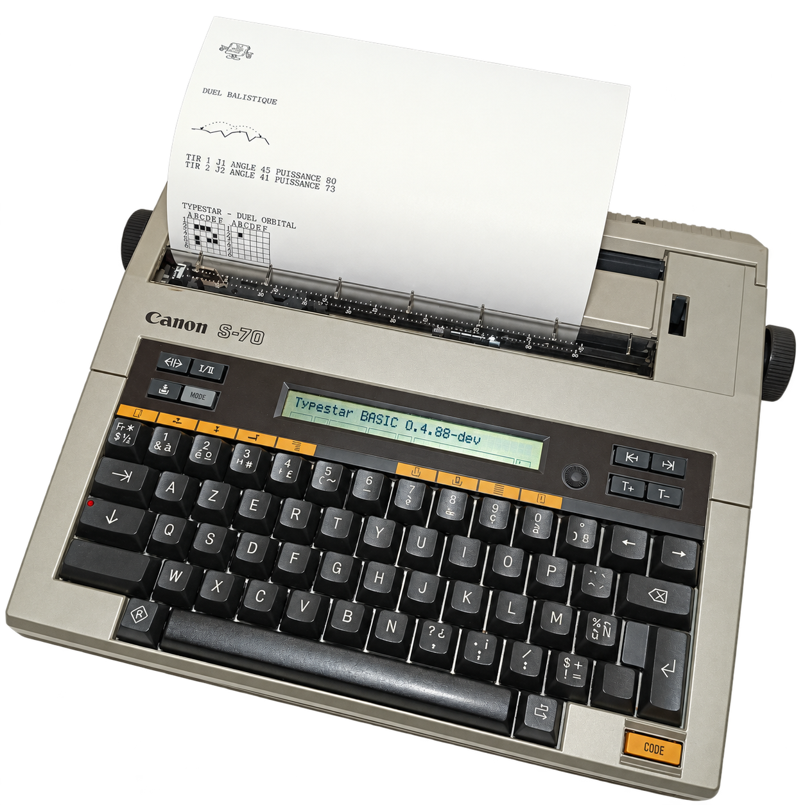
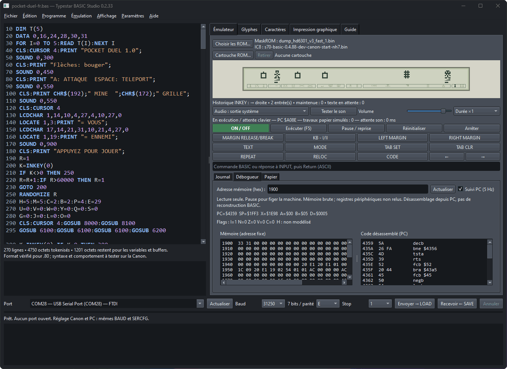

# Typestar BASIC & Studio

<p align="center">
  
</p>



[Français](#français) · [English](#english)

## Français

**Un ordinateur BASIC dans une machine à écrire Canon.** Typestar BASIC remplace la ROM externe sur support IC8 d'une **Canon S-70 / Typestar 7**. Il fonctionne également sur S-60 / Typestar 6 ; sa liaison série nécessite l'ajout des composants correspondants. Les différences matérielles de la S-90 / Typestar 7-II restent à prendre en compte pour le firmware BASIC.

Firmware **0.4.88-dev** · Studio **0.2.33** · Copyright © 2026 Pierre Raimbault · Projet indépendant de Canon.

### Téléchargements

La [version 0.4.88-dev](https://github.com/pR-0000/Typestar-BASIC/releases/tag/v0.4.88-dev) regroupe les images BASIC de 32 Ko et 64 Ko, leurs empreintes et les manuels PDF français et anglais. Le [code source de cette version](https://github.com/pR-0000/Typestar-BASIC/archive/refs/tags/v0.4.88-dev.zip) contient Studio et les programmes d'exemple. L'émulateur utilise une maskROM Canon fournie par l'utilisateur.

### Commencer

1. Consultez le [manuel français](docs/user-manual/README.md), notamment l'installation du mod.
2. Installez Python 3.12 ou plus récent et lancez **[Typestar BASIC Studio.pyw](studio/Typestar%20BASIC%20Studio.pyw)**. Le lanceur prépare son environnement Python local et installe les dépendances manquantes. Voir le [guide Studio](studio/README.md) pour Windows, Linux et macOS.
3. Ouvrez l'un des [programmes fournis](examples/README.md). Les suffixes **-fr** et **-en** indiquent leur langue.
4. Dans Studio, utilisez **Exécuter (F5)** pour l'émulateur ou **Envoyer → LOAD** pour une Canon équipée du firmware et du câble USB appropriés.

### Fonctionnalités

Le firmware propose le stockage tokenisé, les lignes 1–65535, les nombres décimaux, chaînes, tableaux 1D/2D, boucles, sous-programmes, opérateurs logiques, fonctions mathématiques, caractères LCD personnalisés, impression Courier 10, figures, glyphes papier, sons et communication série. Les **5 951 octets libres à vide** sont partagés par le programme, les variables et les allocations temporaires.

Studio regroupe l'éditeur avec coloration syntaxique, les transferts de programmes, les outils de glyphes, l'impression graphique, l'émulateur HD6301, le papier virtuel et le débogueur. L'émulateur demande à l'utilisateur ses fichiers ROM. Les firmwares Canon restent attribués à Canon.

Les transferts BASIC utilisent **31250 bauds, 7E1** par défaut. D'autres réglages, dont 1200 bauds, restent disponibles. Le câble est documenté dans le manuel et dans [Typestar Print](https://github.com/pR-0000/Typestar-Print).

### Organisation

```text
studio/             Lanceur et application PC
src/                Sources HD6301 du firmware
examples/           Programmes principaux français et anglais
  games/            Autres jeux
  terminal/         Terminal BASIC et correspondant Python
  guides/           Notices
tools/              Codecs, transferts et graphismes partagés
  firmware/         Assemblage et construction du firmware
docs/               Documentation et sources des manuels
  user-manual/      Édition française et générateur PDF
    en/             Édition anglaise
```

Les recherches, diagnostics, sauvegardes, réglages privés et fichiers générés sont placés dans des dossiers ignorés par Git. Les PDF et binaires générés sont destinés aux fichiers joints des versions publiées.

### Contribuer et construire le firmware

Pour contribuer : [outils PC](tools/README.md), [construction du firmware](tools/firmware/README.md), [architecture de l'émulateur](docs/studio-emulator-architecture.md) et [format des programmes](docs/tokenized-program-format.md).

La construction actuelle du firmware repose sur une succession d'étapes incrémentales. Le guide de construction décrit les fichiers d'entrée et les prérequis nécessaires pour reproduire cette version.

### Licence

Les contributions originales sont sous [licence MIT](LICENSE). Les éléments issus des firmwares Canon, les documents et illustrations tiers, les polices et les programmes adaptés conservent leurs droits et conditions propres ; voir [les attributions](THIRD_PARTY_NOTICES.md).

---

## English

**Turn a Canon typewriter into a BASIC computer.** Typestar BASIC replaces the socketed IC8 external ROM in a **Canon S-70 / Typestar 7**. It also boots on the S-60 / Typestar 6; serial communication requires installing the missing interface components. The S-90 / Typestar 7-II has hardware differences that still need to be addressed by the BASIC firmware.

Firmware **0.4.88-dev** · Studio **0.2.33** · Copyright © 2026 Pierre Raimbault · Independent project, unaffiliated with Canon.

### Downloads

The [0.4.88-dev release](https://github.com/pR-0000/Typestar-BASIC/releases/tag/v0.4.88-dev) includes the 32 KiB and 64 KiB BASIC images, their checksums and the French and English PDF manuals. The [source code for this release](https://github.com/pR-0000/Typestar-BASIC/archive/refs/tags/v0.4.88-dev.zip) contains Studio and the example programs. The emulator uses a Canon maskROM supplied by the user.

### Getting started

1. Read the [English manual](docs/user-manual/en/README.md), particularly the firmware installation instructions.
2. Install Python 3.12 or later and launch **[Typestar BASIC Studio.pyw](studio/Typestar%20BASIC%20Studio.pyw)**. The launcher creates a local Python environment and installs missing packages. See the [Studio guide](studio/README.md) for Windows, Linux and macOS.
3. Open a [supplied program](examples/README.md). File suffixes **-fr** and **-en** identify French and English versions.
4. In Studio, choose **Run (F5)** for the emulator or **Send → LOAD** for a Canon equipped with the replacement firmware and a suitable USB cable.

### Features

The firmware includes tokenized storage, line numbers 1–65535, decimal arithmetic, strings, 1D/2D arrays, loops, subroutines, logical operators, mathematical functions, custom LCD characters, Courier 10 printing, geometric shapes, paper glyphs, sound and serial communication. Its **5,951 bytes free with an empty program** are shared by the program, variables and temporary allocations.

Studio provides the syntax-highlighting editor, program transfers, glyph tools, graphical printing, HD6301 emulator, virtual paper and debugger. Users supply their own ROM files for the emulator. Canon firmware remains attributed to Canon.

BASIC transfers default to **31250 baud, 7E1**. Other settings, including 1200 baud, remain available. The cable is documented in the manual and in [Typestar Print](https://github.com/pR-0000/Typestar-Print).

### Repository layout

```text
studio/             Launcher and desktop application
src/                HD6301 firmware sources
examples/           Main programs in French and English
  games/            Other games
  terminal/         BASIC terminal and Python counterpart
  guides/           Program guides
tools/              Shared codecs, transfers and graphics
  firmware/         Firmware assembly and build tools
docs/               Documentation and manual sources
  user-manual/      French edition and PDF generator
    en/             English edition
```

Research, diagnostics, backups, private settings and generated files are kept in folders ignored by Git. Generated PDFs and binaries are intended as attachments to published releases.

### Contributing and building the firmware

To contribute, see the [desktop tools](tools/README.md), [firmware build guide](tools/firmware/README.md), [emulator architecture](docs/studio-emulator-architecture.md) and [program format](docs/tokenized-program-format.md).

The current firmware build uses a sequence of incremental stages. The build guide describes the input files and prerequisites required to reproduce this version.

### License

Original contributions are covered by the [MIT License](LICENSE). Material from Canon firmware, third-party documents and illustrations, fonts and adapted programs retain their own rights and terms; see [the attributions](THIRD_PARTY_NOTICES.md).
