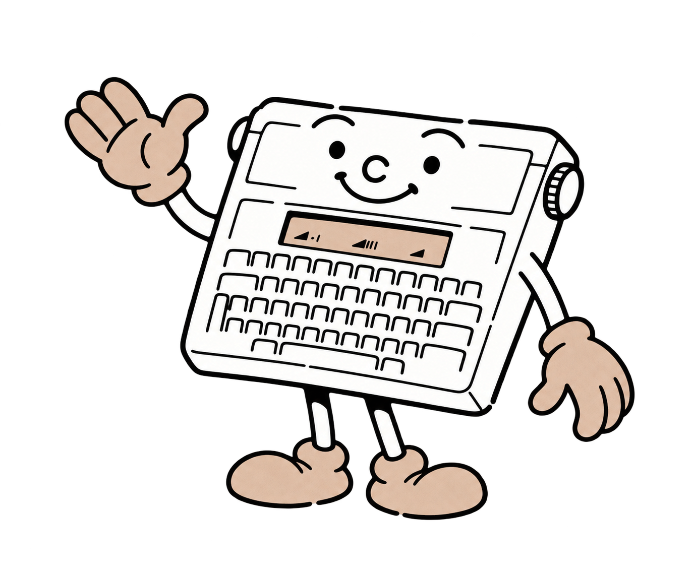
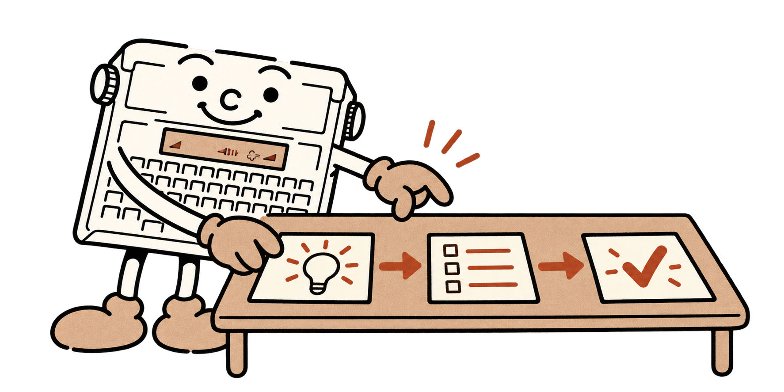

# Bienvenue ! Printy vous accompagne

Une vieille machine à écrire, quelques lignes de BASIC, et voici un petit ordinateur prêt à suivre vos idées ! **Printy** sera votre compagnon dans ce manuel. Avec lui, vous apprendrez à faire un calcul, poser une question, dessiner sur le papier et construire un jeu.

Vous découvrez la programmation ? C’est justement le bon moment pour essayer. **Commencez petit, observez, puis améliorez.** Vous comprendrez bientôt comment plusieurs instructions peuvent travailler ensemble.

## Pourquoi apprendre le BASIC aujourd'hui ?

Programmer, c'est apprendre à **organiser un projet du début à la fin**. Il faut choisir un résultat, découper le travail en étapes, nommer les informations utiles et vérifier ce que l'on obtient. Ces habitudes servent aussi à préparer un exposé, résoudre un problème ou inventer les règles d'un jeu.

Le BASIC fait travailler votre **logique**. Quand les points de vie du joueur atteignent zéro, que doit-il se passer ? Combien de fois faut-il répéter une action ? Comment accueillir une réponse inattendue ? Vous apprendrez à poser ces questions et à leur donner une réponse précise.

L’intelligence artificielle peut vous aider à trouver une piste ou expliquer une erreur. **Comprendre votre programme** vous permet de juger ses propositions, de les corriger et de choisir vous-même le résultat. Vérifier que le programme accomplit bien votre idée fait partie du plaisir de programmer !

> **Le conseil de Printy :** avant d'essayer un calcul, prévoyez son résultat. Ensuite, comparez avec ce que la machine affiche. Voilà déjà une vraie méthode de vérification.

## Une idée, un plan, un essai

Imaginez un jeu de devinettes. Faites d'abord afficher une question. Ajoutez la réponse du joueur, puis la règle qui indique s'il a gagné. Le score, les sons et l'impression pourront venir ensuite. **Chaque petite étape doit fonctionner avant d'ajouter la suivante.**

Une erreur fait partie de l’apprentissage. Un guillemet oublié ou un calcul mal choisi devient une occasion de comprendre un peu mieux la machine. Gardez une copie de votre programme dans Studio avant une grande modification.

Votre Typestar possède une ligne d’écran et une petite mémoire. C’est assez pour découvrir comment un ordinateur raisonne, et surtout pour réaliser un projet que vous pourrez expliquer entièrement. **À vous de jouer : Printy attend vos instructions !**

Pour installer le BASIC, suivez [le guide illustré](02-installation-firmware.md#installation). Si la machine est déjà prête, passez directement à [votre premier calcul](03-premiers-pas.md).
