# 1 — Une histoire des Canon Typestar

## Le bureau tient dans une machine

Au milieu des années 1980, une machine à écrire portable permet d'accomplir très simplement un travail essentiel : préparer un document que l'on pourra lire, remettre à quelqu'un ou envoyer par courrier. La feuille constitue le résultat final, mais aussi une partie de l'espace de travail. On y repère une marge, on juge la disposition d'un titre, on relit une phrase.

Avec l'électronique, une étape nouvelle s'intercale entre le clavier et le papier. Un texte peut attendre dans une mémoire. Une petite ligne d'affichage permet de le vérifier avant l'impression. La machine garde ainsi son usage familier tout en introduisant plusieurs pratiques du traitement de texte.

Les Canon Typestar appartiennent à ce monde. Leur impression thermique remplace la frappe mécanique des caractères par de minuscules éléments chauffants. Avec un ruban de transfert, la chaleur dépose la matière colorante sur le papier. Avec du papier thermique adapté, c'est le papier lui-même qui réagit. Cette technique permet de former les lettres comme des dessins faits de points.

Sur la Typestar 7, l’électronique commande l’impression et accompagne la préparation du texte : un écran pour relire, une mémoire pour conserver, des cartouches pour compléter les possibilités. Le projet Typestar BASIC s’appuie aujourd’hui sur cet ensemble pour lui donner un nouvel usage.

## Canon et la bureautique électronique

Le site de **Shimomaruko, à Tokyo**, accompagne une grande partie de cette histoire. Canon acquiert en 1951 une ancienne usine de Fuji Aviation Instruments et y rassemble progressivement ses activités. Cette vue conservée par le musée Canon montre le terrain et les bâtiments avant leur acquisition. [H28]

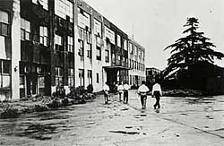

L'histoire commence bien avant la S-70. En 1962, Canon prépare son entrée à grande échelle dans les machines de bureau par un premier plan quinquennal. La calculatrice électronique Canola 130 apparaît en 1964 ; le Canofax 1000 marque l'entrée dans les copieurs en 1965. [H7]

En 1967, le slogan de son trentième anniversaire place photographie et bureautique côte à côte : « Cameras in the Right Hand, Business Machines in the Left ». La BP-1000, une machine de facturation introduite en 1971, constitue un autre jalon de cette activité. [H7]

Cette diversification donne un contexte à l'arrivée des Typestar. Le document comporte plusieurs opérations : saisir, calculer, mettre en forme, imprimer et reproduire. Une machine à écrire électronique réunit certaines de ces opérations dans un appareil individuel. La place du logiciel permet d'en modifier le comportement sans ajouter un mécanisme distinct pour chaque fonction.

Au début des années 1980, plusieurs voies coexistent au catalogue Canon. Le CanoWord 55, destiné au traitement de texte japonais, figure dans l'historique de 1980. En 1982 viennent les machines à écrire AP400 et AP500 pour les langues occidentales, ainsi que le micro-ordinateur 16 bits AS-100. Le CanoWord Mini 5 suit en 1983. [H1]

L'entreprise travaille aussi sur d'autres techniques d'impression : son historique mentionne la LBP-8/CX à laser en 1984 et la BJ-80 à jet d'encre en 1985. La petite Typestar thermique appartient donc à une période où plusieurs solutions sont développées en parallèle, avec des formats et des usages différents. [H1]

### Ryūzaburō Kaku et l'élargissement des activités

**Ryūzaburō Kaku devient président de Canon en 1977.** L’histoire officielle japonaise le place dans cette période de diversification, entre photographie, calculateurs, copieurs et équipements de bureau. Il accompagne, à la direction de l’entreprise, cet élargissement de ses activités. [K1]

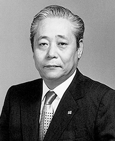

Le **CanoWord 55 de 1980** illustre une autre branche de ce travail : le traitement de texte japonais. Son format est bien différent d'une Typestar, mais tous deux replacent la saisie et l'impression au cœur d'un appareil électronique spécialisé. [H1]

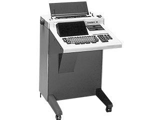

### Un site de recherche en pleine transformation

À Shimomaruko, l'essor de la bureautique s'accompagne de nouveaux bâtiments. Le constructeur Obayashi situe les chantiers des blocs D, E et C entre **1982 et 1985**. Le **bâtiment L**, commencé en avril 1989 et achevé en **avril 1990**, accueille les activités de recherche et développement. La photographie ci-dessous, publiée dans son histoire d'entreprise, montre un des lieux où Canon développe les technologies de cette période. [H27]

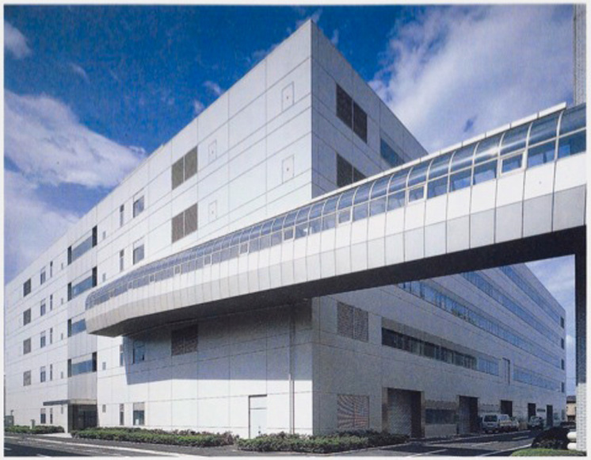

## La portabilité change les priorités

Une portable réunit dans un petit volume le clavier, l'écran, le passage de la feuille et son mécanisme d'entraînement. L'électronique coordonne cet ensemble tout en ménageant l'alimentation par piles. La tête thermique dessine les lettres par points : une même machine peut ainsi proposer plusieurs polices.

Le ruban de transfert accompagne le papier ordinaire ; le papier thermique réagit directement à la chaleur. Ces deux possibilités donnent à la Typestar son format transportable et son fonctionnement discret.

Les archives de design Canon distinguent la **Typestar 5 en 1984** et la **Typestar 6 en 1985**. Elles y côtoient respectivement les ordinateurs V-20 et V-8, autres représentants de l'électronique personnelle de la marque. [H2]

### La Typestar 5 dans les publicités

La publicité ci-dessous porte la mention © 1984 Canon U.S.A. Elle présente la Typestar 5 comme un appareil à emporter, avec un véritable clavier et une petite fenêtre de correction de **quinze caractères**.

### Une Typestar jusque dans l'espace

La publicité suivante porte la mention © 1985 Canon U.S.A. Sa mise en scène spatiale accompagne l’arrivée de la Typestar 6, dont l’annonce décrit un affichage de **trente-deux caractères** et une mémoire « 2K ». Deux générations de machines se côtoient dans cette même publicité.

## Le X-07 : un ordinateur portable à part entière

En **1983**, Canon commercialise au Japon le **X-07**, un ordinateur portable programmable en BASIC. Son processeur NSC800 appartient au monde Z80, tandis que la Typestar utilise un HD6301. Le X-07 propose un LCD de **quatre lignes de vingt caractères**, un affichage graphique de **120 × 32 points** et **8 Ko de RAM**, extensibles. Le prix annoncé au Japon est de **69 800 yens**, pour un appareil d'environ **480 g** alimenté par quatre piles AA. [X1]

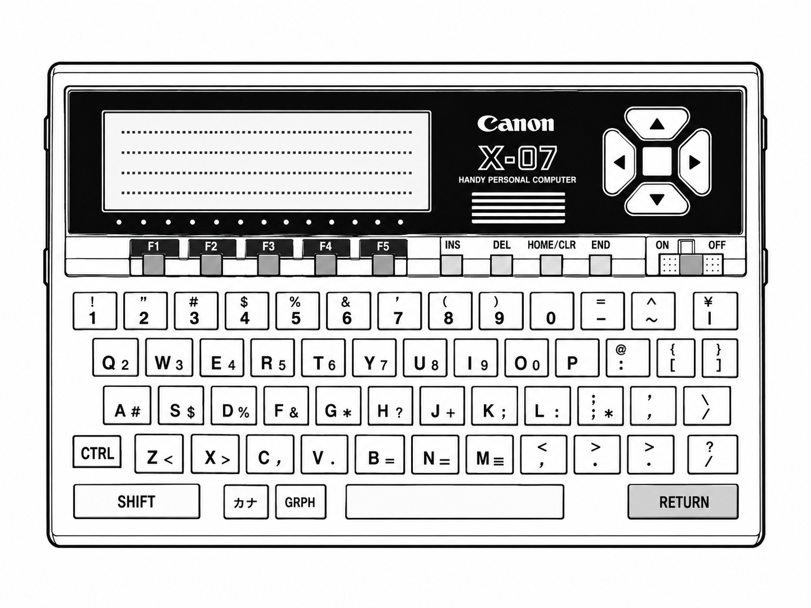

Une publicité japonaise met également en avant un **coupleur optique infrarouge optionnel**, permettant des échanges de données sans câble. La portabilité concerne le poids, mais aussi la manière de programmer et de communiquer. Canon explore ainsi deux usages complémentaires : l’ordinateur BASIC avec le X-07, et la saisie de documents avec les Typestar. [X1]
## Typestar 7 et S-70 : une seule machine, deux noms

« Typestar 7 » est un nom commercial ; « S-70 » est la référence de modèle. Cette correspondance figure explicitement dans le règlement européen du 28 octobre 1985 consacré aux importations de machines à écrire. [H3]

Ce document situe solidement la S-70 en **1985**. Il prévoit une application rétroactive au 23 juin : c’est un repère administratif. La première commercialisation précise reste à documenter. [H3]

Ces listes rapprochent des références techniques et des noms commerciaux que les annonces de collectionneurs emploient parfois séparément. Une plaque portant « S-70 » peut ainsi retrouver sa place dans la famille Typestar.

### Les idées prennent la route

Un enregistrement de la chaîne américaine **WOR 9**, daté du **19 mai 1986**, conserve une publicité pour la **Typestar 7**, entre **15 min 56 s et 16 min 26 s**. La machine promet de coucher ses idées sur le papier partout où elles viennent, avec une présentation professionnelle. Correction des fautes de frappe, mémoire de texte, format compact, faible poids et silence accompagnent cette liberté d'écrire. [H36]

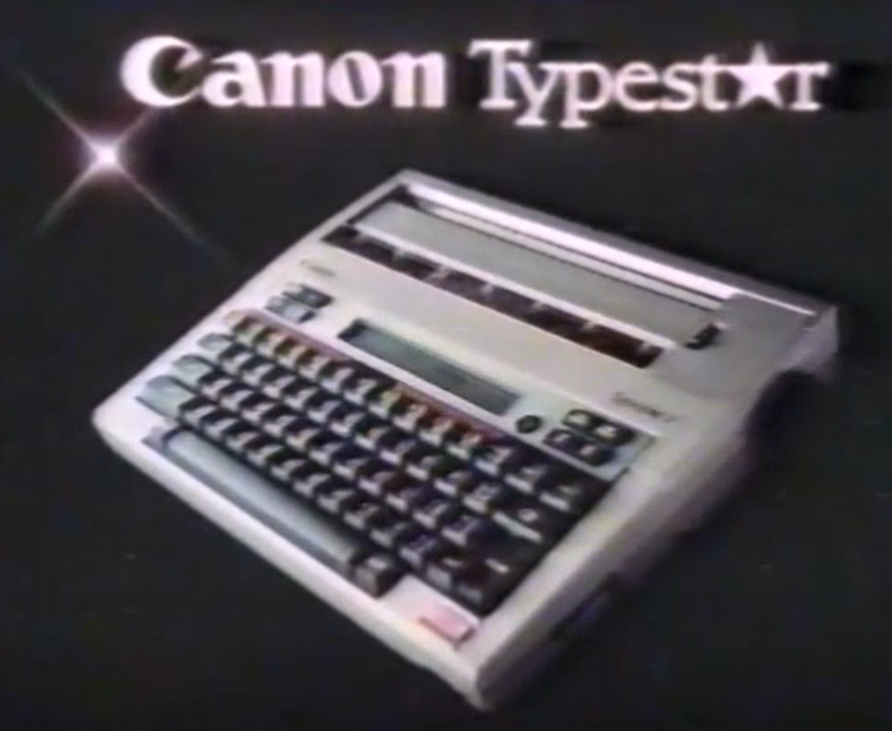

L'écran et la mémoire prolongent ici le rôle du clavier : on prépare son texte avant de l'imprimer. La publicité rassemble ainsi les qualités qui font encore le charme de cette petite machine transportable.

## Un détour par la Bretagne

L'histoire française de Canon apporte un autre repère. Canon Bretagne indique une création juridique en 1983, une production de photocopieurs en 1984 et le début de la production de machines à écrire en 1985. L'assemblage de cartes électroniques suit en 1986 ; les cartouches de toner, fax et imprimantes laser figurent dans les activités de 1987. [H8]

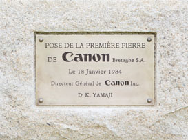

Cette chronologie montre la diversité du travail industriel associé à la bureautique. Les modèles fabriqués sur le site breton restent à documenter ; pour retracer l’origine d’un exemplaire, sa plaque de fabrication constitue un précieux point de départ. [H8]

## Quelques repères dans une gamme difficile à classer

Les dates suivantes sont des **repères documentaires** : lancements décrits par Canon, récompenses de design, annonces commerciales ou éditions de manuels. Chaque vignette indique la nature de son repère. Les collections de la **Typewriter Database** complètent ce panorama par des photographies, des plaques de modèle et des exemplaires conservés. Leurs dates estimées sont signalées comme telles. [H15]

### De la bureautique aux premières portables

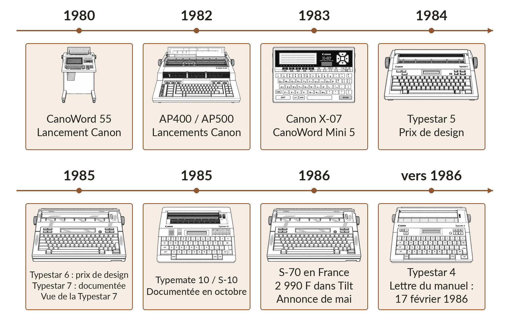

### La gamme s'élargit

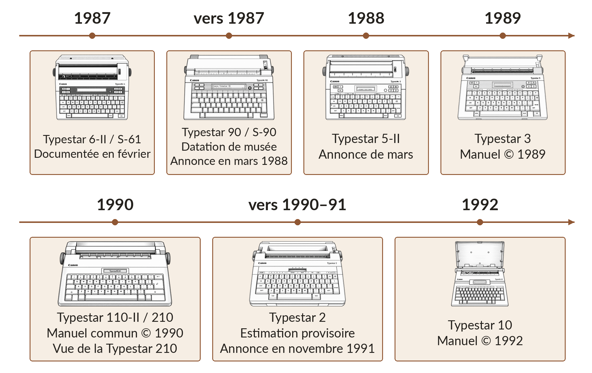

### Les portables des années 1990

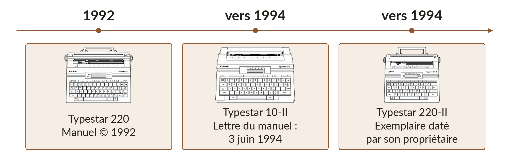

Pour situer les **Typestar 2, 4 et 10-II**, nous proposons respectivement **vers 1990–1991**, **vers 1986** et **vers 1994**. Ces positions restent des estimations de commercialisation. La 2 apparaît dans une publicité de novembre 1991 ; le manuel de la 4 présente une lettre datée de février 1986 ; celui de la 10-II emploie un exemple daté de juin 1994. Chaque date de document constitue un jalon pour retrouver la période de la machine. [H24] [H25] [H26]

### Les repères en détail

| Date | Repère historique |
|---|---|
| **1980** | CanoWord 55, traitement de texte japonais. [H1] |
| **1982** | AP400 et AP500, machines à écrire électroniques ; ordinateur AS-100. [H1] |
| **1983** | Canon X-07 et CanoWord Mini 5 ; création de Canon Bretagne. [X1] [H1] [H8] |
| **1984** | Typestar 5 récompensée pour son design ; publicité Canon U.S.A. datée © 1984. [H2] |
| **1985** | Typestar 6 récompensée ; **S-70 / Typestar 7** et **S-10 / Typemate 10** explicitement documentées en octobre. [H2] [H3] |
| **Mai 1986** | La S-70 est proposée à **2 990 francs** en France dans Tilt n° 31. [H10] |
| **19 mai 1986** | Une publicité américaine pour la **Typestar 7** figure dans un enregistrement de WOR 9. [H36] |
| **1986** | S-16 récompensée pour son design ; dépôt du dessin D299930 le 8 avril. [H2] [H5] |
| **Vers 1986** | **Typestar 4** : le manuel Canon reproduit une lettre datée du **17 février 1986**. Estimation de période. [H25] |
| **Février 1987** | S-61 / Typestar 6 II ajoutée au règlement européen. [H4] |
| **Vers 1987** | **Typestar 90 / S-90**, également connue comme Typestar 7-II. [H11] |
| **Mars 1988** | Typestar 90, 80, 7, 6 II et 5 II proposées ensemble au Royaume-Uni. [H12] |
| **1989** | Édition du manuel **Typestar 3**, portant © 1989. [H18] |
| **1990** | Manuel commun des **Typestar 110-II et 210**, portant © 1990. [H19] |
| **Vers 1990–1991** | **Typestar 2** : estimation provisoire ; publicité identifiable dans *The New Paper* du **28 novembre 1991**. [H24] |
| **1992** | Le manuel **Typestar 10** porte © 1992 ; son LCD affiche seize caractères. [H13] |
| **1992** | Le manuel **Typestar 220** porte également © 1992. [H20] |
| **Vers 1994** | Un exemplaire de **Typestar 220-II** est daté de 1994 par son propriétaire, à partir de son électronique. [H21] [H23] |
| **Vers 1994** | **Typestar 10-II** : exemple daté du **3 juin 1994** dans le manuel allemand Canon. Estimation de période. [H26] |

La S-90 se situe autour de **1987**, avec une présence commerciale vérifiable en **mars 1988**. Pour les modèles plus tardifs, les dates des manuels fournissent des jalons faciles à vérifier. Les appellations et éditions varient selon les pays : chaque référence possède son propre équipement et son public.

## Une famille plus large que ses numéros

### Typemate 10 : la cousine S-10

La **Typemate 10** est déjà présente dans le règlement européen d'octobre 1985, sous la référence **S-10**. Son nom appartient à une branche voisine de la famille Canon. Les exemplaires photographiés montrent une machine compacte, avec une petite fenêtre LCD et plusieurs commandes coulissantes. Son ruban utilise une cassette différente de celle des premières Typestar. Cette silhouette mérite sa propre place dans la frise. [H3] [H22]

### Typestar 2, 3 et 4 : plusieurs façons de rester portable

Les **Typestar 2** et **Typestar 4** illustrent la variété des petites portables : un clavier complet, une fenêtre de contrôle et des commandes adaptées à la préparation du texte. Les photographies de collection permettent de comparer leur façade, leurs touches et le passage du papier. [H15]

Pour la **Typestar 4**, un aperçu du manuel Canon reproduit une lettre du **17 février 1986** : le nom du modèle et ses fonctions y sont directement présentés. Ce document, rapproché de l'exemplaire daté de 1986 par son collectionneur, permet de proposer **vers 1986** dans la frise. [H25] [H16]

La **Typestar 2** figure dans une publicité de *The New Paper*, à Singapour, le **28 novembre 1991**. Une annonce de collection la situe en 1990 ; nous retenons donc **vers 1990–1991 comme hypothèse de travail**, avec 1991 comme repère commercial. Sa date de lancement pourra être précisée par un catalogue ou un manuel daté. [H24] [H29]

La **Typestar 3** possède un manuel daté de **1989**. Il décrit un LCD de **quinze caractères**, deux polices intégrées, **Courier 10** et **Cubic PS**, et un clavier de **44 touches**. L'impression peut être doublée en largeur ou accompagnée d'un fond tramé. Elle conserve ainsi l'idée d'une machine transportable capable de donner plusieurs apparences à un même texte. [H18]

### Typestar 5-II et 6-II : les familles se prolongent

Le suffixe **II** accompagne plusieurs évolutions de la gamme. Canon répertorie la **Typestar 5-II sous la référence S-51** dans sa liste de documentation technique. La **Typestar 6-II correspond à la S-61**, explicitement ajoutée au règlement européen en février 1987. Une annonce britannique de mars 1988 les propose ensemble, aux côtés de la 7 et de la 90. Ces modèles occupent donc plusieurs places dans un même catalogue. [H17] [H4] [H12]

Les noms sur les façades et les références sur les plaques se complètent. Pour reconnaître une machine, le couple **nom commercial / référence de modèle** est particulièrement utile : Typestar 5-II / S-51, Typestar 6-II / S-61, Typestar 7 / S-70.

### Typestar 10 et 10-II : une autre formule

La **Typestar 10** dispose d'un LCD de **seize caractères** dans son manuel de 1992. La **Typestar 10-II**, également conservée dans les collections, poursuit cette autre présentation de la portable : une fenêtre courte au centre, un clavier et un mécanisme thermique dans un boîtier compact. Son manuel allemand contient une lettre datée du **3 juin 1994**, et un propriétaire situe également son exemplaire en 1994. Ces indices conduisent à placer la **10-II vers 1994**, comme estimation de sa période de commercialisation. [H13] [H26] [H30]

### Typestar 110-II, 210, 220 et 220-II : davantage de traitement de texte

Un **manuel commun daté de 1990** réunit les **Typestar 110-II et 210**. Il décrit un LCD de **seize caractères**, jusqu'à **4 Ko** partagés entre mémoire de texte et dictionnaire personnel, ainsi qu'un clavier de **45 touches**. On y retrouve la recherche et le remplacement de texte, des formats de page mémorisés et un correcteur orthographique selon la version régionale. Les deux noms figurent sur la couverture du même manuel ; chacun désigne son modèle. [H19]

La **Typestar 220**, dont le manuel porte **© 1992**, conserve un affichage de seize caractères. Elle propose quatre polices intégrées, des symboles scientifiques et une mémoire allant jusqu'à **3,5 Ko** pour le texte et le dictionnaire personnel. Son manuel décrit une tête thermique de **36 × 40 points** : la famille a aussi évolué à l'intérieur du boîtier. [H20]

La **220-II** prolonge ce panorama dans les années 1990. L'exemplaire documenté par son propriétaire est rattaché à **1994** à partir d'une date visible sur son électronique. Ses impressions de démonstration montrent différents caractères, tailles et motifs. Ce repère situe une machine conservée aujourd'hui et pourra être complété par une annonce ou un catalogue d'époque. [H21] [H23]

### StarWriter : des traitements de texte dédiés

Dans les catalogues de l’époque, **word processor** désigne souvent un **appareil autonome de traitement de texte** : clavier, écran, logiciel et imprimante forment un ensemble consacré à la rédaction. On prépare son document à l’écran, on déplace des passages, on conserve des fichiers, puis on imprime la version choisie. Aujourd’hui, le même terme évoque surtout un logiciel installé sur un ordinateur. [H31]

La **machine à écrire électronique** privilégie la saisie sur papier, immédiatement ou après relecture d’une ligne. Elle peut aussi proposer correction et mémoire : la Typestar 7 permet déjà de conserver et de remanier des textes. La frontière est donc progressive. Ce sont l’étendue des outils d’édition, le stockage et la place accordée au document à l’écran qui rapprochent les StarWriter du poste de travail personnel. [H9] [H31]

La **StarWriter 80**, présentée dans la presse en 1991, imprime par **jet d’encre Bubble Jet**. Les modèles 80 et 85 proposent un LCD de **16 lignes de 80 caractères**, 60 000 octets de mémoire interne et un stockage sur disquette de 720 000 octets. Cet équipement représente environ **7,2 à 7,4 kg** à transporter. La Typestar 7, donnée pour 2,7 kg avec piles et ruban, conserve l’avantage du petit format. [H32] [H31] [H9]

La famille StarWriter réunit plusieurs techniques d’impression : la **StarWriter 30** est encore proposée à **transfert thermique** dans une publicité de 1994. Ces machines à grand écran constituent une piste intéressante pour un autre projet BASIC, à condition d’étudier leur processeur, leurs ROM et leurs périphériques. Cette possibilité reste à explorer ; le présent firmware utilise le matériel des Typestar 6 et 7. [H33]

### Choisir les bons critères de comparaison

Pour comparer deux Typestar, regardez la longueur de l’écran, la mémoire de texte, les cartouches, les possibilités de correction et les interfaces. Le numéro commercial désigne un modèle dans une gamme de machines destinées à différents usages.

La Typestar 7 est particulièrement intéressante pour notre projet : elle réunit un LCD de 32 caractères, de la mémoire externe, des cartouches et une interface vers un ordinateur. Cet équipement en fait l’un des modèles les plus attrayants pour l’expérimentation.

## Une petite machine dans les catalogues de micro-informatique

En **mai 1986**, un lecteur français de *Tilt* trouve la S-70 dans une annonce aux côtés d'imprimantes, d'accessoires et de micro-ordinateurs MSX. Le prix affiché est **2 990 francs**. La machine à écrire devient ainsi un périphérique que l'on peut envisager pour son ordinateur personnel, tout en conservant son propre clavier et son alimentation autonome. [H10]

Un témoignage publié dans *The Rainbow* en **juillet 1986** présente la Typestar 7 comme une machine à écrire servant aussi d'imprimante. Il rappelle un usage concret de l'époque : obtenir du texte sur papier à partir d'un micro-ordinateur domestique. Les interfaces optionnelles Canon font le pont entre ces deux mondes. [H14]

Le catalogue britannique de **mars 1988** montre plusieurs modèles en vente simultanément : Typestar 90, 80, 7, 6 II et 5 II. La gamme propose plusieurs niveaux d’équipement. Le choix dépend de l’affichage, de la mémoire, du type de correction et des accessoires recherchés. [H12]

## Des noms derrière le dessin

Le document américain D299930, déposé le 8 avril 1986 et publié le 21 février 1989, attribue un dessin de machine à écrire électronique à Richard Nibley et Noriaki Haranishi pour Canon. Sa vue en perspective présente une forte ressemblance avec la première Typestar 7. [H5]

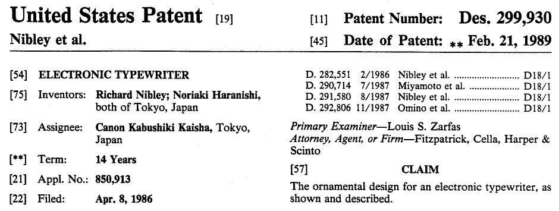

Le brevet protège le **dessin extérieur de la machine**. Sa ressemblance avec la Typestar 7 constitue une piste pour l’histoire du boîtier ; l’identification exacte du modèle reste ouverte. [H5]

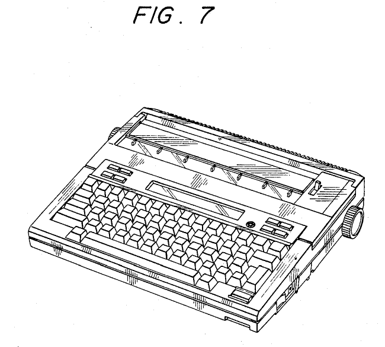

Les planches permettent néanmoins de regarder la machine avec davantage d'attention. La position du clavier, l'emplacement de l'affichage, les commandes supérieures et le passage du papier doivent composer un ensemble utilisable. Une machine à écrire est un objet que l'on touche continuellement : son dessin organise les gestes aussi sûrement que son programme organise les opérations.

Les mêmes noms figurent sur le [dessin D286162 d’une cartouche de police pour machine à écrire](https://patents.google.com/patent/USD286162S/en), déposé le 18 décembre 1984. Leur travail porte donc à la fois sur les machines et sur leurs accessoires.

Sur le fonctionnement électronique, une autre piste porte le nom de **Takahiro Tsukamoto**. Le [brevet japonais JPS5942988A](https://patents.google.com/patent/JPS5942988A/en), déposé pour Canon le 3 septembre 1982 et publié le 9 mars 1984, décrit notamment l’affichage des modes d’une machine à écrire électronique. Il témoigne du travail consacré chez Canon au dialogue entre l’utilisateur et la machine.

Ces pièces donnent des noms et des réalisations aux équipes de cette époque. **Le boîtier, les cartouches et l'affichage sont le fruit de travaux différents**, que les dessins et brevets permettent de retrouver sans attribuer à une seule personne l'ensemble de la machine.

## Canon aujourd’hui : de l’ordinateur à ses périphériques

L’histoire des Typestar appartient à une période où Canon commercialisait aussi des ordinateurs personnels et des systèmes de traitement de texte. Le groupe a ensuite choisi d’autres priorités. Dans son bilan de la période **1996-2000**, Canon explique avoir fermé **sept activités déficitaires, dont celle des ordinateurs personnels**, pour privilégier la rentabilité et renforcer sa situation financière. Cette décision donne une raison documentée au retrait des PC. [H34]

Dans les foyers et les bureaux, le couple **ordinateur et imprimante** a également réuni la rédaction, la correction, le stockage et la mise en page dans un outil polyvalent. Cette évolution aide à comprendre le recul des machines à écrire et des traitements de texte autonomes. La Typestar représente un autre choix : un appareil compact, immédiatement utilisable, qui réunit le clavier et le papier. Notre BASIC retrouve justement une part de cette simplicité.

**Canon reste présent autour de l’informatique**, par l’impression, la numérisation et les services documentaires. En **2025**, *Printing* représente environ **54 %** du chiffre d’affaires consolidé : impression domestique, de bureau et professionnelle. *Imaging*, notamment les appareils photo, objectifs et caméras réseau, représente environ **23 %**. L’imagerie médicale et les équipements industriels, dont ceux destinés aux semi-conducteurs, constituent d’autres grandes activités. La photographie demeure emblématique, tandis que **l’impression arrive en tête par les ventes**. [H35]

Le papier, l’image et leur traitement électronique relient ainsi les Typestar aux appareils actuels de Canon.

[H1]: https://global.canon/en/corporate/history/03.html
[H2]: https://global.canon/en/design/award/1957-2012.html
[H3]: https://www.boe.es/buscar/doc.php?id=DOUE-L-1985-80857&lang=es
[H4]: https://www.boe.es/buscar/doc.php?id=DOUE-L-1987-80192&lang=es
[H5]: https://patents.google.com/patent/USD299930S/en
[H6]: https://archive.org/details/canon-serial-interface-30-manual
[H7]: https://global.canon/en/corporate/history/02.html
[H8]: https://www.canon-bretagne.fr/lentreprise/

[H9]: https://site.xavier.edu/polt/typewriters/CanonTypestar7.pdf

[H10]: https://datassette.s3.us-west-004.backblazeb2.com/revistas/tilt_031.pdf
[H11]: https://collection.sciencemuseumgroup.org.uk/objects/co8537511/canon-typestar-90-electronic-typewriter-with-32-character-liquid-crystal-display
[H12]: https://worldradiohistory.com/UK/Personal-Computer-World/80s/PCW-1988-03-S-OCR.pdf
[H13]: https://site.xavier.edu/polt/typewriters/CanonTypestar10.pdf
[H14]: https://colorcomputerarchive.com/repo/Documents/Magazines/Rainbow%2C%20The%20%28OCR%29/The%20Rainbow%20Vol.%2005%20No.%2012%20-%20July%201986.pdf
[H15]: https://typewriterdatabase.com/canon.656.typewriter-serial-number-database
[H16]: https://typewriterdatabase.com/1986-canon-typestar-4.23633.typewriter
[H17]: https://www.bitsavers.org/pdf/canon/Canon_Technical_Documentation_Part_Number_List_199911.pdf
[H18]: https://site.xavier.edu/polt/typewriters/CanonTypestar3.pdf
[H19]: https://site.xavier.edu/polt/typewriters/CanonTypestar110II%26210.pdf
[H20]: https://site.xavier.edu/polt/typewriters/CanonTypestar220.pdf
[H21]: https://typewriterdatabase.com/1994-canon-typestar-220ii.17763.typewriter
[H22]: https://typewriterdatabase.com/198x-canon-typemate-10.18472.typewriter
[H23]: https://darrengoossens.wordpress.com/2022/03/15/canon-typestar-220-ii-a-fix/

[K1]: https://global.canon/ja/corporate/history/03.html
[X1]: https://akiba-pc.watch.impress.co.jp/docs/column/retrohard/1178338.html

[H24]: https://eresources.nlb.gov.sg/newspapers/digitised/issue/newpaper19911128-1
[H25]: https://typecast.munk.org/wp-content/uploads/2017/11/1986-CanonTypestar4.jpg
[H26]: https://www.manualslib.de/manual/1142678/Canon-Typestar-10-Ii.html?page=2
[H27]: https://www.obayashi.co.jp/chronicle/100yrs/t3c5s99.html
[H28]: https://global.canon/en/c-museum/history/story03.html
[H29]: https://keej.it/categoria-informatica/agenda-elettronica-beverly-hills?pn=2
[H30]: https://thefoolwithapen.com/posts/2024/20240806/

[H31]: https://www.usitc.gov/publications/701_731/pub2411.pdf

[H32]: https://www.worldradiohistory.com/AUSTRALIA/Electronics-Australia/EA-1991-06.pdf

[H33]: https://newspapers.swco.ttu.edu/bitstream/handle/20.500.12255/193068/UD_1994_08_29.pdf?isAllowed=y&sequence=1

[H34]: https://global.canon/en/sustainability/report/pdf/sustainability2006e.pdf
[H35]: https://global.canon/en/ir/business.html

[H36]: https://archive.org/details/wor-9-may-19-1986-commercials
