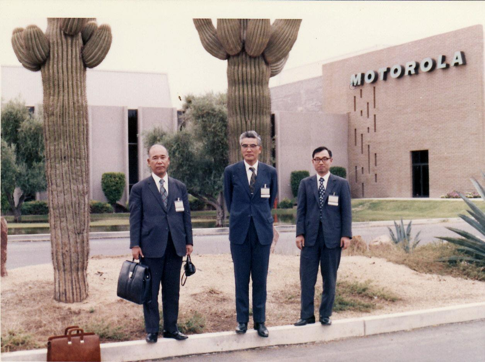
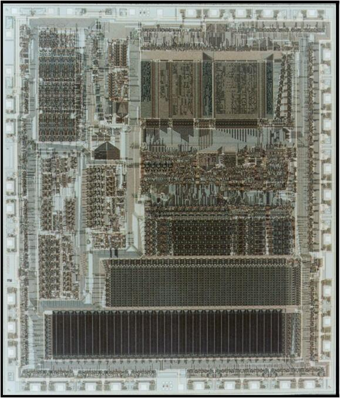
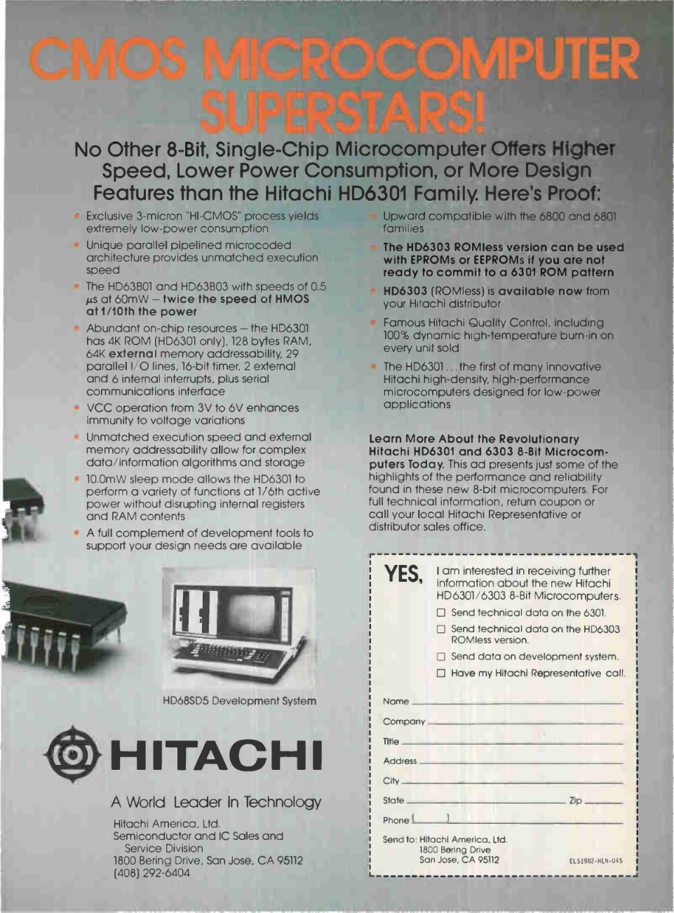

# 2 — Le HD6301, un petit ordinateur sous le clavier

## Du programme au processeur

Lorsque vous tapez `PRINT 2+3`, l’interpréteur BASIC reconnaît votre instruction, effectue le calcul et demande l’affichage du résultat. Ce programme est lui-même exécuté par le processeur de la machine.

Dans la S-70 étudiée, ce processeur est intégré à un **microcontrôleur Hitachi HD6301Y0P**. Un microcontrôleur réunit dans un même composant le calcul, de la mémoire et des circuits pour communiquer avec le reste de la machine. Les pages suivantes proposent une visite de ces fonctions ; vous pourrez ensuite programmer avec quelques instructions simples.

Si vous connaissez **Arduino**, pensez au microcontrôleur **ATmega328P de l'Uno R3**, aux **ESP32** ou au **RP2040 du Raspberry Pi Pico** : le HD6301 réunissait déjà calcul, mémoire et circuits de commande dans une même puce. [M3] [M4] [M5] Un **Z80 classique** est un microprocesseur auquel on ajoute la mémoire et les périphériques autour de la puce. [M6] Arduino et Pico sont des cartes qui accueillent un microcontrôleur ; les Raspberry Pi qui font tourner Linux sont des ordinateurs complets. La même idée de petit cerveau programmable, chargé de faire fonctionner un appareil, relie notre Typestar aux montages électroniques actuels. [M4]

## Une famille issue du monde Motorola 6800

Le HD6301 appartient à la famille de microcontrôleurs développée par Hitachi autour de l'héritage 6800/6801. Dans ses souvenirs, Tsugio Makimoto raconte les échanges technologiques entre Hitachi et Motorola, puis les travaux Hitachi sur la technologie CMOS et les mémoires programmables. Ce témoignage éclaire le contexte industriel, sans suffire à dater chaque variante du composant. [M1]

La technologie CMOS intéresse notamment les appareils portables par sa faible consommation. Chaque constructeur associe ensuite le processeur à son propre clavier, son écran et ses programmes : une même famille de puces peut ainsi servir des machines très différentes.

### Une rencontre, des technologies et des personnes

Makimoto situe en 1974 une visite chez Motorola, où il accompagne Yoshinobu Imamura, responsable de la division des semi-conducteurs de Hitachi. La photographie de ses souvenirs permet de mettre des visages sur cette histoire industrielle.

L'échange envisagé associait la technologie de machines de câblage automatique de Hitachi à la famille de microprocesseurs 6800 de Motorola. Makimoto cite **Jun Suzuki** à la tête de l'équipe qui développait ces machines, et situe l'approbation de l'accord par Hitachi en novembre 1975. Le futur microcontrôleur de notre Canon s'inscrit dans cette histoire d'échanges et de développements. [M1]

Pour les microcontrôleurs CMOS et les mémoires programmables ZTAT, son récit cite une équipe menée par **Toshimasa Kihara**, avec Shiro Baba, Naoki Yashiki, Yasushi Akao, Tsuneo Sato et Kiyoshi Matsubara. Ces ingénieurs développent une famille de circuits que des constructeurs peuvent intégrer dans leurs appareils. [M1]

### 1981 : le passage au CMOS

Le Musée de l’histoire des semi-conducteurs du Japon situe la commercialisation du **HD6301 en 1981**. Hitachi associe la compatibilité logicielle avec l’héritage Motorola à ses propres technologies : CMOS à faible consommation issu des calculatrices et montres, et commande microprogrammée. Ce développement mobilise plusieurs équipes et laboratoires du groupe. Les versions dotées de mémoire non volatile trouvent ensuite des débouchés dans les calculateurs automobiles, les télécopieurs, les imprimantes et les disques durs. [M7]

Le **die** est le morceau de silicium placé à l’intérieur du boîtier. Les connexions de son pourtour rejoignent les broches du composant. Cette photographie montre un **HD6301V**, un membre de la famille à laquelle appartient le HD6301Y0P de notre Typestar.

### Le HD6301 fait sa publicité

Cette rare publicité d’époque montre comment Hitachi présentait la famille HD6301/HD6303 : un petit ordinateur dans une seule puce, rapide et économe en énergie. Son dessin invite à découvrir tout ce qu’un microcontrôleur pouvait déjà réunir.

Le manuel Hitachi décrit le **HD6301Y0** de la S-70 avec 16 Ko de ROM interne, 256 octets de RAM interne, une interface série, des temporisateurs et 53 lignes d’entrée/sortie. Ces lignes relient les fonctions internes de la machine. [M2]

## HD6301 ou HD6303 : une différence importante

Deux références voisines apparaissent dans cette famille : **HD6301** et **HD6303**. Dans les variantes Y décrites par Hitachi, elles partagent le cœur de calcul et le jeu d’instructions. Le **HD6301Y0** possède une ROM gravée à la fabrication ; le **HD6303Y** lit son programme dans une ROM extérieure. Tous deux intègrent de la RAM, une interface série et des temporisateurs. [M2]

| Variante | Mémoire de programme interne | RAM interne |
|---|---|---:|
| HD6301Y0 | 16 Ko de maskROM | 256 octets |
| HD6303Y | Aucune | 256 octets |
| HD63701Y0 | 16 Ko d'EPROM programmable | 256 octets |

La référence complète précise la mémoire, les broches et les périphériques intégrés à chaque variante. Dans notre machine, le composant de référence est le **HD6301Y0P**. [M2]

Cette différence a une conséquence concrète : une partie du programme Canon se trouve dans le microcontrôleur lui-même. Typestar BASIC conserve cette mémoire interne et remplace la ROM extérieure IC8. Les deux programmes travaillent alors ensemble.

## Des parents sous le capot des voitures

Un **ECU** (*Engine Control Unit*) est un calculateur qui reçoit les signaux des capteurs du moteur et commande notamment l’injection ou l’allumage. Les travaux de **RhinoPower** montrent un autre terrain d’application de cette famille : le calculateur de Suzuki Vitara **33920-57B30** contient un processeur Denso à 42 broches, décrit comme proche du **63B01**, avec des compteurs supplémentaires. [M8]

RhinoPower étudie aussi les **76xxx**, des processeurs apparentés au 6301/6801 et enrichis d’un registre d’index Y et de fonctions de temporisation. Ce sont des adaptations aux besoins de l’automobile. [M9] Son **ROM Reader** exploite un mode de test pour lire des mémoires internes et en étudier le programme : une démarche qui rejoint celle de l’exploration de notre Canon. [M10]

## Huit bits pour construire des nombres

Un bit peut prendre deux valeurs, 0 ou 1. Huit bits forment un octet, qui permet de représenter 256 combinaisons. Dans un programme, un octet peut coder un caractère, un petit nombre ou plusieurs indicateurs.

Le HD6301 est un processeur **8 bits** : il manipule notamment des groupes de huit bits. Ses accumulateurs A et B peuvent aussi former un registre de seize bits, nommé D. Pour représenter de grands nombres, son logiciel assemble plusieurs octets. [M2]

Pour les nombres décimaux, l’interpréteur utilise des routines arithmétiques, dont celles identifiées dans le programme interne Canon. La notation BASIC emploie le point : `PRINT 1.5+2.25` affiche `3.75`.

## Quelques outils de travail à l'intérieur du processeur

Un processeur possède de petites cases de travail appelées **registres**. Contrairement aux variables de votre programme BASIC, elles appartiennent directement à son architecture. Voici les principales, pour les lecteurs qui souhaitent jeter un regard sous le capot.

| Registre | Fonction simplifiée |
|---|---|
| A et B | Deux accumulateurs de 8 bits pour les données et les calculs. |
| D | Association de A et B pour certaines opérations sur 16 bits. |
| X | Registre d'index, utile pour parcourir une suite de données. |
| PC | Compteur ordinal : indique où poursuivre l'exécution du code machine. |
| SP | Pointeur de pile : repère une zone utilisée notamment pour les retours de sous-programmes. |
| CCR | Indicateurs du résultat des opérations et de l'état du processeur. |

Le jeu d’instructions comprend notamment une multiplication de deux valeurs de 8 bits, avec un résultat sur 16 bits. L’interpréteur combine ces outils avec ses routines logicielles pour gérer les nombres décimaux, les chaînes et les tableaux. [M2]

Le choix d'un microcontrôleur tient aussi à ce qu'il rassemble autour du processeur. Une interface série intégrée évite de confier toute la réception des bits à une boucle logicielle. Un temporisateur peut compter pendant que le programme effectue un autre travail. Pour une machine portable, réunir ces fonctions dans une puce est aussi important que de disposer d'une instruction rapide.

## Que signifie une fréquence de 1 MHz ?

Une horloge à **1 MHz** marque un million de cycles par seconde. Une instruction BASIC comme PRINT mobilise de nombreuses opérations du processeur, puis l’afficheur ou l’imprimante. Son temps d’exécution dépend de tout ce travail.

Le HD6301Y0 divise par quatre la fréquence de son quartz : Hitachi donne l’exemple d’un quartz à **4 MHz** produisant une horloge système de **1 MHz**. C’est cette horloge système qui cadence le processeur. [M2]

Comparer deux familles uniquement d'après leur fréquence serait tout aussi trompeur. Le nombre de cycles nécessaire à une opération, les instructions disponibles et l'organisation du logiciel comptent aussi. Dans Typestar BASIC, le temps d'un dessin peut dépendre davantage du déplacement du papier et de la tête que du calcul de ses coordonnées.

## Trois mémoires, trois rôles

| Mémoire de la S-70 étudiée | Capacité | Rôle dans notre projet |
|---|---:|---|
| ROM interne du HD6301Y0P | 16 384 octets | Programme Canon gravé dans le composant ; conservé. |
| ROM externe IC8 | 32 768 octets | Programme et données externes ; remplacés par notre image sur OneROM. |
| RAM externe | 8 192 octets | Espace de travail de la machine et de l'interpréteur. |

Les **256 octets de RAM interne** s’ajoutent aux ressources extérieures du tableau. Les capacités internes sont décrites par Hitachi ; les composants externes et leur usage viennent du schéma et des analyses de la S-70. [M2], [P1]

La **ROM** conserve ses instructions et ses données lorsque la machine est éteinte. Une *maskROM* reçoit son contenu à la fabrication du composant ; celle de Canon reste intacte dans notre projet. La **RAM** accueille les valeurs qui changent pendant le fonctionnement. Sa conservation dépend de l’alimentation de sauvegarde et du traitement des données au démarrage.

Les **8 Ko de RAM** accueillent l’interpréteur, ses tampons et les données des programmes. Dans la version de référence, une mémoire de programme vide laisse **5 951 octets** dans l’arène BASIC ; les allocations réduisent ensuite la place disponible.

> **Un Ko, dans ce manuel, vaut 1 024 octets.** Une capacité de 32 Ko correspond donc à 32 768 octets, et non à 32 000.

## Conserver les données à l’arrêt

La RAM conserve son contenu tant qu’elle reçoit une alimentation suffisante. L’appareil peut être arrêté pendant que cette réserve reste alimentée. Le HD6301Y0 possède aussi des modes de sommeil et de veille pour réduire sa consommation. [M2]

La Typestar 7 fonctionne notamment avec quatre piles D / R20. Le manuel Canon recommande de terminer leur remplacement en **moins de trente minutes** pour préserver le texte et le format de ligne. Cette précaution accompagne l’usage portable de la machine. La durée de conservation réelle dépend de son alimentation et de l’état de ses composants. [H9]

Sur l’exemplaire étudié, avec l’adaptateur secteur branché, l’alimentation de la RAM mesure environ **4,4 V machine éteinte**, contre **4,8 V allumée**. La mémoire reste donc alimentée dans ces conditions. Pour conserver durablement un programme BASIC, gardez aussi une copie sur le PC avec Studio.

Le démarrage peut effacer ou réutiliser certaines cases. Conserver un programme demande donc à la fois une alimentation de sauvegarde et des emplacements respectés au redémarrage. C’est pourquoi le firmware vérifie le programme conservé et protège sa zone de mémoire.

## Comment le processeur trouve-t-il une donnée ?

Pensez à la mémoire comme à une suite de cases numérotées. Le numéro d’une case est son **adresse**. Le processeur dispose de **65 536 adresses**, soit 64 Ko, réparties entre ROM, RAM et registres de commande.

Pour sélectionner un octet dans une ROM de 32 Ko, quinze lignes d’adresse suffisent : **A0 à A14** donnent 32 768 combinaisons. Un circuit de décodage sélectionne ensuite le composant correspondant à l’accès demandé.

Le HD6301Y0 peut fonctionner avec sa ROM interne et un bus externe actifs. La S-70 associe ainsi le programme du MCU à une ROM et une RAM supplémentaires. Typestar BASIC conserve ce mode et réutilise les services Canon. [M2]

## Les périphériques travaillent avec le processeur

Le circuit Canon **MB62H177**, repéré IC5 sur le schéma, participe notamment à la gestion du LCD et du buzzer, ainsi qu'au décodage de signaux du système. Les circuits de puissance et les moteurs réalisent les mouvements mécaniques. Le processeur les commande par l'intermédiaire de pilotes logiciels. [P1]

Pour le LCD, l'IC5 reconnaît des commandes proches de la famille **Hitachi HD44780**. Le processeur lui envoie des codes de caractères ; le circuit d'affichage choisit les pixels des lettres dans sa police interne. Une petite mémoire supplémentaire accueille les dessins personnalisés. Les essais sur S-70 et la comparaison avec la fiche HD44780U ont permis d'en préciser le fonctionnement, présenté dans [le chapitre des caractères](12-table-caracteres.md#ic5-lcd). [L1] [L2]

Voici une vue fonctionnelle simplifiée, pour suivre le rôle des différents composants :

Les temporisateurs permettent de cadencer des opérations. Une interruption permet au processeur de traiter un événement au moment utile, puis de reprendre son travail. Ces mécanismes comptent autant que la vitesse brute : une tête d'impression doit chauffer et se déplacer au bon instant.

La tête se déplace horizontalement ; pour changer de hauteur sur la feuille, c'est le papier qui avance ou recule. L'écran LCD est lui aussi un périphérique spécialisé : ses caractères, ses triangles et ses indicateurs ont chacun leur mode de commande. Le BASIC vous évite de gérer directement ces détails.

## Pourquoi garder le programme Canon ?

Les routines Canon conservées apportent des services arithmétiques et des mécanismes de bas niveau identifiés pendant l’analyse. Notre ROM réutilise ces services et ajoute ses propres commandes et pilotes.

La OneROM installée à la place d’IC8 présente la nouvelle image au processeur. **C’est le HD6301 de la Canon qui exécute le BASIC.** La OneROM remplit le rôle d’une mémoire de programme.

Les lectures de ROM, notamment réalisées avec [630x/680x MaskROM Reader](https://github.com/pR-0000/630x-680x-MaskROM-Reader), ont permis d’observer le code présent dans la machine. Le désassemblage révèle des instructions et des données ; les essais matériels vérifient ensuite leur rôle.

## Ce qu'il faut retenir pour programmer

Pour commencer à programmer, retenez trois idées : votre programme partage une petite mémoire avec ses variables ; les dessins et les textes font travailler une vraie mécanique ; une sauvegarde sur PC conserve durablement votre travail.

Après la présentation du firmware, dans le chapitre pratique, nous laisserons les composants sous leur capot. Quelques lignes de BASIC suffiront pour leur donner du travail.

[M1]: references.md
[M2]: references.md
[P1]: https://ajd.sh/posts/canon-typestar-part-1/

[H9]: https://site.xavier.edu/polt/typewriters/CanonTypestar7.pdf

[M3]: https://docs.arduino.cc/hardware/uno-rev3/

[M4]: https://www.raspberrypi.com/documentation/microcontrollers/pico-series.html

[M5]: https://www.espressif.com/en/products/socs/esp32

[M6]: https://www.zilog.com/docs/z80/um0080.pdf

[M7]: https://www.shmj.or.jp/english/pdf/ic/exhibi708E.pdf

[M8]: https://www.rhinopower.org/ECUs/57B30/57B30.html

[M9]: https://www.rhinopower.org/76xxx/76xxx.html

[M10]: https://www.rhinopower.org/ECUs/RomReader/Romreader.html

[L1]: https://cdn-shop.adafruit.com/datasheets/HD44780.pdf#page=18
[L2]: references.md#lcd-ic5
