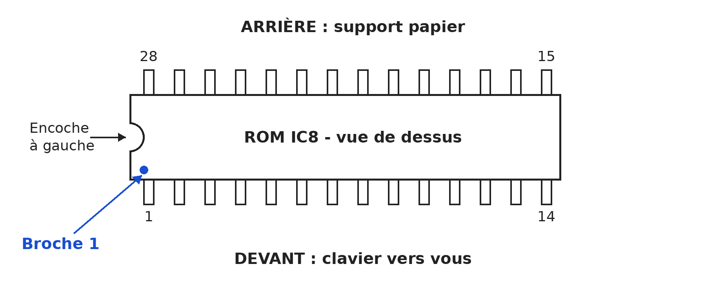

<a id="installation"></a>
# Installation - Passer au BASIC

Pour installer Typestar BASIC, nous remplaçons la ROM extérieure **IC8**, enfichée dans un support. Le remplacement se fait directement sur ce support. Le microcontrôleur et sa ROM interne Canon restent en place. Conservez la puce d'origine : vous pourrez retrouver le fonctionnement Canon en la remettant dans son support.

Ce guide illustré présente la **Canon S-70 / Typestar 7** photographiée pour le projet. Une révision de la S-60 / Typestar 6 accepte également ce firmware, comme le précise la section ci-dessous. La S-90 demande un binaire BASIC adapté à sa ROM interne.

<a id="s60-serial"></a>
### Une Typestar 6 peut aussi passer au BASIC

Le démarrage de Typestar BASIC et le **chargement de programmes avec Studio jusqu'à 31250 bauds, en 7E1**, ont été validés sur une **Canon S-60 / Typestar 6**, équipée du PCB **NG3-0672 / NH1-0159-065**, daté **« 86;06,12. »**. Cet exemplaire possède une petite trappe de port série, collée en usine, et une molette de contraste d'impression à l'avant. Le BASIC remplace sa ROM IC8, avec le microcontrôleur d'origine conservé. L'ajout du circuit série décrit ci-dessous demande des soudures ; le remplacement d'IC8 reste une opération sur support.

D'autres S-60 présentent une coque sans trappe et une molette sur le côté droit : leur compatibilité reste à vérifier sur leur propre carte. **La référence du PCB est le repère à contrôler avant d'entreprendre cette extension.**

### Les composants du port série S-60

La prise de la S-70 de référence porte le marquage **AMP 8609 747109-1**. Pour CN7, la **TE Connectivity / AMP 5745001-3** constitue une référence de **DE-9 mâle coudée pour circuit imprimé** : comparez son [plan constructeur](https://www.te.com/en/product-5745001-3.html) aux perçages et fixations de la carte. Un équivalent de stock ancien a été utilisé sur l'exemplaire testé.

| Emplacement | Composant à monter |
|---|---|
| **CN7** | Prise DE-9 mâle coudée, implantation et fixations compatibles avec la référence **5745001-3**. |
| **IC4** | **Texas Instruments CD4050BE**, buffer CMOS non inverseur en DIP-16, testé à la place du Fujitsu MB84050B. Broche **1 : +5 V** ; broche **8 : masse**. |
| **R77, R78, R79** | Une résistance de **4,7 kΩ** à chaque emplacement : respectivement en série avec **CN7.4, CN7.2 et CN7.7**. |
| **RA1** | Trois résistances de **4,7 kΩ** et trois de **22 kΩ**, câblées selon les deux tableaux suivants. |

### Reconstituer RA1 avec six résistances

RA1 associe trois résistances série et trois rappels au +5 V. La numérotation ci-dessous reprend le relevé de cette carte : **la broche 7 est la pastille repérée sur le PCB par un petit carré ; elle est reliée au +5 V**. En partant de cette extrémité, les pastilles se comptent **7, 6, 5, 4, 3, 2, 1**. Les numéros CN7 sont ceux des contacts du connecteur ; les numéros IC4 sont ceux du buffer.

| Pastille RA1 | Connexion sur le PCB |
|---|---|
| **1** | **CN7.5**, entrée d'activation de l'interface **IF_ENABLE#**. |
| **2** | **IC4.3**, entrée du buffer d'activation. |
| **3** | **CN7.3**, données reçues du PC **RXD**. |
| **4** | **IC4.7**, entrée du buffer de réception. |
| **5** | **CN7.6**, détection d'interface **IF_PRESENT#**. |
| **6** | **IC4.9**, entrée du buffer de détection. |
| **7 - carré** | **+5 V**, alimentation commune des rappels. |

Soudez chaque résistance entre les deux pastilles indiquées, avec des liaisons isolées :

| Entre les pastilles RA1 | Valeur | Fonction |
|---|---|---|
| **1 et 2** | **4,7 kΩ** | Série sur IF_ENABLE#. |
| **3 et 4** | **4,7 kΩ** | Série sur RXD. |
| **5 et 6** | **4,7 kΩ** | Série sur IF_PRESENT#. |
| **1 et 7** | **22 kΩ** | Rappel d'IF_ENABLE# au +5 V. |
| **3 et 7** | **22 kΩ** | Rappel de RXD au +5 V. |
| **5 et 7** | **22 kΩ** | Rappel d'IF_PRESENT# au +5 V, pour définir son état câble débranché. |

Ce montage est la reconstruction fonctionnelle retenue pour l'extension. Les trois paires **1-2, 3-4 et 5-6** doivent conserver leur résistance série : un réseau composé uniquement de résistances en étoile autour de la broche 7 assure les rappels mais laisse ces liaisons manquantes. L'intervention se fait hors tension, toutes alimentations retirées. Avant l'essai, contrôlez les connexions du tableau et l'orientation d'IC4, puis utilisez le [câble USB Typestar](09-sons-serie-memoire.md) et les mêmes réglages série dans Studio et sur la Canon.

## Avant d'ouvrir la machine

Préparez un petit tournevis cruciforme pour les vis du boîtier, un petit tournevis plat ou un extracteur de circuits pour la ROM, un récipient pour les quatre vis et votre mémoire de remplacement **déjà programmée**. Travaillez sur une table dégagée, avec assez de lumière pour voir les broches.

Avant le changement, imprimez ou sauvegardez les textes à conserver. Les documents Canon et les programmes BASIC utilisent des formats distincts. Si vous mettez à jour un BASIC déjà installé, conservez votre programme sur le PC avec [Typestar BASIC Studio](09-sons-serie-memoire.md#save).

Éteignez la Canon, débranchez l'adaptateur secteur et les câbles, puis retirez les piles. La machine doit rester sans alimentation pendant le démontage et le remplacement. Retirez la feuille et la cassette de ruban si elle gêne l'accès. Relevez le support papier et retirez le capot amovible qui couvre le mécanisme d'impression.

## Choisir et préparer la mémoire de remplacement

Les puces proposées ici ont deux rangées de quatorze broches : ce boîtier se nomme **DIP 28**. Le tableau distingue leur capacité et leur méthode de programmation.

| Mémoire | Fichier à utiliser | Préparation |
|---|---|---|
| **OneROM Fire 28**, dont la révision 28C utilisée dans le projet | `typestar-basic-32k.bin` : 32 768 octets | Programmation USB, profil **27C256** ; solution déjà utilisée sur la machine. |
| **Winbond W27C512**, boîtier DIP de 28 broches | `typestar-basic-64k-mirror.bin` : 65 536 octets | Programmateur prenant en charge **W27C512**, puis vérification de la lecture. Effacement électrique hors machine. |
| **EPROM 27C256**, boîtier DIP de 28 broches, brochage standard | `typestar-basic-32k.bin` : 32 768 octets | Profil exact de la puce dans le programmateur ; pour une EPROM à fenêtre, effacement aux UV avant réutilisation. |

Les deux fichiers prêts à programmer se trouvent dans le [dossier d'installation](../installation.md), avec leur version et leurs empreintes de contrôle.

La ROM originale de notre S-70 est une NEC D27C256C-20. Pour une autre 27C256, choisissez une version lisible sous 5 V et un temps d'accès de 200 ns ou plus rapide ; vérifiez sa fiche et son boîtier avant de l'enficher.

La W27C512 contient 64 Ko. Le fichier fourni répète notre image IC8 de 32 Ko dans les deux moitiés : le contenu reste ainsi le même quel que soit l'état de sa ligne A15. La Canon accède toujours à une image de 32 Ko. Ses broches de lecture sont vérifiées dans la [fiche Winbond, DIP 28, page 3](https://media.digikey.com/pdf/Data%20Sheets/Winbond%20PDFs/W27C512.pdf) ; un essai sur machine complète la vérification du composant.

Choisissez la référence complète et vérifiez son brochage. La **28C256** et la **27C256** possèdent par exemple des fonctions différentes sur certaines broches. Les montages décrits ici précisent les composants adaptés à IC8.

### Programmer une OneROM

Si votre OneROM est déjà préparée avec Typestar BASIC, passez au démontage. Sinon, retirez-la de la Canon et branchez-la **seule** au PC par USB. Avec [One ROM Web](https://onerom.org/web/), ouvrez Chrome ou Edge, cliquez sur **Connect**, puis choisissez **Custom ROM Image**. Sélectionnez le modèle et la révision de votre carte, chargez `typestar-basic-32k.bin`, choisissez **ROM Type : 27C256**, puis lancez la programmation. Attendez la vérification avant de débrancher. Sous Linux, consultez les réglages USB indiqués par OneROM pour détecter la carte.

Le fichier BASIC est l’image ROM à présenter à la Canon. One ROM Web combine cette image avec le profil choisi pour construire puis programmer le firmware de la carte OneROM.

Pour les utilisateurs de l'[outil officiel en ligne de commande](https://github.com/piersfinlayson/one-rom/blob/main/docs/CLI-MANUAL.md), placez-vous dans le dossier contenant l'image de 32 Ko :

```text
onerom program --slot "file=typestar-basic-32k.bin,type=27C256" --plugin usb
onerom inspect slots
```

Le profil reste **27C256**, même si la OneROM peut émuler d'autres capacités. Gardez la programmation et l'installation dans la Canon comme deux opérations séparées : après la programmation, débranchez l'USB avant d'enficher la carte.

### Programmer une W27C512 ou une EPROM

Placez la puce dans le programmateur suivant son propre repère de broche 1. Choisissez sa référence exacte, ouvrez le fichier adapté à sa capacité, puis effectuez l'effacement nécessaire, la programmation et la vérification complète. Pour la W27C512, utilisez **tout** le fichier de 65 536 octets ; pour une 27C256, celui de 32 768 octets. Une puce correctement vérifiée est prête à être installée.

La programmation se fait hors de la Canon. Le programmateur applique les tensions nécessaires à la puce retirée de la machine. Réinstallez-la dans IC8 seulement après programmation et vérification.

## Étape 1 - Retirer les quatre vis

Regardez la machine comme lorsque vous tapez au clavier. Les **quatre cercles rouges A, B, C et D** indiquent les vis à enlever : deux vers l'arrière, sous le support papier relevé, et deux de part et d'autre de la zone LCD. Dévissez-les et gardez-les ensemble. Cette opération concerne les quatre vis repérées sur le dessin.


## Étape 2 - Libérer les cinq clips

La coque est aussi retenue par **cinq clips en plastique** : deux latéraux et trois sur le bord avant, près de la barre d'espace. Ils se trouvent aux emplacements des flèches jaunes de la vue précédente. Après les vis, libérez ces attaches pour soulever la coque.

À chaque emplacement, exercez une pression modérée **vers l'intérieur de la machine**, dans le sens de la flèche. Soulevez en même temps la coque de quelques millimètres pour dégager l'attache, puis passez à la suivante. Procédez progressivement : le plastique ancien doit fléchir juste assez pour que le clip se libère. Si un endroit résiste, reprenez le repérage de sa vis ou de son clip plutôt que de tirer davantage.

La vue suivante montre les attaches de la coque **retournée**. Les ouvertures et leurs formes permettent de reconnaître les zones à dégager ; la vue intérieure inverse les côtés par rapport à la machine posée devant vous.


### Voir la forme d'un clip

Les deux vues montrent une **attache latérale** et les **languettes du bord avant**. Dans les deux cas, la pression se fait **vers l'intérieur**, dans le sens des flèches. Dégagez les attaches une à une ; gardez la pression orientée vers l’intérieur.


Lorsque les cinq clips sont libres, soulevez doucement la coque et posez-la à côté. Laissez le clavier, le LCD, les nappes et les câbles en place.

## Étape 3 - Trouver IC8

La puce à remplacer est la **ROM IC8**, dans le support repéré **256ROM**, près du bord avant de la carte. La flèche bleue du dessin la désigne. Sur notre S-70, elle porte le marquage NEC D27C256C. Juste à sa gauche se trouve le support **IC7 / 128ROM**, vide sur cette machine : le BASIC se place dans IC8.


Repérez le **sens de la ROM avant de la retirer**. Quand la machine est devant vous, clavier vers vous et support papier à l'arrière, son **encoche est à gauche**. Le petit repère de broche 1 se trouve du même côté. Prenez une photo si vous souhaitez conserver un témoin de cette position.

## Étape 4 - Sortir la ROM d'origine

Avec un extracteur, soulevez la puce progressivement. Avec un petit tournevis plat, glissez doucement la lame **entre le corps de la ROM et le haut de son support**, à une extrémité. Soulevez très légèrement, puis faites de même à l'autre extrémité. Alternez jusqu'à ce que la ROM sorte à peu près horizontalement.

Il suffit de petites levées successives. Maintenez la lame entre la puce et son support ; des levées alternées et très courtes gardent les broches alignées. Conservez la ROM originale dans une protection adaptée, identifiée au nom de sa machine.

## Étape 5 - Installer la nouvelle ROM dans le bon sens

Placez la ROM programmée, ou la OneROM préparée, dans **le même support IC8**. Sur une puce DIP classique, l'encoche doit rester **vers la gauche**. Sur une OneROM, utilisez son repère de broche 1 pour retrouver ce même côté ; ce repère de broche 1 donne le sens à respecter.



Présentez toutes les broches devant leurs contacts, puis appuyez régulièrement sur les deux extrémités. Regardez les deux rangées de côté : chaque broche doit être droite et engagée dans son contact. L'image suivante montre la OneROM montée à la place de la NEC.


Le microcontrôleur reste intact. Conservez les **ponts de soudure INT/EXT** dans leur état d’origine et IC7 libre. La ROM IC8 suffit pour utiliser le BASIC au clavier.

## Étape 6 - Remonter et faire le premier essai

Reposez la coque sans coincer de câble. Vérifiez l'alignement des ouvertures du clavier, du LCD et des molettes. Réengagez les cinq clips par une pression légère, puis remettez les quatre vis sans serrage excessif. Reposez le capot amovible et le ruban si vous l'aviez retiré.

Rebranchez ensuite l'alimentation et allumez. Le LCD doit montrer **BOOTING**, puis **Typestar BASIC** et son numéro de version. Une touche quelconque passe le message d'accueil ; une autre passe le message de mémoire libre et fait apparaître `>`. Avec un programme vide, le nombre attendu est **5951 bytes free** ; un programme conservé peut laisser moins de place.

Essayez votre première instruction :

```basic
PRINT 2+3
```

Le résultat est `5`. Appuyez sur une touche pour revenir à l'invite. Poursuivez avec [Studio](02-studio.md) ou [vos premières instructions](03-premiers-pas.md).

### Du papier et des piles pour vos premiers essais

Pour les jeux et les dessins, choisissez du **papier thermique A4**, si possible **sans BPA**, idéalement **sans phénols**. Il s’imprime directement **sans cassette**, face sensible vers la tête : vous économisez les rubans devenus rares et coûteux. Avec du papier ordinaire, la Typestar 7 utilise les cassettes **IR-50 II** (noir), **IR-51 II** (rouge) ou **IR-52 II** (bleu), selon le manuel Canon. [C1] [C7]

Pour faciliter la recharge, choisissez **quatre accumulateurs lithium-ion R20 / D à sortie régulée de 1,5 V et recharge USB** : ils fournissent 6 V au total. Utilisez quatre éléments identiques, adaptés au courant des moteurs et de l’impression, et rechargez-les hors de la Canon. La mention **1,5 V** distingue ces modèles des éléments lithium de 3,6 ou 3,7 V. Leur tension reste stable ; l’autonomie dépend de leur énergie et du rythme d’impression. [C6]

### Vérifier le premier démarrage

Éteignez et retirez de nouveau toutes les alimentations avant de rouvrir. Vérifiez d'abord **IC8**, le sens de la puce, les deux rangées de broches et le fichier programmé. Pour une OneROM, contrôlez le profil **27C256** ; pour une W27C512, la présence du fichier complet de 64 Ko et sa vérification par le programmateur.

Le retour au fonctionnement d'origine consiste à remettre la ROM Canon dans IC8, hors tension et dans son sens initial. Si la Canon redémarre normalement avec cette puce, reprenez la préparation de la mémoire BASIC. Ce contrôle concerne IC8, son orientation et l’image qui y est programmée.

[C6]: https://shop.ansmann.de/en/li-ion-batteries-d-typ-6000-min-5400-mah-2pcs-cardboard-box

[C7]: https://www.koehlerpaper.com/en/products/Thermal-paper/TH_POS_Cash-register-rolls.php

[C1]: https://site.xavier.edu/polt/typewriters/CanonTypestar7.pdf
