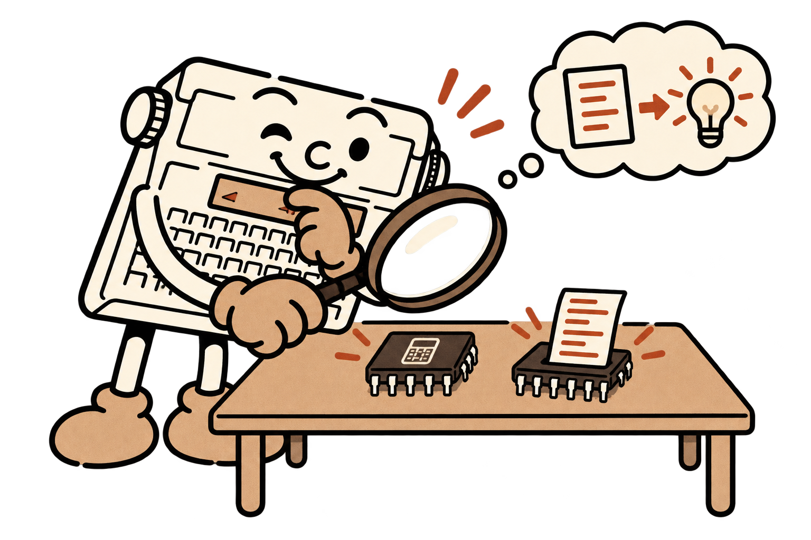
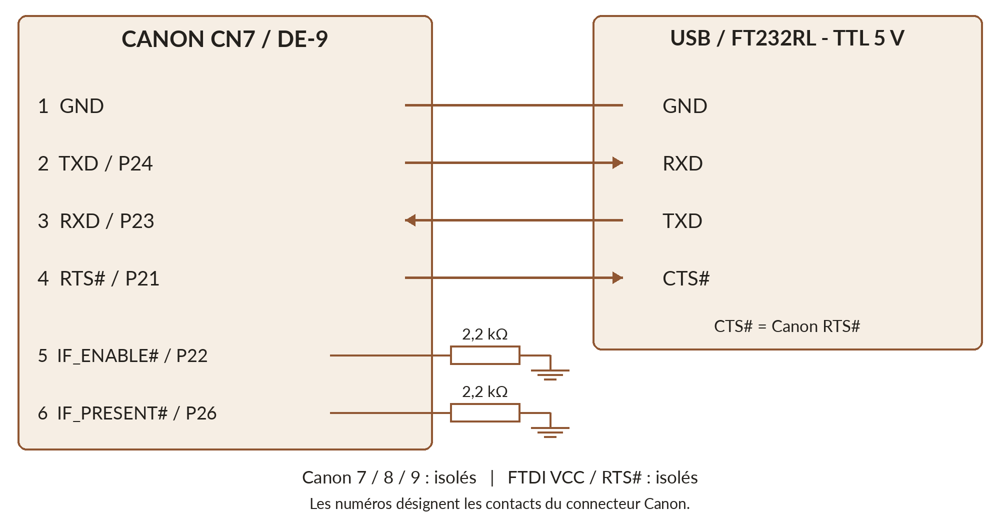
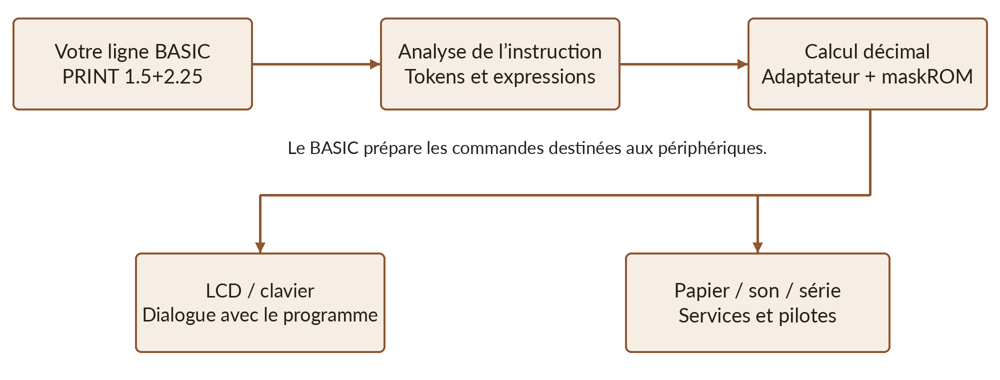
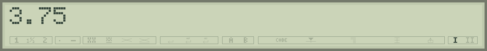

# Typestar BASIC sous le capot

Vous pouvez commencer à programmer sans lire ce chapitre. Il répond à une autre curiosité : **comment une machine à écrire devient-elle un ordinateur BASIC ?** La réponse tient dans un nouveau programme, quelques mémoires bien organisées et des services Canon que nous avons appris à réutiliser.



## Comprendre avant de remplacer

La S-70 possède deux mémoires de programme : une **maskROM de 16 Ko dans le microcontrôleur IC9** et une **ROM de 32 Ko sur le support IC8**. Le logiciel d’origine répartit ses services entre les deux. Typestar BASIC remplace IC8 et coopère avec les routines conservées dans la maskROM.

Le développement a commencé par la lecture des ROM, puis leur **désassemblage** : retrouver les instructions HD6301 et repérer les tables, les appels et les échanges avec les périphériques. Le schéma électronique a aidé à relier une adresse ou un bit à un composant réel. [P1]

Des programmes très courts ont ensuite exercé séparément le clavier, le LCD, le buzzer, la liaison série et l'impression. Les résultats observés sur machine ont permis de corriger les hypothèses. Une IA a accompagné la recherche et l'écriture du code ; **les essais et les documents techniques ont servi de vérification**.

La nouvelle ROM associe un interpréteur écrit pour la machine, des adaptations des services existants et certaines routines Canon conservées. **Typestar BASIC s’inspire des BASIC Microsoft, avec ses propres possibilités et limites.**

## Le logiciel Canon : texte, mémoire et cartouches

Avec le logiciel d’origine, le LCD permet de relire et corriger le texte avant l’impression. Le manuel annonce environ **6 000 caractères**, répartis sous **26 codes de titre**, soit environ trois feuilles A4. Cette réserve accueille à la fois le texte et les informations de format, comme les marges et les tabulations. [H9]

Une adresse ou une formule de courrier peut ainsi être rappelée et réimprimée. Le logement latéral accueille deux familles d'accessoires : les **cartouches ROM Typestyle**, pour changer de police sur papier, et les **cartouches RAM**, pour conserver des textes.

### Typestyle : une autre écriture sur le papier

**Courier 10 est intégré à la machine.** Le manuel de la Typestar 7 présente cinq polices supplémentaires, chacune dans sa cartouche : [H9]

| Cartouche annoncée par Canon | Espacement |
|---|---|
| **Courier Italic 10II** | Fixe, 10 caractères par pouce ; caractères italiques. |
| **Courier 12II** | Fixe, 12 caractères par pouce. |
| **Cubic PSII** | Proportionnel. |
| **Dictionary PSII** | Proportionnel. |
| **Armeria PSII** | Proportionnel. |

Le nombre 10 ou 12 exprime une **densité de caractères par pouce**. À 12, davantage de lettres tiennent sur une ligne. **PS** désigne l'espacement proportionnel : un *i* occupe moins de largeur qu'un *W*. Dictionary PSII est bien une police d'écriture. Sous le logiciel Canon, le réglage de style **A** utilise Courier 10 ; **B** choisit la cartouche insérée. [H9] [H37]

Les captures de **Courier 12II** et **Dictionary PSII** étudiées pour ce projet contiennent leurs noms, les largeurs des caractères et les motifs imprimables. Sur l'exemplaire **Cubic PSII** ouvert avec une Typestar 90 / 7-II, une ROM **Hitachi HN613128P de 16 Ko** conserve ces données. [H37]

### Les cartouches RAM : une bibliothèque de textes

Le logiciel Canon organise les documents sous **26 titres A à Z**, dans la mémoire interne comme sur cartouche. Pour modifier ou imprimer un texte archivé, on le rappelle d'abord dans la mémoire interne ; après modification, on le recopie sur la cartouche. Le petit aperçu aide à reconnaître les documents. [H9] [P1]

| Capacité annoncée | Exemple documenté |
|---|---|
| **4K**, environ 4 000 caractères | Manuel Canon Typestar 7. [H9] |
| **8 Ko** | Cartouche décrite avec une Typestar 7 par Alex Dueppen. [P1] |
| **16 Ko** | Cartouche photographiée avec une Typestar 90 / 7-II. [H37] |

Ces trois capacités constituent des **modèles documentés**, avec leurs notices et machines associées. Chaque cartouche RAM entretient ses données grâce à une **pile lithium CR2032 de 3 V** remplaçable. Une sauvegarde des textes permet de préparer sereinement son remplacement. [H9] [H37]

### Un véritable connecteur mémoire

Le connecteur possède **40 contacts au pas de 1,27 mm**. Ce pas rappelle celui du CompactFlash ; le brochage et le fonctionnement restent propres à Canon. Le schéma montre un bus de données de huit bits et les adresses **A0 à A15** : seize bits peuvent désigner **65 536 adresses**, soit 64 Ko. La quantité accessible dépend ensuite des circuits de sélection et des banques, qui rendent visible une partie de la mémoire à la fois. [P1]

**Avec Typestar BASIC aujourd'hui**, le programme et ses données occupent la RAM interne, et LPRINT utilise Courier 10. L'exploitation des cartouches constitue une extension envisagée pour la suite. Studio permet déjà d'essayer les cartouches de police avec le firmware Canon émulé. La conservation à l'arrêt est expliquée dans [le chapitre des mémoires](02-hd6301.md).

Les différences entre les S-60, S-70 et S-90 sont présentées dans [le chapitre du matériel](02-hd6301.md). La S-70 reste la machine de référence du firmware.

<a id="serial-cable"></a>
## La liaison série : comprendre le câble USB

Canon proposait les interfaces **Serial I/F-30** et **Parallel Interface-30** pour relier certaines machines à un ordinateur. Leur électronique adaptait les signaux du connecteur Canon à ceux du périphérique choisi. Notre câble USB retrouve cet usage avec un convertisseur **FTDI FT232RL à niveaux TTL 5 V**. Il a été validé sur S-70 et S-90 avec le firmware Canon. [H6] [U1]

**Série** signifie que les bits d’un caractère se suivent sur un fil. Le microcontrôleur possède sa propre interface SCI : **P24 / TXD** émet les données et **P23 / RXD** les reçoit. La masse fournit une référence commune. L’émission de l’un rejoint donc la réception de l’autre : TXD Canon vers RXD FTDI, et RXD Canon vers TXD FTDI.



### Les neuf contacts côté Canon

Le tableau numérote les contacts de **CN7 / DE-9 côté Canon**. Les noms RXD et TXD du convertisseur sont ceux de son interface TTL ; les numéros de sa puce ne sont pas utilisés ici. [U1]

| Contact Canon | Signal et rôle | Connexion du câble |
|---|---|---|
| 1 | GND, masse | Masse FTDI. |
| 2 | TXD, P24 : données émises par la Canon | RXD FTDI. |
| 3 | RXD, P23 : données reçues par la Canon | TXD FTDI. |
| 4 | RTS#, P21 : *Request To Send* | CTS# FTDI : la Canon autorise ou suspend l’envoi du PC. |
| 5 | IF_ENABLE#, P22 : activation de l’interface | Une résistance de **2,2 kΩ vers la masse**. |
| 6 | IF_PRESENT#, P26 : présence de l’interface | Une seconde résistance de **2,2 kΩ vers la masse**. |
| 7 | DTR#, P27 : *Data Terminal Ready*, état ONLINE | Laisser isolé dans ce câble. |
| 8 | Sans connexion sur la Canon | Laisser isolé. |
| 9 | Alimentation Canon **+5 V** | Laisser isolé. |

RTS et DTR reprennent les noms du manuel série Canon. **IF_ENABLE# et IF_PRESENT# sont les noms fonctionnels de notre documentation**. Le signe `#` signifie « actif à l’état bas ». Chaque ligne 5 et 6 possède **sa propre résistance** ; elles restent séparées. Les sorties **RTS#** et **VCC** du convertisseur FTDI restent également isolées. [H6] [U1]

Avec un câble FTDI TTL-232R à six fils, les contacts du petit connecteur sont : 1 masse (noir), 2 CTS# (marron), 4 TXD (orange), 5 RXD (jaune). Le contact 3 VCC et le contact 6 RTS# restent isolés. Les couleurs et le brochage d’un autre adaptateur se vérifient dans sa notice.

La forme DE-9 est aussi utilisée en RS-232, mais **le port Canon travaille en TTL 5 V**. Choisissez un adaptateur USB-TTL compatible 5 V. Pour repérer les contacts, utilisez les numéros gravés sur le connecteur : une vue de face et une vue côté soudures se présentent en miroir. Le schéma complet est reproduit en [annexe](13-annexe-schema.md). [P1]

### Le signal qui évite de perdre des caractères

Le PC peut transmettre bien plus vite que les moteurs n’impriment. **RTS# Canon devient bas lorsque la machine peut recevoir, et remonte lorsqu’elle demande une pause.** Le convertisseur lit ce signal sur CTS#. Ce contrôle matériel laisse la Canon terminer son travail avant de recevoir la suite.

Le firmware Canon et **Typestar Print** utilisent habituellement **1200 bauds, 7 bits, parité paire, 1 bit de stop**, soit **1200/7E1**. Typestar BASIC utilise par défaut **31250/7E1** pour LOAD, SAVE et l’impression graphique. Le câble reste le même ; les réglages et le protocole changent avec le logiciel. **Typestar BASIC Studio** prépare les transferts de programmes, décrits dans [son chapitre](02-studio.md#transferts) et dans [les commandes série](09-sons-serie-memoire.md#baud).

## Trois étages pour exécuter une instruction

Quand vous demandez `PRINT 1.5+2.25`, trois opérations principales se succèdent. L'analyseur reconnaît PRINT et l'expression. Le moteur de calcul produit le nombre. Le service d'affichage convertit le résultat en caractères et les transmet au LCD.



Le même principe s'applique à un dessin. Le BASIC reconnaît LINE ou CIRCLE, prépare un motif puis commande l'impression. Le papier et la tête ont besoin de vrais déplacements : **une instruction courte peut déclencher beaucoup de travail mécanique**.

## La carte des mémoires

Une adresse désigne une case de mémoire ou un registre matériel. Les valeurs ci-dessous sont écrites en hexadécimal : le préfixe `$` est utilisé dans ce tableau technique ; dans un programme BASIC, une constante hexadécimale s'écrit `&H`.

| Zone dans l'espace du processeur | Fonction dans la S-70 de référence |
|---|---|
| Registres du MCU et RAM interne | Commandes des ports, temporisateurs, interface série et travail de bas niveau ; 256 octets de RAM interne. |
| `$1800` à `$1FFF` | RAM de travail : états de pilotes, tampons, console, calculs, boucles et pile. |
| `$2000` à `$37FF` | Zone documentaire utilisée pour le programme et les données BASIC, avec un préambule réservé. |
| `$4000` à `$BFFF` | ROM externe IC8 : BASIC, données et services conservés, selon la sélection de mémoire. |
| `$C000` à `$FFFF` | Les 16 Ko de maskROM Canon et les vecteurs du MCU. |

**La puce IC8 contient 32 Ko**, correspondant à `$4000` à `$BFFF` lorsque la ROM est sélectionnée. Sa partie basse a été réorganisée pour accueillir davantage de fonctions. Le circuit de sélection peut aussi faire apparaître des données de cartouche dans une partie de l’espace d’adressage. Le tableau résume les zones utilisées par le firmware.

La zone partagée par vos programmes et vos données va de **`$20C0` à `$37FF`**, soit 5 952 octets. Un octet marque la fin du programme : la machine annonce **5 951 bytes free** à vide. Les autres zones accueillent les services Canon, les interruptions et les données de travail.

Le programme grandit depuis le bas de cette arène. Les données s’allouent à la demande depuis le haut, dans la même réserve. **FRE(0) et MEM montrent la place restante**, après le programme et les allocations.

> **La ROM et la RAM ont chacune leur travail.** La ROM contient l’interpréteur et ses ressources. La RAM accueille votre jeu, que vous pouvez remplacer en chargeant un autre programme.

## Des mots raccourcis : les tokens

Dans Studio, un fichier `.bas` est du texte lisible. Dans la RAM Canon, plusieurs mots fréquents sont remplacés par un **token**, un code d'un seul octet. PRINT, par exemple, occupe cinq lettres dans le fichier, mais un seul octet dans le programme stocké.

```basic
10 PRINT "SALUT"
```

Cette ligne occupe **12 octets** dans le programme : trois octets d'en-tête, un pour PRINT, un espace et les sept caractères de `"SALUT"`. Le zéro de fin de programme est partagé par toutes les lignes.

| Champ d'une ligne stockée | Taille | Contenu |
|---|---:|---|
| Longueur de l'enregistrement | 1 octet | Permet de rejoindre directement la ligne suivante ; zéro termine le programme. |
| Numéro de ligne | 2 octets | De 1 à 65535, octet de poids fort en premier. |
| Corps de la ligne | Variable | Tokens, texte, nombres et ponctuation. |

Les lignes restent triées par numéro. **Deux octets permettent les numéros de 1 à 65535** ; la quantité de RAM détermine le nombre de lignes stockables. Les instructions séparées par `:` partagent le même en-tête.

Le dictionnaire contient **37 codes**, de `$80` à `$A4`, pour les instructions et fonctions les plus courantes, dont LLIST, DIM et RND. Un seul octet représente ainsi un mot entier. Les autres commandes peuvent aussi être conservées sous leur forme écrite dans le corps de ligne.

Les noms de variables, les nombres, les espaces, les chaînes et les commentaires REM restent lisibles. Un accent accepté dans une chaîne occupe un code natif d’un octet. LIST et SAVE retrouvent une représentation lisible ; Studio transporte directement les enregistrements natifs.

Cette méthode gagne surtout de la place sur les instructions fréquentes. Les commentaires REM conservent leur texte entier. Une ligne source reste limitée à **63 caractères natifs**, numéro compris ; l’exécution dépend ensuite des calculs et des mouvements demandés.

## Une calculatrice Canon au service du BASIC

Le firmware d'origine propose une calculatrice, accessible par CODE+C sur la S-70. Son analyse a révélé dans la maskROM des routines d'**addition, soustraction, multiplication et division décimales**. Typestar BASIC réutilise ces opérations au lieu de reproduire tout leur code dans IC8.

Un petit adaptateur prépare les opérandes, appelle le service Canon puis reprend le résultat. Les calculs natifs emploient huit chiffres décimaux et un octet de signe/échelle. Pour stocker une valeur dans les données BASIC, le firmware compacte les chiffres en **quatre octets BCD**, plus un octet de signe/échelle : cinq octets par valeur numérique, hors métadonnées.

*BCD* signifie que chaque chiffre décimal occupe quatre bits. Les chiffres de 12.5 peuvent ainsi être conservés dans le motif `00 00 01 25 01` : le dernier octet indique ici une décimale. Ce format représente **huit chiffres significatifs** et jusqu’à **sept décimales**.

```basic
PRINT 1.5+2.25
PRINT 12.5/2
```



Vous obtenez **3.75** et **6.25**. Les opérations plus complexes, comme SIN, COS, LOG et EXP, sont des routines propres au BASIC. Elles utilisent les opérations décimales et des approximations pour calculer leurs résultats.

L’adaptateur respecte les zones de travail du programme Canon, la profondeur de pile et l’état des interruptions. Appeler une routine existante demande de préparer ses données et son contexte d’exécution.

## Faire tenir les fonctions dans 32 Ko

L’espace de la ROM est compté. Le code est organisé en modules assembleur et en entrées vers les services conservés. Le suivi des appels a permis de retirer les chemins devenus inutiles et de répartir certains modules dans les fragments disponibles. La mise en commun de routines tient compte de leurs données de travail et de leurs interruptions.

La police papier est comprimée **sans perte**. Le codec représente les **différences XOR entre colonnes**, regroupe les longues répétitions de différences nulles, puis applique un codage **Huffman** : les motifs fréquents utilisent des codes plus courts. La décompression séparée de chaque caractère économise aussi de la RAM.

Pour LPRINT, un cache prépare les caractères distincts du texte. Une lettre répétée réutilise le même dessin. Cela évite de décomprimer à nouveau chaque occurrence et réduit les pauses pendant l'impression. La préparation du cache et le mouvement mécanique restent deux travaux différents.

Pour les glyphes répétés, une seule bande de dessin est préparée, puis réutilisée pendant la passe. Un mur de 16 × 16 en mode 4 demande **348 octets temporaires**, pour une ou seize copies. Les deux moitiés du dessin sont imprimées successivement. Le programme et ses tableaux restent en mémoire.

| Ressource de la version 0.4.93-dev | Taille |
|---|---:|
| ROM BASIC | 32 768 octets |
| Occupation de la ROM | 32 707 octets |
| Réserve explicitement libre | 61 octets |
| RAM BASIC libre à vide, programme et données | 5 951 octets |

## Garder le programme, partager les tampons

Le démarrage affiche BOOTING pendant les vérifications. Une signature, les limites des enregistrements et un contrôle d’intégrité permettent de reconnaître un programme conservé. Le firmware reprend un contenu valide et prépare les variables pour une nouvelle exécution.

Cette conservation utilise une **RAM alimentée**. SAVE dans Studio permet de garder une copie durable sur le PC. Une coupure assez longue ou une alimentation de sauvegarde défaillante peut faire perdre le programme.

Les tampons sont partagés selon le travail demandé. Les calculs et l’impression normale disposent d’espaces définis. Pour recevoir davantage de données, l’impression graphique depuis le PC peut réutiliser l’arène du programme : **NEW intervient lorsque l’impression est réellement engagée**. L’appui sur CODE+P ouvre d’abord une attente ; Studio annonce l’utilisation de la mémoire avant l’envoi.

## IC7 et INT/EXT : vers un firmware entièrement nouveau

Le circuit porte un second emplacement, **IC7, marqué « 128ROM »**, prévu pour 16 Ko, ainsi que des **ponts de soudure INT/EXT** près du microcontrôleur. Ces straps soudés choisissent son mode ; on peut aussi les remplacer par des broches et des cavaliers amovibles pour expérimenter. Les essais de décodage montrent la sélection d’IC7 lors de lectures dans la région haute. En mode externe, le HD6301 peut chercher le programme correspondant à sa ROM interne dans une ROM placée sur IC7. [M2]

Cette voie permettrait de remplacer les services Canon de la maskROM par un firmware entièrement original. Elle **remplace les 16 Ko internes**, plutôt que d'ajouter une banque de 16 Ko au BASIC actuel. Une ROM haute doit notamment fournir le démarrage et les vecteurs d'interruption appropriés.

La broche A14 d’IC7 est reliée au +5 V sur la carte étudiée : une ROM de 32 Ko y présente **sa moitié haute de 16 Ko**. Il faut y préparer un programme de démarrage adapté, avec les vecteurs d’interruption. L’image externe Canon d’IC8 contient d’autres services et demande une organisation différente.

**L’installation décrite dans ce manuel conserve INT et la maskROM Canon**, avec le remplacement d’IC8. L’utilisation d’IC7 ouvre une autre voie de développement, pour maîtriser tout le logiciel de la machine.

Le [chapitre Studio](02-studio.md#debogueur) montre comment observer ces mécanismes dans le débogueur : registres, mémoire et instructions du HD6301. Les essais sur machine complètent la simulation pour les déplacements du papier et le son.

[P1]: https://ajd.sh/posts/canon-typestar-part-1/
[H37]: https://silvergreen93.wordpress.com/2024/03/04/the-canon-typestar-90/
[M2]: references.md

[H9]: https://site.xavier.edu/polt/typewriters/CanonTypestar7.pdf
[H6]: https://archive.org/details/canon-serial-interface-30-manual

[U1]: https://github.com/pR-0000/Typestar-Print/blob/main/docs/CABLE_WIRING.md
