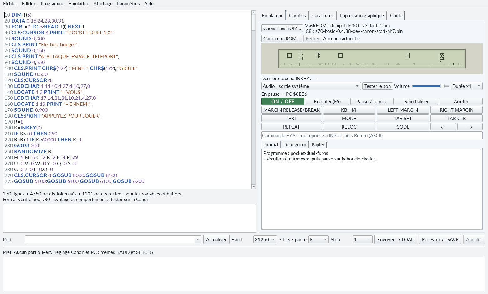
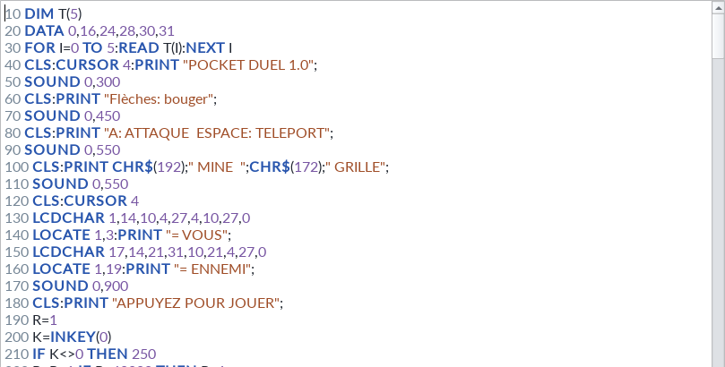
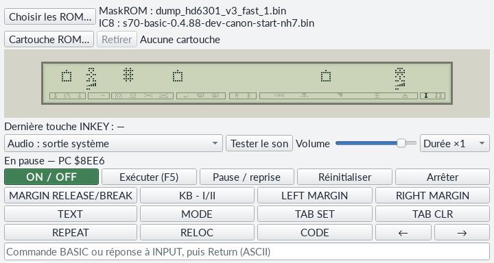
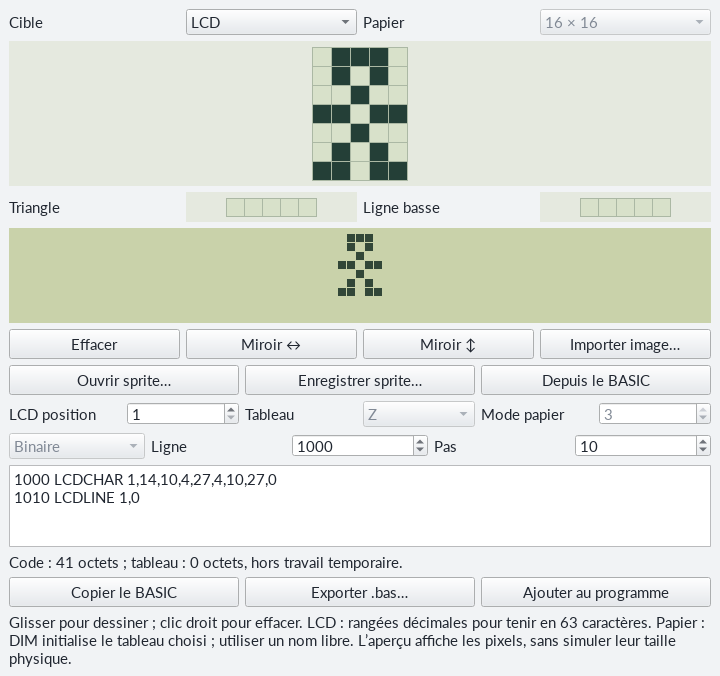
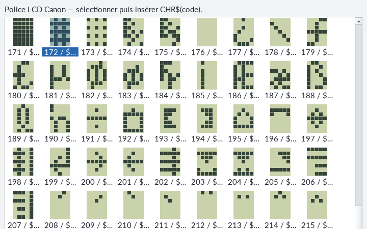
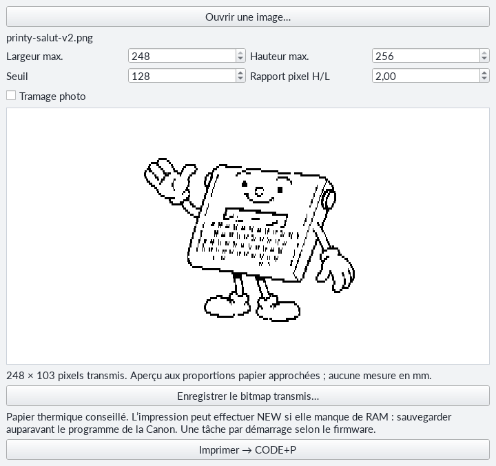
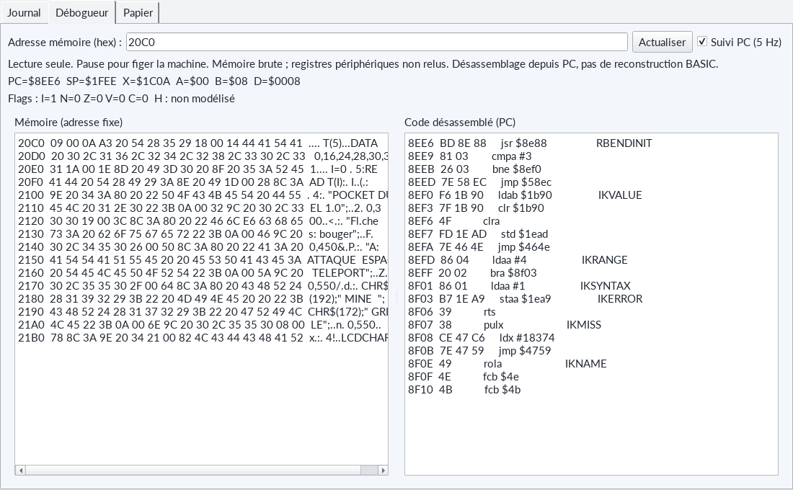

# Typestar BASIC Studio - votre atelier sur ordinateur

Écrire un programme sur un grand écran, dessiner son personnage à la souris, puis le voir s'animer sur les trente-deux caractères de la Typestar : **Studio réunit ces étapes dans une seule fenêtre**. Vous pouvez préparer vos idées dans l'émulateur, puis les envoyer à la Canon avec le câble USB.



**Votre parcours en trois gestes :** ouvrez un fichier BASIC, essayez-le avec **Exécuter (F5)**, puis choisissez **Envoyer → LOAD** pour le retrouver sur la vraie machine. Chaque atelier du manuel peut suivre ce même chemin.

## Ouvrir et personnaliser Studio

Installez **Python 3.12 ou plus récent**, puis ouvrez **Typestar BASIC Studio.pyw** dans le dossier `studio` du projet. Sous Windows, un double-clic lance l'interface. Sous Linux et macOS, vous pouvez lancer ce même fichier avec Python 3. Les menus et les fichiers BASIC restent les mêmes ; les pilotes et permissions du port série dépendent du système utilisé.

Au premier lancement, le lanceur prépare son environnement Python et installe les composants nécessaires. Gardez une connexion Internet pendant cette première préparation. Les lancements suivants réutilisent cet environnement. Le fichier `studio-install.log`, dans le dossier `studio`, donne les précisions utiles si l'installation rencontre un problème.

Choisissez **Paramètres → Langue → Français**, puis relancez Studio pour appliquer cette langue. Dans **Affichage → Thème**, sélectionnez **Clair**, **Sombre** ou **Suivre le système**. La langue, le thème, les fichiers ROM de l'émulateur et les réglages série sont conservés dans le fichier de configuration **studio.ini**, situé dans le dossier de configuration utilisateur du système.

<a id="editeur"></a>
## Un éditeur pour préparer vos instructions

L'éditeur occupe la partie gauche de la fenêtre. Les **numéros de ligne**, les **instructions**, les **nombres**, les **chaînes entre guillemets** et les **commentaires REM** ont des couleurs différentes. Elles vous aident à distinguer le texte affiché des ordres donnés au BASIC.



Utilisez **Fichier → Nouveau**, **Ouvrir**, **Enregistrer** ou **Enregistrer sous** pour ranger vos programmes. **Ctrl+F** recherche un mot ; les commandes du menu **Édition** permettent de copier, coller, annuler et rétablir. Les fichiers `.bas` sont du texte **UTF-8** : vous pouvez écrire les accents reconnus par le LCD directement dans les messages.

Avec **Programme → Vérifier les limites** ou **F4**, Studio contrôle les numéros de ligne, leur longueur, les caractères et la place occupée par le programme tokenisé. Cliquez sur un diagnostic pour rejoindre la ligne concernée. L'estimation de mémoire précède la création des variables : votre programme utilisera aussi de la RAM pendant son exécution. Les essais dans l'émulateur permettent ensuite de vérifier les calculs et le déroulement.

**Essayons ensemble.** Créez un nouveau fichier et recopiez ces lignes :

```basic
10 CLS
20 PRINT "BONJOUR !";
30 FOR I=1 TO 3
40 BEEP
50 NEXT I
60 END
```

Enregistrez-le, puis appuyez sur **F5**. Le message apparaît sur le LCD virtuel et trois bips se succèdent. Changez `3` en `5` : votre première modification est prête à être essayée.

<a id="emulateur"></a>
## Une Typestar sur votre écran

L'onglet **Émulateur** exécute les instructions du processeur HD6301 à partir des **deux fichiers ROM que vous sélectionnez** : la maskROM interne Canon et le firmware externe Typestar BASIC. Ouvrez **Choisir les ROM…**, indiquez vos fichiers, puis conservez le mode **Auto** pour une paire reconnue. Les fichiers Canon sont à fournir séparément. Le choix reste mémorisé pour la prochaine séance.



| Commande | Ce qu'elle permet de faire |
|---|---|
| ON / OFF | Allumer ou éteindre la machine virtuelle. ON donne accès au démarrage et à ses messages d'accueil. |
| Exécuter (F5) | Charger le texte de l'éditeur et lancer son RUN. Le démarrage se termine automatiquement ; une machine déjà prête conserve sa session. |
| Pause / reprise (F6) | Suspendre l'exécution, puis la reprendre au même endroit. |
| Arrêter | Figer la machine, son écran et son papier. Pause / reprise permet de continuer. |
| Réinitialiser | Recommencer le démarrage de la machine virtuelle. |

Cliquez dans le **LCD** pour lui donner le clavier de l'ordinateur. Les flèches servent aux déplacements ; **Échap** demande BREAK. Les boutons reproduisent les touches particulières de la Canon : **MARGIN RELEASE/BREAK**, **TEXT**, les marges et les tabulations. **F7** correspond à **CODE**, **F8** à **MODE** et **F9** à **KB - I/II**. Le champ de commande sous les boutons permet aussi de saisir une instruction ou une réponse à INPUT, puis Return.

Pour un jeu, gardez la touche voulue enfoncée pendant son action : **INKEY lit la touche maintenue**. Avec Pocket Duel, par exemple, relâchez la flèche après un déplacement pour choisir votre prochaine action. Les [programmes complets](11-programmes-complets.md) présentent les commandes de chaque jeu.

Le LCD reproduit la police native, les caractères personnels, les triangles, la ligne inférieure et les indicateurs. **Affichage → Pixels LCD** choisit des pixels **Jointifs** ou **Légèrement espacés**. Le menu **Émulation → Son du buzzer** active le son ; le bouton **Tester le son**, la sortie audio, le volume et le réglage **Durée** aident à l'adapter à votre ordinateur.

**Une machine pour expérimenter.** Les calculs et le BASIC passent par les ROM sélectionnées ; les moteurs, le papier et le buzzer sont des modèles fonctionnels. Le son et les temps d'exécution donnent une approximation de la Canon. Les échanges série se vérifient avec le câble et la machine réelle : le port physique est utilisé par les commandes de transfert de Studio.

## Dessiner un personnage, puis retrouver son BASIC

Dans l'onglet **Glyphes**, choisissez la cible **LCD**. Chaque case de la grille représente un pixel du caractère **5 × 7**. Cliquez ou glissez pour dessiner ; le bouton droit efface. Les deux petites grilles règlent le **triangle** et la **ligne basse** associés à la position choisie.



Studio prépare les lignes `LCDCHAR` et, selon votre dessin, `LCDLINE`. Choisissez le **numéro de départ** et le **pas** entre les lignes, puis utilisez **Ajouter au programme**. Gardez un emplacement libre pour ces numéros ; Studio vous signale une collision. Placez les instructions d'initialisation sur le chemin exécuté avant le jeu : un dessin rangé après `END` attendra qu'un sous-programme l'utilise.

Le chemin inverse est tout aussi pratique : sélectionnez dans l'éditeur les lignes qui définissent un glyphe, puis cliquez sur **Depuis le BASIC**. Studio reconnaît les définitions prises en charge et les replace dans la grille. S'il en trouve plusieurs, choisissez le dessin à retoucher. Les sprites peuvent aussi être conservés dans un fichier **JSON**, ou exportés en **BASIC**.

La cible **Papier** propose notamment **16 × 16**, **16 × 8** et **31 × 16**. Les rangées sont converties en valeurs binaires, hexadécimales ou décimales dans un tableau BASIC. Le mode papier **3** double la largeur pour obtenir des pixels aux proportions proches du carré sur la feuille. Un nom de tableau libre et une seule initialisation `DIM` suffisent pour préparer votre dessin. Le chapitre [papier et dessins](08-papier-dessins.md#glyph) explique comment le réutiliser.

### Choisir un caractère déjà disponible

L'onglet **Caractères** présente les dessins de la police LCD avec leurs codes décimaux et hexadécimaux. Sélectionnez une case, puis utilisez **Insérer l'expression au curseur**, ou double-cliquez sur le caractère. Studio insère par exemple `CHR$(172)`.



Placez cette expression **hors des guillemets**, comme dans `PRINT "GRILLE ";CHR$(172)`. Les positions 0 à 15 désignent les caractères personnalisés et leurs alias ; leur apparence dépend du programme exécuté. La [table des caractères](12-table-caracteres.md) est également reproduite à la fin du manuel.

<a id="transferts"></a>
## Passer de l'ordinateur à la Canon

Branchez le câble USB, puis choisissez le **port série** dans la liste de Studio : son nom et sa description aident à reconnaître l'adaptateur FTDI. Sous Windows, le nom ressemble à `COM28` ; sous Linux à `/dev/ttyUSB0` ; sous macOS à `/dev/cu.usbserial-…`. Le bouton **Actualiser** renouvelle la liste.

Les réglages habituels sont **31 250 bauds, 7 bits, parité E, 1 bit de stop**, soit **31250/7E1**. La Canon et Studio doivent utiliser les mêmes valeurs. Si vous les avez changées pour un autre usage, les commandes `BAUD` et `SERCFG` du [chapitre série](09-sons-serie-memoire.md#baud) permettent de les accorder.


**Pour envoyer :** ouvrez le programme dans l'éditeur, choisissez **Envoyer → LOAD**, puis confirmez le remplacement du programme présent sur la Canon. Tapez ensuite **LOAD**, puis **Return**, sur celle-ci. Gardez les deux appareils disponibles jusqu'à l'acquittement de fin indiqué dans le journal.

**Pour recevoir :** choisissez **Recevoir ← SAVE**, indiquez le fichier de destination, puis tapez **SAVE** et **Return** sur la Canon. Après réception complète, le fichier est enregistré sur l'ordinateur. Ouvrez-le avec le menu **Fichier** pour le modifier : le texte déjà présent dans l'éditeur reste disponible pendant la réception.

**Annuler** interrompt l'opération côté ordinateur ; les données déjà reçues restent sur la Canon. En cas de transfert interrompu, BREAK redonne accès à sa console. Le journal aide à contrôler le port choisi, les réglages et les acquittements avant de recommencer.

## Voir la feuille et imprimer une image

Dans l'émulateur, ouvrez le sous-onglet **Papier**. La feuille se construit à partir des colonnes envoyées à la tête d'impression. Vous pouvez régler le **zoom**, activer **Suivre l'impression**, effacer l'aperçu et exporter le résultat en **PNG** ou **PDF**. Les [programmes complets](11-programmes-complets.md) présentent un schéma des grilles de Duel Orbital et une vue simulée de la feuille de Duel Balistique. Les légendes distinguent les dessins explicatifs des captures de l’émulateur.

L'onglet **Impression graphique** prépare une image pour **la Canon réelle**. Ouvrez votre image, choisissez ses dimensions et ajustez le **seuil**, ou cochez **Tramage photo** pour répartir les points noirs. L'aperçu montre le résultat monochrome aux proportions papier approchées.



Préparez votre papier thermique, sauvegardez le programme présent dans la Canon, puis choisissez **Imprimer → CODE+P**. Après confirmation dans Studio, appuyez sur **CODE+P** sur la machine. L'impression graphique peut effectuer `NEW` pour utiliser la mémoire programme comme tampon ; le message de confirmation permet de sauvegarder votre travail auparavant. Les dimensions transmises vont jusqu'à **248 × 256 pixels**.

<a id="debogueur"></a>
## Observer ce qui se passe avec le débogueur

Le sous-onglet **Débogueur** ouvre une fenêtre sur le travail du processeur. Vous pouvez commencer à programmer sans l'utiliser, puis y revenir par curiosité : comment quelques mots de BASIC deviennent-ils des instructions pour le HD6301 ?



Les **registres** sont les petites mémoires de travail du processeur. **PC** désigne l'adresse de sa prochaine instruction ; **SP** repère sa pile. Les **flags** résument certains résultats, par exemple une valeur nulle ou une retenue. Ils concernent le code machine en cours d'exécution.


La vue **Mémoire (adresse fixe)** affiche les octets à partir de l'adresse hexadécimale choisie. La vue **Code désassemblé (PC)** traduit les octets en instructions HD6301 et suit le compteur PC. Ces deux vues ont leur propre défilement. **Suivi PC (5 Hz)** actualise les observations pendant l'exécution ; **Pause** permet de prendre le temps de lire et **Actualiser** renouvelle l'état affiché.

**Une adresse PC et un numéro de ligne BASIC sont deux repères différents.** Le premier appartient au processeur, le second à votre programme. Pour corriger un programme, commencez par le numéro de ligne indiqué par le BASIC et la méthode du [chapitre sur les erreurs](10-erreurs-et-limites.md). Le débogueur complète cette démarche pour explorer l'interpréteur ; ses vues présentent la mémoire et les instructions en lecture seule.

**À vous de jouer.** Ouvrez **piano-fr.bas**, lancez-le avec F5 et essayez quelques lettres. Ouvrez ensuite **pocket-duel-fr.bas** pour découvrir les personnages personnalisés. Quand vous serez prêt, envoyez l'un de ces programmes à la Canon : les mêmes lignes quittent alors l'écran de l'ordinateur pour faire vivre votre machine.
