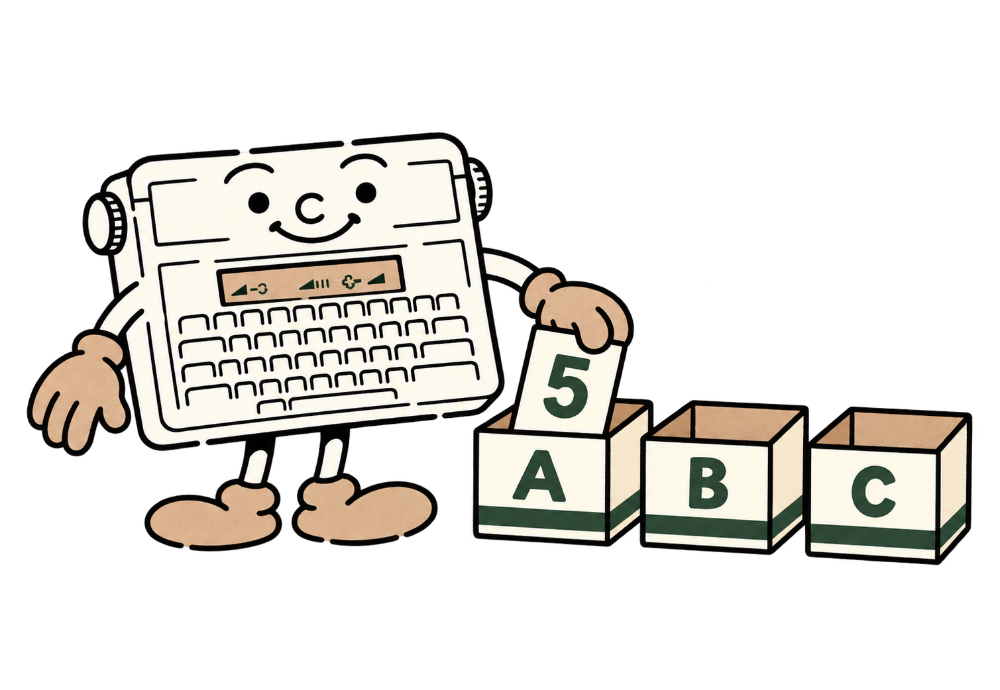

# 4 - Des nombres, des mots et des petites boîtes

Une variable ressemble à une boîte portant une étiquette. Vous y placez une valeur, puis vous utilisez l'étiquette pour retrouver cette valeur. Le BASIC reconnaît les variables numériques **A à Z** et les variables de texte **A$ à Z$**. Le signe `$` nous avertit que la boîte contient du texte.



<a id="let"></a>
## Donner une valeur : LET

```basic
A=5
PRINT A
```

L'écran affiche 5. `A=5` est une **affectation** : elle place 5 dans A. Vous pouvez écrire `LET A=5` ; le mot `LET` est facultatif. Pour remplacer cette valeur, écrivez simplement `A=8`.

```basic
10 A=5
20 A=A+1
30 PRINT A
```

La ligne 20 prend l'ancienne valeur de A, lui ajoute 1, puis range le résultat dans A. Le programme affiche 6. Ce signe `=` se lit ici « reçoit la valeur de ».

Une variable numérique commence à zéro. Une variable de texte commence avec le texte vide, écrit `""`. **Les noms ont une seule lettre** : utilisez P pour un prix, N pour un nombre et T pour un total. Ajoutez un commentaire REM pour rappeler le rôle de chaque lettre.

## Calculer avec les nombres décimaux

Pour écrire un nombre décimal, utilisez le **point**, même dans un programme français : `2.5`. La virgule sert à séparer les paramètres de certaines commandes.

| Signe | Opération | Exemple | Résultat |
|---|---|---|---:|
| `+` | Addition | `8+3` | 11 |
| `-` | Soustraction | `8-3` | 5 |
| `*` | Multiplication | `8*3` | 24 |
| `/` | Division | `8/4` | 2 |
| `^` | Puissance | `2^3` | 8 |

Voici un petit budget :

```basic
10 P=2.5
20 N=4
30 T=P*N
40 PRINT "TOTAL=";T
```

Quatre objets à 2,50 coûtent 10. Le point-virgule accole le message et le nombre. **À vous de jouer.** Changez P et N, puis relancez le programme.

Les calculs disposent de **huit chiffres significatifs**, avec au plus sept chiffres après le point. Cette précision compte tous les chiffres utiles, avant et après le point. Certains résultats sont arrondis : vérifiez les écarts acceptables dans vos longs calculs.

Une division par zéro ou un résultat trop grand déclenche une erreur. Pour saisir un nombre, écrivez ses chiffres et un point éventuel, comme `125.5`.

<a id="priorites"></a>
## Dans quel ordre se font les calculs ?

```basic
PRINT 2+3*4
```

Le résultat est 14 : le BASIC effectue la multiplication avant l'addition. Pour obtenir 20, imposez l'addition d'abord :

```basic
PRINT (2+3)*4
```

Les **parenthèses** regroupent les opérations. Quand une expression devient difficile à lire, elles sont souvent plus utiles qu'un raccourci.

Du plus prioritaire au moins prioritaire, le BASIC traite : la puissance `^` ; les signes d'un nombre `+` et `-` ; `*` et `/` ; `MOD` ; `+` et `-` ; les comparaisons ; `NOT` ; `AND` ; `OR`. Les puissances se regroupent à droite : `2^3^2` vaut `2^(3^2)`, donc 512. Le signe moins passe après la puissance : `-2^2` vaut -4 ; `(-2)^2` vaut 4.

Une base négative exige un exposant entier. `2^-3` vaut 0.125. Par convention dans ce BASIC, `0^0` vaut 1 ; une puissance négative de zéro est refusée.

<a id="binaire-hexadecimal"></a>
## Compter en binaire et en hexadécimal

Les nombres ordinaires utilisent dix chiffres, de 0 à 9. Le **binaire** utilise deux chiffres, 0 et 1. Placez `%` devant un nombre binaire :

```basic
PRINT %10101
```

Vous obtenez 21. De droite à gauche, les positions valent 1, 2, 4, 8 et 16. Dans 10101, les positions 16, 4 et 1 sont présentes : 16+4+1=21. Vous pouvez ajouter des zéros au début pour aligner les motifs : la valeur reste identique.

Le binaire est pratique pour dessiner des pixels : 1 signifie allumé, 0 signifie éteint. L'**hexadécimal** regroupe les chiffres par valeurs de seize et utilise aussi A, B, C, D, E et F. Son préfixe est `&H` :

```basic
PRINT &H1F
```

Le résultat est 31. `%11111`, `&H1F` et `31` désignent la même valeur. Pour l’hexadécimal, employez toujours le préfixe `&H`.

## Le texte dans les variables

```basic
10 A$="BONJOUR"
20 B$=A$+" !"
30 PRINT B$
```

Le signe `+` réunit deux chaînes : cette opération s'appelle la **concaténation**. Ici, le résultat est BONJOUR !. Les guillemets délimitent le texte contenu dans la chaîne.

Chaque chaîne ou résultat de calcul sur une chaîne peut contenir **63 octets au maximum**. Sur le PC, les fichiers sont enregistrés en UTF-8 ; **Typestar BASIC Studio** convertit les accents reconnus, dans les guillemets, vers les caractères de la machine. Ils occupent alors un octet par caractère en mémoire BASIC. Les accents du LCD et les caractères de la police papier sont deux ensembles différents.

Les mots-clés, noms de variables et commentaires `REM` doivent rester en caractères ASCII. Pour insérer un signe par son numéro, `CHR$` permet de donner son code. Par exemple, `CHR$(34)` produit un guillemet. Pour intégrer un guillemet au texte, utilisez `CHR$(34)`.

<a id="dim"></a>
## Plusieurs boîtes sous un même nom : DIM

Un **tableau** est une rangée de boîtes numérotées. Pour ranger cinq notes, vous pourriez utiliser cinq lettres. Un tableau permet de les garder ensemble :

```basic
10 DIM N(4)
20 N(0)=12:N(1)=15:N(2)=9
30 N(3)=18:N(4)=11
40 PRINT N(3)
```

Le résultat est 18. `DIM N(4)` crée **cinq** cellules : N(0), N(1), N(2), N(3) et N(4). Le nombre donné est le dernier indice autorisé, et non le nombre de cellules. Toutes les cellules commencent à zéro.

Un tableau à deux dimensions ressemble à un damier. `DIM M(2,3)` crée trois rangées et quatre colonnes, soit douze cellules. Dans ce manuel, nous utiliserons `M(rangée,colonne)` pour les dessins, avec la première rangée et la première colonne numérotées zéro.

```basic
10 DIM M(2,3)
20 M(1,2)=7
30 PRINT M(1,2)
```

Vous obtenez 7. Une variable A, une chaîne A$ et un tableau A(...) sont distincts. Déclarez **un tableau par instruction** : `DIM A(9):DIM B(2,3)` fonctionne ; chaque DIM décrit son tableau numérique, à une ou deux dimensions.

## Garder de la place pour le programme

Un tableau prend de la mémoire dès sa déclaration. Chaque cellule numérique utilise cinq octets ; l'ensemble du tableau ajoute neuf octets de gestion. `DIM A(9)` prend donc 9+10*5, soit 59 octets. Une variable numérique utilise six octets. Une variable chaîne réserve 73 octets lors de sa première affectation non vide ; cette réserve reste allouée si vous lui donnez ensuite `""`. `CLEAR`, `RUN` et `NEW` réinitialisent ces allocations selon leur rôle.

Pour voir l'effet d'un tableau, essayez au clavier :

```basic
CLEAR
PRINT FRE(0)
DIM A(9)
PRINT FRE(0)
```

Vous devez constater une diminution de 59 octets entre les deux nombres affichés. Les moteurs, dessins et impressions utilisent aussi de la mémoire de travail temporaire. Un programme qui remplit presque toute la RAM peut se charger correctement et manquer ensuite de place pour ses tableaux ou ses impressions. Gardez une réserve adaptée à ce qu'il doit faire.
