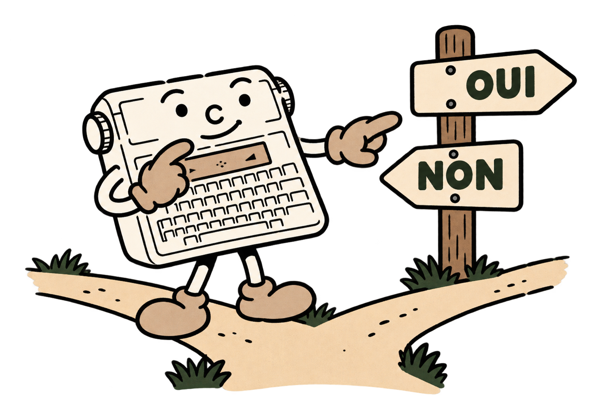

# 5 - Choisir, recommencer et retrouver son chemin

Jusqu'ici, la machine suivait les lignes l'une après l'autre. Un jeu ou un questionnaire doit aussi choisir son chemin. Chaque réponse peut conduire à son propre message.



<a id="input"></a>
## Poser une question : INPUT

```basic
10 INPUT "PRIX";P
20 INPUT "NOMBRE";N
30 PRINT "TOTAL=";P*N
```

`INPUT` attend votre réponse, puis la range dans la variable indiquée. Le message entre guillemets est facultatif et contient au maximum **16 caractères**. Une seule variable est demandée par instruction. Cette instruction s'utilise dans un programme lancé par `RUN`.

Pour une variable numérique comme N, vous pouvez répondre `4`, `2.5` ou même `2+3`. Si la réponse est vide, incomplète ou impossible à calculer, la saisie est redemandée. L'ancienne valeur reste intacte jusqu'à l'acceptation de la nouvelle. Le BASIC reconnaît un nombre ; votre programme précise ensuite la règle du jeu. Par exemple, IF peut demander une quantité positive.

Pour demander du texte, choisissez une variable terminée par `$` :

```basic
10 INPUT "TON NOM";N$
20 PRINT "BONJOUR ";N$
```

Le texte conserve ses espaces et ses majuscules ou minuscules. Return seul donne une chaîne vide. Saisissez directement votre réponse texte, puis Return. `INPUT` vise une variable simple ; pour remplir une cellule de tableau, lisez d'abord une variable, puis affectez-la à la cellule.

<a id="comparaisons"></a>
## Comparer deux valeurs

| Signe | Question posée | Exemple |
|---|---|---|
| `=` | Est-ce égal ? | `A=5` |
| `<>` | Est-ce différent ? | `A<>5` |
| `<` | Est-ce plus petit ? | `A<5` |
| `<=` | Est-ce plus petit ou égal ? | `A<=5` |
| `>` | Est-ce plus grand ? | `A>5` |
| `>=` | Est-ce plus grand ou égal ? | `A>=5` |

Une comparaison donne **-1 si elle est vraie** et **0 si elle est fausse**. Avec `IF`, toute valeur non nulle signifie vrai. Dans une affectation, `A=5` range 5 ; dans `IF A=5`, le même signe pose une question.

Les chaînes peuvent aussi être comparées, à condition de comparer du texte à du texte. La comparaison distingue les majuscules des minuscules et suit l'ordre des codes de caractères. Pour vérifier deux mots identiques, cela suffit ; les mots accentués suivent eux aussi l’ordre des codes.

<a id="if"></a>
<a id="then"></a>
<a id="else"></a>
## Faire un choix : IF, THEN et ELSE

```basic
10 INPUT "TON AGE";A
20 IF A<10 THEN PRINT "MOINS DE DIX ANS"
30 IF A>=10 THEN PRINT "DIX ANS OU PLUS"
```

`IF` se lit « si » et `THEN` se lit « alors ». La ligne 20 signifie : « Si A est plus petit que 10, alors affiche ce message. » Une condition fausse laisse le programme continuer sans exécuter la branche.

`ELSE` ajoute le choix contraire :

```basic
10 INPUT "NOMBRE";N
20 IF N=7 THEN PRINT "GAGNE" ELSE PRINT "PERDU"
```

Les deux possibilités doivent être sur **la même ligne physique**. IF, THEN et ELSE composent une instruction sur cette ligne. Après THEN ou ELSE, vous pouvez mettre une instruction, plusieurs instructions séparées par `:`, ou un numéro de ligne vers lequel aller.

```basic
10 INPUT "NOMBRE";N
20 IF N<0 THEN 100 ELSE 30
30 PRINT "NOMBRE ACCEPTE":END
100 PRINT "ESSAIE UN NOMBRE POSITIF"
110 GOTO 10
```

Lorsque plusieurs IF sont imbriqués sur une ligne, ELSE appartient au IF non terminé le plus proche. Pour vos premiers programmes, des branches courtes avec des numéros de ligne seront plus faciles à relire.

<a id="goto"></a>
## Revenir à une ligne : GOTO

`GOTO 10` signifie « poursuis à la ligne 10 ». La destination doit exister et le programme doit être en cours d'exécution. Cette instruction permet de redemander une réponse, de rejoindre une autre partie du jeu ou de recommencer un travail.

```basic
10 INPUT "DEVINE 6*7";N
20 IF N<>42 THEN 10
30 PRINT "BRAVO !"
```

Ce petit questionnaire continue jusqu’à obtenir la réponse 42. BREAK permet d'en sortir. Un saut qui revient toujours au même endroit sans issue crée une boucle infinie : la machine continuera aussi longtemps qu'on la laissera faire.

<a id="for"></a>
<a id="to"></a>
<a id="step"></a>
<a id="next"></a>
## Répéter un nombre connu de fois : FOR et NEXT

```basic
10 FOR I=1 TO 5
20 PRINT I
30 SOUND 0,500
40 NEXT I
```

Le programme affiche 1, 2, 3, 4 puis 5, avec une pause d'une demi-seconde entre les nombres. `FOR` prépare le compteur I, `TO` donne sa limite et `NEXT` passe à la valeur suivante. Le pas habituel est 1.

Pour compter de deux en deux, ajoutez `STEP 2`. Pour compter à rebours :

```basic
10 FOR I=5 TO 1 STEP -1
20 PRINT I:SOUND 0,500
30 NEXT I
40 BEEP
```

STEP accepte un pas décimal, positif ou négatif, différent de zéro. Choisissez un signe qui conduit vers la limite. La boucle s’exécute lorsque sa valeur initiale se situe dans les limites choisies.

Vous pouvez placer une boucle dans une autre, jusqu'à huit niveaux. Chaque boucle active doit utiliser une variable de contrôle différente : par exemple I pour les rangées et J pour les colonnes. `NEXT` sans nom reprend la boucle la plus intérieure ; préciser le nom rend le programme plus lisible. Pour terminer deux boucles, écrivez `NEXT J:NEXT I`.

<a id="gosub"></a>
<a id="return"></a>
## Une petite tâche réutilisable : GOSUB et RETURN

Un **sous-programme** est une tâche que plusieurs parties du programme peuvent appeler. `GOSUB` retient l'endroit où revenir, puis saute à la tâche ; `RETURN` reprend juste après l'appel.

```basic
10 GOSUB 100
20 PRINT "BONJOUR":SOUND 0,500
30 GOSUB 100
40 END
100 SOUND 300,100:SOUND 450,100
110 RETURN
```

Le même petit signal est joué deux fois. `END` empêche l'exécution principale de continuer accidentellement dans les lignes 100 et 110. Un sous-programme utilise les mêmes variables que le reste du programme : il partage les variables du programme principal.

Vous pouvez imbriquer huit appels. RETURN reprend le travail après le GOSUB correspondant ; terminez les boucles ouvertes dans le sous-programme avant de revenir.

<a id="end"></a>
<a id="rem"></a>
## Terminer et expliquer : END et REM

`END` termine le programme. `REM` commence un commentaire destiné à la personne qui lit le programme.

```basic
10 REM CALCUL DU PRIX TOTAL
20 P=2.5:N=4
30 PRINT P*N
40 END
```

Le commentaire prend **tout le reste de la ligne**, y compris les signes `:` et le mot ELSE éventuels. Écrivez directement le commentaire après REM. Rédigez les commentaires sans accents pour conserver leur format ASCII.

<a id="data"></a>
<a id="read"></a>
<a id="restore"></a>
## Préparer des valeurs : DATA, READ et RESTORE

`DATA` range une liste de valeurs dans le texte du programme. `READ` prend la prochaine valeur et la place dans une variable. La lecture avance dans l'ordre des DATA du programme.

```basic
10 DATA "ALICE",12,"BRUNO",15
20 READ N$,A
30 PRINT N$;" : ";A:SOUND 0,1000
40 READ N$,A
50 PRINT N$;" : ";A
```

Le programme affiche ALICE : 12, puis BRUNO : 15. La destination doit correspondre au type de la donnée : une chaîne pour du texte, une variable numérique pour un nombre. `READ` peut aussi remplir une cellule de tableau numérique.

Les DATA contiennent des **constantes** : écrivez `DATA 6`. Les nombres décimaux, binaires et hexadécimaux sont admis. Placez les textes entre guillemets ; leurs virgules appartiennent alors au texte.

`RESTORE` replace la lecture au premier DATA. Il s'écrit sans numéro de ligne. Une lecture au-delà des données disponibles provoque une erreur. Une erreur de type laisse la donnée fautive en place au lieu de la sauter.

```basic
10 DIM A(2)
20 DATA 3,5,8
30 FOR I=0 TO 2:READ A(I):NEXT I
40 RESTORE
50 READ N:PRINT N
```

Le résultat final est 3, car RESTORE a ramené la lecture au début.

<a id="and"></a>
<a id="or"></a>
<a id="not"></a>
<a id="mod"></a>
## Combiner les questions : AND, OR, NOT et MOD

Pour accepter un nombre entre 1 et 6, les deux conditions doivent être vraies :

```basic
10 INPUT "DE 1 A 6";N
20 IF (N>=1) AND (N<=6) THEN 40
30 GOTO 10
40 PRINT "ACCEPTE"
```

`AND` signifie « et ». `OR` signifie « ou » : `IF (N<1) OR (N>6) THEN 10` redemande les valeurs hors de l'intervalle. `NOT` inverse les bits ; appliqué à une comparaison vraie (-1) ou fausse (0), il inverse aussi sa réponse.

Ces opérateurs utilisent **16 bits** : `%101 AND %011` vaut 1 et `%101 OR %011` vaut 7. Les opérandes entiers vont de -32768 à 65535 ; le résultat est signé, de -32768 à 32767. Pour les conditions, mettez les comparaisons entre parenthèses. AND et OR évaluent les deux côtés : vérifiez B avant de calculer A/B.


`MOD` calcule le reste entier : `17 MOD 5` vaut 2. Testez `N MOD 2=0` pour reconnaître un nombre pair. Choisissez un diviseur différent de zéro ; le reste suit le signe du dividende.
