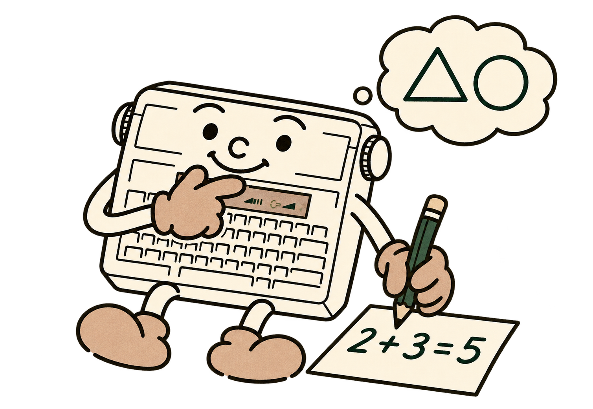

# 6 - Une boîte à outils pour les calculs et le texte

Une **instruction** fait quelque chose : PRINT affiche, INPUT pose une question. Une **fonction** fournit une valeur que vous pouvez afficher, ranger ou employer dans un calcul. Écrivez `PRINT SQR(9)` ou `A=SQR(9)`, plutôt que `SQR(9)` seul.

Dans les descriptions suivantes, x représente un nombre et s une chaîne. Vous pouvez les remplacer par des constantes, des variables ou des expressions.



<a id="abs"></a>
<a id="sgn"></a>
## ABS et SGN : regarder la valeur et le signe

`ABS(x)` donne la distance de x à zéro, sans son signe : `ABS(-8)` et `ABS(8)` valent tous deux 8. Si deux joueurs se trouvent aux positions A et B, leur distance est `ABS(A-B)`.

`SGN(x)` donne -1 pour un nombre négatif, 0 pour zéro et 1 pour un nombre positif. Cette fonction peut indiquer dans quel sens se déplacer pour atteindre une cible.

```basic
10 A=4:B=9
20 PRINT "DISTANCE=";ABS(A-B)
```

Le résultat est DISTANCE=5. Changez A et B : la distance restera positive ou nulle.

<a id="int"></a>
<a id="fix"></a>
## INT et FIX : garder un entier

`INT(x)` donne le plus grand entier inférieur ou égal à x. `FIX(x)` retire la partie après le point, en allant vers zéro. Pour un nombre positif, ils donnent la même chose ; pour un nombre négatif, ils diffèrent.

| Expression | Résultat |
|---|---:|
| `INT(3.8)` | 3 |
| `FIX(3.8)` | 3 |
| `INT(-3.8)` | -4 |
| `FIX(-3.8)` | -3 |

Pour arrondir un nombre **positif** au plus proche, utilisez `INT(x+0.5)`. INT seul donne l’entier inférieur. Les coordonnées et les masques de pixels attendent des entiers exacts : ajoutez INT ou FIX si votre calcul fournit un décimal.

<a id="sqr"></a>
## SQR : retrouver le côté d'un carré

`SQR(x)` donne la racine carrée de x. Puisque 5*5 vaut 25, `SQR(25)` vaut 5. Le nombre doit être positif ou nul.

```basic
10 A=9:B=12
20 PRINT SQR(A*A+B*B)
```

Le résultat est 15. Ce calcul donne la longueur de la diagonale d'un rectangle dont les côtés mesurent 9 et 12. Une racine décimale est affichée avec la précision disponible ; `SQR(2)` donne un nombre décimal.

<a id="rnd"></a>
<a id="randomize"></a>
## RND et RANDOMIZE : faire un choix imprévisible

`RND(1)` donne un nombre de 0 à 0.9999, par pas de 0.0001. Pour fabriquer un dé à six faces :

```basic
PRINT INT(RND(1)*6)+1
```

La multiplication donne une valeur inférieure à 6, INT garde un entier de 0 à 5 et l'addition transforme cet intervalle en 1 à 6. Pour choisir parmi N possibilités numérotées de 1 à N, remplacez 6 par N.

Le générateur est **pseudo-aléatoire** : il suit une règle à partir d'une valeur de départ, appelée graine. `RANDOMIZE 1234` choisit cette graine. Elle doit être un entier de **1 à 65535**. La même graine reproduit la même suite, ce qui est très utile pour comparer deux essais.

```basic
10 RANDOMIZE 1234
20 FOR I=1 TO 5
30 PRINT INT(RND(1)*6)+1:SOUND 0,500
40 NEXT I
```

Ce BASIC accepte seulement l'argument **1** de RND. RANDOMIZE demande une graine explicite. Pour varier une partie, un programme peut faire évoluer la graine pendant qu'il attend la touche du joueur. L’appui du joueur contribue ainsi à choisir la partie.

<a id="pi"></a>
<a id="sin"></a>
<a id="cos"></a>
<a id="tan"></a>
<a id="atn"></a>
## PI, SIN, COS, TAN et ATN : explorer les angles

`PI` est la constante 3.1415927. Elle s'écrit sans parenthèses. Le tour complet d'un cercle vaut 2*PI **radians**. Les fonctions trigonométriques utilisent les radians, tandis que l'on parle souvent d'angles en degrés à l'école. Pour convertir des degrés en radians, multipliez par PI/180.

```basic
10 A=30*PI/180
20 PRINT SIN(A)
```

Le résultat est proche de 0.5. `SIN` donne le sinus, `COS` le cosinus et `TAN` la tangente. `ATN` effectue le chemin inverse de la tangente : elle donne un angle en radians à partir d'un rapport. Par exemple, `ATN(1)` est proche de PI/4, soit 45 degrés.

Ces outils permettent de calculer des trajectoires ou des points sur un cercle. L’instruction de dessin CIRCLE prépare directement un cercle à partir de son centre et de son rayon.

SIN, COS et TAN acceptent des arguments entre **-1000 et 1000 radians**. TAN est refusée lorsque le cosinus calculé est trop proche de zéro. Les résultats sont approchés et les calculs prennent plus de temps que des additions. Pour tester un résultat, vérifiez une petite tolérance, par exemple `ABS(A-B)<0.001`, plutôt qu'une égalité parfaite.

<a id="log"></a>
<a id="exp"></a>
## LOG et EXP : des outils pour aller plus loin

`LOG(x)` donne le logarithme naturel de x ; x doit être strictement positif. `EXP(x)` donne l'exponentielle. Ces deux fonctions se répondent : `EXP(LOG(2))` est proche de 2.

Elles servent notamment aux calculs de croissance et à certaines puissances. Pour une première rencontre, essayez simplement :

```basic
PRINT LOG(1)
PRINT EXP(0)
```

Les résultats sont 0 puis 1. EXP refuse un argument supérieur à 18 ; en dessous de -18, elle donne zéro à la précision retenue. Comme les fonctions trigonométriques, ces calculs sont approchés et relativement lents.

<a id="len"></a>
<a id="left"></a>
<a id="right"></a>
<a id="mid"></a>
## LEN, LEFT$, RIGHT$ et MID$ : découper les mots

`LEN(s)` compte les octets de la chaîne. Dans une chaîne convertie pour la machine, chaque caractère reconnu compte pour un. `LEN("CHAT")` vaut 4 et `LEN("")` vaut 0.

`LEFT$(s,n)` prend jusqu'à n caractères à gauche ; `RIGHT$(s,n)` fait la même chose à droite. `MID$(s,debut,n)` prend un morceau à partir de la position indiquée. Dans une chaîne, **la première position est 1**, contrairement aux indices des tableaux qui commencent à zéro.

```basic
10 A$="TYPESTAR"
20 PRINT LEFT$(A$,4)
30 SOUND 0,1000
40 PRINT RIGHT$(A$,4)
50 SOUND 0,1000
60 PRINT MID$(A$,3,3)
```

Vous lisez TYPE, puis STAR, puis PES. Si n dépasse ce qui reste dans la chaîne, le BASIC prend seulement le contenu disponible. Une longueur de zéro donne une chaîne vide. Le début de MID$ doit être au moins 1. Sans troisième paramètre, `MID$(A$,5)` prend tout ce qui reste à partir de la cinquième position, ici STAR.

**À vous de jouer.** Remplacez TYPESTAR par un autre mot et prévoyez les trois résultats avant de lancer le programme.

<a id="asc"></a>
<a id="chr"></a>
## ASC et CHR$ : passer du caractère à son code

`ASC(s)` donne le code du premier caractère de s. Donnez-lui une chaîne contenant au moins un caractère. `CHR$(n)` fabrique une chaîne d'un seul octet, dont le code est n, de 0 à 255.

```basic
PRINT ASC("A")
PRINT CHR$(65)
```

Les résultats sont 65 puis A. Les codes étendus sont ceux du LCD Canon : ils appartiennent à la table de la machine. `CHR$(171)` produit le bloc noir natif, utile pour un curseur ou un obstacle. Les codes 172 et 192 sont employés dans Pocket Duel pour son terrain et ses mines.

Pour afficher un guillemet dans une phrase :

```basic
PRINT "IL DIT ";CHR$(34);"BONJOUR";CHR$(34)
```

Dans une chaîne envoyée au LCD, les codes comme 10 et 13 sélectionnent aussi des glyphes ; ils représentent des caractères du contrôleur. Utilisez PRINT seul ou sans point-virgule final pour finir la ligne d'affichage. Choisissez un code dans le catalogue LCD ou dans la table LPRINT, selon la destination.

<a id="str"></a>
<a id="val"></a>
## STR$ et VAL : relier les nombres et le texte

`STR$(x)` écrit un nombre en texte. VAL lit une constante complète : `VAL("12.5")` vaut 12.5 et `VAL("&H1F")` vaut 31. INPUT accepte aussi les expressions. Cet exemple affiche PRIX=12.5 :

```basic
10 A=12.5:B$="PRIX="+STR$(A)
20 PRINT B$
```
