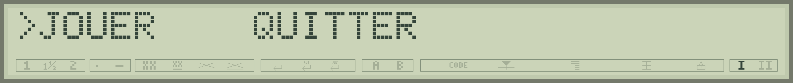
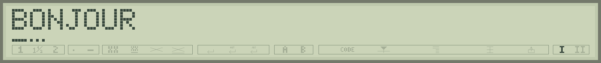
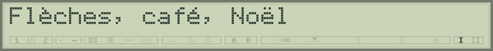

# 7 - Composer un écran et écouter le clavier

Le LCD possède une ligne de **32 caractères**. Chaque lettre occupe cinq colonnes de sept pixels, avec une petite séparation entre deux cases. Sous les lettres se trouvent un triangle à cinq segments, une ligne de cinq pixels et les indicateurs du panneau. Un petit écran peut devenir un menu, un tableau de score ou même le terrain d'un jeu.

<a id="print"></a>
## PRINT : afficher exactement ce que l'on veut

PRINT accepte des nombres, des chaînes, des variables et des résultats de calculs. Le point-virgule accole les éléments ; la virgule ajoute **un espace**, et non une grande zone de tabulation.

```basic
PRINT "SCORE=";12
PRINT "A","B"
```

Vous obtenez SCORE=12 puis A B. Un point-virgule final laisse le prochain affichage continuer sur la même ligne. PRINT sans argument termine la ligne en cours.

```basic
10 PRINT "TYPE";
20 PRINT "STAR"
```

Le résultat est TYPESTAR. Un texte long doit composer avec les 32 cases ; pour un menu ou un jeu, préparez des messages qui tiennent dans cette largeur. Découpez les longs textes en plusieurs écrans faciles à lire.

Pour afficher le résultat d'une comparaison commençant par une chaîne, mettez l'expression entre parenthèses : `PRINT ("A"="A")` affiche -1. Sans elles, PRINT peut prendre le premier texte pour un élément à afficher.

<a id="cls"></a>
<a id="locate"></a>
## CLS et LOCATE : écrire au bon endroit

`CLS` efface le texte, les triangles composés et les lignes inférieures créées par LCDLINE. Les autres indicateurs restent dans leur état. `LOCATE 1,colonne` place le prochain affichage à une colonne de **1 à 32**. Le premier paramètre reste 1 : la console peut conserver un historique, mais le LCD physique affiche une ligne de texte.

```basic
10 CLS
20 PRINT "SCORE: ";
30 LOCATE 1,8:PRINT 25;
```

Le score apparaît à partir de la huitième case. Pour remplacer 100 par 9, écrivez assez d'espaces derrière le nouveau nombre ; sinon les deux zéros restés à droite pourraient donner 900. `PRINT "9  ";` occupe les trois cases.


Dans un menu, évitez de tout réafficher à chaque mouvement. Effacez le marqueur ancien et placez le nouveau :

```basic
10 CLS:PRINT " JOUER    QUITTER";
20 LOCATE 1,1:PRINT ">";
30 SOUND 0,1000
40 LOCATE 1,1:PRINT " ";
50 LOCATE 1,10:PRINT ">";
```



Vous voyez le marqueur changer de choix sans redessiner tout le texte. Le point-virgule final est particulièrement utile pour ces mises à jour locales.

<a id="cursor"></a>
## CURSOR : choisir le curseur de saisie

| Mode | Effet |
|---:|---|
| 0 | Rectangle clignotant sans triangle ; mode habituel au démarrage. |
| 1 | Curseur matériel et triangle clignotants. |
| 2 | Triangle matériel fixe. |
| 3 | Curseur matériel clignotant et triangle fixe. |
| 4 | Curseur désactivé. |

`CURSOR 4` convient à un écran de jeu entièrement réservé à votre dessin. `CURSOR 0` retrouve le rectangle habituel. Cette commande choisit le comportement du curseur ; pour dessiner un triangle à une case précise, utilisez LCDTRI.

<a id="lcdchar"></a>
## LCDCHAR : dessiner un personnage de cinq pixels sur sept

Chaque rangée se décrit avec cinq bits. Le bit de gauche est le premier du dessin. Voici un petit visage :


```basic
10 CLS:CURSOR 4
20 LCDCHAR 1,14,17,21,17,21,17,14,0
```

Après la position 1 viennent **sept nombres pour les sept rangées**, puis un dernier masque pour le triangle. Tous sont obligatoires et vont de 0 à 31. Ici, zéro laisse le triangle éteint.


On peut écrire les rangées en binaire pour mieux voir le dessin. Comme une ligne source est limitée à 63 caractères, un tableau permet de conserver une présentation lisible :

```basic
10 DIM A(7)
20 DATA %01110,%10001,%10101,%10001
30 DATA %10101,%10001,%01110,0
40 FOR I=0 TO 7:READ A(I):NEXT I
50 CLS:CURSOR 4
60 LCDCHAR 1,A(0),A(1),A(2),A(3),A(4),A(5),A(6),A(7)
```

Ce second programme affiche le même visage. LCDCHAR reçoit chaque rangée séparément, comme A(0), A(1), etc. Le BASIC attribue automatiquement un emplacement de caractère personnalisé au motif affiché.

**À vous de jouer.** Remplacez la troisième rangée `%10101` par `%10001`. Les deux pixels intérieurs disparaissent. Essayez ensuite de changer la dernière rangée pour faire un autre visage.

<a id="lcdtri"></a>
## LCDTRI : cinq segments sous un personnage

```basic
10 CLS:CURSOR 4
20 LCDTRI 5,%10101
```

La cinquième case présente un triangle dont un segment sur deux est allumé. Dans ce masque, le bit 4 commande le segment le plus à gauche, le plus court ; le bit 0 commande le segment le plus à droite, le plus haut. `%11111`, soit 31, allume le triangle entier ; 0 l'éteint.

LCDTRI peut composer le triangle avec **un espace ou un caractère créé par LCDCHAR**. Pour accompagner une lettre, définissez son dessin avec LCDCHAR, puis ajoutez LCDTRI. La composition utilise le bitmap accessible du motif personnalisé. Une lettre native reste dessinée par le contrôleur ; la tentative de la composer avec LCDTRI signale `?LCD CHAR`.

```basic
10 CLS:CURSOR 4
20 LCDCHAR 1,14,17,21,17,21,17,14,0
30 LCDTRI 1,%10101
```

Le visage et son triangle se partagent maintenant la même case. PRINT à cet emplacement remplace le caractère et son triangle. Sur un caractère personnalisé, LCDTRI modifie seulement le masque du triangle et conserve les sept rangées du dessin.


<a id="lcdline"></a>
## LCDLINE : une petite ligne indépendante

```basic
10 CLS
20 PRINT "BONJOUR";
30 LCDLINE 1,%11111
40 LCDLINE 2,%10101
```

Sous la première lettre, les cinq pixels s'allument ; sous la deuxième, un pixel sur deux s'allume. Pour cette ligne horizontale, le bit 4 est à gauche. La position va de 1 à 32, le masque de 0 à 31.



Ces pixels restent allumés lorsque vous réécrivez du texte aux mêmes endroits : leur affichage est indépendant de la lettre. `LCDLINE 1,0` efface la ligne de la première case. CLS efface toutes les lignes créées ainsi. Cette indépendance permet de faire un soulignement ou un indicateur de progression.

## Huit motifs, mais trente-deux cases

Le LCD possède **huit emplacements de motifs personnalisés**, partagés par LCDCHAR, les triangles composés et LCDLINE. Le rectangle du curseur utilise désormais un caractère natif et laisse les huit emplacements disponibles.

Les motifs peuvent être partagés par plusieurs cases d’écran : un même motif de triangle ou de ligne inférieure peut servir à plusieurs cases. En revanche, chaque définition LCDCHAR possède son propre emplacement. Des masques différents peuvent épuiser les emplacements bien avant que les 32 cases soient occupées.

Le firmware réutilise un emplacement dès que la dernière case qui l’utilisait est effacée. Pour enlever un personnage de la case 5 :

```basic
LOCATE 1,5:PRINT " ";
LCDLINE 5,0
```

La première instruction retire le personnage et son triangle ; la seconde retire une éventuelle ligne indépendante au même endroit. S'il existe d'autres références au même motif, retirez-les aussi. CLS fait le ménage pour tout l'écran. Si tous les emplacements restent utilisés, une nouvelle demande donne `?LCD SLOTS`.

<a id="icon"></a>
## ICON : les indicateurs du panneau

`ICON index,code` écrit dans une cellule du panneau inférieur. L'index va de **0 à 31** et le code de **0 à 255**. Chaque paire index/code désigne une cellule et le motif brut qui y sera écrit.

Sur la S-70 relevée pour le projet, cet exemple agit sur l'indicateur de la cellule 20 :

```basic
ICON 20,178
SOUND 0,1000
ICON 20,32
```

32 est le code espace utilisé pour effacer cette cellule. Le sens visible dépend du câblage des segments du panneau ; certaines variantes de LCD présentent des symboles différents. Les cellules 30 et 31 servent aussi aux indicateurs I/II du clavier. Évitez de les modifier si vous souhaitez conserver cette indication.

CLS conserve les indicateurs écrits par ICON, sauf les cellules occupées par les lignes personnalisées dont il retire les références. Réservez des cellules distinctes à ICON et LCDLINE pour conserver leurs états indépendamment.

<a id="inkey"></a>
<a id="keys"></a>
## INKEY et KEYS : savoir quelle touche a été pressée

INPUT convient pour une réponse complète. `INKEY(0)` convient pour un menu ou un jeu : elle fournit le code d’une touche disponible, ou zéro dans l’attente d’une touche ; recommencez sa lecture lorsque le résultat vaut zéro.

```basic
10 CLS:PRINT "APPUYEZ SUR UNE TOUCHE";
20 K=INKEY(0)
30 IF K=0 THEN 20
40 PRINT "CODE=";K
```

Le paramètre de INKEY est toujours zéro. Une touche disponible est consommée une fois ; le programme choisit lui-même le rythme des lectures suivantes. BREAK garde son rôle d'interruption.

| Touche utile dans un programme | Code retourné par INKEY |
|---|---:|
| Return | 13 |
| Backspace | 8 |
| Espace | 32 |
| Flèche gauche | 18, soit `&H12` |
| Flèche droite | 19, soit `&H13` |

Les flèches possèdent leurs propres codes de commande. Les touches numériques « 1 » et « 2 » renvoient respectivement 49 et 50.

`KEYS`, au clavier de commande, sert au diagnostic des codes **physiques**. Backspace porte le code physique &H2F et INKEY donne 8 ; les flèches portent &H31 et &H32 et INKEY donne 18 et 19. Pour tester une flèche dans un programme, utilisez donc `IF K=18 THEN ...` ou `IF K=19 THEN ...`.

## Les accents et les caractères natifs

Dans un fichier BASIC préparé sur le PC, vous pouvez écrire des accents reconnus entre guillemets : `PRINT "Flèches, café, Noël"`. Studio se charge de la conversion. La saisie réelle dépend aussi de la table de votre clavier ; Studio vous permet ainsi de préparer les textes accentués depuis le clavier du PC.



La table prend en charge : **Ç ç ß Ë É Â é È Ò Ù à è ì ò ù Ä Ö Ü ä ö ü â ê î ô û ã Ã Ï õ Õ Ñ ñ ë ï**. Pour les autres symboles natifs, utilisez CHR$ et le catalogue des caractères de Studio. Les codes 0 à 7 sélectionnent les caractères personnalisés ; 8 à 15 sont des alias de ces mêmes huit motifs. Les codes 16 à 31 apparaissent vides dans les essais. Le code 32 est l'espace.

Vous retrouverez les 256 codes natifs dans [la table des caractères](12-table-caracteres.md). Elle reprend la palette de Studio et distingue les motifs LCD de la police papier.
