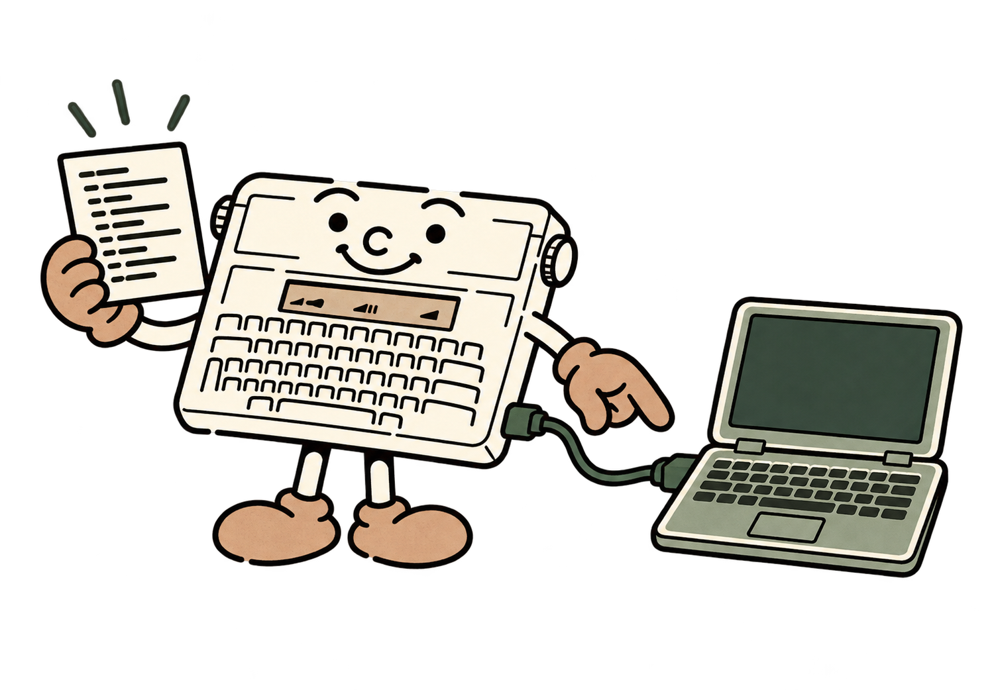
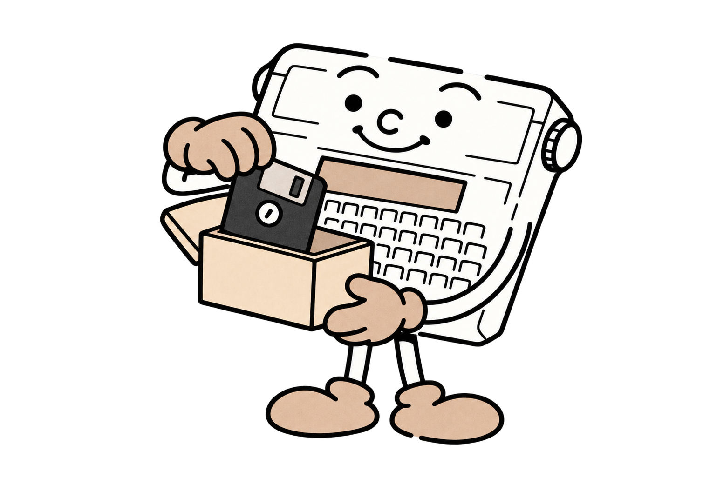

# 9 - Faire du bruit et échanger des informations

Un signal bref peut annoncer une bonne réponse. Une liaison série peut conserver un programme sur votre PC ou envoyer une information à un autre appareil. Ces fonctions ajoutent de nouvelles possibilités sans changer la façon d'écrire vos lignes BASIC.

<a id="beep"></a>
<a id="sound"></a>
## BEEP et SOUND : un signal, un bruitage ou une pause


`BEEP` joue un bip d'environ 100 millisecondes. Vous pouvez préciser sa durée, de **0 à 2000 millisecondes** : `BEEP 200` joue un signal de deux dixièmes de seconde.

`SOUND modulation,duree` module le buzzer pendant la durée demandée. La modulation est un entier de **60 à 750 hertz**, la durée un entier de **0 à 2000 millisecondes**. La valeur spéciale zéro donne une pause silencieuse :

```basic
10 SOUND 300,100
20 SOUND 0,50
30 SOUND 450,150
```

Le programme joue un petit signal en deux parties. `SOUND 0,1000` attend environ une seconde sans produire de son ; c'est aussi un moyen simple de laisser lire un message. Pour attendre plus de deux secondes, enchaînez plusieurs pauses ou utilisez une boucle.

Pendant BEEP et SOUND, le programme attend la fin du signal ou de la pause. Ces instructions sont **bloquantes** et peuvent être interrompues par BREAK. Les durées sont nominales, adaptées au rythme des messages et des bruitages.

Le nombre de SOUND choisit la **modulation d’amplitude**. Le firmware ouvre et ferme la porte du buzzer, qui conserve sa fréquence sonore propre et son niveau matériel. Les sons brefs et les bruitages exploitent particulièrement bien ce mécanisme.

## Conserver le programme sur un ordinateur



La sauvegarde série copie **le programme** dans un fichier sur le PC ; les variables sont recréées à l’exécution. Utilisez le câble prévu pour la Typestar : il adapte l’USB aux signaux **TTL de 5 V** et au brochage propre de son connecteur DE-9.

Ouvrez **Typestar BASIC Studio** en lançant le fichier **Typestar BASIC Studio.pyw**. Au bas de la fenêtre, choisissez le port correspondant au câble : son nom et sa description permettent de repérer l'adaptateur FTDI. Si vous venez de brancher le câble, cliquez sur **Actualiser**. Les noms de ports diffèrent selon Windows, Linux ou macOS ; choisissez celui proposé pour votre adaptateur.

Les réglages doivent être identiques dans Studio et sur la machine. Au démarrage du BASIC, ils sont **31250 bauds, 7E1** : sélectionnez **Baud 31250**, **parité E** et **Stop 1** dans Studio. Les sept bits de données sont déjà prévus par le logiciel. Si vous avez changé les réglages de la Canon, remettez les mêmes valeurs des deux côtés avant le transfert.




<a id="save"></a>
<a id="load"></a>
### SAVE : envoyer, LOAD : recevoir

**Sauvegarder de la Canon vers le PC :**

1. Dans Studio, cliquez sur **Recevoir ← SAVE**. Vous pouvez aussi choisir **Programme > Recevoir de la Canon (SAVE)…**.
2. Donnez un nom au fichier de sauvegarde, par exemple `mon-jeu.bas`, et choisissez où le conserver.
3. Lorsque Studio vous le demande, tapez `SAVE` puis appuyez sur Return sur la Canon.
4. Attendez la confirmation de réception dans Studio. Le fichier est écrit après la réception complète ; vous pouvez ensuite l'ouvrir dans l'éditeur.

**Charger du PC vers la Canon :**

1. Ouvrez votre fichier `.bas` dans Studio, ou écrivez un petit programme dans son éditeur. Ce sont les lignes actuellement présentes dans l'éditeur qui seront envoyées.
2. Cliquez sur **Envoyer → LOAD**, ou choisissez **Programme > Envoyer à la Canon (LOAD)…**. Confirmez le remplacement du programme de la machine.
3. Lorsque Studio vous le demande, tapez `LOAD` puis appuyez sur Return sur la Canon. Le message LOADING indique que la réception est en cours.
4. Attendez la confirmation du transfert dans Studio. Tapez ensuite `LIST` pour relire le programme ou `RUN` pour le lancer.

**LOAD remplace le programme présent sur la Canon.** Sauvegardez-le avec Recevoir ← SAVE avant de charger un autre jeu. Retenez les deux directions : **LOAD fait entrer le programme dans la Canon ; SAVE le fait sortir vers le PC**.

LOAD et SAVE s’utilisent **depuis la console**. Une interruption du chargement peut laisser un programme partiel : réglez la cause du problème, recommencez le transfert complet, puis vérifiez avec LIST et RUN. La copie sauvegardée sur le PC permet de retrouver votre ancien programme.

Les fichiers restent en UTF-8 sur le PC. Studio convertit les accents reconnus pour le LCD et les reconstitue à la réception. Ses boutons de transfert réunissent toutes les étapes nécessaires.

**Pour dépanner un transfert**, vérifiez le port choisi, le câble, la commande LOAD ou SAVE demandée et les réglages des deux côtés. Attendez le message de Studio avant de valider sur la Canon. Après une interruption, utilisez Annuler si le transfert reste actif dans Studio, retrouvez la console avec BREAK, puis recommencez l’opération complète.

<a id="baud"></a>
<a id="sercfg"></a>
## BAUD et SERCFG : régler la conversation

```basic
BAUD 31250
SERCFG 7E1
```

BAUD choisit le débit parmi **1200, 2400, 7812, 15625 et 31250**. Le chiffre 7812 désigne le réglage correspondant du matériel ; sélectionnez le même choix côté PC.

SERCFG choisit le format des caractères, **sans guillemets**. Le premier chiffre est toujours 7 : sept bits de données. N signifie sans parité, E parité paire et O parité impaire. Le dernier chiffre donne un ou deux bits de stop. Les six formats sont **7N1, 7N2, 7E1, 7E2, 7O1 et 7O2**.

La parité ajoute une petite vérification à chaque caractère ; le matériel s’en charge. **Choisissez le même format des deux côtés**, par exemple 7E1, pour assurer le dialogue.

BAUD et SERCFG s'appliquent aux transferts de programme, au mode graphique PC et aux sessions série. Fermez une session avec SERCLOSE avant de changer ces réglages. Vous pouvez revenir à `BAUD 1200` pour dialoguer avec un appareil plus ancien qui accepte ce débit.

<a id="seropen"></a>
<a id="serout"></a>
<a id="serin"></a>
<a id="serclose"></a>
## SEROPEN, SEROUT, SERIN et SERCLOSE : parler depuis un programme

`SEROPEN debit` ouvre une session au débit indiqué, avec le format sélectionné par SERCFG. `SEROUT code` envoie un code de **0 à 127**. `SERIN(0)` lit sans attendre : elle donne un code de 0 à 127 si un caractère est arrivé, ou **-1** dans l’attente d’un caractère. SERCLOSE termine l'émission et ferme la session.

Pour SERIN, **zéro est une donnée série valide** ; **-1 indique l’attente d’une donnée**. L’argument de SERIN est toujours zéro.

Voici un programme d'écho : il attend un caractère envoyé par le PC, puis lui renvoie le même code.

```basic
10 SERCFG 7E1
20 SEROPEN 31250
30 A=SERIN(0)
40 IF A=-1 THEN 30
50 SEROUT A
60 SERCLOSE
70 END
```

Pour l’essayer, ouvrez le câble côté PC avec les mêmes réglages et envoyez un caractère brut. Le programme échange directement des codes, avec son propre dialogue.

Organisez un échange **un caractère, une réponse** : le programme choisit quand il écoute et comment il répond. Ce rythme convient à la petite réserve de réception, notamment pendant les calculs ou l’impression. Le câble assure les signaux nécessaires au dialogue.

Écrivez **SERCLOSE avant END**, puis fermez la session avant LOAD, SAVE, une nouvelle SEROPEN ou un changement de réglages. Une erreur ou BREAK ferme aussi la liaison. Ces fonctions constituent une base pour un clavier distant ou un terminal simple ; votre programme construit ensuite le protocole souhaité.

**À essayer : le clavier distant.** Le dossier `examples/remote-keyboard/` fournit le programme BASIC et son correspondant Python, avec une notice bilingue. Chargez le programme avec Studio, lancez le script sur le PC, puis tapez RUN sur la Canon. Le mode moniteur montre les codes des touches ; l'option `--type` les transforme en frappes dans la fenêtre choisie. Lettres, accents reconnus, Entrée, Retour arrière et navigation passent ainsi par la liaison série à 31250/7E1.

## Imprimer une image depuis le PC

Depuis la console BASIC, **CODE + P** ouvre le mode imprimante graphique série. Ce raccourci est réservé à l’usage direct. Studio prépare et envoie l’image monochrome avec le protocole adapté.

Ce mode peut utiliser la mémoire du programme pour son tampon : **le premier bloc d’impression validé peut provoquer NEW**. CODE+P ouvre d’abord une attente. Sauvegardez votre programme avant l’envoi et fermez une éventuelle session SEROPEN.

<a id="peek"></a>
<a id="poke"></a>
## PEEK et POKE : regarder sous le capot

Ces deux outils s'adressent aux lecteurs qui commencent à explorer la mémoire et les périphériques. `PEEK(adresse)` lit un octet. `POKE adresse,valeur` écrit un octet. L'adresse est un entier de **0 à 65535** ; la valeur écrite est un entier de **0 à 255**.

```basic
PRINT PEEK(&H4000)
```

Cet exemple lit le premier octet de la zone CPU où se trouve la ROM externe. Le résultat dépend du firmware. PEEK emploie les adresses du processeur ; le fichier ROM range, lui, les octets de l’image.

POKE écrit directement dans la mémoire ou les registres du matériel. Réservez-le aux adresses dont vous connaissez le rôle et gardez une sauvegarde avant l’exploration : une écriture erronée peut modifier le programme ou déclencher une action. Les commandes BASIC dédiées simplifient les dessins, les sons et les déplacements ordinaires.

**Et pour lire une cartouche ?** PEEK observe la mémoire actuellement visible du processeur. L'accès à une cartouche demande aussi de choisir sa banque, puis de rétablir la mémoire normale : certaines fenêtres partagent leurs adresses avec le programme BASIC lui-même. Un futur lecteur de cartouches devra effectuer cette courte opération dans une routine toujours accessible, puis confier les octets à un programme BASIC et à son correspondant série sur PC.
