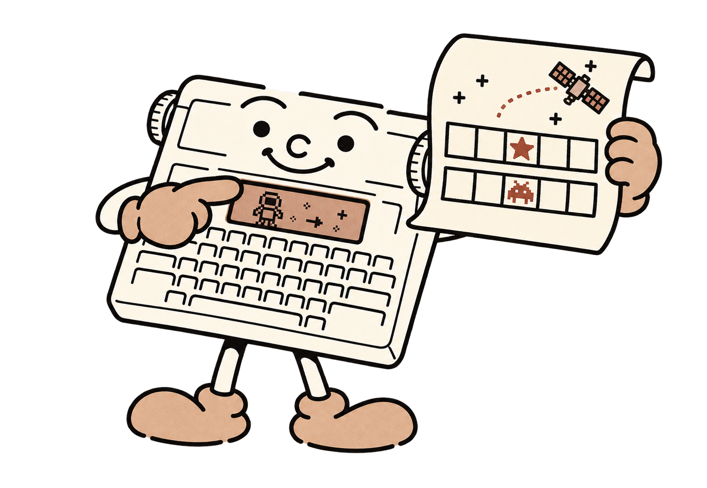
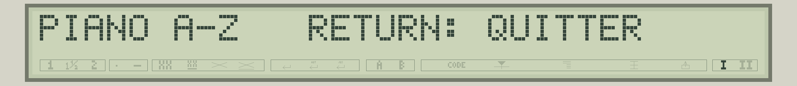
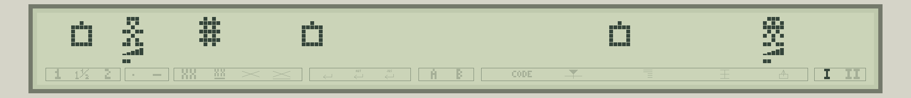
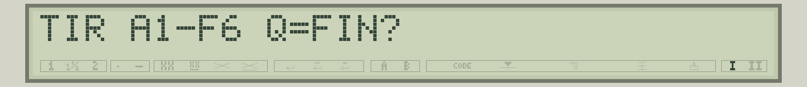
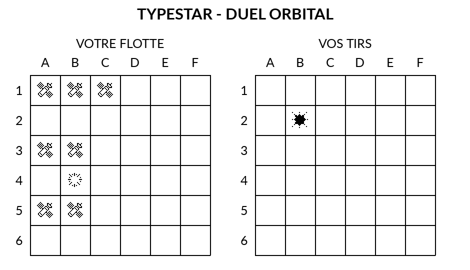
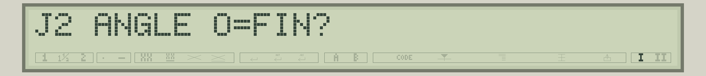
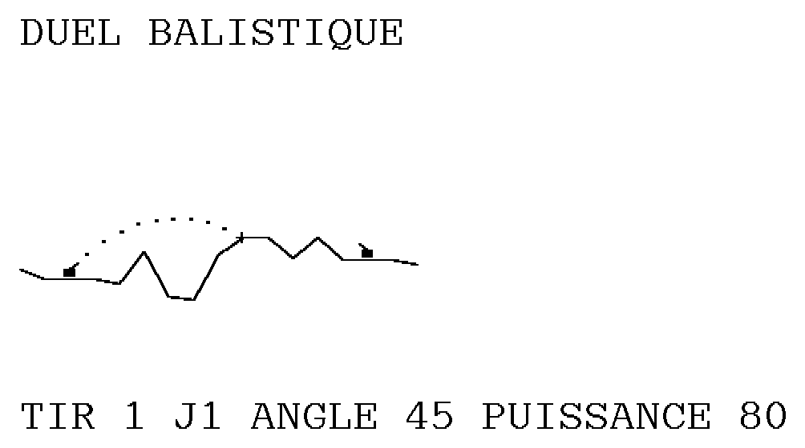

# 11 - Des programmes complets à essayer

Voici quatre programmes de la sélection Typestar BASIC : un instrument sonore, un jeu sur LCD et deux jeux sur papier. Ouvrez le fichier indiqué dans **Typestar BASIC Studio**, puis utilisez **Exécuter (F5)** dans l’émulateur ou **Envoyer → LOAD** pour la Canon. Les listings ci-dessous sont les sources complets des fichiers fournis.



**Un seul programme tient en mémoire à la fois.** Sauvegardez votre travail avant de charger un jeu. Pour les jeux imprimés, utilisez de préférence du **papier thermique** et laissez les moteurs positionner la feuille pendant la partie. Les anciens rubans de transfert seraient rapidement consommés.

## Piano

Un petit instrument sonore commandé par les lettres du clavier. Ce programme court est un bon point de départ pour lire un listing complet. Les valeurs de DATA attribuent une modulation à chaque lettre ; le buzzer reste un générateur de bruitages, et non un instrument à hauteur musicale précise.

**Pour jouer :** appuyez sur les lettres **A à Z**. **Return** termine le programme. Essayez quelques touches, puis changez une valeur de DATA pour comparer les sons.



**À observer dans le programme :** DIM réserve un tableau, READ le remplit, INKEY lit le clavier et SOUND produit le son.

**Fichier à ouvrir dans Studio :** [piano-fr.bas](../../examples/piano-fr.bas).

```basic
10 DIM F(25)
20 DATA 131,524,466,262,147,277,294,311,196,330,349
30 DATA 370,392,555,207,220,233,155,247,165,185,494
40 DATA 415,440,174,138
50 FOR I=0 TO 25:READ F(I):NEXT I
60 CLS:CURSOR 4
70 PRINT "PIANO A-Z   RETURN: QUITTER";
80 C=INKEY(0):IF C=0 THEN 80
90 IF C=13 THEN 140
100 C=C AND 223
110 IF C<65 THEN 80
120 IF C>90 THEN 80
130 SOUND F(C-65),80:GOTO 80
140 CLS:PRINT "FIN DU PIANO":END
```

## Pocket Duel

Deux personnages s’affrontent dans une arène de trente-deux cases. Le bord gauche rejoint le bord droit. Des mines et des grilles compliquent les déplacements ; les petits triangles montrent la vie et la ligne inférieure indique la charge disponible. Ce jeu utilise uniquement le LCD et le buzzer.

**Commandes :** flèches gauche/droite pour bouger ; **A en minuscule** pour attaquer un voisin ; **Espace** pour se téléporter ; **Return** pour terminer. Attaque et téléportation demandent une charge pleine. L’adversaire agit après votre action. La version anglaise est également fournie dans les exemples de Studio.



**À observer dans le programme :** LCDCHAR définit les personnages, LOCATE évite de redessiner tout l’écran, LCDTRI et LCDLINE montrent les jauges ; INKEY, les conditions et les sous-programmes organisent le jeu.

**Fichier à ouvrir dans Studio :** [pocket-duel-fr.bas](../../examples/pocket-duel-fr.bas).

```basic
10 DIM T(5)
20 DATA 0,16,24,28,30,31
30 FOR I=0 TO 5:READ T(I):NEXT I
40 CLS:CURSOR 4:PRINT "POCKET DUEL 1.0";
50 SOUND 0,300
60 CLS:PRINT "Flèches: bouger";
70 SOUND 0,450
80 CLS:PRINT "A: ATTAQUE  ESPACE: TELEPORT";
90 SOUND 0,550
100 CLS:PRINT CHR$(192);" MINE  ";CHR$(172);" GRILLE";
110 SOUND 0,550
120 CLS:CURSOR 4
130 LCDCHAR 1,14,10,4,27,4,10,27,0
140 LOCATE 1,3:PRINT "= VOUS";
150 LCDCHAR 17,14,21,31,10,21,4,27,0
160 LOCATE 1,19:PRINT "= ENNEMI";
170 SOUND 0,900
180 CLS:PRINT "APPUYEZ POUR JOUER";
190 R=1
200 K=INKEY(0)
210 IF K<>0 THEN 250
220 R=R+1:IF R>60000 THEN R=1
230 GOTO 200
250 RANDOMIZE R
260 H=5:M=5:C=2:B=2:P=4:E=29
270 U=0:V=0:W=0:Y=0:Q=0:S=0
280 G=0:J=0:L=0:O=0
290 CLS:CURSOR 4:GOSUB 8000:GOSUB 8100
295 GOSUB 6100:GOSUB 6100:GOSUB 6100:GOSUB 6200

300 K=INKEY(0):IF K=0 THEN 300
310 IF K=13 THEN 9900
320 IF K=18 THEN 400
330 IF K=19 THEN 460
340 IF K=97 THEN 500
350 IF K=32 THEN 600
360 GOTO 300

400 N=P-1:IF N=0 THEN N=32
410 IF N=E THEN GOSUB 8800:GOTO 300
420 GOSUB 7600
425 IF Z=1 THEN GOSUB 8800:GOSUB 5000:GOTO 300
430 X=P:GOSUB 8300:P=N:C=C+1
435 IF C>5 THEN C=5
440 GOSUB 8500:IF H<1 THEN 9700
450 GOSUB 8000:GOSUB 5000:GOTO 300

460 N=P+1:IF N=33 THEN N=1
470 IF N=E THEN GOSUB 8800:GOTO 300
480 GOSUB 7600
485 IF Z=1 THEN GOSUB 8800:GOSUB 5000:GOTO 300
490 X=P:GOSUB 8300:P=N:C=C+1
492 IF C>5 THEN C=5
495 GOSUB 8500:IF H<1 THEN 9700
497 GOSUB 8000:GOSUB 5000:GOTO 300

500 IF C<5 THEN GOSUB 8810:GOTO 300
510 D=ABS(E-P)
520 IF D<>1 AND D<>31 THEN GOSUB 8810:GOTO 300
530 C=0:LCDLINE P,0:M=M-1
540 X=E:GOSUB 8400:SOUND 140,55
550 K=1+INT(RND(1)*3):GOSUB 9100
560 IF M<1 THEN 9600
570 GOSUB 5000:GOTO 300

600 IF C<5 THEN GOSUB 8810:GOTO 300
610 C=0:X=P:GOSUB 8400
620 GOSUB 7800
630 IF N=0 THEN GOSUB 8810:GOTO 300
640 P=N:X=P:GOSUB 8400
650 SOUND 350,45:SOUND 700,45
660 GOSUB 8500:IF H<1 THEN 9700
670 GOSUB 8000:GOSUB 5000:GOTO 300

5000 D=ABS(E-P)
5010 IF D=1 OR D=31 THEN 5200
5020 GOSUB 7000
5030 GOSUB 7500
5040 IF Z=1 THEN 5400
5050 GOSUB 7600
5060 IF Z=1 THEN 5400
5070 X=E:GOSUB 8300:E=N:B=B+1
5075 IF B>5 THEN B=5
5080 GOSUB 8100:GOTO 5900

5200 IF B<5 THEN 5300
5210 B=0:LCDLINE E,0:H=H-1
5220 X=P:GOSUB 8400:SOUND 120,55
5230 K=1+INT(RND(1)*3):GOSUB 9000
5240 IF H<1 THEN 9700
5250 GOTO 5900

5300 GOSUB 7000:GOSUB 7100
5310 GOSUB 7500:IF Z=1 THEN 5350
5320 GOSUB 7600:IF Z=1 THEN 5350
5330 X=E:GOSUB 8300:E=N:B=B+1
5335 IF B>5 THEN B=5
5340 GOSUB 8100:GOTO 5900
5350 B=B+1:IF B>5 THEN B=5
5360 GOTO 5900

5400 GOSUB 7100
5410 GOSUB 7500:IF Z=1 THEN 5450
5420 GOSUB 7600:IF Z=1 THEN 5450
5430 X=E:GOSUB 8300:E=N:B=B+1
5435 IF B>5 THEN B=5
5440 GOSUB 8100:GOTO 5900
5450 IF B<5 THEN 5900
5460 B=0:X=E:GOSUB 8400:GOSUB 7900
5470 IF N=0 THEN 5900
5480 E=N:X=E:GOSUB 8400:GOSUB 8100

5900 GOSUB 6000:RETURN

6000 GOSUB 6300:GOSUB 6400
6010 IF RND(1)<.7 THEN GOSUB 6100
6020 IF RND(1)<.45 THEN GOSUB 6200
6030 RETURN

6100 F=0:IF U=0 THEN F=1
6110 IF F=0 AND W=0 THEN F=2
6120 IF F=0 AND Q=0 THEN F=3
6130 IF F=0 THEN RETURN
6140 A=0:GOSUB 6800:IF N=0 THEN RETURN
6150 LOCATE 1,N:PRINT CHR$(192);
6160 D=4+INT(RND(1)*2)
6170 IF F=1 THEN U=N:V=D
6180 IF F=2 THEN W=N:Y=D
6190 IF F=3 THEN Q=N:S=D
6195 RETURN

6200 F=0:IF G=0 THEN F=1
6210 IF F=0 AND L=0 THEN F=2
6220 IF F=0 THEN RETURN
6230 A=1:GOSUB 6800:IF N=0 THEN RETURN
6240 LOCATE 1,N:PRINT CHR$(172);
6250 D=4+INT(RND(1)*2)
6260 IF F=1 THEN G=N:J=D ELSE L=N:O=D
6270 RETURN

6300 IF U>0 THEN V=V-1
6310 IF U>0 AND V=0 THEN LOCATE 1,U:PRINT " ";:U=0
6320 IF W>0 THEN Y=Y-1
6330 IF W>0 AND Y=0 THEN LOCATE 1,W:PRINT " ";:W=0
6340 IF Q>0 THEN S=S-1
6350 IF Q>0 AND S=0 THEN LOCATE 1,Q:PRINT " ";:Q=0
6360 IF G>0 THEN J=J-1
6370 IF G>0 AND J=0 THEN LOCATE 1,G:PRINT " ";:G=0
6380 IF L>0 THEN O=O-1
6390 IF L>0 AND O=0 THEN LOCATE 1,L:PRINT " ";:L=0
6395 RETURN

6400 IF G=0 THEN 6450
6410 IF RND(1)>=.55 THEN 6450
6420 X=G:GOSUB 6600
6430 IF N=G THEN 6450
6440 LOCATE 1,G:PRINT " ";:G=N
6445 LOCATE 1,G:PRINT CHR$(172);
6450 IF L=0 THEN RETURN
6460 IF RND(1)>=.55 THEN RETURN
6470 X=L:GOSUB 6600
6480 IF N=L THEN RETURN
6490 LOCATE 1,L:PRINT " ";:L=N
6492 LOCATE 1,L:PRINT CHR$(172);
6495 RETURN

6600 D=1:IF RND(1)<.5 THEN D=-1
6610 N=X+D:IF N=0 THEN N=32
6620 IF N=33 THEN N=1
6630 GOSUB 6700:IF Z=0 THEN RETURN
6640 N=X-D:IF N=0 THEN N=32
6650 IF N=33 THEN N=1
6660 GOSUB 6700:IF Z=0 THEN RETURN
6670 N=X:RETURN

6700 Z=0
6710 IF N=P OR N=E THEN Z=1
6720 IF N=U OR N=W OR N=Q THEN Z=1
6730 IF N=G OR N=L THEN Z=1
6740 RETURN

6800 D=0
6810 D=D+1:IF D>12 THEN N=0:RETURN
6820 N=1+INT(RND(1)*32)
6830 IF N=P OR N=E THEN 6810
6840 IF N=U OR N=W OR N=Q THEN 6810
6850 IF N=G OR N=L THEN 6810
6860 IF A=0 THEN RETURN
6870 Z=ABS(N-P):IF Z=1 OR Z=31 THEN 6810
6880 Z=ABS(N-E):IF Z=1 OR Z=31 THEN 6810
6890 RETURN

7000 A=P-E:IF A<0 THEN A=A+32
7010 F=E-P:IF F<0 THEN F=F+32
7020 IF A<=F THEN D=1 ELSE D=-1
7030 N=E+D:IF N=33 THEN N=1
7040 IF N=0 THEN N=32
7050 RETURN

7100 N=E-D
7110 IF N=33 THEN N=1
7120 IF N=0 THEN N=32
7130 RETURN

7500 Z=0
7510 IF N=U OR N=W OR N=Q THEN Z=1
7520 RETURN

7600 Z=0
7610 IF N=G OR N=L THEN Z=1
7620 RETURN

7700 Z=0
7710 IF N=G THEN G=0:J=0:Z=1
7720 IF N=L THEN L=0:O=0:Z=1
7730 IF Z=0 THEN RETURN
7740 LOCATE 1,N:PRINT " ";:SOUND 260,30
7750 RETURN

7800 A=0
7810 A=A+1:IF A>12 THEN N=0:RETURN
7820 N=1+INT(RND(1)*32)
7830 IF N=P OR N=E OR N=G OR N=L THEN 7810
7840 RETURN

7900 A=0
7910 A=A+1:IF A>12 THEN N=0:RETURN
7920 N=1+INT(RND(1)*32)
7930 IF N=P OR N=E OR N=U OR N=W OR N=Q THEN 7910
7940 IF N=G OR N=L THEN 7910
7950 RETURN

8000 LCDCHAR P,14,10,4,27,4,10,27,0
8010 LCDTRI P,T(H):LCDLINE P,T(C)
8020 RETURN

8100 LCDCHAR E,14,21,31,10,21,4,27,0
8110 LCDTRI E,T(M):LCDLINE E,T(B)
8120 RETURN

8300 LCDLINE X,0
8310 LOCATE 1,X:PRINT " ";
8320 RETURN

8400 GOSUB 8300
8410 LCDCHAR X,17,4,10,21,10,4,17,0
8420 SOUND 0,55
8430 GOSUB 8300
8440 RETURN

8500 F=0
8510 IF P=U THEN U=0:V=0:F=1
8520 IF P=W THEN W=0:Y=0:F=1
8530 IF P=Q THEN Q=0:S=0:F=1
8540 IF F=0 THEN RETURN
8550 H=H-1:X=P:GOSUB 8400
8560 SOUND 80,60:RETURN

8600 F=0
8610 IF E=U THEN U=0:V=0:F=1
8620 IF E=W THEN W=0:Y=0:F=1
8630 IF E=Q THEN Q=0:S=0:F=1
8640 IF F=0 THEN RETURN
8650 M=M-1:X=E:GOSUB 8400
8660 SOUND 80,60:RETURN

8800 SOUND 60,40:RETURN
8810 SOUND 180,75:SOUND 90,75:RETURN

9000 GOSUB 7200:A=0
9010 IF A>=K THEN GOSUB 8000:RETURN
9020 N=P+D
9030 IF N=33 THEN N=1
9040 IF N=0 THEN N=32
9050 GOSUB 7700
9060 P=N:A=A+1:GOSUB 8500
9070 IF F=1 OR H<1 THEN GOSUB 8000:RETURN
9080 GOTO 9010

9100 GOSUB 7300:A=0
9110 IF A>=K THEN GOSUB 8100:RETURN
9120 N=E+D
9130 IF N=33 THEN N=1
9140 IF N=0 THEN N=32
9150 GOSUB 7700
9160 E=N:A=A+1:GOSUB 8600
9170 IF F=1 OR M<1 THEN GOSUB 8100:RETURN
9180 GOTO 9110

7200 A=P-E:IF A<0 THEN A=A+32
7210 F=E-P:IF F<0 THEN F=F+32
7220 IF A<=F THEN D=1 ELSE D=-1
7230 RETURN

7300 A=E-P:IF A<0 THEN A=A+32
7310 F=P-E:IF F<0 THEN F=F+32
7320 IF A<=F THEN D=1 ELSE D=-1
7330 RETURN

9600 SOUND 440,50:SOUND 560,50:SOUND 700,150
9610 CLS:PRINT "VICTOIRE !";
9620 END

9700 SOUND 300,70:SOUND 180,90:SOUND 70,180
9710 CLS:PRINT "DEFAITE...";
9720 END

9900 CLS:PRINT "FIN DE PARTIE";
9910 END
```

## Duel Orbital

Une bataille spatiale inspirée de la bataille navale. Vous commandez trois formations de satellites, de trois, deux et deux cases, sur une grille de six cases de côté. La Canon possède la même flotte ; le premier à toucher les sept cases adverses gagne. Vos satellites et les tirs restent visibles sur le papier.

**Pour jouer :** Return à l’accueil ; saisissez une case de départ comme **A1**, puis **H** pour placer la formation vers la droite ou **V** vers le bas. Pendant la partie, entrez votre tir de **A1 à F6**, ou **Q** pour terminer. La grille de gauche contient vos satellites ; celle de droite conserve vos tirs. Laissez le programme positionner le papier.





**À observer dans le programme :** LINE construit les grilles ; GLYPH imprime satellites, tirs et explosions ; tableaux, hasard et tests logiques gèrent les positions et les décisions adverses.

**Fichier à ouvrir dans Studio :** [duel-orbital-fr.bas](../../examples/duel-orbital-fr.bas).

```basic
10 REM TYPESTAR - DUEL ORBITAL 1.5
20 CLS:CURSOR 4:PRINT "DUEL ORBITAL - ENTREE";:G=1
30 G=G+1:IF G>60000 THEN G=1
40 IF INKEY(0)<>13 THEN 30
50 RANDOMIZE G:DIM B(1,35):DIM C(35):DIM H(1,3)
60 V=1:FOR S=1 TO 3
70 P=INT(RND(1)*36):D=INT(RND(1)*2):GOSUB 600
80 IF F=1 THEN 70
90 GOSUB 660:NEXT S
100 GOSUB 1200:V=0:P=0:D=0
110 FOR S=1 TO 3
120 GOSUB 800
170 GOSUB 600:IF F=0 THEN 190
180 CLS:PRINT "BORD OU SATELLITE DEJA PRESENT";
182 SOUND 120,80:GOSUB 900:GOTO 120
190 GOSUB 660:FOR I=0 TO L-1:J=P+I*U
200 GOSUB 1400:GLYPH Z(0),16,16,3:B=K+56:C=G
210 NEXT I:GOSUB 1600:NEXT S
220 A=0:E=0:N=0
230 INPUT "TIR A1-F6 Q=FIN";A$
240 IF A$="Q" OR A$="q" THEN 400
250 IF LEN(A$)<>2 THEN 380
260 X=ASC(LEFT$(A$,1)):IF X>96 THEN X=X-32
270 X=X-65:Y=ASC(RIGHT$(A$,1))-49
280 IF X<0 OR X>5 OR Y<0 OR Y>5 THEN 380
290 J=6*Y+X:IF B(1,J)>3 THEN 390
300 N=N+1:V=1:GOSUB 700
310 CLS:PRINT "VOUS : ";R$;" ";A;"/7";
320 IF A=7 THEN 400
330 GOSUB 1000:V=0:GOSUB 700
340 CLS:PRINT "CANON ";CHR$(65+X);Y+1;" ";R$;" ";E;"/7";
350 IF E=7 THEN 400
360 GOTO 230
380 CLS:PRINT "Saisir A1 a F6, ou Q";:GOSUB 900:GOTO 230
390 CLS:PRINT "Deja vise : tir conserve";:GOSUB 900:GOTO 230
400 R$="ABANDON":IF A=7 THEN R$="VICTOIRE !"
410 IF E=7 THEN R$="LA CANON GAGNE"
420 FOR J=0 TO 35
430 IF B(1,J)=0 OR B(1,J)>3 THEN 450
440 V=1:GOSUB 1400:GLYPH Z(0),16,16,3:B=K+56:C=G
450 NEXT J
460 G=0:K=616:GOSUB 1500:LPRINT R$;" - ";N;" TOURS"
470 B=672:C=0:GOSUB 1600:CLS:PRINT R$;" ";A;"-";E;
480 SOUND 440,100:SOUND 700,150:END
600 L=2:IF S=1 THEN L=3
610 X=P MOD 6:Y=INT(P/6):U=1+5*D:F=0
620 IF D=0 AND X+L>6 THEN F=1:RETURN
630 IF D=1 AND Y+L>6 THEN F=1:RETURN
640 FOR I=0 TO L-1:IF B(V,P+I*U)<>0 THEN F=1
650 NEXT I:RETURN
660 FOR I=0 TO L-1:B(V,P+I*U)=S:NEXT I:RETURN
700 S=B(V,J):B(V,J)=S+4:R$="VIDE"
702 IF V=0 THEN C(J)=1
704 IF S=0 THEN 740
710 R$="TOUCHE":H(V,S)=H(V,S)+1
712 IF V=0 THEN E=E+1:C(J)=2
714 IF V=1 THEN A=A+1
720 L=2:IF S=1 THEN L=3
724 IF H(V,S)<>L THEN 740
726 R$="DETRUIT":IF V=1 THEN 740
730 FOR I=0 TO 35:IF B(0,I)=S+4 THEN C(I)=3
732 NEXT I
740 X=J MOD 6:Y=INT(J/6)
750 GOSUB 1400:T=32:IF S=0 THEN T=16
752 GLYPH Z(T),16,16,3:B=K+56:C=G
760 IF V=0 THEN GOSUB 1600
762 SOUND 300+300*(S<>0)*-1,80:RETURN
800 L=2:IF S=1 THEN L=3
805 CLS:PRINT L;" CASES - DEPART A1-F6";
810 INPUT "CASE";A$:IF LEN(A$)<>2 THEN 800
815 X=ASC(LEFT$(A$,1)):IF X>96 THEN X=X-32
820 X=X-65:Y=ASC(RIGHT$(A$,1))-49
825 IF X<0 OR X>5 OR Y<0 OR Y>5 THEN 800
830 P=6*Y+X:INPUT "HORIZ H / VERT V";A$
835 D=0:IF A$="H" OR A$="h" THEN RETURN
840 D=1:IF A$="V" OR A$="v" THEN RETURN
845 GOTO 830
900 IF INKEY(0)<>0 THEN 900
910 K=INKEY(0):IF K=0 THEN 910
920 RETURN
1000 T=INT(RND(1)*36)
1010 IF C(T)<>0 THEN T=(T+1) MOD 36:GOTO 1010
1020 W=0:FOR I=0 TO 35
1030 IF C(I)<>2 THEN 1090
1040 FOR D=0 TO 3:U=1
1042 IF D=1 THEN U=-1
1044 IF D=2 THEN U=6
1046 IF D=3 THEN U=-6
1050 J=I+U:GOSUB 1100:IF F=1 THEN 1080
1052 IF C(J)<>0 THEN 1080
1054 Z=J:Q=2+RND(1):J=I-U:GOSUB 1100
1060 IF F=1 THEN 1070
1062 IF C(J)=2 THEN Q=Q+2
1070 IF Q>W THEN W=Q:T=Z
1080 NEXT D
1090 NEXT I:J=T:RETURN
1100 F=0:IF J<0 OR J>35 THEN F=1:RETURN
1110 IF ABS((J MOD 6)-(I MOD 6))>1 THEN F=1
1120 RETURN
1200 LSPACING 1:B=0:C=0:DIM Z(47)
1210 FOR I=0 TO 47:READ Z(I):NEXT I
1230 LPRINT "TYPESTAR - DUEL ORBITAL":B=56
1240 FOR V=0 TO 1:G=16+144*V:K=168:GOSUB 1500:F=0
1245 FOR T=0 TO 7:R=31:IF T=7 THEN R=16
1250 DRAW DEFERRED
1252 LINE 0,0,0,R,1:LINE 40,0,40,R,1
1254 LINE 80,0,80,R,1:LINE 120,0,120,R,1
1256 LINE 160,0,160,R,1:LINE 200,0,200,R,1
1258 LINE 240,0,240,R,1
1260 IF F<=R THEN LINE 0,F,240,F,1:F=F+40
1265 DRAW PRINT:F=F-32:B=B+56:NEXT T
1270 C=G:NEXT V
1280 FOR V=0 TO 1:FOR X=0 TO 5
1290 G=18+144*V+20*X:K=112:GOSUB 1500
1300 LPRINT CHR$(65+X);:C=G+16:NEXT X
1310 FOR Y=0 TO 5:G=144*V:K=182+70*Y:GOSUB 1500
1320 LPRINT Y+1;:C=G+16:NEXT Y:NEXT V
1330 GOSUB 1600:RETURN
1400 G=18+144*V+20*(J MOD 6):K=175+70*INT(J/6)
1410 GOSUB 1500:RETURN
1500 F=G-C:IF F=0 THEN 1540
1510 IF ABS(F)>128 THEN F=SGN(F)*128
1520 IF F<0 THEN ORIGIN 128,0 ELSE ORIGIN
1530 HEAD F:C=C+F:GOTO 1500
1540 F=K-B:IF F=0 THEN 1580
1550 IF ABS(F)>448 THEN F=SGN(F)*448
1560 IF F<0 THEN ORIGIN 0,448 ELSE ORIGIN
1570 FEED F:B=B+F:GOTO 1540
1580 ORIGIN:RETURN
1600 G=0:K=1428:GOSUB 1500:RETURN
1700 DATA &H1000,&H2832,&H542C,&HAA24,&H54D2,&H292E
1706 DATA &H1690,&H0450,&H0820,&H1048,&H20D4,&H512A
1712 DATA &H4A55,&H242A,&H1814,&H0008
1720 DATA &H0000,&H0100,&H2548,&H1110,&H0820,&H2004
1726 DATA &H0000,&H700E,&H0000,&H2004,&H0820,&H1010
1732 DATA &H2108,&H0540,&H0100,&H0000
1740 DATA &H8102,&H0000,&H2108,&H1BB0,&H1FF0,&H0FF0
1746 DATA &H1FF8,&HBFFD,&H1FF8,&H0FF0,&H1FF0,&H1FF0
1752 DATA &H2388,&H0100,&H8002,&H0100
```

## Duel Balistique

Deux canons se font face sur un relief imprimé une seule fois. Choisissez l’angle et la puissance : la trajectoire apparaît en pointillés et les impacts s’accumulent. Le terrain reste fixe et l’historique des valeurs jouées est imprimé sous l’arène. Vous pouvez affronter la Canon ou jouer à deux.

**Pour jouer :** entrez une graine de **1 à 9999**, puis **1** pour la Canon ou **2** pour deux joueurs. Choisissez l’angle demandé et une puissance de **20 à 100**. Un angle nul termine la partie. Gardez la même graine pour rejouer sur le même relief ; sauvegardez votre programme avant de charger ce jeu.





**À observer dans le programme :** RANDOMIZE et RND préparent le terrain ; une table de sinus et des additions successives accélèrent les trajectoires ; BOX, LINE, DRAW et les moteurs composent le dessin.

**Fichier à ouvrir dans Studio :** [duel-balistique-fr.bas](../../examples/duel-balistique-fr.bas).

```basic
10 REM DUEL BALISTIQUE 0.6 - TERRAIN FIXE X2
20 CLS:CURSOR 4:INPUT "GRAINE 1-9999";G
25 IF G<1 OR G>9999 THEN 20
30 RANDOMIZE G:DIM H(16):DIM B(1):DIM L(1)
31 DIM X(11):DIM Y(9)
32 DIM T(18):FOR I=0 TO 18:READ T(I):NEXT I
40 INPUT "1=CANON 2=DUO";M
50 IF M<>1 AND M<>2 THEN 40
60 H(0)=140:FOR I=1 TO 16
70 H(I)=H(I-1)+INT(RND(1)*61)-30
80 IF H(I)<120 THEN H(I)=120
90 IF H(I)>180 THEN H(I)=180
100 NEXT I
110 H(1)=H(2):H(3)=H(2):H(13)=H(14):H(15)=H(14)
120 B(0)=30:B(1)=210:L(0)=100:L(1)=100
130 S=0:N=0:F=0:B=0:L=0:LSPACING 1:GOSUB 1000
140 CLS:PRINT "J1 ";L(0);" J2 ";L(1);
150 IF S=1 AND M=1 THEN 220
160 IF S=1 THEN 165
162 INPUT "J1 ANGLE 0=FIN";A:GOTO 170
165 INPUT "J2 ANGLE 0=FIN";A
170 IF A=0 THEN 600
180 IF A<10 OR A>80 THEN 160
190 INPUT "PUISSANCE 20-100";P
200 IF P<20 OR P>100 THEN 190
210 GOTO 240
220 A=35+INT(RND(1)*41):P=65+INT(RND(1)*36)
240 X=B(S):GOSUB 800:Z=E-6:Y=Z
242 CLS:PRINT "CALCUL DU TIR...";
245 X(10)=A:X(11)=P
250 I=INT(A/5):R=A/5-I
252 U=(T(18-I)+(T(17-I)-T(18-I))*R)*P/5000
254 V=(T(I)+(T(I+1)-T(I))*R)*P/5000
256 IF S=1 THEN U=-U
260 F=0:J=1-2*S:H=15/ABS(U):Q=H*H
262 K=Q-V*H:R=2*Q:W=0:I=2+12*S:Y=Z
270 O=Y-H(I):I=I+J:T=W+H:Y=Y+K:K=K+R
274 IF Y>=H(I) THEN 290
276 IF I=0 OR I=16 THEN 330
278 W=T:GOTO 270
290 P=K-R-Q-H(I)+H(I-J):A=0:E=1
292 FOR J=1 TO 5:C=(A+E)/2
294 IF O+C*(P+Q*C)<0 THEN A=C ELSE E=C
296 NEXT J:C=(A+E)/2:T=W+H*C:F=1
298 Y=H(I-1+2*S):D=Y+C*(H(I)-Y):GOTO 340
330 D=Y
340 C=B(S)+U*T:N=N+1
342 IF C<0 THEN C=0
344 IF C>240 THEN C=240
350 CLS:PRINT "TRACE DU TIR ";N;:GOSUB 1100
370 IF F=0 THEN 450
380 FOR J=0 TO 1
390 O=ABS(B(J)-C):K=ABS(H(2+12*J)-D)
395 R=O:IF K>R THEN R=K
400 R=R+3*(O+K-R)/8
405 IF O<=6 AND K<=8 THEN K=100:GOTO 415
410 K=INT(100-3*R):IF K<0 THEN K=0
415 IF J<>S AND K>0 THEN F=2
420 L(J)=L(J)-K:IF L(J)<0 THEN L(J)=0
430 NEXT J
440 IF F=2 THEN SOUND 560,50:SOUND 700,90
450 H=0:G=840+84*(N-1):GOSUB 1500
460 LPRINT "TIR ";N;" J";S+1;" ANGLE ";X(10);
470 LPRINT " PUISSANCE ";X(11)
480 B=G+56:L=0
490 H=0:G=1680:IF B+280>G THEN G=B+280
492 GOSUB 1500
500 IF L(0)=0 OR L(1)=0 THEN 560
510 S=1-S:GOTO 140
560 CLS:PRINT "FIN J1=";L(0);" J2=";L(1);
565 SOUND 440,60:SOUND 560,60:SOUND 700,140
570 END
600 CLS:PRINT "DUEL TERMINE";:END
800 REM HAUTEUR DU TERRAIN EN X : SORTIE E
810 I=INT(X/15):IF I>15 THEN I=15
820 E=H(I)+(H(I+1)-H(I))*(X-I*15)/15
830 RETURN
1000 REM LE TERRAIN N'EST IMPRIME QU'UNE FOIS
1005 LPRINT "DUEL BALISTIQUE":B=56
1006 A=H(0):FOR I=1 TO 16
1007 IF H(I)<A THEN A=H(I)
1008 NEXT I:A=32*INT((2*A-20)/32)
1009 FOR V=0 TO 1:U=248*V:H=128*V
1010 G=56+56*(A/32):GOSUB 1500:DRAW DEFERRED:P=0
1020 FOR I=0 TO 15
1022 K=30*I-U:R=K+30:W=2*H(I)-A:Z=2*H(I+1)-A
1024 IF R<0 OR K>247 THEN 1040
1026 IF K<0 THEN W=W+(Z-W)*(-K)/(R-K):K=0
1028 IF R>247 THEN Z=W+(Z-W)*(247-K)/(R-K):R=247
1030 LINE K,INT(W),R,INT(Z),2
1032 IF INT(W)+1>P THEN P=INT(W)+1
1034 IF INT(Z)+1>P THEN P=INT(Z)+1
1040 NEXT I
1050 FOR J=0 TO 1:X=2*B(J)-U
1052 IF X<0 OR X>247 THEN 1082
1060 K=2*H(2+12*J)-A:BOX X-6,K-12,X+6,K-4,1,1
1070 W=10:IF J=1 THEN W=-10
1080 LINE X,K-12,X+W,K-20,2
1082 NEXT J
1090 DRAW PRINT:B=G+56*(INT(P/32)+1):NEXT V
1092 H=0:G=1680:GOSUB 1500:RETURN
1100 REM CALCUL UNIQUE DES POINTS, RENDU X2 PAR ZONES
1102 X=B(S):W=Z:R=T/10:P=U*R:O=2*R*R:K=O/2-V*R
1104 E=1000:Q=0:FOR J=0 TO 8
1106 X=X+P:W=W+K:K=K+O:X(J)=2*INT(X):Y(J)=2*INT(W)
1108 IF Y(J)<E THEN E=Y(J)
1110 IF Y(J)+3>Q THEN Q=Y(J)+3
1112 NEXT J:X(9)=2*INT(C):Y(9)=2*INT(D)
1114 R=0:IF F=1 THEN R=6
1116 IF Y(9)-R<E THEN E=Y(9)-R
1118 R=3:IF F=1 THEN R=7
1119 IF Y(9)+R>Q THEN Q=Y(9)+R
1120 E=32*INT(E/32)
1122 FOR T=0 TO INT((Q-E)/256):A=E+256*T
1124 FOR V=0 TO 1:U=248*V:H=128*V
1126 G=56+56*(A/32):GOSUB 1500:DRAW DEFERRED:P=-1
1130 FOR J=0 TO 9
1132 IF J=9 AND F=1 THEN 1144
1134 K=X(J)-U:W=Y(J)-A:R=K+3:Z=W+3
1140 GOSUB 1300
1144 NEXT J:IF F=0 THEN 1160
1150 K=X(9)-6-U:R=K+12:W=Y(9)-A:Z=W:GOSUB 1400
1152 K=X(9)-U:R=K:W=Y(9)-6-A:Z=W+12:GOSUB 1400
1160 IF P<0 THEN DRAW CANCEL:GOTO 1166
1162 DRAW PRINT:B=G+56*(INT(P/32)+1)
1166 NEXT V:NEXT T:RETURN
1300 REM POINT 4X4, DECOUPE AUX LIMITES DES ZONES
1302 IF R<0 OR K>247 OR Z<0 OR W>255 THEN RETURN
1304 IF K<0 THEN K=0
1306 IF R>247 THEN R=247
1308 IF W<0 THEN W=0
1310 IF Z>255 THEN Z=255
1312 BOX K,W,R,Z,1,1:IF Z>P THEN P=Z
1314 RETURN
1400 REM DECOUPE DES DEUX TRAITS DE LA CROIX
1402 IF R<0 OR K>247 OR Z<0 OR W>255 THEN RETURN
1404 IF K<0 THEN K=0
1406 IF R>247 THEN R=247
1408 IF W<0 THEN W=0
1410 IF Z>255 THEN Z=255
1412 LINE K,W,R,Z,2:IF Z+1>P THEN P=Z+1
1414 IF P>255 THEN P=255
1416 RETURN
1500 REM SUIVI TETE ET PAPIER EN UNITES MOTEUR
1502 O=H-L:IF O=0 THEN 1510
1504 IF ABS(O)>128 THEN O=SGN(O)*128
1506 IF O<0 THEN ORIGIN 128,0 ELSE ORIGIN
1508 HEAD O:L=L+O:GOTO 1502
1510 O=G-B:IF O=0 THEN RETURN
1512 IF ABS(O)>448 THEN O=SGN(O)*448
1514 IF O<0 THEN ORIGIN 0,448 ELSE ORIGIN
1516 FEED O:B=B+O:GOTO 1510
2000 DATA 0,87,174,259,342,423,500,574,643,707
2010 DATA 766,819,866,906,940,966,985,996,1000
```
