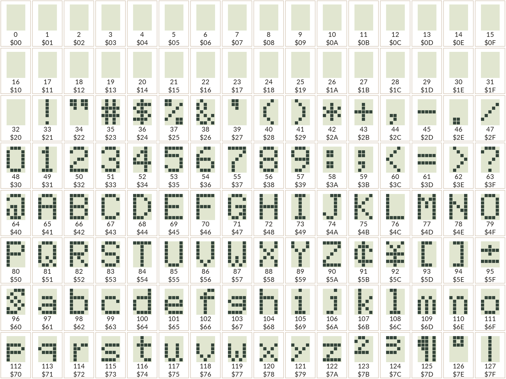
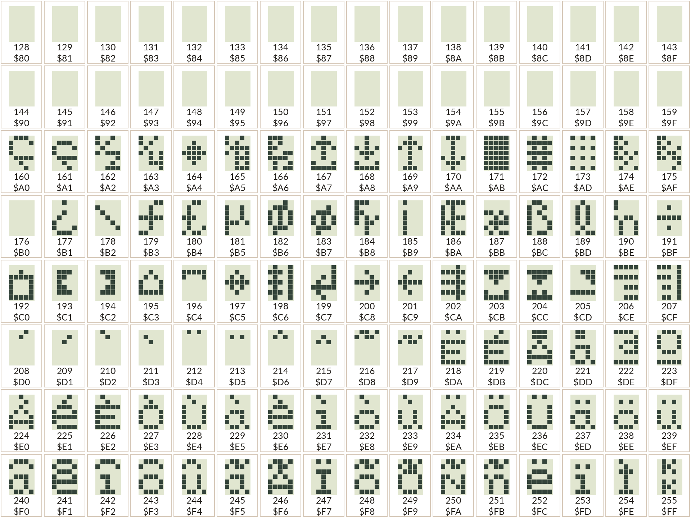
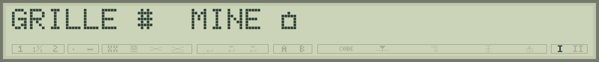
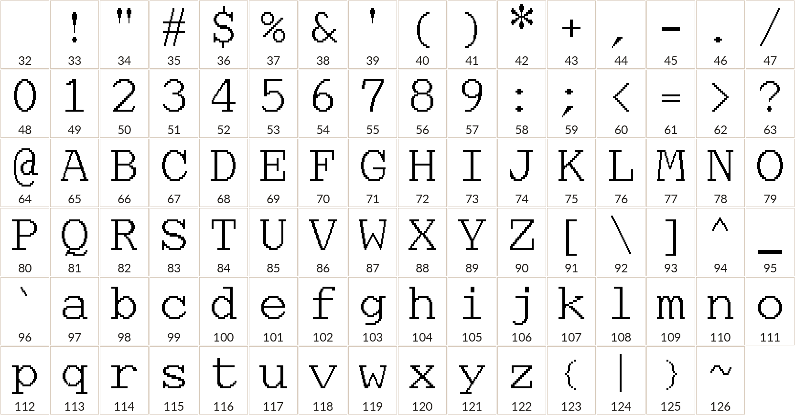

# Choisir ses caractères

La palette **Caractères** de Studio donne accès aux 256 codes du LCD. Sélectionnez un dessin puis utilisez **Insérer l’expression au curseur** : Studio écrit CHR$(code) dans votre programme. Vous pouvez ainsi choisir un symbole sans le chercher sur le clavier de la Canon.

**Les deux tables suivantes reprennent les dessins de la palette Studio**, transcrits par observation de l’écran de la S-70. Elles permettent de choisir une lettre, un cadre, un symbole ou une petite pièce de décor.

<a id="ic5-lcd"></a>
## L'IC5 : des codes de caractères aux pixels

Quand votre programme affiche `PRINT "A"`, le processeur transmet le **code 65** à l'afficheur. Le circuit repéré **IC5**, marqué **MB62H177**, prend alors en charge le dessin de la lettre sur le LCD. La police native se trouve dans le générateur de caractères du circuit d'affichage ; les ROM du processeur contiennent aussi des motifs destinés à certaines compositions du logiciel Canon. [P1] [L2]

### Une parenté avec la famille HD44780

Les commandes observées et l'organisation des mémoires rappellent les contrôleurs **Hitachi HD44780**. La fiche **HD44780U**, dans sa **table 4, variante A02**, présente une police européenne comprenant des lettres, des signes et des accents dont plusieurs ressemblent aux dessins de la Typestar. Cette documentation constitue une référence de comparaison : l'IC5 porte la référence MB62H177, et notre catalogue conserve les formes et les codes relevés sur la Canon. [L1] [L2]

Cette ressemblance aide à comprendre le fonctionnement de l'écran. La Typestar possède cependant ses propres choix de caractères et une bande de triangles et d'indicateurs adaptée à une machine à écrire. Par exemple, le catalogue observé commence ses caractères étendus par **Ç au code 160** et possède un **rectangle plein au code 171**. La table Canon ci-dessous reste la référence pour vos programmes.

### Trois mémoires aux rôles différents

| Mémoire de l'afficheur | Ce qu'elle contient | Exemple |
|---|---|---|
| **DDRAM**, mémoire d'affichage | Les codes placés aux positions de l'écran. | Le code 65 choisit la lettre A. |
| **CGROM**, police fixe | Les dessins permanents des lettres et symboles natifs. | Les pixels du A ou du Ç. |
| **CGRAM**, mémoire des dessins personnalisés | Les rangées de pixels modifiables par le programme. | Un personnage créé avec LCDCHAR. |

Les essais confirment la lecture des codes en DDRAM et celle des motifs en CGRAM. **Relire une lettre dans la mémoire d'affichage renvoie son code**, par exemple 65 pour A. Les accès identifiés donnent les pixels des dessins personnalisés ; les caractères fixes ont été relevés en les affichant puis en transcrivant leurs pixels. Cette transcription fournit la police du LCD émulé dans Studio. [L2]

### Pourquoi huit caractères personnalisés ?

Le modèle confirmé sur la S-70 emploie **64 octets de CGRAM**, organisés en **8 motifs de 8 rangées**. Les caractères visibles occupent cinq colonnes sur sept rangées ; la huitième rangée participe aux triangles sous les lettres. Les codes **0 à 7** sélectionnent ces huit motifs, et **8 à 15** les répètent : modifier un motif change toutes ses occurrences et son alias. [L2]

Les accents déjà présents dans la police fixe utilisent leurs propres codes et conservent les huit emplacements personnalisés disponibles. Le curseur BASIC utilise lui aussi le rectangle natif 171. Vous pouvez donc afficher plusieurs accents et vos dessins personnels sur le même écran.

### Ce que les essais ont précisé

Les écritures puis relectures de CGRAM conservent les huit bits des octets testés, tandis que **les cinq bits de poids faible** produisent les points visibles. Des écritures espacées de **64 octets** ont retrouvé les mêmes cellules : ce retour explique la capacité retenue. Ces observations ont servi à ajuster Studio. [L2]

Le processeur accède aux commandes et à l'état du LCD par l'adresse hexadécimale **&H0038**, et aux données par **&H0039**. La zone logique des 32 caractères et celle de la bande inférieure ont des usages distincts sur le verre. Le BASIC propose PRINT, LCDCHAR, LCDTRI, LCDLINE et ICON pour les commander. [L2]

La fiche HD44780U décrit un déplacement horizontal de l'affichage. Sur l'IC5 étudié, les recherches ont établi les accès aux mémoires et aux indicateurs ; une commande de défilement vertical matériel reste inconnue. La console BASIC fait évoluer son contenu en réécrivant les caractères. [L1] [L2]

## Codes LCD 0 à 127



**0 à 7** désignent les huit motifs personnalisés ; **8 à 15** sont leurs alias. Leur dessin dépend de ce que le programme a défini. Ils apparaissent vides ici. Les positions **16 à 31** sont vides sur l'écran étudié. L'espace habituel est le **code 32**.

## Codes LCD 128 à 255



La plage **128 à 159** apparaît vide sur la S-70 ; les caractères étendus commencent à **160, Ç**. Le rectangle plein **171** sert au curseur BASIC. La grille **172** et le symbole **192** composent le terrain et les mines de Pocket Duel. Choisissez les motifs visibles dans le catalogue.

## Utiliser un dessin de la table

```basic
10 CLS:CURSOR 4
20 PRINT CHR$(160);" ";CHR$(172);" ";CHR$(192)
```

Le programme affiche trois caractères natifs séparés par des espaces. **CHR$ se place hors des guillemets** : `PRINT "CHR$(172)"` écrirait simplement le texte CHR$(172).

```basic
10 CLS:CURSOR 4
20 PRINT "GRILLE ";CHR$(172);"  MINE ";CHR$(192)
```



Les accents courants peuvent aussi être écrits directement dans une chaîne de Studio, par exemple `PRINT "Flèches, café, Noël"`. L'outil convertit les caractères pris en charge vers leurs codes natifs. Pour un symbole ou un caractère sans touche correspondante, CHR$ reste la méthode la plus claire. Le tableau décrit l'écran S-70 de référence : une autre variante de machine peut posséder des dessins différents.

## Et sur le papier ?

**PRINT et LPRINT possèdent leurs propres polices.** LPRINT utilise les 95 caractères ASCII imprimables, de **32 à 126**, espace compris. Pour reproduire sur papier un motif LCD, comme la grille 172, définissez son dessin avec GLYPH.



```basic
10 LPRINT "Antislash : ";CHR$(92)
20 LPRINT "Barre verticale : ";CHR$(124)
```

Pour les accents et les signes supplémentaires, préparez un motif GLYPH. La liste complète des caractères LPRINT et un programme pour l’imprimer sont disponibles dans [la référence LPRINT](caracteres-lprint.md). Les dessins personnalisés sont expliqués dans [le chapitre papier](08-papier-dessins.md#glyph).

[P1]: https://ajd.sh/posts/canon-typestar-part-1/
[L1]: https://cdn-shop.adafruit.com/datasheets/HD44780.pdf#page=18
[L2]: references.md#lcd-ic5
