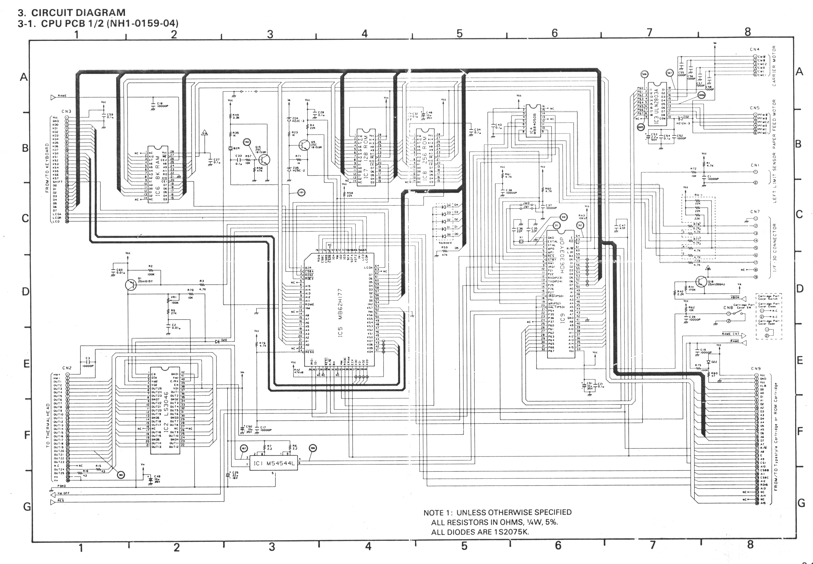
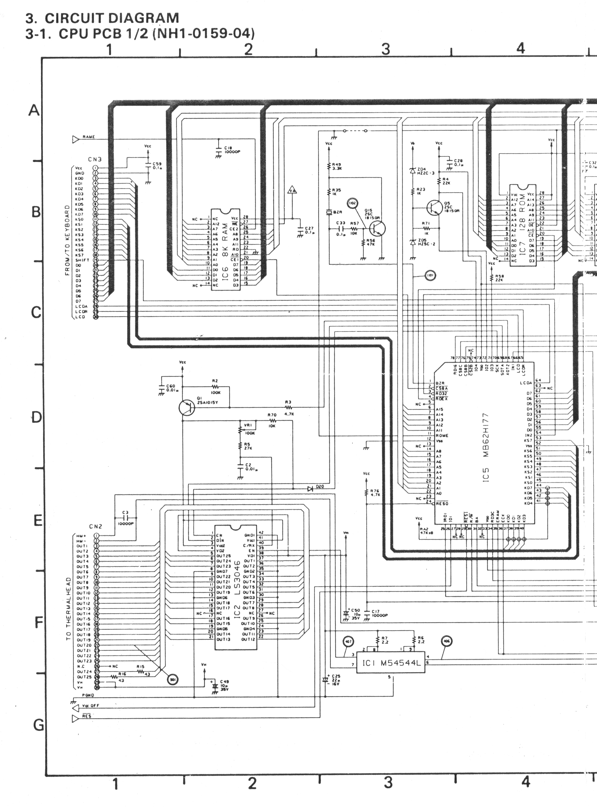
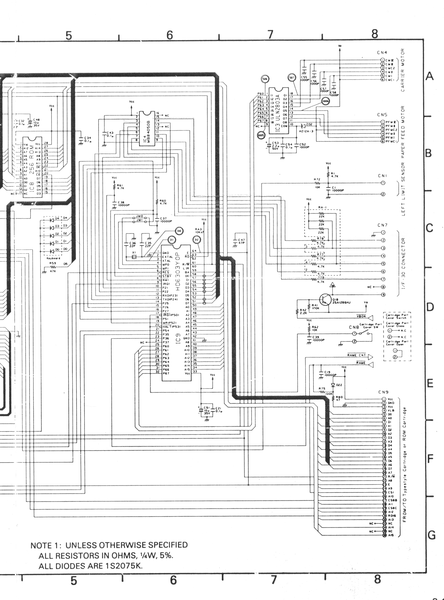

# Annexe - Le schéma de la carte CPU

Cette planche Canon représente la **carte CPU 1/2, NH1-0159-04** de la Typestar 7. Elle relie notamment le microcontrôleur IC9, le circuit IC5, les mémoires et les connecteurs. Le scan a été publié par AJD, dont l’article conserve aussi le contexte du document. [P1]

Le recadrage retire les marges inutiles. Un traitement de niveaux de gris et de contraste atténue la teinte du papier, la pliure et les surlignages colorés, **en conservant les pixels des tracés et les inscriptions lisibles du scan**. Les détails incertains restent à vérifier sur la machine ou sur le scan d’origine, conservé dans les ressources du manuel. Les deux vues suivantes agrandissent les moitiés de la planche avec un léger recouvrement.

## Partie gauche : mémoire, IC5 et tête thermique

## Partie droite : microcontrôleur et connecteurs

[P1]: https://ajd.sh/posts/canon-typestar-part-1/
