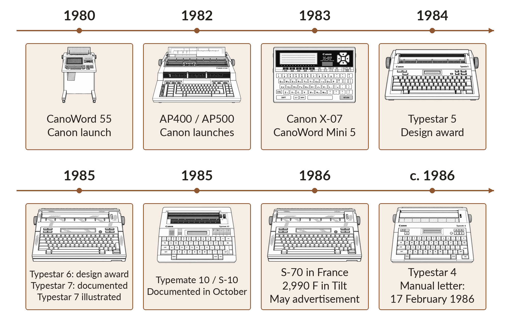
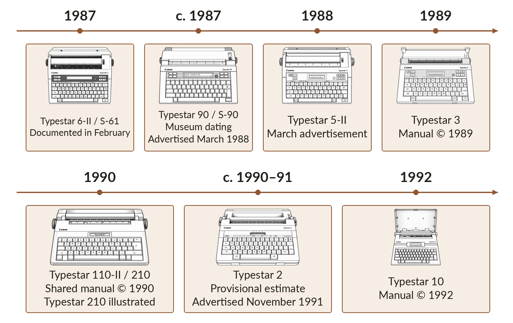
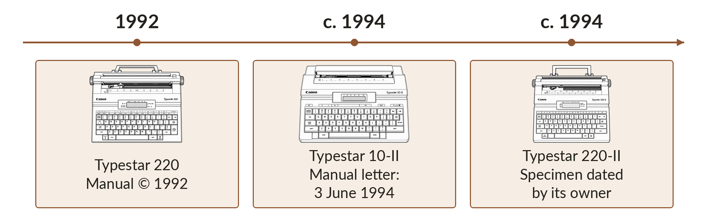

# 1 - A history of the Canon Typestar

## An office inside one machine

In the mid-1980s, a portable typewriter made an essential task simple: preparing a document to read, hand to someone or post. The sheet was both the final result and part of the workspace. It showed margins, the arrangement of a heading and the sentence being reviewed.

Electronics introduced a new stage between keyboard and paper. Text could wait in memory; a small display let its author check it before printing. The machine retained its familiar purpose while introducing practices associated with word processing.

Canon's Typestars belong to this world. Thermal printing replaces mechanical character impact with tiny heating elements. A transfer ribbon deposits colour on paper when heated; suitable thermal paper reacts directly. Letters can thus be formed as drawings made of dots.

On the Typestar 7, electronics controls printing and helps prepare text: a display for reviewing, memory for keeping work, cartridges for extra capabilities. Typestar BASIC builds on that equipment to give it a new use.

## Canon and electronic office equipment

**Shimomaruko in Tokyo** accompanies much of this story. In 1951, Canon acquired a former Fuji Aviation Instruments factory and gradually brought its activities together there. Canon's museum preserves this view of the land and buildings before acquisition. [H28]

The story begins long before the S-70. In 1962, Canon prepared a large-scale entry into office equipment with its first five-year plan. The Canola 130 electronic calculator appeared in 1964; Canofax 1000 marked its entry into copying in 1965. [H7]

In 1967, the thirtieth-anniversary slogan put photography beside office equipment: "Cameras in the Right Hand, Business Machines in the Left". The BP-1000 billing machine, introduced in 1971, was another milestone. [H7]

This diversification gives context to the Typestar. Document work involves typing, calculating, formatting, printing and copying. An electronic typewriter brings some of these tasks into one personal device. Software can change its behaviour without a separate mechanism for every function.

Several approaches coexisted in Canon's early-1980s catalogue. The Japanese-language CanoWord 55 appears in the 1980 history. The AP400 and AP500 Western-language typewriters followed in 1982, alongside the 16-bit AS-100 computer. CanoWord Mini 5 arrived in 1983. [H1]

Canon also developed other printing technologies: its history lists the LBP-8/CX laser printer in 1984 and BJ-80 inkjet in 1985. The small thermal Typestar therefore belongs to a period of parallel solutions, different formats and different purposes. [H1]

### Ryūzaburō Kaku and diversification

**Ryūzaburō Kaku became Canon president in 1977.** The official Japanese history places him in this diversification into photography, calculators, copiers and office equipment. As a company leader, he accompanied its broadening activities. [K1]

The **1980 CanoWord 55** illustrates another branch: Japanese word processing. Its format differs greatly from a Typestar, but both put typing and printing at the centre of a specialised electronic device. [H1]

### A research site in transformation

At Shimomaruko, office-equipment growth brought new buildings. Contractor Obayashi dates blocks D, E and C to **1982-1985**. **Building L**, started in April 1989 and completed in **April 1990**, housed research and development. This photograph from the contractor's corporate history shows one setting for Canon's technologies of the period. [H27]

## Portability changes priorities

A portable brings keyboard, display, paper path and feed mechanism into a small space. Electronics coordinates everything while conserving battery power. A thermal head draws dotted letters, allowing one machine to offer several fonts.

Transfer ribbon serves plain paper; thermal paper responds directly to heat. These alternatives help give the Typestar its portable size and quiet operation.

Canon's design archives recognise the **Typestar 5 in 1984** and **Typestar 6 in 1985**. They appear alongside the V-20 and V-8 computers respectively, other examples of Canon personal electronics. [H2]

### Advertising the Typestar 5

The advertisement below bears © 1984 Canon U.S.A. It presents the Typestar 5 as a machine to take along, with a proper keyboard and a **fifteen-character** correction window.

### A Typestar in space

This advertisement bears © 1985 Canon U.S.A. Its space setting accompanies the Typestar 6, described with a **thirty-two-character** display and "2K" memory. Two machine generations share the advertisement.

## The X-07: a portable computer in its own right

In **1983**, Canon introduced the **X-07** in Japan, a portable programmable in BASIC. Its NSC800 processor belongs to the Z80 world, while the Typestar uses an HD6301. X-07 offered a **four-line, twenty-character LCD**, **120 × 32-dot** graphics and **8 KB expandable RAM**. The advertised Japanese price was **69,800 yen**, for approximately **480 g**, powered by four AA batteries. [X1]

A Japanese advertisement also highlights an **optional infrared optical coupler** for wireless data exchange. Portability concerns both weight and ways of programming and communicating. Canon explored complementary uses: a BASIC computer with X-07, document preparation with Typestar. [X1]

## Typestar 7 and S-70: one machine, two names

"Typestar 7" is the commercial name; "S-70" is the model reference. Their correspondence appears explicitly in the European regulation of 28 October 1985 concerning typewriter imports. [H3]

This firmly places S-70 in **1985**. The regulation applies retrospectively from 23 June, an administrative landmark. The precise first-sale date remains to be established. [H3]

These lists connect technical references and commercial names sometimes used separately in collectors' advertisements. A plate reading "S-70" can thus find its place in the Typestar family.

### Taking ideas along

A recording from American television station **WOR 9**, dated **19 May 1986**, preserves a **Typestar 7** commercial between **15:56 and 16:26**. It promises to put ideas on paper wherever they occur, with professional-looking results. Typing-error correction, text memory, compact size, low weight and quiet operation accompany this freedom to write. [H36]

The display and memory extend the keyboard's role: writers prepare their text before printing it. The commercial brings together the qualities that still give this small portable machine its appeal.

## A visit to Brittany

Canon's French history provides another landmark. Canon Bretagne dates its legal creation to 1983, photocopier production to 1984 and typewriter production to 1985. Circuit-board assembly followed in 1986; toner cartridges, fax machines and laser printers appear in its 1987 activities. [H8]

The chronology shows the variety of industrial work around office equipment. The models manufactured in Brittany remain to be documented; a machine's manufacturing plate is a valuable starting point for tracing its origin. [H8]

## Landmarks in a confusing range

The following dates are **documentary landmarks**: Canon launches, design awards, advertisements or manual editions. Each panel identifies its evidence. **Typewriter Database** collections add photographs, model plates and preserved specimens; estimated dates are marked as such. [H15]

### From office equipment to the first portables

### The range expands

### The 1990s portables

For **Typestar 2, 4 and 10-II**, proposed positions are **around 1990-1991**, **around 1986** and **around 1994**, respectively. These remain marketing-period estimates. The 2 appears in a November 1991 advertisement; the 4 manual includes a February 1986 letter; the 10-II manual uses a June 1994 example. Each document provides a landmark. [H24] [H25] [H26]

### The landmarks in detail

| Date | Historical landmark |
|---|---|
| **1980** | CanoWord 55 Japanese word processor. [H1] |
| **1982** | AP400 and AP500 electronic typewriters; AS-100 computer. [H1] |
| **1983** | Canon X-07 and CanoWord Mini 5; Canon Bretagne established. [X1] [H1] [H8] |
| **1984** | Typestar 5 design award; Canon U.S.A. advertisement © 1984. [H2] |
| **1985** | Typestar 6 design award; **S-70 / Typestar 7** and **S-10 / Typemate 10** explicitly documented in October. [H2] [H3] |
| **May 1986** | S-70 offered for **2,990 francs** in French magazine Tilt no. 31. [H10] |
| **19 May 1986** | A **Typestar 7** commercial appears in a WOR 9 recording from the United States. [H36] |
| **1986** | S-16 design award; design D299930 filed on 8 April. [H2] [H5] |
| **Around 1986** | **Typestar 4**: Canon manual reproduces a letter dated **17 February 1986**. Period estimate. [H25] |
| **February 1987** | S-61 / Typestar 6 II added to European regulation. [H4] |
| **Around 1987** | **Typestar 90 / S-90**, also known as Typestar 7-II. [H11] |
| **March 1988** | Typestar 90, 80, 7, 6 II and 5 II sold together in Britain. [H12] |
| **1989** | **Typestar 3** manual edition © 1989. [H18] |
| **1990** | Joint **Typestar 110-II and 210** manual © 1990. [H19] |
| **Around 1990-1991** | **Typestar 2**: provisional estimate; identifiable advertisement in *The New Paper*, **28 November 1991**. [H24] |
| **1992** | **Typestar 10** manual © 1992; sixteen-character LCD. [H13] |
| **1992** | **Typestar 220** manual also © 1992. [H20] |
| **Around 1994** | **Typestar 220-II** specimen dated to 1994 by its owner from the electronics. [H21] [H23] |
| **Around 1994** | **Typestar 10-II**: example dated **3 June 1994** in Canon's German manual. Period estimate. [H26] |

S-90 belongs around **1987**, with a verifiable commercial presence in **March 1988**. Later manual dates provide checkable landmarks. Names and editions vary by country: each reference has its equipment and intended audience.

## A family broader than its numbers

### Typemate 10: the S-10 cousin

**Typemate 10** already appears as **S-10** in the October 1985 European regulation. It belongs to a neighbouring Canon branch. Photographs show a compact machine with a small LCD and several sliding controls. Its ribbon cassette differs from early Typestars. This silhouette deserves its own timeline place. [H3] [H22]

### Typestar 2, 3 and 4: different ways to stay portable

**Typestar 2** and **Typestar 4** illustrate the variety of small portables: full keyboards, checking windows and document-preparation controls. Collection photographs let us compare their fronts, keys and paper paths. [H15]

For **Typestar 4**, a Canon manual preview reproduces a letter dated **17 February 1986**, directly showing the model name and features. Alongside the specimen assigned to 1986 by its collector, this supports **around 1986** on the timeline. [H25] [H16]

**Typestar 2** appears in Singapore's *The New Paper* on **28 November 1991**. A collection listing dates it to 1990; we use **around 1990-1991 provisionally**, with 1991 as a commercial landmark. A dated catalogue or manual may establish its launch more precisely. [H24] [H29]

**Typestar 3** has a **1989** manual. It describes a **fifteen-character LCD**, two built-in fonts, **Courier 10** and **Cubic PS**, and a **44-key** keyboard. Printing can be double-width or accompanied by a shaded background. A portable could give the same text several appearances. [H18]

### Typestar 5-II and 6-II: continuing families

The suffix **II** accompanies several developments. Canon's technical documentation list identifies **Typestar 5-II as S-51**. **Typestar 6-II is S-61**, explicitly added to the European regulation in February 1987. A March 1988 British advertisement offers both beside the 7 and 90. These models occupied several positions within one catalogue. [H17] [H4] [H12]

Front-panel names and model-plate references complement each other. The **commercial name / model reference** pair is especially useful: Typestar 5-II / S-51, Typestar 6-II / S-61, Typestar 7 / S-70.

### Typestar 10 and 10-II: another formula

**Typestar 10** has a **sixteen-character LCD** in its 1992 manual. **Typestar 10-II**, also preserved in collections, continues this arrangement: a short central window, keyboard and thermal mechanism in a compact case. Its German manual includes a letter dated **3 June 1994**, and an owner also dates a specimen to 1994. These clues place **10-II around 1994**, as a marketing-period estimate. [H13] [H26] [H30]

### Typestar 110-II, 210, 220 and 220-II: more word processing

A **joint 1990 manual** covers **Typestar 110-II and 210**. It describes a **sixteen-character LCD**, up to **4 KB** shared between text and a personal dictionary, and **45 keys**. Functions include search and replace, stored page formats and regional spelling correction. Both names appear on the same cover, each identifying its own model. [H19]

**Typestar 220**, whose manual is **© 1992**, retains sixteen display characters. It offers four built-in fonts, scientific symbols and up to **3.5 KB** for text and the personal dictionary. Its manual describes a **36 × 40-dot** thermal head: the family evolved inside the case too. [H20]

**220-II** extends the picture into the 1990s. Its documented specimen is assigned to **1994** from a visible electronics date. Demonstration prints show different characters, sizes and patterns. A period advertisement or catalogue could supplement this surviving-machine landmark. [H21] [H23]

### StarWriter: dedicated word processors

In period catalogues, **word processor** often means a **dedicated, self-contained appliance**: keyboard, screen, software and printer form a system devoted to writing. You prepare a document on screen, move passages, save files, then print the version you choose. Today, the same term usually suggests software running on a computer. [H31]

An **electronic typewriter** centres on typing onto paper, immediately or after reviewing a line. It may also offer correction and memory: the Typestar 7 already stores and edits texts. The boundary is therefore gradual. The range of editing tools, storage and emphasis on the on-screen document bring StarWriter machines closer to a personal workstation. [H9] [H31]

The **StarWriter 80**, reported in 1991, uses **Bubble Jet inkjet** printing. Models 80 and 85 offer **16 lines of 80 characters**, 60,000 bytes of internal memory and 720,000-byte floppy storage. This equipment weighs **7.2–7.4 kg**. Typestar 7, specified at 2.7 kg with batteries and ribbon, retains its compact advantage. [H32] [H31] [H9]

The StarWriter family includes several printing technologies: a **StarWriter 30** is advertised with **thermal transfer** in 1994. These large-display machines could be interesting for another BASIC project, after studying their processors, ROMs and peripherals. That remains unexplored; this firmware uses Typestar 6 and 7 hardware. [H33]

### Choosing useful comparisons

Compare display length, text memory, cartridges, correction features and interfaces. Commercial numbers identify models within a range serving different needs.

Typestar 7 is particularly attractive here: its 32-character LCD, external memory, cartridges and computer interface make it one of the most appealing models for experiments.

## A little machine in microcomputer catalogues

In **May 1986**, French *Tilt* readers found S-70 advertised beside printers, accessories and MSX computers, at **2,990 francs**. The typewriter could become a personal computer peripheral while keeping its own keyboard and independent power. [H10]

A reader's account in *The Rainbow*, **July 1986**, presents Typestar 7 as both typewriter and printer. It recalls a practical period use: putting home-computer text on paper. Optional Canon interfaces bridged these worlds. [H14]

A **March 1988** British catalogue shows Typestar 90, 80, 7, 6 II and 5 II offered simultaneously. Equipment varied; buyers chose according to display, memory, correction and accessories. [H12]

## Names behind the design

US design D299930, filed on 8 April 1986 and published on 21 February 1989, credits Richard Nibley and Noriaki Haranishi for Canon. Its perspective view strongly resembles the early Typestar 7. [H5]

The patent protects the **machine's exterior design**. Its resemblance to Typestar 7 provides a clue to the case's history; the exact model identification remains open. [H5]

The drawings invite closer attention. Keyboard position, display, upper controls and paper path form a usable whole. A typewriter is touched constantly: its design organises gestures as surely as software organises operations.

The same names appear on [typewriter font-cartridge design D286162](https://patents.google.com/patent/USD286162S/en), filed on 18 December 1984. Their work concerned accessories as well as machines.

For electronics, another clue names **Takahiro Tsukamoto**. [Japanese patent JPS5942988A](https://patents.google.com/patent/JPS5942988A/en), filed for Canon on 3 September 1982 and published on 9 March 1984, describes electronic typewriter mode displays. It records attention to the dialogue between user and machine.

These documents attach names and achievements to period teams. **Case, cartridges and display arose from different work**, traced through drawings and patents without attributing the whole machine to one person.

## Canon today: from computers to peripherals

Typestars belong to a period when Canon also sold personal computers and word processors. Its priorities later changed. Reviewing **1996-2000**, Canon reports closing **seven unprofitable businesses, including personal computers**, to improve profitability and financial strength. This documents a reason for leaving PCs. [H34]

In homes and offices, **computer plus printer** brought writing, correction, storage and layout into a versatile tool. This helps explain the decline of standalone typewriters and word processors. Typestar represents another choice: a compact, immediately usable keyboard-and-paper machine. Our BASIC recovers some of that simplicity.

**Canon remains active around computing**, through printing, scanning and document services. In **2025**, *Printing* represented about **54%** of consolidated sales, covering home, office and professional printing. *Imaging*, including cameras, lenses and network cameras, represented about **23%**. Medical imaging and industrial equipment, including semiconductor manufacturing tools, are other major activities. Photography remains emblematic, while **printing leads by sales**. [H35]

Paper, imaging and electronic processing connect the Typestar to Canon's present equipment.

[H1]: https://global.canon/en/corporate/history/03.html

[H2]: https://global.canon/en/design/award/1957-2012.html

[H3]: https://www.boe.es/buscar/doc.php?id=DOUE-L-1985-80857&lang=es

[H4]: https://www.boe.es/buscar/doc.php?id=DOUE-L-1987-80192&lang=es

[H5]: https://patents.google.com/patent/USD299930S/en

[H7]: https://global.canon/en/corporate/history/02.html

[H8]: https://www.canon-bretagne.fr/lentreprise/

[H9]: https://site.xavier.edu/polt/typewriters/CanonTypestar7.pdf

[H10]: https://datassette.s3.us-west-004.backblazeb2.com/revistas/tilt_031.pdf

[H11]: https://collection.sciencemuseumgroup.org.uk/objects/co8537511/canon-typestar-90-electronic-typewriter-with-32-character-liquid-crystal-display

[H12]: https://worldradiohistory.com/UK/Personal-Computer-World/80s/PCW-1988-03-S-OCR.pdf

[H13]: https://site.xavier.edu/polt/typewriters/CanonTypestar10.pdf

[H14]: https://colorcomputerarchive.com/repo/Documents/Magazines/Rainbow%2C%20The%20%28OCR%29/The%20Rainbow%20Vol.%2005%20No.%2012%20-%20July%201986.pdf

[H15]: https://typewriterdatabase.com/canon.656.typewriter-serial-number-database

[H16]: https://typewriterdatabase.com/1986-canon-typestar-4.23633.typewriter

[H17]: https://www.bitsavers.org/pdf/canon/Canon_Technical_Documentation_Part_Number_List_199911.pdf

[H18]: https://site.xavier.edu/polt/typewriters/CanonTypestar3.pdf

[H19]: https://site.xavier.edu/polt/typewriters/CanonTypestar110II%26210.pdf

[H20]: https://site.xavier.edu/polt/typewriters/CanonTypestar220.pdf

[H21]: https://typewriterdatabase.com/1994-canon-typestar-220ii.17763.typewriter

[H22]: https://typewriterdatabase.com/198x-canon-typemate-10.18472.typewriter

[H23]: https://darrengoossens.wordpress.com/2022/03/15/canon-typestar-220-ii-a-fix/

[K1]: https://global.canon/ja/corporate/history/03.html

[X1]: https://akiba-pc.watch.impress.co.jp/docs/column/retrohard/1178338.html

[H24]: https://eresources.nlb.gov.sg/newspapers/digitised/issue/newpaper19911128-1

[H25]: https://typecast.munk.org/wp-content/uploads/2017/11/1986-CanonTypestar4.jpg

[H26]: https://www.manualslib.de/manual/1142678/Canon-Typestar-10-Ii.html?page=2

[H27]: https://www.obayashi.co.jp/chronicle/100yrs/t3c5s99.html

[H28]: https://global.canon/en/c-museum/history/story03.html

[H29]: https://keej.it/categoria-informatica/agenda-elettronica-beverly-hills?pn=2

[H30]: https://thefoolwithapen.com/posts/2024/20240806/

[H31]: https://www.usitc.gov/publications/701_731/pub2411.pdf

[H32]: https://www.worldradiohistory.com/AUSTRALIA/Electronics-Australia/EA-1991-06.pdf

[H33]: https://newspapers.swco.ttu.edu/bitstream/handle/20.500.12255/193068/UD_1994_08_29.pdf?isAllowed=y&sequence=1

[H34]: https://global.canon/en/sustainability/report/pdf/sustainability2006e.pdf

[H35]: https://global.canon/en/ir/business.html

[H36]: https://archive.org/details/wor-9-may-19-1986-commercials
