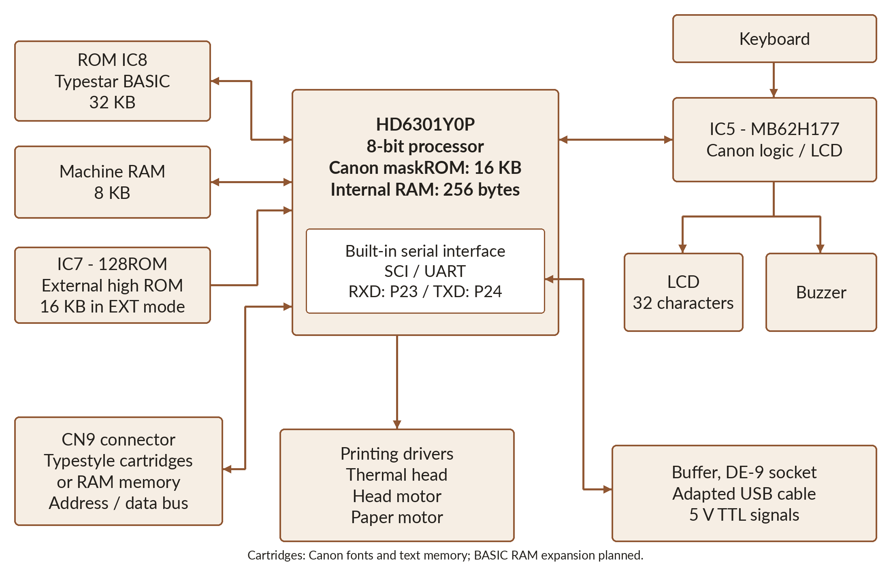

# 2 - The HD6301, a little computer beneath the keyboard

## From program to processor

When you type `PRINT 2+3`, the BASIC interpreter recognises the instruction, performs the calculation and requests the display of the result. That interpreter is itself a program executed by the machine's processor.

In the S-70 studied here, this processor is integrated into a **Hitachi HD6301Y0P microcontroller**. A microcontroller brings calculation, memory and circuits for communication with the rest of the machine together in one component. The following pages introduce these functions; afterwards, a few simple instructions will put them to work.

## A family with Motorola 6800 roots

The HD6301 belongs to Hitachi's microcontroller family built on the 6800/6801 heritage. In his memoirs, Tsugio Makimoto describes technology exchanges between Hitachi and Motorola, then Hitachi's work on CMOS technology and programmable memories. His account illuminates the industrial setting; individual chip variants have their own dates. [M1]

CMOS technology is particularly attractive for portable equipment because of its low power consumption. Each manufacturer then connects the processor to its own keyboard, display and programs: one chip family can serve very different machines.

### A meeting, technologies and people

Makimoto places a visit to Motorola in 1974, accompanying Yoshinobu Imamura, head of Hitachi's semiconductor division. The photograph in his memoirs puts faces to this industrial history.

The planned exchange linked Hitachi's automatic wire-bonding technology with Motorola's 6800 microprocessor family. Makimoto names **Jun Suzuki** as leader of the team developing those machines, and dates Hitachi's approval of the agreement to November 1975. The microcontroller eventually used in our Canon belongs to this history of exchanges and development. [M1]

For CMOS microcontrollers and ZTAT programmable memories, his account identifies a team led by **Toshimasa Kihara**, with Shiro Baba, Naoki Yashiki, Yasushi Akao, Tsuneo Sato and Kiyoshi Matsubara. These engineers developed a circuit family that equipment makers could integrate into their products. [M1]

### Advertising the HD6301

This rare period advertisement shows how Hitachi presented the HD6301/HD6303 family: a fast, economical little computer in one chip. Its illustration invites us to discover how much a microcontroller could already contain.

Hitachi's handbook describes the S-70's **HD6301Y0** as having 16 KB internal ROM, 256 bytes internal RAM, a serial interface, timers and 53 input/output lines. These lines connect the machine's internal functions. [M2]

## HD6301 or HD6303: an important difference

Two neighbouring names appear in this family: **HD6301** and **HD6303**. The Y variants described by Hitachi share their computing core and instruction set. The **HD6301Y0** has factory-programmed ROM; the **HD6303Y** reads its program from external ROM. Both integrate RAM, a serial interface and timers. [M2]

| Variant | Internal program memory | Internal RAM |
|---|---|---:|
| HD6301Y0 | 16 KB maskROM | 256 bytes |
| HD6303Y | None | 256 bytes |
| HD63701Y0 | 16 KB programmable EPROM | 256 bytes |

The complete part number identifies each variant's memory, pins and peripherals. Our reference component is the **HD6301Y0P**. [M2]

There is a practical consequence: part of Canon's program lives inside the microcontroller. Typestar BASIC retains this memory and replaces external ROM IC8. The two programs then work together.

## Eight bits to build numbers

A bit has two possible values, 0 and 1. Eight bits form a byte, which can represent 256 combinations. A byte in a program may encode a character, a small number or several flags.

The HD6301 is an **8-bit** processor: it handles groups of eight bits. Its A and B accumulators can also form a sixteen-bit register called D. Software combines several bytes to represent larger numbers. [M2]

For decimal numbers, the interpreter uses arithmetic routines, including those identified in Canon's internal program. BASIC uses a decimal point: `PRINT 1.5+2.25` displays `3.75`.

## Some tools inside the processor

A processor has small working stores called **registers**. Unlike your BASIC variables, these belong directly to its architecture. Here are the main ones for readers curious about what happens beneath the cover.

| Register | Simplified purpose |
|---|---|
| A and B | Two 8-bit accumulators for data and calculations. |
| D | A and B combined for certain 16-bit operations. |
| X | Index register, useful for stepping through a sequence of data. |
| PC | Program counter: where machine-code execution continues next. |
| SP | Stack pointer: identifies an area used especially for subroutine returns. |
| CCR | Flags describing operation results and processor state. |

The instruction set includes multiplication of two 8-bit values to give a 16-bit result. The interpreter combines these tools with software routines to handle decimal numbers, strings and arrays. [M2]

A microcontroller's surrounding functions matter too. An integrated serial interface handles bit reception without dedicating a software loop to every bit. A timer can count while the program does other work. For portable equipment, bringing these functions together is as important as a fast instruction.

## What does 1 MHz mean?

A **1 MHz** clock marks one million cycles per second. A BASIC instruction such as PRINT involves many processor operations, then the display or printer. Its execution time depends on all this work.

The HD6301Y0 divides its crystal frequency by four: Hitachi gives the example of a **4 MHz** crystal producing a **1 MHz** system clock. This system clock sets the processor's pace. [M2]

Comparing processor families also calls for their cycles per operation, instruction sets and software organisation. In Typestar BASIC, drawing time can depend more on paper and head movement than on calculating coordinates.

## Three memories, three jobs

| Memory in the studied S-70 | Capacity | Role in our project |
|---|---:|---|
| HD6301Y0P internal ROM | 16,384 bytes | Factory-programmed Canon code; retained. |
| External ROM IC8 | 32,768 bytes | External code and data; replaced by our image on OneROM. |
| External RAM | 8,192 bytes | Workspace for the machine and interpreter. |

The **256 bytes of internal RAM** supplement the external resources. Hitachi documents the internal capacities; the external components and their use are established by the schematic and S-70 analysis. [M2] [P1]

**ROM** keeps instructions and data when power is off. A *maskROM* receives its contents during manufacture; Canon's stays intact in our project. **RAM** holds values that change during operation. Retention depends on backup power and how startup treats those values.

The **8 KB RAM** holds interpreter state, buffers and program data. In the reference version, an empty program leaves **5,951 bytes** in the BASIC arena; allocations reduce the remaining space.

> **In this manual, 1 KB means 1,024 bytes.** A 32 KB capacity therefore means 32,768 bytes.

## Retaining data while switched off

RAM retains its contents while it receives sufficient power. The machine can be off while this reserve remains powered. The HD6301Y0 also offers sleep and standby modes to reduce consumption. [M2]

The Typestar 7 can run on four D / R20 batteries. Canon's manual recommends replacing them within **thirty minutes** to preserve text and line formatting. This precaution supports portable use; actual retention depends on power and component condition. [H9]

With the mains adapter connected, the studied machine's RAM supply measures approximately **4.4 V switched off**, and **4.8 V switched on**. Its memory therefore remains powered under these conditions. Keep a copy in Studio on the computer for durable program storage.

Startup can clear or reuse some locations. Retention needs both backup power and locations respected during restart. That is why the firmware checks retained programs and protects their memory area.

## How does the processor find data?

Think of memory as numbered boxes. A box's number is its **address**. The processor has **65,536 addresses**, or 64 KB, divided between ROM, RAM and control registers.

Selecting a byte in 32 KB of ROM takes fifteen address lines: **A0 to A14** give 32,768 combinations. A decoding circuit then selects the component for the requested access.

The HD6301Y0 can operate with both its internal ROM and external bus active. The S-70 combines its MCU program with additional ROM and RAM. Typestar BASIC retains this mode and reuses Canon services. [M2]

## Peripherals work with the processor

Canon's **MB62H177**, marked IC5 on the schematic, participates in LCD and buzzer management and system signal decoding. Power circuits and motors produce the mechanical movement. The processor controls them through software drivers. [P1]

This simplified functional view shows the components' roles:

Timers pace operations. Interrupts let the processor handle events when required, then resume its work. These mechanisms matter as much as raw speed: a print head must heat and move at the correct moment.

The head moves horizontally; changing height on the sheet means advancing or reversing the paper. The LCD is another specialised peripheral: characters, triangles and indicators each have their own controls. BASIC takes care of these details for you.

## Why keep Canon's program?

The retained Canon routines provide arithmetic and low-level services identified during analysis. Our ROM uses these services and adds its own commands and drivers.

OneROM in IC8 presents the new image to the processor. **The Canon's HD6301 executes BASIC.** OneROM serves as program memory.

ROM reads, including those made with [630x/680x MaskROM Reader](https://github.com/pR-0000/630x-680x-MaskROM-Reader), revealed the code inside the machine. Disassembly exposes instructions and data; hardware experiments then check their roles.

## What matters when programming

Remember three ideas: your program shares a small memory with its variables; text and graphics put real mechanics to work; and a computer backup keeps your work durably.

After the firmware introduction, the practical chapters leave the components beneath their cover. A few lines of BASIC will be enough to give them work.

[M1]: references.md
[M2]: references.md
[P1]: https://ajd.sh/posts/canon-typestar-part-1/
[H9]: https://site.xavier.edu/polt/typewriters/CanonTypestar7.pdf
