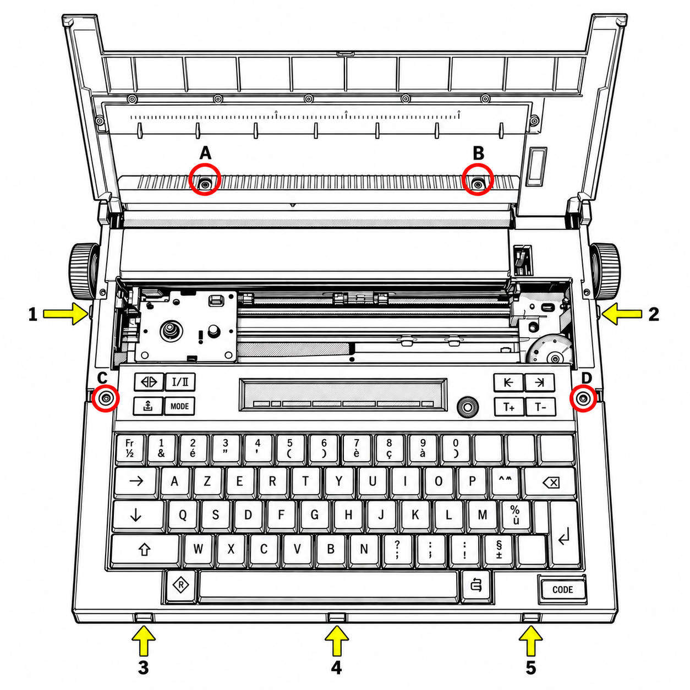
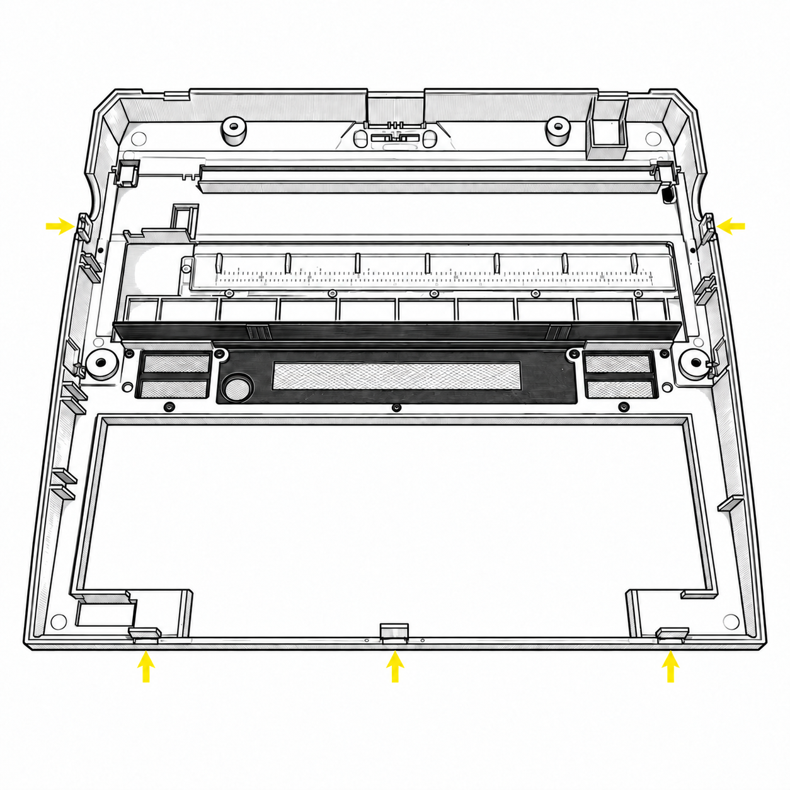
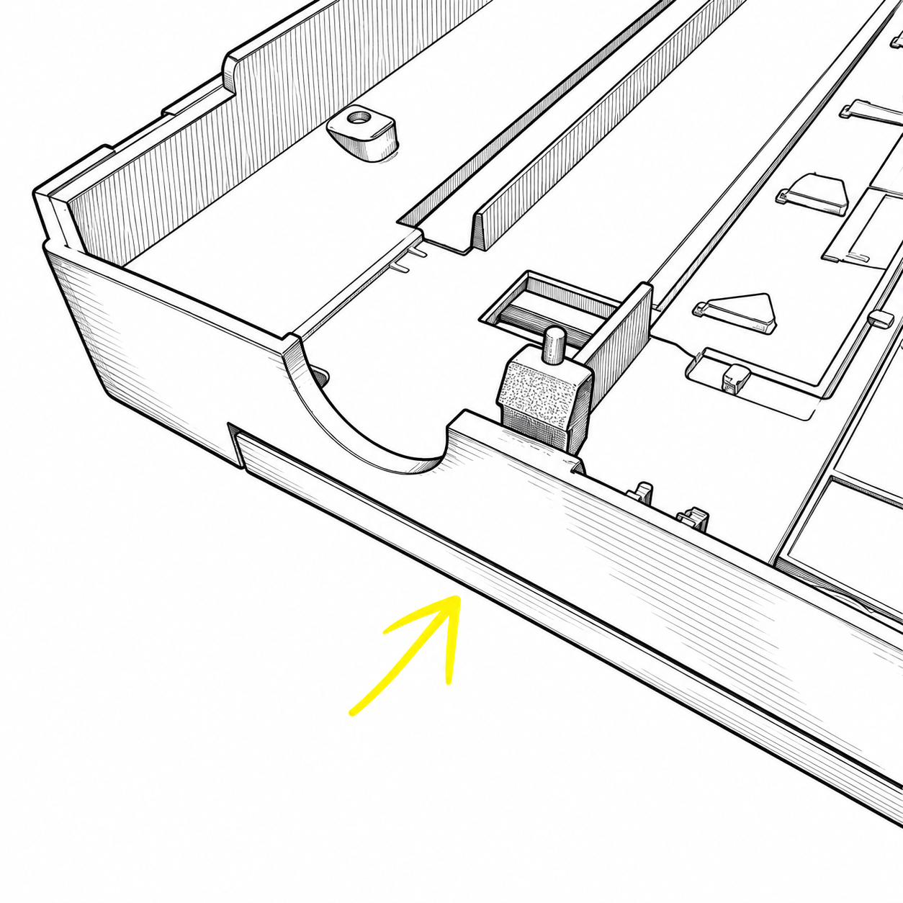
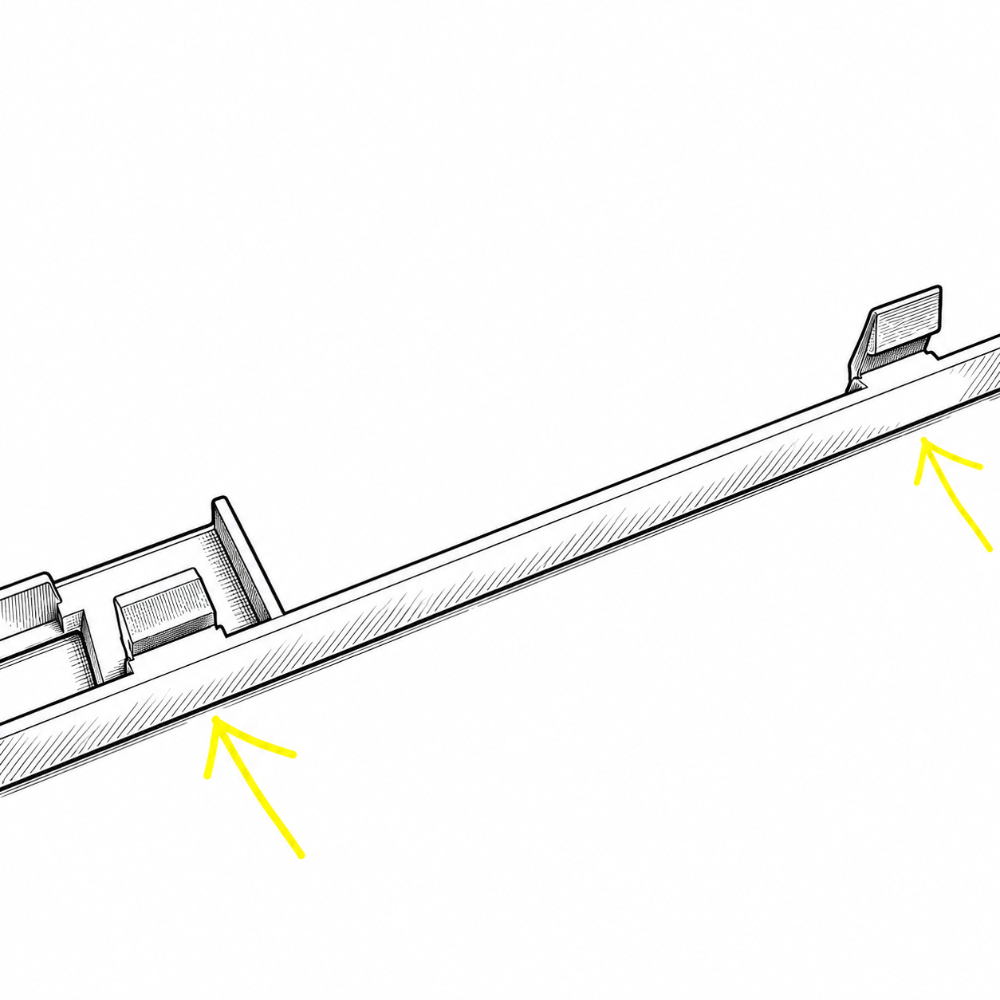
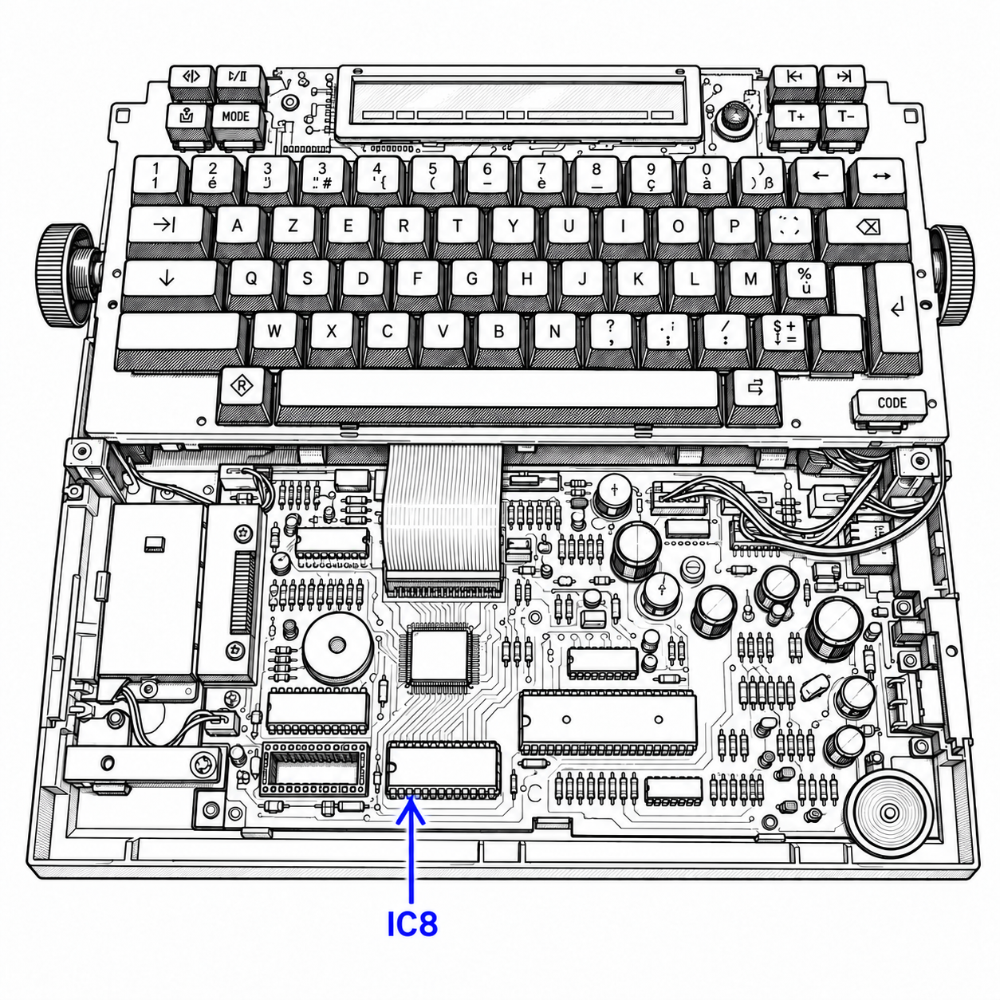
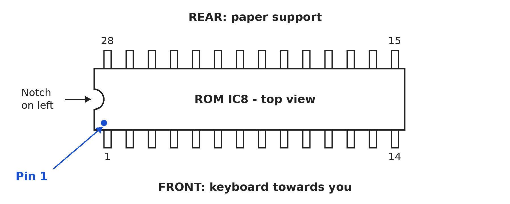
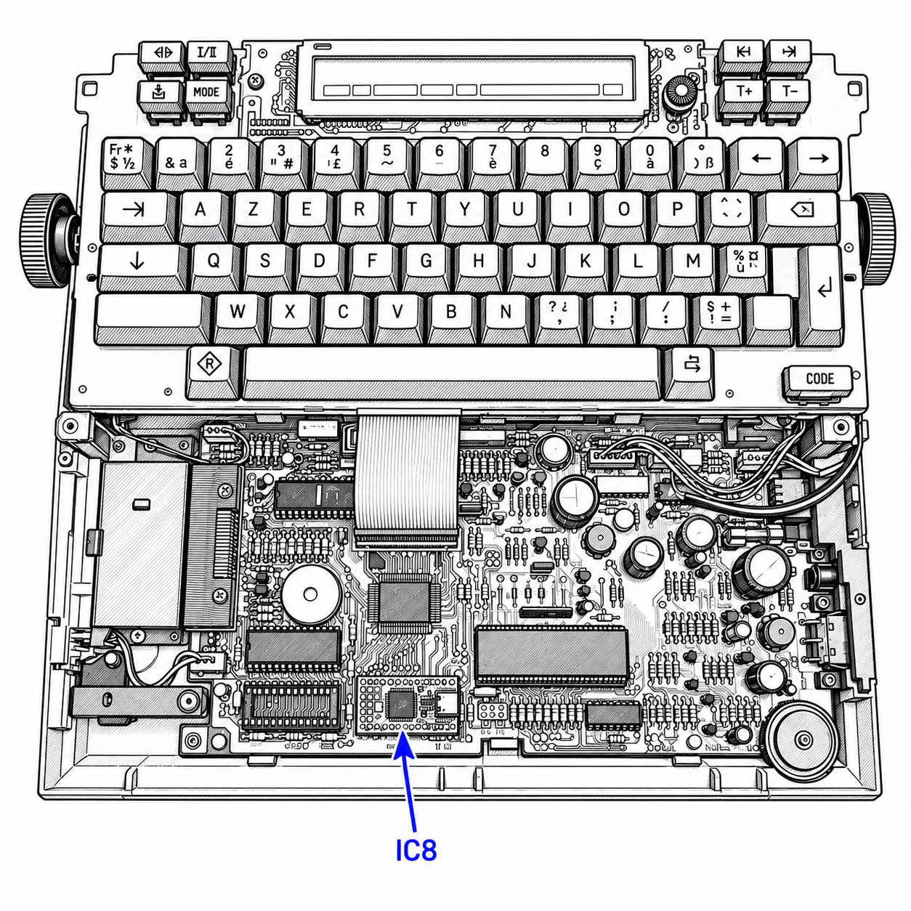

<a id="installation"></a>
# Installation - Switching to BASIC

To install Typestar BASIC, we replace the external **IC8 ROM**, fitted in a socket. The replacement fits directly into that socket. The microcontroller and its internal Canon ROM stay in place. Keep the original chip: reinstalling it restores Canon's original operation.

This illustrated guide shows the **Canon S-70 / Typestar 7** used for the project. One revision of the S-60 / Typestar 6 also runs this firmware, as explained below. The S-90 requires a BASIC binary adapted to its internal ROM.

<a id="s60-serial"></a>
### A Typestar 6 can run BASIC too

Typestar BASIC startup and **program loading with Studio at up to 31250 baud, using 7E1**, have been validated on a **Canon S-60 / Typestar 6** with PCB **NG3-0672 / NH1-0159-065**, dated **"86;06,12."**. This machine has a small serial-port hatch, glued shut at the factory, and a print-contrast control at the front. BASIC replaces its IC8 ROM while retaining the original microcontroller. Adding the serial circuit described below requires soldering; replacing IC8 remains a socketed-chip operation.

Other S-60 machines have a case without a hatch and a contrast control on the right side; their compatibility still needs checking on their own boards. **Check the PCB reference before undertaking this extension.**

### S-60 serial-port components

The connector on the reference S-70 is marked **AMP 8609 747109-1**. For CN7, **TE Connectivity / AMP 5745001-3** provides a reference for a **right-angle male DE-9 PCB connector**: compare its [manufacturer's drawing](https://www.te.com/en/product-5745001-3.html) with the board's holes and mountings. A new-old-stock equivalent was used on the tested machine.

| Position | Component to fit |
|---|---|
| **CN7** | Right-angle male DE-9 connector with a footprint and mountings compatible with **5745001-3**. |
| **IC4** | **Texas Instruments CD4050BE**, non-inverting CMOS buffer in DIP-16, tested in place of the Fujitsu MB84050B. Pin **1: +5 V**; pin **8: ground**. |
| **R77, R78, R79** | One **4.7 kΩ** resistor at each position, in series with **CN7.4, CN7.2 and CN7.7**, respectively. |
| **RA1** | Three **4.7 kΩ** and three **22 kΩ** resistors, wired according to the next two tables. |

### Rebuilding RA1 with six resistors

RA1 combines three series resistors and three pull-ups to +5 V. The numbering below follows the measurements on this board: **pin 7 is the pad marked by a small square on the PCB; it connects to +5 V**. Starting at that end, count the pads **7, 6, 5, 4, 3, 2, 1**. CN7 numbers identify connector contacts; IC4 numbers identify buffer pins.

| RA1 pad | PCB connection |
|---|---|
| **1** | **CN7.5**, interface-enable input **IF_ENABLE#**. |
| **2** | **IC4.3**, enable buffer input. |
| **3** | **CN7.3**, data received from the PC, **RXD**. |
| **4** | **IC4.7**, receive buffer input. |
| **5** | **CN7.6**, interface detection **IF_PRESENT#**. |
| **6** | **IC4.9**, detection buffer input. |
| **7 - square** | **+5 V**, common supply for the pull-ups. |

Solder each resistor between the two pads shown, using insulated connections:

| Between RA1 pads | Value | Function |
|---|---|---|
| **1 and 2** | **4.7 kΩ** | Series resistor on IF_ENABLE#. |
| **3 and 4** | **4.7 kΩ** | Series resistor on RXD. |
| **5 and 6** | **4.7 kΩ** | Series resistor on IF_PRESENT#. |
| **1 and 7** | **22 kΩ** | IF_ENABLE# pull-up to +5 V. |
| **3 and 7** | **22 kΩ** | RXD pull-up to +5 V. |
| **5 and 7** | **22 kΩ** | IF_PRESENT# pull-up to +5 V, defining its state with the cable unplugged. |

This is the functional reconstruction selected for the upgrade. The three pairs **1-2, 3-4 and 5-6** must retain their series resistors: a network containing only resistors in a star around pin 7 provides pull-ups but leaves these connections missing. Work with all power sources removed. Before testing, check the connections in the table and IC4's orientation, then use the [Typestar USB cable](09-sons-serie-memoire.md) with matching serial settings in Studio and on the Canon.

## Before opening the machine

Prepare a small cross-head screwdriver for the case screws, a small flat screwdriver or IC extractor for the ROM, a container for the four screws and your **already programmed** replacement memory. Work on a clear table, with enough light to see the pins.

Print or save any texts you want to keep before changing the ROM. Canon documents and BASIC programs use different formats. When updating an existing BASIC installation, save your program to the computer with [Typestar BASIC Studio](09-sons-serie-memoire.md#save).

Switch off the Canon, unplug the power adapter and cables, then remove the batteries. Keep the machine unpowered while opening it and replacing the ROM. Remove the paper and, if it obstructs access, the ribbon cassette. Raise the paper support and remove the detachable cover over the printing mechanism.

## Choosing and preparing replacement memory

The chips suggested here have two rows of fourteen pins: this package is called **28-pin DIP**. The table distinguishes their capacity and programming method.

| Memory | File to use | Preparation |
|---|---|---|
| **OneROM Fire 28**, including the 28C revision used in the project | `typestar-basic-32k.bin`: 32,768 bytes | USB programming, **27C256** profile; already used on the machine. |
| **Winbond W27C512**, 28-pin DIP package | `typestar-basic-64k-mirror.bin`: 65,536 bytes | Programmer supporting **W27C512**, followed by read-back verification. Electrically erased outside the machine. |
| **27C256 EPROM**, standard 28-pin DIP pinout | `typestar-basic-32k.bin`: 32,768 bytes | Exact chip profile in the programmer; windowed EPROMs require UV erasure before reuse. |

The two programming files are in the [installation folder](../../installation.md), with their version and checksums.

The original ROM in our S-70 is an NEC D27C256C-20. For another 27C256, choose a 5 V read-compatible device with an access time of 200 ns or faster; check its datasheet and package before fitting it.

The W27C512 holds 64 KB. The supplied file repeats our 32 KB IC8 image in both halves, so the content is identical for either state of A15. The Canon still accesses a 32 KB image. Its read-mode pins have been checked against the [Winbond datasheet, 28-pin DIP, page 3](https://media.digikey.com/pdf/Data%20Sheets/Winbond%20PDFs/W27C512.pdf); a hardware trial completes component verification.

Choose the full part number and check its pinout. For example, **28C256** and **27C256** assign different functions to some pins. The arrangements described here specify suitable IC8 replacements.

### Programming a OneROM

If your OneROM already contains Typestar BASIC, proceed to opening the case. Otherwise, remove it from the Canon and connect it **on its own** to the computer by USB. Open [One ROM Web](https://onerom.org/web/) in Chrome or Edge, click **Connect**, then choose **Custom ROM Image**. Select your board model and revision, load `typestar-basic-32k.bin`, choose **ROM Type: 27C256**, then start programming. Wait for verification before unplugging it. On Linux, consult OneROM's USB setup instructions if the board is not detected.

The BASIC file is the ROM image presented to the Canon. One ROM Web combines that image with the chosen profile to build and program the OneROM board's own firmware.

For the [official command-line tool](https://github.com/piersfinlayson/one-rom/blob/main/docs/CLI-MANUAL.md), open the folder containing the 32 KB image:

```text
onerom program --slot "file=typestar-basic-32k.bin,type=27C256" --plugin usb
onerom inspect slots
```

The profile remains **27C256**, even though OneROM can emulate other capacities. Programming and installation are separate operations: unplug USB after programming, then fit the board in the Canon.

### Programming a W27C512 or EPROM

Fit the chip in the programmer according to its pin 1 mark. Select the exact part, open the file matching its capacity, then erase as required, program and verify the entire chip. Use the **complete** 65,536-byte file for a W27C512, and the 32,768-byte file for a 27C256. A verified chip is ready to install.

Programming takes place outside the Canon. The programmer supplies the required voltages to the removed chip. Refit it in IC8 after programming and verification.

## Step 1 - Remove the four screws

Look at the machine as you would when typing. The **four red circles A, B, C and D** mark the screws: two towards the rear, beneath the raised paper support, and two beside the LCD area. Remove these four marked screws and keep them together.



## Step 2 - Release the five clips

The case is also held by **five plastic clips**: two at the sides and three along the front edge near the space bar. The yellow arrows in the previous view show their positions. Release them after removing the screws.

At each position, apply moderate pressure **towards the inside**, following the arrow. At the same time, raise the case a few millimetres to release the catch, then move to the next one. Work gradually: the old plastic needs just enough flex to release the clip. If a point resists, check its screw or clip position before lifting further.

The next view shows the upper case **turned over**. Its openings and shapes help identify the catches; the inside view reverses the sides compared with the machine in front of you.



### Looking closely at a clip

These views show a **side catch** and the **front tabs**. In both cases, pressure goes **inwards**, following the arrows. Release the catches one by one, keeping the pressure directed inwards.




When all five clips are free, lift the case gently and place it beside the machine. Leave the keyboard, LCD, ribbon cables and wiring in place.

## Step 3 - Find IC8

The chip to replace is **ROM IC8**, in the socket marked **256ROM**, near the front edge of the board. The blue arrow identifies it. On our S-70 it is marked NEC D27C256C. Immediately to its left is **IC7 / 128ROM**, empty on this machine: BASIC belongs in IC8.



Note the **ROM's orientation before removing it**. With the keyboard towards you and the paper support at the rear, its **notch points left**. The pin 1 mark is at the same end. Take a photograph if you would like a record.

## Step 4 - Remove the original ROM

With an IC extractor, lift the chip gradually. With a small flat screwdriver, gently insert the blade **between the ROM body and the top of its socket** at one end. Lift very slightly, then do the same at the other end. Alternate until the ROM comes out approximately level.

Small successive movements are enough. Keep the blade between chip and socket; short, alternating lifts keep the pins aligned. Store the original ROM in suitable protection labelled with its machine's name.

## Step 5 - Fit the replacement in the correct orientation

Fit the programmed ROM or prepared OneROM in **the same IC8 socket**. A conventional DIP chip's notch points **left**. On a OneROM, use its pin 1 marking to identify that same end.



Align every pin with its contact, then press evenly at both ends. Inspect both rows from the side: every pin should be straight and seated in its contact. The next image shows OneROM replacing the NEC chip.



The microcontroller stays intact. Keep the **INT/EXT solder bridges** in their original state and IC7 empty. Replacing IC8 is enough to use BASIC from the keyboard.

## Step 6 - Reassemble and try it

Refit the case with all cables clear. Check the keyboard, LCD and knob openings. Engage the five clips with gentle pressure, then replace the four screws without overtightening. Refit the detachable cover and ribbon cassette if removed.

Reconnect power and switch on. The LCD should show **BOOTING**, then **Typestar BASIC** and its version. Any key dismisses the welcome message; another dismisses the memory message and brings up `>`. An empty program should give **5951 bytes free**; a retained program may leave less space.

Try your first instruction:

```basic
PRINT 2+3
```

The result is `5`. Press a key to return to the prompt. Continue with [Studio](02-studio.md) or [your first instructions](03-premiers-pas.md).

### Paper and batteries for your first experiments

For games and drawings, choose **A4 thermal paper**, preferably **BPA-free**, ideally **phenol-free**. It prints directly **without a cassette**, with its sensitive side facing the head, saving increasingly scarce and costly ribbons. On plain paper, the Typestar 7 uses **IR-50 II** black, **IR-51 II** red or **IR-52 II** blue cassettes according to Canon's manual. [C1] [C7]

For convenient recharging, choose **four D / R20 lithium-ion batteries with regulated 1.5 V outputs and USB charging**: together they supply 6 V. Use four matching cells suitable for motor and printing current, and recharge them outside the Canon. The **1.5 V** rating distinguishes these from 3.6 or 3.7 V lithium cells. Their voltage stays stable; operating time depends on stored energy and printing activity. [C6]

### Checking the first startup

Switch off and remove all power again before reopening. First check **IC8**, orientation, both rows of pins and the programmed file. For OneROM, check the **27C256** profile; for W27C512, check that the complete 64 KB file was programmed and verified.

To restore original operation, refit Canon's ROM in IC8 with power removed and in its original orientation. If the Canon starts normally with that chip, review the BASIC memory preparation. This check concerns IC8, its orientation and its programmed image.

[C6]: https://shop.ansmann.de/en/li-ion-batteries-d-typ-6000-min-5400-mah-2pcs-cardboard-box
[C7]: https://www.koehlerpaper.com/en/products/Thermal-paper/TH_POS_Cash-register-rolls.php
[C1]: https://site.xavier.edu/polt/typewriters/CanonTypestar7.pdf
