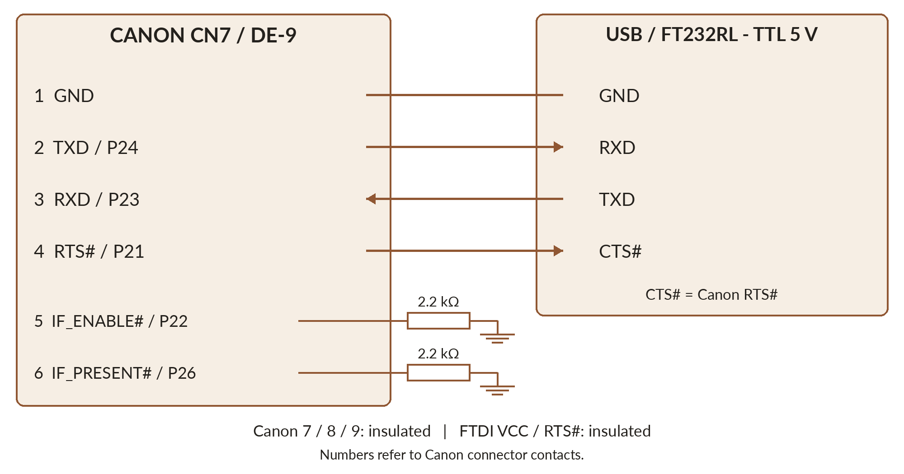
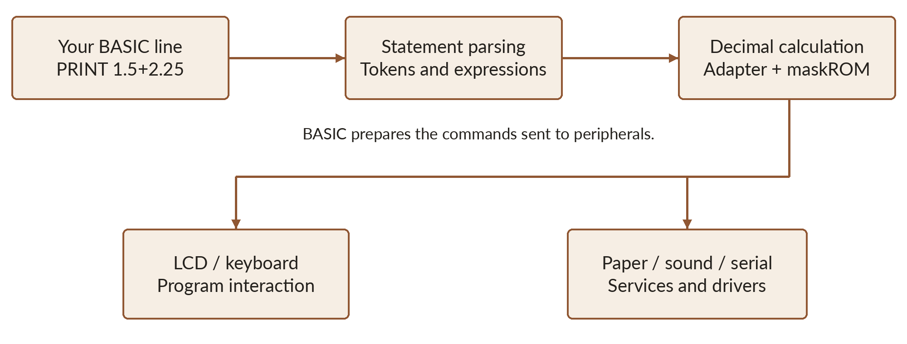

# Typestar BASIC beneath the cover

You can start programming before reading this chapter. It answers another question: **how does a typewriter become a BASIC computer?** Through a new program, carefully organised memory and Canon services we have learned to reuse.


## Understanding before replacing

The S-70 has two program memories: **16 KB maskROM inside microcontroller IC9**, and **32 KB ROM in socket IC8**. Original software distributes services between them. Typestar BASIC replaces IC8 and cooperates with routines retained in the maskROM.

Development began by reading ROMs, then **disassembling** them: identifying HD6301 instructions, tables, calls and peripheral exchanges. The schematic helped connect an address or bit to a real component. [P1]

Short programs then exercised the keyboard, LCD, buzzer, serial connection and printer separately. Hardware observations corrected hypotheses. AI assisted research and code writing; **experiments and technical documents provided verification**.

The new ROM combines a purpose-written interpreter, adaptations of existing services and retained Canon routines. **Typestar BASIC draws inspiration from Microsoft BASIC, with its own capabilities and limits.**

## Canon software: text, memory and cartridges

Original software uses the LCD to review and correct text before printing. The manual advertises approximately **6,000 characters**, stored under **26 title codes**, roughly three A4 sheets. This reserve holds both text and formatting such as margins and tabs. [H9]

An address or letter template can be recalled and reprinted. **COURIER 12II** and **DICTIONARY PSII** cartridges add character designs; analysis revealed font data. **RAM** cartridges preserve documents. The manual describes a 4K model holding about 4,000 characters, powered by a CR2032 lithium battery, with copy and recall functions. [H9]

Typestar BASIC uses the machine's reserve for **one program and its data**, with the organisation below. RAM cartridge support is planned. [The memory chapter](02-hd6301.md) explains retention while switched off.

Differences between the S-60, S-70 and S-90 appear in [the hardware chapter](02-hd6301.md). The S-70 remains the firmware's reference machine.

## Serial communication: understanding the USB cable

Canon offered **Serial I/F-30** and **Parallel Interface-30** to connect certain machines to computers. Their electronics adapted Canon connector signals to the chosen peripheral. Our USB cable provides that connection using an **FTDI FT232RL converter with 5 V TTL levels**. It has been validated with Canon firmware on the S-70 and S-90. [H6] [U1]

**Serial** means the bits of a character follow each other along a wire. The microcontroller has its own SCI interface: **P24 / TXD** transmits and **P23 / RXD** receives. Ground provides a common reference. Each transmitter connects to the other's receiver: Canon TXD to FTDI RXD, Canon RXD to FTDI TXD.



### The nine contacts on the Canon side

The table numbers **Canon CN7 / DE-9 contacts**. Converter RXD and TXD refer to its TTL interface; this table does not use its IC pin numbers. [U1]

| Canon contact | Signal and role | Cable connection |
|---|---|---|
| 1 | GND, ground | FTDI ground. |
| 2 | TXD, P24: Canon transmitted data | FTDI RXD. |
| 3 | RXD, P23: Canon received data | FTDI TXD. |
| 4 | RTS#, P21: *Request To Send* | FTDI CTS#: Canon permits or pauses computer transmission. |
| 5 | IF_ENABLE#, P22: interface enable | One **2.2 kΩ resistor to ground**. |
| 6 | IF_PRESENT#, P26: interface presence | A second **2.2 kΩ resistor to ground**. |
| 7 | DTR#, P27: *Data Terminal Ready*, ONLINE state | Leave insulated in this cable. |
| 8 | Unconnected on the Canon | Leave insulated. |
| 9 | Canon **+5 V** supply | Leave insulated. |

RTS and DTR follow Canon's serial-manual names. **IF_ENABLE# and IF_PRESENT# are functional names used by our documentation**. `#` means active low. Contacts 5 and 6 each have **their own resistor** and remain separate. The FTDI converter's **RTS#** and **VCC** outputs also remain insulated. [H6] [U1]

For a six-wire FTDI TTL-232R cable, the small header contacts are 1 ground (black), 2 CTS# (brown), 4 TXD (orange), 5 RXD (yellow). Contact 3 VCC and contact 6 RTS# remain insulated. Check another adapter's colours and pinout in its own documentation.

DE-9 is also used for RS-232, but **Canon's port operates at 5 V TTL levels**. Choose a 5 V-compatible USB-TTL adapter. Identify contacts by the connector's moulded numbers: front and solder-side views are mirrored. The complete schematic appears in [the appendix](13-annexe-schema.md). [P1]

### The signal that prevents lost characters

A computer can send much faster than the motors print. **Canon RTS# goes low when the machine can receive, and high when it requests a pause.** The converter reads it through CTS#. This hardware flow control lets Canon finish its work before accepting more.

Canon firmware and **Typestar Print** normally use **1200 baud, 7 bits, even parity, 1 stop bit**, or **1200/7E1**. Typestar BASIC defaults to **31250/7E1** for LOAD, SAVE and graphics printing. The cable stays the same; software determines settings and protocol. **Typestar BASIC Studio** handles program transfers, described in [its chapter](02-studio.md#transferts) and [serial commands](09-sons-serie-memoire.md#baud).

## Three stages in executing a statement

For `PRINT 1.5+2.25`, three main operations follow. The parser recognises PRINT and its expression. Arithmetic calculates the number. Display services turn the result into characters and send them to the LCD.



Drawing follows the same principle. BASIC recognises LINE or CIRCLE, prepares a pattern and controls printing. Paper and head need real movement: **a short statement can trigger considerable mechanical work**.

## The memory map

An address identifies a memory cell or hardware register. The technical table uses hexadecimal prefixed by `$`; in BASIC, write hexadecimal constants with `&H`.

| Processor address area | Purpose in the reference S-70 |
|---|---|
| MCU registers and internal RAM | Ports, timers, serial interface and low-level work; 256 bytes internal RAM. |
| `$1800` to `$1FFF` | Workspace: driver states, buffers, console, calculations, loops and stack. |
| `$2000` to `$37FF` | Document area used for BASIC program and data, with a reserved preamble. |
| `$4000` to `$BFFF` | External IC8 ROM: BASIC, data and retained services, according to memory selection. |
| `$C000` to `$FFFF` | 16 KB Canon maskROM and MCU vectors. |

**IC8 contains 32 KB**, corresponding to `$4000` through `$BFFF` when selected. Its lower portion was reorganised to accommodate more functions. Selection circuitry can also map cartridge data into part of the address space. This table summarises firmware areas.

The shared program/data arena spans **`$20C0` to `$37FF`**, or 5,952 bytes. One byte marks program end, so an empty machine announces **5951 bytes free**. Other areas serve Canon routines, interrupts and workspace.

The program grows upwards from the arena's bottom. Data allocates on demand downwards from its top. **FRE(0) and MEM show remaining space**, after program storage and allocations.

> **ROM and RAM have different jobs.** ROM holds the interpreter and resources. RAM holds your game, replaced when you load another program.

## Shortened words: tokens

In Studio, a `.bas` file is readable text. In Canon RAM, several frequent words become **tokens**, single-byte codes. PRINT occupies five letters in the file but one byte in storage.

```basic
10 PRINT "HELLO"
```

This line occupies **12 bytes**: a three-byte header, one PRINT token, one space and the seven characters of `"HELLO"`. The end-of-program zero is shared by all lines.

| Stored line field | Size | Contents |
|---|---:|---|
| Record length | 1 byte | Direct access to the next line; zero ends the program. |
| Line number | 2 bytes | 1 to 65535, high byte first. |
| Line body | Variable | Tokens, text, numbers and punctuation. |

Lines remain sorted by number. **Two bytes support numbers 1 to 65535**; RAM determines how many lines fit. Statements separated by `:` share one header.

The dictionary has **37 codes**, `$80` to `$A4`, for common statements and functions including LLIST, DIM and RND. Each represents a whole word. Other commands may remain written out in the line body.

Variable names, numbers, spaces, strings and REM comments stay readable. A recognised accented character occupies one native byte in a string. LIST and SAVE reconstruct readable text; Studio transfers native records directly.

The saving is greatest with frequent instructions. REM comments retain all their text. Source lines remain limited to **63 native characters**, including number; speed then depends on requested calculations and movement.

## Canon's calculator serves BASIC

Original firmware offers a calculator, reached with CODE+C on the S-70. Analysis identified **decimal addition, subtraction, multiplication and division** routines in the maskROM. Typestar BASIC reuses them rather than duplicating their code in IC8.

A small adapter prepares operands, calls Canon's service and retrieves the result. Native calculations use eight decimal digits and a sign/scale byte. To store BASIC values, the firmware packs digits into **four BCD bytes**, plus one sign/scale byte: five bytes per numeric value, excluding metadata.

*BCD* means each decimal digit occupies four bits. The digits of 12.5 can be stored as `00 00 01 25 01`, whose final byte indicates one decimal place here. The format represents **eight significant digits** and up to **seven decimal places**.

```basic
PRINT 1.5+2.25
PRINT 12.5/2
```


Results are **3.75** and **6.25**. More complex functions such as SIN, COS, LOG and EXP are BASIC's own routines, using decimal arithmetic and approximations.

The adapter respects Canon's workspace, stack depth and interrupt state. Calling an existing routine requires the right data and execution context.

## Fitting the functions into 32 KB

ROM space is limited. Code is organised into assembly modules and entries into retained services. Following calls identified unused paths and allowed modules to occupy available fragments. Shared routines account for workspace and interrupts.

The paper font is **losslessly compressed**. The codec represents **XOR differences between columns**, groups long runs of zero differences, then applies **Huffman coding**, giving frequent patterns shorter codes. Decoding characters individually also saves RAM.

LPRINT caches the distinct characters of a text. Repeated letters reuse the same drawing, avoiding repeated decoding and reducing pauses. Cache preparation and mechanical movement remain separate jobs.

## Retaining programs and sharing buffers

Startup shows BOOTING during checks. A signature, record bounds and integrity check identify retained programs. The firmware accepts valid contents and prepares variables for a fresh run.

Retention uses **powered RAM**. SAVE in Studio provides a durable computer copy. A sufficiently long power loss or failed backup supply can lose the program.

Buffers are shared according to the task. Calculations and ordinary printing have defined spaces. To receive more data, computer graphics printing may reuse the program arena: **NEW occurs when printing actually starts**. CODE+P initially opens a waiting state; Studio announces memory use before sending.

## IC7 and INT/EXT: towards entirely new firmware

The board has a second position, **IC7, marked "128ROM"**, intended for 16 KB, and **INT/EXT solder bridges** near the MCU. These select its mode; experimenters can replace them with pins and removable jumpers. Decoding experiments show IC7 selected for high-region reads. In external mode, the HD6301 can fetch the program corresponding to its internal ROM from a ROM in IC7. [M2]

This could replace Canon maskROM services with entirely original firmware. It **replaces the internal 16 KB**, rather than adding a 16 KB bank to present BASIC. A high ROM must provide appropriate startup and interrupt vectors.

IC7 A14 is tied to +5 V on the studied board: a 32 KB ROM presents **its upper 16 KB half** there. Prepare suitable startup code and vectors. Canon's IC8 image contains different services and requires a different organisation.

**This manual's installation retains INT and Canon's maskROM**, replacing IC8. IC7 opens another development route towards complete software control.

[The Studio chapter](02-studio.md#debogueur) shows how to observe these mechanisms through registers, memory and HD6301 instructions. Physical experiments complement simulation for paper movement and sound.

[P1]: https://ajd.sh/posts/canon-typestar-part-1/
[M2]: references.md
[H9]: https://site.xavier.edu/polt/typewriters/CanonTypestar7.pdf
[H6]: https://archive.org/details/canon-serial-interface-30-manual
[U1]: https://github.com/pR-0000/Typestar-Print/blob/main/docs/CABLE_WIRING.md
