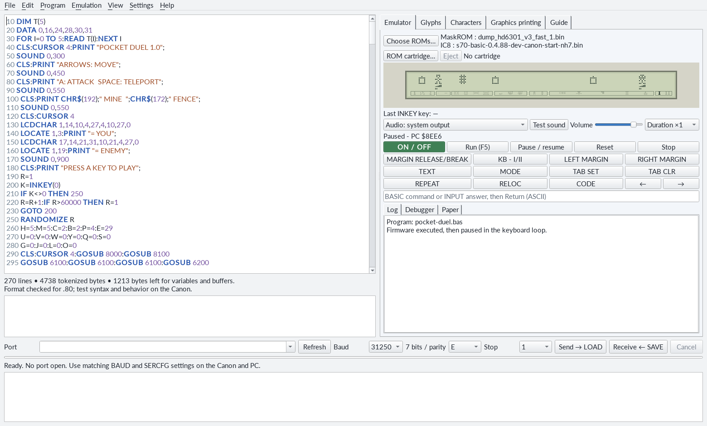
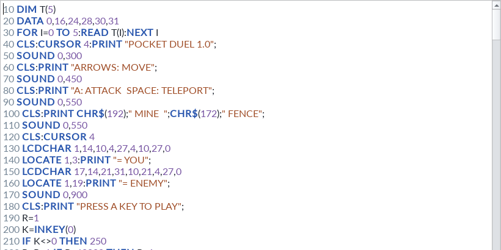
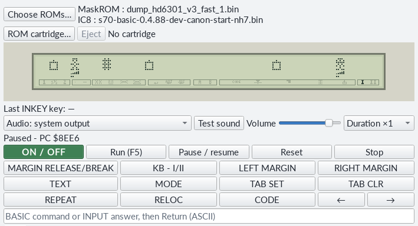
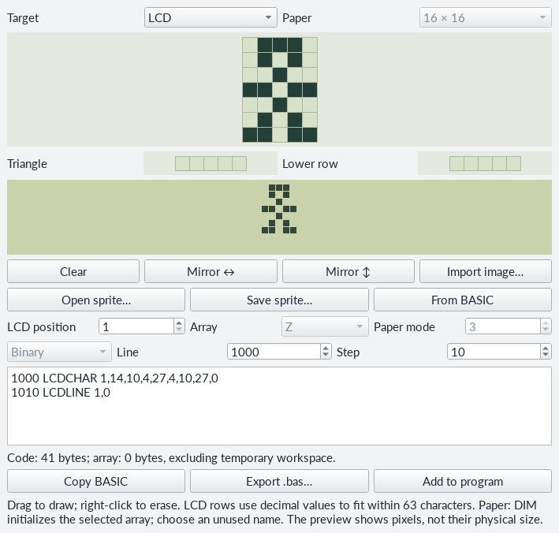
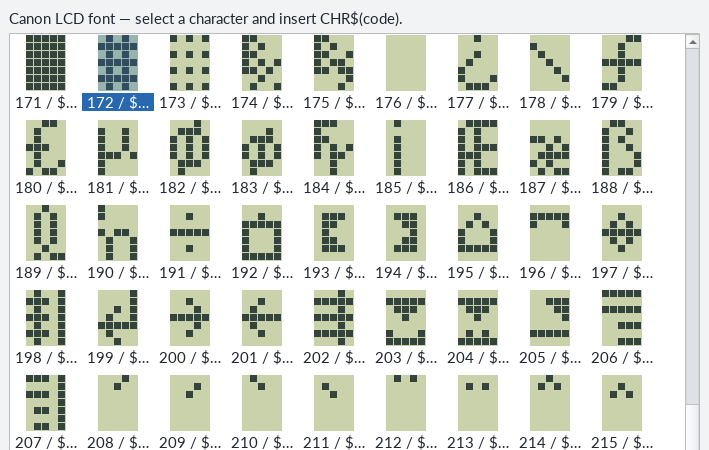
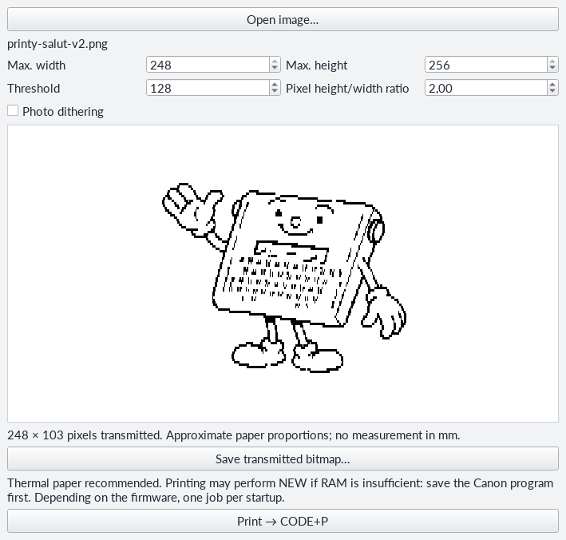
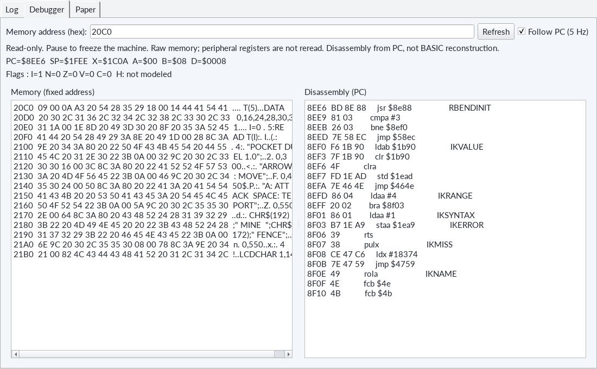
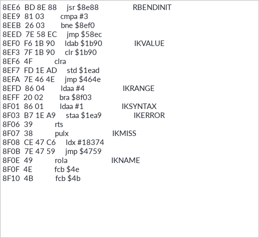

# Typestar BASIC Studio - your computer workshop

Write on a large screen, draw a character with the mouse, then watch it move across the Typestar's thirty-two cells: **Studio brings these steps together in one window**. Prepare ideas in the emulator, then send them to the Canon through the USB cable.



**Three steps to follow:** open a BASIC file, try it with **Run (F5)**, then choose **Send → LOAD** to use it on the real machine. Every workshop in this manual can follow that route.

## Opening and personalising Studio

Install **Python 3.12 or later**, then open **Typestar BASIC Studio.pyw** in the project's `studio` folder. On Windows, double-click to launch. On Linux and macOS, launch the same file with Python 3. Menus and BASIC files stay the same; serial drivers and permissions depend on the operating system.

On first launch, the launcher prepares its Python environment and installs required components. Keep an Internet connection during this preparation. Later launches reuse that environment. `studio-install.log` in the `studio` folder provides details if installation encounters a problem.

English is the default language. Select **Settings → Language → English** if required, then restart to apply it. Under **View → Theme**, choose **Light**, **Dark** or **Follow system**. Language, theme, emulator ROM files and serial settings are retained in **studio.ini**, in the operating system's user configuration folder.

<a id="editeur"></a>
## An editor for preparing instructions

The editor occupies the left side. **Line numbers**, **statements**, **numbers**, **quoted strings** and **REM comments** use different colours, helping distinguish displayed text from BASIC commands.



Use **File → New**, **Open**, **Save** or **Save as** to organise programs. **Ctrl+F** searches; **Edit** provides copy, paste, undo and redo. `.bas` files are **UTF-8** text, allowing recognised LCD accents directly in messages.

**Program → Check limits**, or **F4**, checks line numbers, lengths, characters and tokenised program size. Click a diagnostic to reach the relevant line. The memory estimate precedes variable allocation: execution will also use RAM. Emulator experiments then check calculations and program flow.

**Let's try it.** Create a new file and enter:

```basic
10 CLS
20 PRINT "HELLO!";
30 FOR I=1 TO 3
40 BEEP
50 NEXT I
60 END
```

Save, then press **F5**. The message appears on the virtual LCD and three beeps follow. Change `3` to `5`: your first modification is ready to try.

<a id="emulateur"></a>
## A Typestar on your screen

The **Emulator** tab runs HD6301 instructions from **the two ROM files you select**: Canon's internal maskROM and the external Typestar BASIC firmware. Open **Choose ROMs…**, select your files and keep **Auto** for a recognised pair. Supply Canon files separately. Your choices are retained for next time.



| Control | What it does |
|---|---|
| ON / OFF | Power the virtual machine on or off. ON gives access to startup and welcome messages. |
| Run (F5) | Load the editor text and RUN it. Startup completes automatically; an already-ready machine retains its session. |
| Pause / resume (F6) | Suspend execution, then continue at the same place. |
| Stop | Freeze the machine, display and paper. Pause / resume continues. |
| Reset | Restart the virtual machine's boot sequence. |

Click the **LCD** to give it the computer keyboard. Arrows move; **Escape** requests BREAK. Buttons reproduce Canon's special keys: **MARGIN RELEASE/BREAK**, **TEXT**, margins and tabs. **F7** is **CODE**, **F8** is **MODE**, **F9** is **KB - I/II**. The command field below the buttons also accepts a statement or INPUT reply followed by Return.

For a game, hold the required key during the action: **INKEY reads the held key**. In Pocket Duel, release the arrow after moving to choose the next action. [Complete programs](11-programmes-complets.md) describes each game's controls.

The LCD reproduces the native font, custom characters, triangles, lower line and indicators. **View → LCD pixels** chooses **Contiguous** or **Slightly spaced** pixels. **Emulation → Buzzer sound** enables audio; **Test sound**, output selection, volume and **Duration** help adapt it to your computer.

**A machine for experimenting.** Calculations and BASIC pass through the selected ROMs; motors, paper and buzzer use functional models. Sound and timing approximate the Canon. Serial communication is checked with the cable and real machine: Studio's transfer commands use the physical port.

## Drawing a character and finding its BASIC

In **Glyphs**, select **LCD**. Each grid cell is one pixel of a **5 × 7** character. Click or drag to draw; right-click erases. The two small grids set the **triangle** and **lower line** for the chosen position.



Studio prepares `LCDCHAR` and, as required, `LCDLINE` statements. Choose the **starting line number** and **step**, then **Add to program**. Leave these numbers free; Studio reports collisions. Put initialisation where it executes before the game: a drawing after `END` waits for a subroutine call.

The reverse route is useful too: select glyph-definition lines in the editor and click **From BASIC**. Studio recognises supported definitions and reconstructs the grid. If several are found, select one to edit. Sprites can also be saved as **JSON** or exported as **BASIC**.

**Paper** offers sizes including **16 × 16**, **16 × 8** and **31 × 16**. Rows become binary, hexadecimal or decimal values in a BASIC array. Paper mode **3** doubles width for approximately square pixels. Choose a free array name and initialise it with one `DIM`. [Paper and drawings](08-papier-dessins.md#glyph) explains reuse.

### Choosing an existing character

**Characters** shows LCD font drawings with decimal and hexadecimal codes. Select a cell, then **Insert expression at cursor**, or double-click it. Studio inserts an expression such as `CHR$(172)`.



Put the expression **outside quotes**, as in `PRINT "GRID ";CHR$(172)`. Positions 0 to 15 select custom characters and aliases; their appearance depends on the running program. The [character table](12-table-caracteres.md) is also reproduced near the end.

<a id="transferts"></a>
## From computer to Canon

Connect the USB cable, then choose its **serial port** in Studio's list. Name and description identify the FTDI adapter. Typical names are `COM28` on Windows, `/dev/ttyUSB0` on Linux and `/dev/cu.usbserial-…` on macOS. **Refresh** updates the list.

Usual settings are **31,250 baud, 7 data bits, E parity, 1 stop bit**, or **31250/7E1**. Canon and Studio must match. If changed for another use, `BAUD` and `SERCFG` in [the serial chapter](09-sons-serie-memoire.md#baud) restore matching values.


**To send:** open the program in the editor, choose **Send → LOAD** and confirm replacement of the Canon's program. Then type **LOAD**, followed by **Return**, on the machine. Keep both available until the log reports the final acknowledgement.

**To receive:** choose **Receive ← SAVE**, name the destination file, then type **SAVE** and **Return** on the Canon. Complete reception saves the file to the computer. Open it from **File** to edit; the editor's existing text remains available during reception.

**Cancel** stops the computer operation; data already received remains on the Canon. BREAK restores its console after an interrupted transfer. Use the log to check the port, settings and acknowledgements before retrying.

## Seeing paper and printing an image

Within the emulator, open **Paper**. The sheet develops from columns sent to the print head. Adjust **zoom**, enable **Follow printing**, clear the preview or export **PNG** and **PDF**. [Complete programs](11-programmes-complets.md) includes an explanatory Orbital Duel grid and a simulated Ballistic Duel sheet. Captions distinguish explanatory drawings from emulator captures.

To develop games faster, check **Instant printing**. Studio speeds up BASIC firmware paper routines while preserving their pixels and positions. Calculations, sounds and input waits continue to run, so large maps still take time to prepare. You can change this option during execution. Your choice is saved for the next session.

**Graphics printing** prepares an image for **the real Canon**. Open it, choose dimensions and adjust **threshold**, or enable **Photo dithering** to distribute black dots. The preview shows monochrome output with approximate paper proportions.



Prepare thermal paper, save the program on the Canon, then choose **Print → CODE+P**. After confirming in Studio, press **CODE+P** on the machine. Graphics printing may perform `NEW` to borrow program RAM as a buffer; the confirmation gives you time to save first. Transmitted dimensions reach **248 × 256 pixels**.

<a id="debogueur"></a>
## Observing execution with the debugger

**Debugger** opens a window on processor activity. You can begin programming without it, then return out of curiosity: how do a few BASIC words become HD6301 instructions?



**Registers** are the processor's small working stores. **PC** points to the next instruction; **SP** identifies the stack. **Flags** summarise results such as zero or carry. They describe the currently executing machine code.



**Memory (fixed address)** shows bytes from a chosen hexadecimal address. **Disassembly (PC)** translates bytes into HD6301 instructions and follows PC. Each view scrolls independently. **Follow PC (5 Hz)** updates during execution; **Pause** gives time to read and **Refresh** updates observations.

**A PC address and a BASIC line number are different landmarks.** The former belongs to the processor, the latter to your program. To fix a program, start with BASIC's error line and [the error chapter's method](10-erreurs-et-limites.md). The debugger supplements this by exploring the interpreter; its memory and instruction views are read-only.

**Your turn.** Open **piano-en.bas**, press F5 and try some letters. Then open **pocket-duel-en.bas** to discover custom characters. When ready, send one to the Canon: the same lines leave the computer screen to bring your machine to life.
