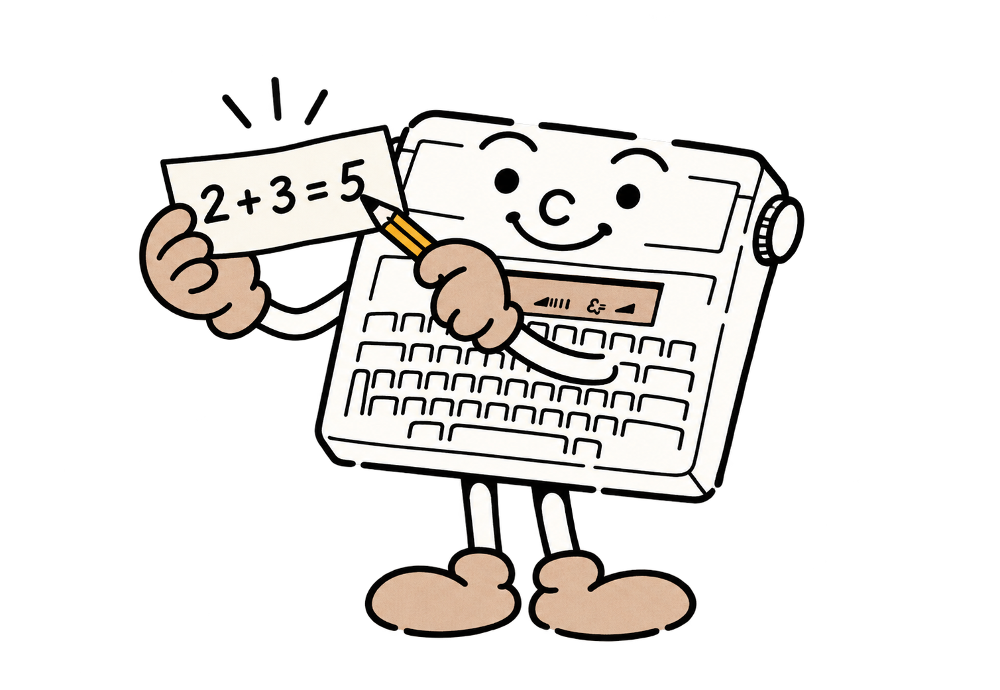
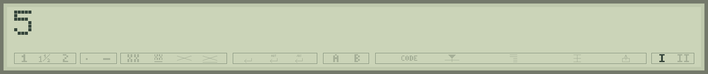

# 3 - Your turn to give instructions

Switch on. While the retained program is checked, `BOOTING` tells you that startup is in progress. **Typestar BASIC** and its version appear next. Press any key to see the available memory, then another to begin. With an empty program, **5,951 bytes** are available for your program and the information it uses.

The `>` sign is the command prompt. It means, "I am ready. What instruction should I follow?" In the examples, the prompt is a landmark. Type only the text inside the box, then press **Return**.



## A first calculation

```basic
PRINT 2+3
```

The machine displays `5`. `PRINT` asks it to display something. Here, that something is the result of an addition.



Press any key to return to the prompt, then try:

```basic
PRINT "HELLO"
```

This time, quotation marks tell BASIC, "Here is some text." The machine displays the letters instead of looking for a calculation. At the end of displayed output or a program, the result stays visible until a key is pressed. You have time to read it.

**Your turn.** Change both numbers in the addition. Then display your first name in quotation marks. You have used BASIC as a little calculator and a message board.

## Moving along a line

The left and right arrows move the cursor through the line you are preparing. The cursor is the blinking rectangle at the next typing position. **Backspace** removes the character to its left, including when capitals are locked.

To remove the beginning of the line at once, place the cursor after the text to remove, then press **CODE + Backspace**. Text on the right is retained. To clear the whole line, first move the cursor to its end.

**LEFT MARGIN** and **RIGHT MARGIN** recall the previous and next console line respectively. History holds eight lines, viewed one at a time on the LCD. To review a program, use `LIST`.

In the BASIC editor, **CODE + left arrow** inserts `<` and **CODE + right arrow** inserts `>`. These signs will help compare numbers. **KB - I/II** switches the keyboard character table.

## Interrupting an experiment

**MARGIN RELEASE**, at the upper left, acts as **BREAK**. If a program keeps running, press it. It also interrupts input and some lengthy operations. A mechanical operation may need to finish its current step before stopping.

After an error or interruption, the display clears and the cursor returns to its default mode. The message stays until **Return**. An error during a program adds `@` followed by the line number: `?SYNTAX @20`, for example, asks you to review line 20.

A syntax error often means a missing quotation mark, comma or parenthesis. Compare your line calmly with the example, correct it and try again.

<a id="run"></a>
## From an immediate command to a program: RUN

An instruction without a line number runs immediately. An instruction with a number is stored for later. This is how a program is built.

Save any program you wish to keep before starting a new exercise. This instruction clears the program in memory:

```basic
NEW
```

Then enter each line separately:

```basic
10 PRINT "HELLO"
20 PRINT 6*7
30 END
```

The lines are stored in number order. Type:

```basic
RUN
```

BASIC displays HELLO, then 42. With only one LCD line, the second output replaces the first. We will learn to request a reply or wait for a key to make each step readable. `END` marks the end of a program; reaching its last line also ends execution.

`RUN` starts from the beginning and resets numeric variables, arrays and working data. String variables become empty. Each RUN prepares a fresh game or calculation.

<a id="list"></a>
## Reviewing and correcting: LIST

```basic
LIST
```

`LIST` shows the program one line at a time. **Return** shows the next; **BREAK** leaves the listing. A source line may be longer than the LCD's 32 visible cells; the listing has to work within that width. Studio lets you read the entire text comfortably on the computer.

Request just line 20:

```basic
LIST 20
```

Or a range, including both endpoints:

```basic
LIST 10,30
```

To replace a line, enter its number and new text. `20 PRINT 7*8` replaces line 20, leaving the others intact. To delete a line, type its number alone: `20`. Numbers range from **1 to 65535**. Choosing 10, 20, 30 leaves room to insert line 15.

For a paper copy, use [LLIST](08-papier-dessins.md#llist). Selecting one line or a range follows the same principle.

<a id="new"></a>
<a id="clear"></a>
<a id="mem"></a>
<a id="fre"></a>
## Managing memory: NEW, CLEAR, MEM and FRE

`NEW` clears the program and working data. `CLEAR` clears only variables, strings and arrays, keeping program lines. Print or cancel any deferred drawing before `CLEAR`.

`MEM` displays the available bytes. A **byte** is a small unit of memory. To use this number in a calculation, request it with `FRE(0)`:

```basic
PRINT FRE(0)
```

The program and variables share the 5,951 bytes available when empty. Common keywords are stored in a shortened form called a **token**, and line numbers use two bytes. You still type the usual words; `LIST` and `SAVE` return ordinary text.

Adding, deleting or successfully changing a line resets variables. Put initial values inside the program using assignments or `DATA`, rather than relying on an earlier keyboard calculation.

The firmware checks retained programs at restart. Powered RAM preserves the program; a computer backup provides durable storage. Variables are recreated during execution. This version holds one program at a time.

## Reading the examples

Keywords appear in capitals to make them easy to spot. Commas, parentheses, quotation marks and semicolons are part of the instruction. In a syntax description, names such as `number` or `column` stand for your own values.

Square brackets mark optional parts. `BEEP [duration]` means you may write `BEEP` or `BEEP 200`. Type the chosen form directly, such as `BEEP 200`. Each boxed program below is a separate exercise: use `NEW` before entering another, after saving anything you wish to keep.
