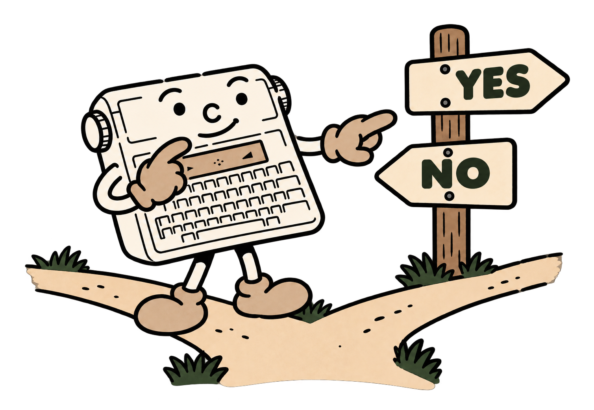

# 5 - Choosing, repeating and finding your way

So far, the machine has followed lines one after another. A game or questionnaire also needs to choose its path. Each answer can lead to its own message.



<a id="input"></a>
## Asking a question: INPUT

```basic
10 INPUT "PRICE";P
20 INPUT "QUANTITY";N
30 PRINT "TOTAL=";P*N
```

`INPUT` waits for your reply, then stores it in the named variable. The optional quoted prompt holds at most **16 characters**. Each statement requests one variable. Use INPUT in a program started with `RUN`.

For a numeric variable such as N, you can answer `4`, `2.5`, or even `2+3`. Empty, incomplete or uncomputable replies are requested again. The previous value remains intact until the new one is accepted. BASIC recognises a number; your program then applies the game's rule. For example, IF can require a positive quantity.

To request text, choose a variable ending in `$`:

```basic
10 INPUT "YOUR NAME";N$
20 PRINT "HELLO ";N$
```

Text keeps its spaces and letter case. Return alone gives an empty string. Type your text directly, then Return. `INPUT` targets a simple variable; to fill an array cell, read a variable first, then assign it to the cell.

<a id="comparaisons"></a>
## Comparing two values

| Sign | Question | Example |
|---|---|---|
| `=` | Is it equal? | `A=5` |
| `<>` | Is it different? | `A<>5` |
| `<` | Is it smaller? | `A<5` |
| `<=` | Is it smaller or equal? | `A<=5` |
| `>` | Is it larger? | `A>5` |
| `>=` | Is it larger or equal? | `A>=5` |

A comparison gives **-1 when true**, and **0 when false**. With `IF`, any non-zero value means true. In an assignment, `A=5` stores 5; in `IF A=5`, the same sign asks a question.

Strings can also be compared, by comparing text with text. Comparison distinguishes capitals from lowercase and follows character-code order. This is enough to check identical words; accented words also follow code order.

<a id="if"></a>
<a id="then"></a>
<a id="else"></a>
## Making a choice: IF, THEN and ELSE

```basic
10 INPUT "YOUR AGE";A
20 IF A<10 THEN PRINT "UNDER TEN"
30 IF A>=10 THEN PRINT "TEN OR OLDER"
```

Line 20 means, "If A is smaller than 10, then display this message." A false condition lets execution continue without taking the branch.

`ELSE` adds the alternative:

```basic
10 INPUT "NUMBER";N
20 IF N=7 THEN PRINT "YOU WIN" ELSE PRINT "YOU LOSE"
```

Both choices belong on **the same physical line**. IF, THEN and ELSE form a statement on that line. After THEN or ELSE, put one statement, several separated by `:`, or a destination line number.

```basic
10 INPUT "NUMBER";N
20 IF N<0 THEN 100 ELSE 30
30 PRINT "NUMBER ACCEPTED":END
100 PRINT "TRY A POSITIVE NUMBER"
110 GOTO 10
```

When several IF statements are nested on one line, ELSE belongs to the nearest unfinished IF. Short branches using line numbers are easier to review in your first programs.

<a id="goto"></a>
## Returning to a line: GOTO

`GOTO 10` means "continue at line 10". The destination must exist and the program must be running. Use it to request another reply, reach another part of a game or repeat some work.

```basic
10 INPUT "WHAT IS 6*7";N
20 IF N<>42 THEN 10
30 PRINT "WELL DONE!"
```

This little quiz continues until the answer is 42. BREAK exits it. A jump that always returns to the same place with no exit creates an infinite loop: the machine continues for as long as you let it.

<a id="for"></a>
<a id="to"></a>
<a id="step"></a>
<a id="next"></a>
## Repeating a known number of times: FOR and NEXT

```basic
10 FOR I=1 TO 5
20 PRINT I
30 SOUND 0,500
40 NEXT I
```

The program displays 1, 2, 3, 4, then 5, pausing half a second between numbers. `FOR` prepares counter I, `TO` supplies its limit, and `NEXT` moves to the next value. The usual step is 1.

Add `STEP 2` to count in twos. To count backwards:

```basic
10 FOR I=5 TO 1 STEP -1
20 PRINT I:SOUND 0,500
30 NEXT I
40 BEEP
```

STEP accepts positive or negative non-zero decimal steps. Choose a sign that leads towards the limit. The loop executes when its initial value lies within the chosen limits.

You may nest loops up to eight levels. Each active loop uses a different control variable: I for rows and J for columns, for example. `NEXT` without a name continues the innermost loop; naming it improves readability. To close two loops, write `NEXT J:NEXT I`.

<a id="gosub"></a>
<a id="return"></a>
## A reusable little task: GOSUB and RETURN

A **subroutine** is a task called from several parts of a program. `GOSUB` remembers where to return, then jumps to the task; `RETURN` resumes immediately after the call.

```basic
10 GOSUB 100
20 PRINT "HELLO":SOUND 0,500
30 GOSUB 100
40 END
100 SOUND 300,100:SOUND 450,100
110 RETURN
```

The same little signal plays twice. `END` keeps the main program from continuing accidentally into lines 100 and 110. A subroutine shares the main program's variables.

You can nest eight calls. RETURN resumes after the matching GOSUB; finish loops opened inside a subroutine before returning.

<a id="end"></a>
<a id="rem"></a>
## Ending and explaining: END and REM

`END` ends the program. `REM` starts a comment for the person reading it.

```basic
10 REM CALCULATE THE TOTAL PRICE
20 P=2.5:N=4
30 PRINT P*N
40 END
```

A comment takes **the rest of the line**, including any `:` signs and ELSE keywords. Write the comment directly after REM, using unaccented ASCII characters.

<a id="data"></a>
<a id="read"></a>
<a id="restore"></a>
## Preparing values: DATA, READ and RESTORE

`DATA` stores a list of values in the program text. `READ` takes the next value and puts it in a variable. Reading follows the DATA statements in program order.

```basic
10 DATA "ALICE",12,"BRUNO",15
20 READ N$,A
30 PRINT N$;" : ";A:SOUND 0,1000
40 READ N$,A
50 PRINT N$;" : ";A
```

The program displays ALICE : 12, then BRUNO : 15. The destination must match the data type: a string for text, a numeric variable for a number. `READ` can also fill a numeric array cell.

DATA holds **constants**: write `DATA 6`. Decimal, binary and hexadecimal numbers are accepted. Quote text; commas inside quotes then belong to the text.

`RESTORE` returns reading to the first DATA. It takes no line number. Reading beyond the available data causes an error. A type error leaves the offending item in place rather than skipping it.

```basic
10 DIM A(2)
20 DATA 3,5,8
30 FOR I=0 TO 2:READ A(I):NEXT I
40 RESTORE
50 READ N:PRINT N
```

The final result is 3, because RESTORE returned reading to the beginning.

<a id="and"></a>
<a id="or"></a>
<a id="not"></a>
<a id="mod"></a>
## Combining questions: AND, OR, NOT and MOD

To accept a number from 1 to 6, both conditions must be true:

```basic
10 INPUT "FROM 1 TO 6";N
20 IF (N>=1) AND (N<=6) THEN 40
30 GOTO 10
40 PRINT "ACCEPTED"
```

`AND` requires both conditions. `OR` accepts either: `IF (N<1) OR (N>6) THEN 10` asks again for out-of-range values. `NOT` inverts bits; applied to a true (-1) or false (0) comparison, it also reverses the answer.

These operators use **16 bits**: `%101 AND %011` gives 1 and `%101 OR %011` gives 7. Integer operands range from -32768 to 65535; results are signed, from -32768 to 32767. Parenthesise comparisons in conditions. AND and OR evaluate both sides: check B before calculating A/B.

`MOD` gives the integer remainder: `17 MOD 5` gives 2. Test `N MOD 2=0` to recognise an even number. Choose a non-zero divisor; the remainder follows the dividend's sign.
