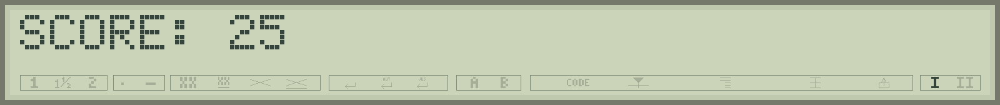
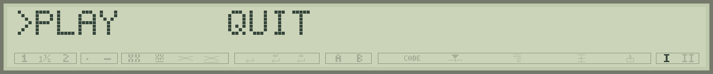
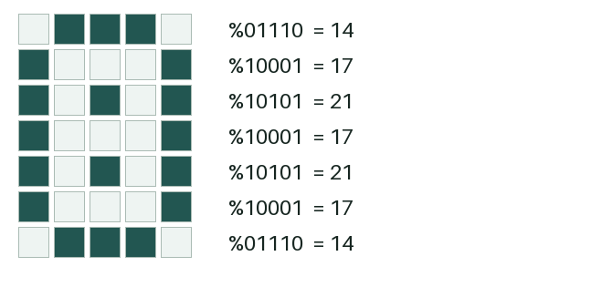
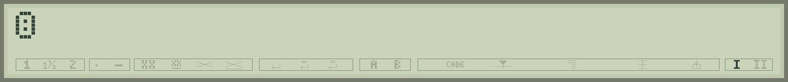
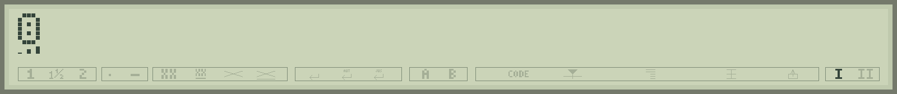
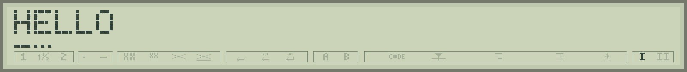
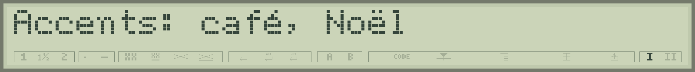

# 7 - Composing a screen and listening to the keyboard

The LCD has one line of **32 characters**. Each letter occupies five columns of seven pixels, with a small gap between cells. Below are five-segment triangles, five-pixel lines and panel indicators. A little display can become a menu, a scoreboard or even a playing field.

<a id="print"></a>
## PRINT: displaying exactly what you want

PRINT accepts numbers, strings, variables and calculated results. A semicolon joins items; a comma adds **one space**.

```basic
PRINT "SCORE=";12
PRINT "A","B"
```

You obtain SCORE=12, then A B. A final semicolon lets the next output continue on the same line. PRINT with no argument ends the current line.

```basic
10 PRINT "TYPE";
20 PRINT "STAR"
```

The result is TYPESTAR. Plan menus and games around the 32 visible cells. Divide long text into several readable screens.

To display a comparison starting with a string, parenthesise the expression: `PRINT ("A"="A")` gives -1. Otherwise PRINT may take the first string as an output item.

<a id="cls"></a>
<a id="locate"></a>
## CLS and LOCATE: writing in the right place

`CLS` clears text, composed triangles and lower lines created with LCDLINE. Other indicators keep their state. `LOCATE 1,column` positions the next output at a column from **1 to 32**. The first parameter remains 1: the console keeps history, but the physical LCD shows one text line.

```basic
10 CLS
20 PRINT "SCORE: ";
30 LOCATE 1,8:PRINT 25;
```

The score starts in the eighth cell. When replacing 100 with 9, add spaces after the new number, otherwise the remaining zeros could make 900. `PRINT "9  ";` occupies all three cells.



For menus, update just the cursor rather than all the text:

```basic
10 CLS:PRINT " PLAY     QUIT";
20 LOCATE 1,1:PRINT ">";
30 SOUND 0,1000
40 LOCATE 1,1:PRINT " ";
50 LOCATE 1,10:PRINT ">";
```



The marker changes choice without redrawing everything. Final semicolons are especially useful for these local updates.

<a id="cursor"></a>
## CURSOR: choosing the input cursor

| Mode | Effect |
|---:|---|
| 0 | Blinking rectangle without triangle; default at startup. |
| 1 | Blinking hardware cursor and triangle. |
| 2 | Steady hardware triangle. |
| 3 | Blinking hardware cursor with steady triangle. |
| 4 | Cursor disabled. |

`CURSOR 4` suits a game screen reserved entirely for your drawing. `CURSOR 0` restores the usual rectangle. This command chooses cursor behaviour; use LCDTRI to draw a triangle at a particular cell.

<a id="lcdchar"></a>
## LCDCHAR: drawing a five-by-seven character

Describe each row with five bits. The left bit is the drawing's leftmost pixel. Here is a little face:



```basic
10 CLS:CURSOR 4
20 LCDCHAR 1,14,17,21,17,21,17,14,0
```

After position 1 come **seven numbers for the seven rows**, then a final triangle mask. All are required, ranging from 0 to 31. Zero leaves the triangle off here.



Binary makes the drawing easier to see. Since a source line is limited to 63 characters, an array can keep the layout readable:

```basic
10 DIM A(7)
20 DATA %01110,%10001,%10101,%10001
30 DATA %10101,%10001,%01110,0
40 FOR I=0 TO 7:READ A(I):NEXT I
50 CLS:CURSOR 4
60 LCDCHAR 1,A(0),A(1),A(2),A(3),A(4),A(5),A(6),A(7)
```

This displays the same face. LCDCHAR receives each row separately, as A(0), A(1), and so on. BASIC automatically allocates a custom-character slot to the displayed pattern.

**Your turn.** Replace the third row `%10101` with `%10001`. The two inner pixels disappear. Try changing the last row to make another face.

<a id="lcdtri"></a>
## LCDTRI: five segments beneath a character

```basic
10 CLS:CURSOR 4
20 LCDTRI 5,%10101
```

The fifth cell shows a triangle with alternate segments lit. Bit 4 controls the leftmost, shortest segment; bit 0 controls the rightmost, tallest segment. `%11111`, or 31, lights the whole triangle; 0 switches it off.

LCDTRI composes a triangle with **a space or a character defined by LCDCHAR**. To accompany a letter, define its drawing with LCDCHAR, then add LCDTRI. Composition uses the custom pattern's accessible bitmap. Native letters are drawn by the controller; trying to combine one with LCDTRI produces `?LCD CHAR`.

```basic
10 CLS:CURSOR 4
20 LCDCHAR 1,14,17,21,17,21,17,14,0
30 LCDTRI 1,%10101
```

The face and triangle share a cell. PRINT at that position replaces both. On a custom character, LCDTRI changes just the triangle mask and keeps the seven drawing rows.



<a id="lcdline"></a>
## LCDLINE: a little independent line

```basic
10 CLS
20 PRINT "HELLO";
30 LCDLINE 1,%11111
40 LCDLINE 2,%10101
```

All five pixels light beneath the first letter; alternate pixels light beneath the second. Bit 4 is on the left. Position ranges from 1 to 32, mask from 0 to 31.



These pixels stay lit when text is rewritten at the same positions: they are independent of the letter. `LCDLINE 1,0` clears the first cell's line. CLS clears all these lines. Use them for underlining or progress indicators.

## Eight patterns, thirty-two cells

The LCD has **eight custom-pattern slots**, shared by LCDCHAR, composed triangles and LCDLINE. The rectangular cursor now uses a native character, leaving all eight slots available.

Several display cells can share a pattern: the same triangle or lower-line mask may serve several cells. Each LCDCHAR definition has its own slot. Different masks can exhaust slots before all 32 cells are occupied.

The firmware reuses a slot when the last cell referring to it is cleared. To remove a character from cell 5:

```basic
LOCATE 1,5:PRINT " ";
LCDLINE 5,0
```

The first statement removes character and triangle; the second removes any independent line there. Remove other references to a shared pattern too. CLS clears the whole screen. If every slot is still used, a new request gives `?LCD SLOTS`.

<a id="icon"></a>
## ICON: panel indicators

`ICON index,code` writes to a lower-panel cell. Index ranges from **0 to 31**, code from **0 to 255**. Each pair selects a cell and the raw pattern written there.

On the S-70 documented for the project, this example operates the indicator at cell 20:

```basic
ICON 20,178
SOUND 0,1000
ICON 20,32
```

32 is the space code used to clear this cell. Its visible meaning depends on panel-segment wiring; LCD variants can have different symbols. Cells 30 and 31 also serve keyboard I/II indicators. Reserve them if you want to keep that indication.

CLS preserves ICON indicators except cells occupied by custom lower lines whose references it removes. Reserve separate cells for ICON and LCDLINE to maintain independent states.

<a id="inkey"></a>
<a id="keys"></a>
## INKEY and KEYS: finding which key was pressed

INPUT suits a complete reply. `INKEY(0)` suits menus and games: it returns an available key code, or zero while waiting. Read it again when the result is zero.

```basic
10 CLS:PRINT "PRESS A KEY";
20 K=INKEY(0)
30 IF K=0 THEN 20
40 PRINT "CODE=";K
```

INKEY's parameter is always zero. An available key is consumed once; the program sets the pace of subsequent reads. BREAK retains its interrupt role.

| Useful key | INKEY result |
|---|---:|
| Return | 13 |
| Backspace | 8 |
| Space | 32 |
| Left arrow | 18, or `&H12` |
| Right arrow | 19, or `&H13` |

Arrows have their own control codes. Digit keys "1" and "2" return 49 and 50 respectively.

`KEYS`, entered at the command prompt, diagnoses **physical** codes. Backspace is physically &H2F and INKEY returns 8; arrows are physically &H31 and &H32 and INKEY returns 18 and 19. Test arrows with `IF K=18 THEN ...` or `IF K=19 THEN ...` in a program.

## Accents and native characters

In a computer-prepared BASIC file, recognised accents may appear inside quotes: `PRINT "Accents: café, Noël"`. Studio converts them. Physical typing also depends on the keyboard table; Studio lets you prepare accented text with the computer keyboard.



The table supports **Ç ç ß Ë É Â é È Ò Ù à è ì ò ù Ä Ö Ü ä ö ü â ê î ô û ã Ã Ï õ Õ Ñ ñ ë ï**. Use CHR$ and Studio's catalogue for other native symbols. Codes 0 to 7 select custom characters; 8 to 15 alias the same eight patterns. Codes 16 to 31 appear blank in experiments. Code 32 is space.

The [character table](12-table-caracteres.md) reproduces all 256 native codes from Studio's palette and distinguishes LCD patterns from the paper font.
