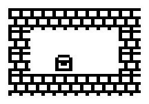

# Workshop: a map made of small pictures

A **tilemap** is a map made of small cells. We prepare a few pictures in a **palette**, then give their numbers to compose the plan. Think of a mosaic: a wall is tile **1**, a chest is tile **2**, and **0** leaves white paper.

Open [tilemap-en.bas](../../../examples/graphics/tilemap-en.bas) in **Typestar BASIC Studio**. The program uses one array, **G**, to prepare a map **6 columns wide and 4 rows high**. First, here is how the data reaches the printer.

## DATA prepares values; READ takes them one at a time

**DATA holds constants in the program text.** A constant can be a number such as 1 or a binary picture such as `%11111111`. The program chooses their destination using **READ**.

Imagine every DATA value lined up along one long ribbon. A small marker points to the next value to read. RUN starts with the marker at the beginning. Each READ takes the next value and advances the marker. Values on the same DATA line are read from left to right, then reading continues in the next DATA statement. Comments are skipped.

**BASIC line numbers put DATA statements in reading order.** You can renumber them while keeping this order and get the same picture. The destination named in READ determines where values are stored: `READ A,B` fills A then B; `READ G(64)` fills array cell G(64) directly.

DATA can appear after END, as it does here: READ finds values throughout the program. END stops instruction execution. `RESTORE` moves the marker back to the first DATA; GOTO chooses the next instruction to execute. In this workshop, we retain the marker between reading the pictures and reading the plan, to follow the whole ribbon in order.

## Why share one array?

**GLYPH's fast mode 5 expects a specific format**: first the pixels for a palette of 16 pictures, then the numbers of the pictures to print across one map row. Array G places these two parts side by side. The palette stays in place; the small map-row section is reused four times. This saves RAM and enables one continuous carriage sweep per row.

| Array elements | Purpose |
|---|---|
| G(0) through G(3) | Tile 0: empty floor, already zero after DIM. |
| G(4) through G(7) | Tile 1: wall, loaded once. |
| G(8) through G(11) | Tile 2: chest, loaded once. |
| G(12) through G(63) | Room for 13 more pictures, left zero. |
| G(64) through G(69) | The 6 picture numbers for the map row to print now. |

The **first 64 values** describe the pictures. The **next 6** are choices from that palette: 0 for floor, 1 for wall, 2 for chest. A picture number identifies its place in the palette; a BASIC line number identifies its place in the program.

## The complete program

Each picture uses **8 DATA lines of 8 bits**, one per pixel row. The final four DATA lines describe the plan. Read the comments, then follow the values' journey explained after the listing.

```basic
10 REM A MAP WITH 6 COLUMNS AND 4 ROWS
20 REM G(0) TO G(63): PALETTE OF 16 TILES
30 REM G(64) TO G(69): 6 CELLS TO PRINT
40 DIM G(69)
50 REM TILE 0: THE FLOOR STAYS EMPTY THANKS TO DIM
60 REM TILE 1: THE WALL USES G(4) TO G(7)
70 REM TILE 2: THE CHEST USES G(8) TO G(11)
80 REM READ TAKES DATA VALUES IN THEIR ORDER
90 FOR I=4 TO 11
100 READ A,B
110 G(I)=256*A+B
120 NEXT I
130 REM LSPACING 1 KEEPS THE MAP BANDS TOGETHER
140 LSPACING 1
150 REM READ CONTINUES: 6 TILE NUMBERS PER MAP ROW
160 FOR Y=1 TO 4
170 FOR X=0 TO 5
180 READ G(64+X)
190 NEXT X
200 REM 6 TILES, 8 PIXELS HIGH, MODE 5
210 GLYPH G(0),6,8,5
220 NEXT Y
230 REM PRESENT THE DRAWING ABOVE THE PRINT HEAD
240 ORIGIN:FEED 128
250 END
260 REM TILE 1: WALL, 1 DATA LINE PER PIXEL ROW
270 DATA %11111111
280 DATA %10001000
290 DATA %10001000
300 DATA %11111111
310 DATA %00100010
320 DATA %00100010
330 DATA %11111111
340 DATA %10001000
350 REM TILE 2: CHEST, READ FROM TOP TO BOTTOM
360 DATA %00000000
370 DATA %00111100
380 DATA %01000010
390 DATA %01111110
400 DATA %01011010
410 DATA %01000010
420 DATA %01111110
430 DATA %00000000
440 REM THE MAP: 0 FLOOR, 1 WALL, 2 CHEST
450 DATA 1,1,1,1,1,1
460 DATA 1,0,0,0,0,1
470 DATA 1,0,2,0,0,1
480 DATA 1,1,1,1,1,1
```



## Following the data onto the paper

### 1. Preparing the array

Line **40**, `DIM G(69)`, creates **70 cells**, numbered 0 through 69, all zero. Tile 0 therefore represents empty floor. We will fill tiles 1 and 2, then the six cells for the map row to print.

### 2. Reading the wall and chest pixels

The loop on lines **90 through 120** varies I from 4 through 11, making **8 iterations**. On each iteration, line **100**, `READ A,B`, reads **2 values**: one pixel row into A, then the next into B. It therefore consumes the **16 DATA values on lines 270 through 430**, in order.

Line **110**, `G(I)=256*A+B`, stores that pair in G. The driver expects two eight-pixel rows per value. Multiplication of A by **256**, or **2 to the power of 8**, puts its eight pixels ahead of B's. The wall's first two lines, `%11111111` and `%10001000`, thus become `%1111111110001000` in G(4).

| Iteration | Values taken by READ A,B | Destination prepared by line 110 |
|---|---|---|
| I = 4 | DATA on lines 270 and 280 | G(4), start of the wall. |
| I = 5 | DATA on lines 290 and 300 | G(5), next part of the wall. |
| I = 7 | DATA on lines 330 and 340 | G(7), end of the wall. |
| I = 8 | DATA on lines 360 and 370 | G(8), start of the chest. |
| I = 11 | DATA on lines 420 and 430 | G(11), end of the chest. |

A **1** prints a black dot; a **0** leaves white paper. Look at the chest's eight lines from top to bottom: you can recognise its shape directly in the bits. Leading zeros keep the rows aligned.

### 3. Continuing with the plan

After those 16 values, the reading marker points to **the first 1 on line 450**. The loop on lines **170 through 190** varies X from 0 through 5. Line **180**, `READ G(64+X)`, stores the next six values directly in G(64) through G(69).

| Map row Y | DATA read | Contents of G(64) through G(69) |
|---|---|---|
| 1 | Line 450 | 1, 1, 1, 1, 1, 1 |
| 2 | Line 460 | 1, 0, 0, 0, 0, 1 |
| 3 | Line 470 | 1, 0, 2, 0, 0, 1 |
| 4 | Line 480 | 1, 1, 1, 1, 1, 1 |

These new values replace only the six working cells. Pictures in G(0) through G(63) remain ready to use. The outer Y loop makes us read and then print each of the four map rows.

### 4. Giving the array to GLYPH

Line **210**, `GLYPH G(0),6,8,5`, means: "use the array starting at G(0), print **6 pictures 8 pixels high**, using **mode 5**". G(0) identifies the start of the buffer here.

GLYPH reads pixels from the first 64 cells and map-row choices from the next six. It then draws the pictures in order. **READ loaded the data; line 110 assembled the pixels; GLYPH prints the prepared array.** These instructions explicitly connect DATA to printing.

`LSPACING 1` brings the bands together into a continuous map. Mode 5 retains mode 4's large square pixels and prints consecutive pictures, including empty cells, in one pass. Finally, line 240 presents the drawing above the print head.

## Your turn!

Replace a border **1** with **0** to open a doorway. Move the **2** in the plan DATA to change the chest's position. Line numbers can change: keep picture DATA before plan DATA, in the same order as their READ statements.

To create picture **3**, add its **8 DATA lines** between the chest and the plan. Extend the loading loop to `FOR I=4 TO 15`: the new picture will fill G(12) through G(15). Then put some **3s** in the plan.

To use eight columns, use `DIM G(71)`, change `FOR X=0 TO 5` to `FOR X=0 TO 7`, add two values to each map row and call `GLYPH G(0),8,8,5`. One row supports up to **40 pictures**; reserve that many cells after the palette's 64 values.

A **16 × 16** picture splits into four 8 × 8 tiles: top left, top right, bottom left and bottom right. Print the upper parts across the whole row, then the lower parts. **Ruins** and **Orbital Duel** use this principle to retain their large artwork while reducing carriage returns.
