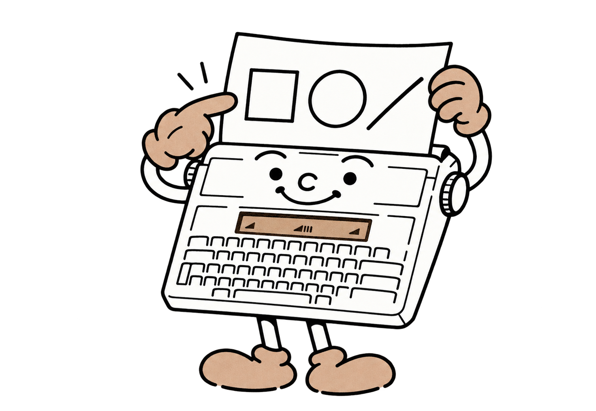
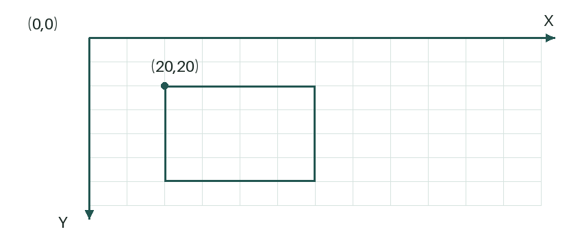

# 8 - Your program leaves a mark on paper

The display shows the present result. Paper can keep a game log, a map or a drawing. Load a sheet securely in the rollers. For drawings and repeated experiments, **A4 thermal paper, preferably BPA-free**, saves transfer ribbon; plain paper requires a ribbon.

Start with small patterns away from the edges. Choose an origin and check that the drawing fits. **Printed marks stay on the paper**: new patterns are superimposed on existing ones.



<a id="lprint"></a>
## LPRINT: output on paper

```basic
10 LPRINT "MY FIRST PROGRAM"
20 LPRINT "2+3=";2+3
```

LPRINT follows PRINT's principles: quoted text, calculated values, semicolons to join items and commas to add one space. The leading L indicates printer output. Write **LPRINT**, with one initial L.

A final semicolon keeps the paper line open:

```basic
10 LPRINT "DAY ";1;" - ";
20 LPRINT "SCORE ";25
30 LPRINT
```

The first two statements print DAY 1 - SCORE 25 on one line. The third adds a blank line. Without a final semicolon, the line ends and the paper advances by the selected spacing.

Maximum width is **72 characters**. Choose paragraph line endings yourself; a statement exceeding the remaining width is rejected before printing. Several short strings can form one long paper line: multiple 63-character BASIC lines may contribute to it.

### The paper font and LCD font

The paper font is **Courier 10 from Canon's original firmware**, losslessly compressed to fit the BASIC ROM. Some punctuation has been adapted to ASCII. LPRINT provides the **95 printable ASCII characters**, codes 32 to 126: letters, digits and punctuation, including backslash, vertical bar and brackets. `CHR$(92)` prints a backslash, `CHR$(124)` a vertical bar, and `CHR$(34)` a quotation mark.


For initial paper text, use letters from this table, such as "Cafe". Accepted codes are **32 to 126**; other values cause an error. GLYPH and geometry commands let you create extra signs, accents and drawings.

<a id="llist"></a>
## LLIST: keeping your program on paper

Would you like to review your program comfortably? Type **LLIST** at `>`: the machine prints the line numbers and statements in memory.

```basic
LLIST
```

Supply a number for one line, or first and last numbers separated by a comma for a range:

```basic
LLIST 20
LLIST 10,100
```

Both endpoints are included; missing lines are skipped. The listing uses **Courier 10** and **LSPACING**. Lines print consecutively; **MARGIN RELEASE / BREAK** interrupts printing. A paper line already opened by LPRINT and a semicolon is finished before listing begins.

LLIST is a **console command**, like LIST. Your program and variables remain in memory. LCD-specific characters outside ASCII print as **?**: "été", for example, becomes "?t?". Listing continues normally. Full text remains available through LIST and SAVE in Studio. Leave a little free RAM for the driver to prepare glyphs, as with LPRINT.

> **Try this:** open Piano in Studio, send it to the machine, then type `LSPACING 1.5` and `LLIST 10,100`. You have the beginning of its listing, ready for pencil notes.

<a id="lspacing"></a>
## LSPACING: choosing line spacing

```basic
LSPACING 1.5
```

Choose **1**, **1.5** or **2**. The default is 1.5. A value of 1 is close spacing; 1.5 gives breathing room; 2 doubles the line pitch. These values control both LPRINT advance and the LLOCATE grid.

Choose spacing **before** preparing a text block. LSPACING declares the current physical position as the new text origin. Changing it within a layout therefore changes the starting point. Graphics and FEED retain their own units.

<a id="llocate"></a>
## LLOCATE: returning to a text cell

`LLOCATE row,column` positions text in a grid of **64 rows and 72 columns**, numbered from 1. Its first position corresponds to the physical position when the text reference was established. Position the paper before establishing it.

```basic
10 LSPACING 1.5
20 LPRINT "NAME      SCORE"
30 LPRINT "ALICE"
40 LLOCATE 2,11:LPRINT 25;
```

ALICE is printed, then the score is added in column 11 of the same row. The paper moves to reach the target. Returning to text **superimposes** marks: existing printing remains.

LLOCATE and LPRINT share a reference. After graphics, glyphs or motor operations, establish a new text block with LSPACING or ORIGIN at a known position. This gives subsequent lines a consistent reference.

Repeated round trips may cause slight mechanical drift, as observed in tests. Calibration depends on machine and paper. For a log, move in one direction as much as possible; for a game overprinting a grid, check the result on your own machine.

<a id="repere-graphique"></a>
## Before drawing: three different units

Text uses **rows and columns**. Shapes use **graphics coordinates**. Motors use **movement units**. Each reference has its own unit.

In a drawing, X increases to the right and Y downwards. Allowed coordinates are **X 0 to 247** and **Y 0 to 255**. Graphics units correct the different physical dot sizes on the two axes: equal width and height give approximately a square.



The coordinates define a logical drawing window on paper. The head prints native rows: Y is converted to `INT(Y/2)`. Two consecutive Y coordinates may fall on the same row. Small curves reveal the steps of this dot grid.

For a complete drawing, define shapes in the same reference using DRAW DEFERRED. To arrange several drawings on a sheet, use motor commands between compositions, respecting their own units.

<a id="point"></a>
<a id="line"></a>
## POINT and LINE: the first marks

`POINT x,y` prints a point. `POINT x,y,size` prints a square point of size **1 to 16**; default 1.

`LINE x1,y1,x2,y2,thickness` joins two points. Thickness is required, an integer from **1 to 16**. Coordinates must also be integers.

```basic
10 LINE 0,0,60,40,2
```

The line joins the first point to the second. Keep Y unchanged for a horizontal line, X unchanged for a vertical line. Increase thickness for a more visible mark, up to 16.

<a id="box"></a>
## BOX: an outline or filled rectangle

```basic
10 BOX 0,0,60,40,2,0
```

The coordinate pairs give opposite corners. Place the first corner above and left of the second, with **x1 ≤ x2 and y1 ≤ y2**. The next-to-last number is thickness. The last selects **0 for an outline**, **1 for a filled rectangle**.

`BOX 0,0,40,40,2,0` gives a square. Supply thickness for filled shapes too: `BOX 0,0,40,40,1,1`.

<a id="circle"></a>
## CIRCLE: a circle or disc

```basic
10 CIRCLE 30,30,20,2,0
```

The first two numbers give the centre, the third the radius, followed by thickness and fill. Radius must be a positive integer; thickness ranges from 1 to 16. The last parameter is 0 for an outline, 1 for a filled disc.

The whole circle must fit within drawing limits. Centre 30,30 with radius 20 stays between 10 and 50 on each axis. A very small circle may resemble a rounded polygon because it contains few dots.

<a id="draw"></a>
## DRAW: printing now or preparing a composition

The default is **DRAW INSTANT**. Each POINT, LINE, BOX or CIRCLE prints immediately. Printing may advance the paper; the next command uses the current physical position. Prepare a deferred composition to superimpose shapes in one reference.

Prepare a rectangle, its diagonal and a circle together:

```basic
10 DRAW DEFERRED
20 BOX 0,0,60,60,2,0
30 LINE 0,0,60,60,2
40 CIRCLE 30,30,20,2,0
50 DRAW PRINT
```

DRAW DEFERRED opens a composition. Commands add shapes without printing. DRAW PRINT prints everything, closes the composition and restores immediate mode. DRAW CANCEL discards it and also restores immediate mode.

A composition holds at most **32 shapes**. POINT counts as one, even at size 1. Calling DRAW DEFERRED again retains the open list; cancel first to start afresh. Switching to INSTANT is rejected while shapes remain pending; print or cancel them.

Composition also reduces movement and repeated printing of the same bands. Empty band tails and completely empty bands are skipped where possible. Preparing elements together is often faster than printing each small line separately.

<a id="origin"></a>
<a id="move"></a>
<a id="head"></a>
<a id="feed"></a>
## ORIGIN, MOVE, HEAD and FEED: controlling the motors

These commands position things. **ORIGIN declares the coordinates of the current physical position**. MOVE, HEAD and FEED perform movements; you choose the reference's starting point.

| Command | Meaning | Limits |
|---|---|---|
| `ORIGIN` | Declare the current position as 0,0. | Reference definition. |
| `ORIGIN x,y` | Assign the given coordinates to it. | X 0..128; Y 0..448. |
| `MOVE x,y` | Move to an absolute position in this reference. | X 0..128; Y 0..448. |
| `HEAD dx` | Move the head relatively. | dx -128..128. |
| `FEED dy` | Move the paper relatively. | dy -448..448. |

ORIGIN with X alone gives Y=0. One **motor unit represents two phase changes**; text and graphics references use their own units. The final position must stay within bounds. Negative FEED reverses movement; positive FEED advances in the printing progression direction.

```basic
ORIGIN:HEAD 8:HEAD -8
ORIGIN:FEED 112:FEED -112
```

The first experiment moves the head away and back. The second makes a paper round trip. Load the sheet so it remains gripped throughout both movements. These commands drive motors only; printing controls heating.

To reverse from the present position, assign a known positive coordinate: `ORIGIN 0,112:FEED -56`. ORIGIN declares the estimated position as 112, then FEED commands 56 units backwards.

Printing, an error or BREAK invalidates motor tracking. Declare ORIGIN again before a new sequence and close graphics compositions before driving motors. Let the program move the paper to retain its reference.

<a id="glyph"></a>
## GLYPH: printing your own drawing

A **glyph** is a pixel drawing. In a list, each row holds a binary, hexadecimal or decimal mask. Width and height range from **1 to 16**; bit width-1 is the leftmost pixel.

```basic
10 DIM A(7)
20 DATA %00111100,%01000010,%10100101,%10000001
30 DATA %10100101,%10011001,%01000010,%00111100
40 FOR I=0 TO 7:READ A(I):NEXT I
50 GLYPH A(0),8,8,3
```

The face has eight rows of eight pixels. A(0) selects its first source row; 8,8 gives dimensions; 3 selects proportions.

| Mode | Effect |
|---:|---|
| 1 | Native dots, one dot per source pixel; default when omitted. |
| 2 | Double width and height. |
| 3 | Double width only, for approximately square proportions. |

Native dots are taller than wide: **mode 3** makes approximately square proportions. **Mode 2** doubles both dimensions while retaining the native ratio. Always supply source dimensions.

### A matrix for pixels

A matrix holds **0 or 1 per pixel**, with **1 to 31 columns** and **1 to 16 rows**. The supplied width must match the array; the starting column is zero.

```basic
10 DIM M(3,3)
20 FOR I=0 TO 3
30 M(I,I)=1
40 NEXT I
50 GLYPH M(0,0),4,4,3
```

This prints a diagonal; other cells stay zero. Each numeric cell occupies five bytes, so a list of masks saves memory.

GLYPH immediately prints a complete source. First close any deferred composition or text line. The driver advances in bands of 16 native dots, even for shorter patterns.

**Your turn.** Print the face in modes 1, 2 and 3. Compare proportions before choosing your next game's mode.
