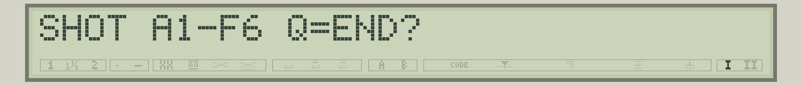
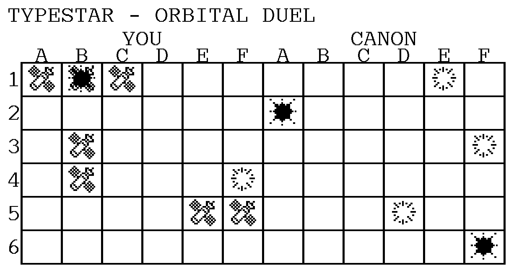
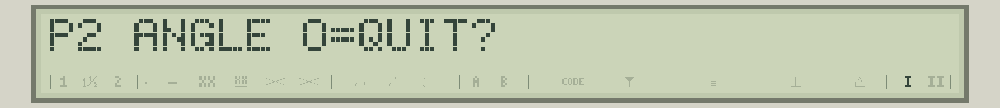
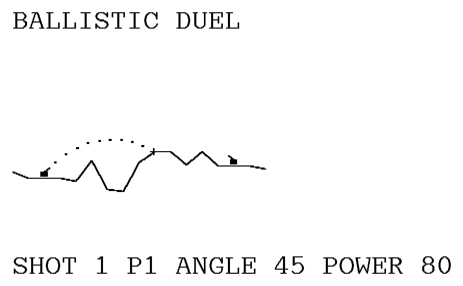
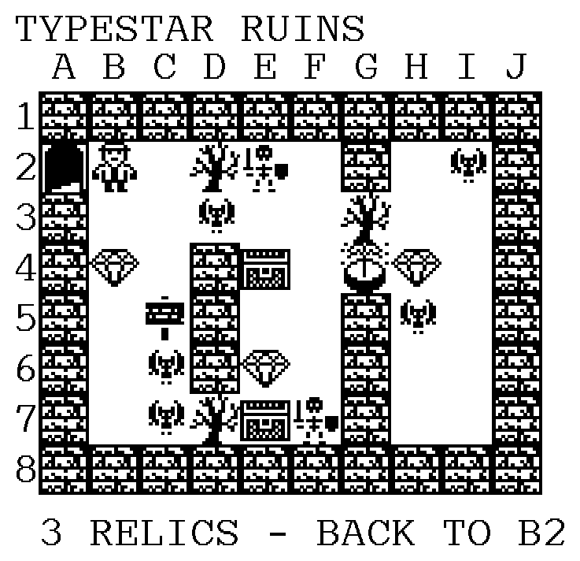
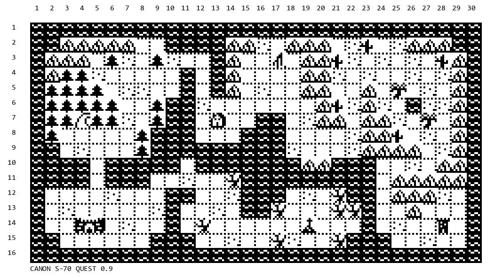
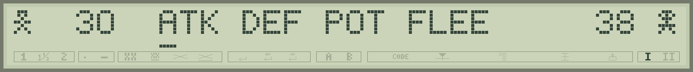

# 11 - Complete programs to try

This Typestar BASIC selection includes a sound instrument, an LCD game and paper games. Open the named file in **Typestar BASIC Studio**, then use **Run (F5)** in the emulator or **Send → LOAD** for the Canon. The listings below are the complete sources of the supplied files.


**Memory holds one program at a time.** Save your work before loading a game. For printed games, prefer **thermal paper** and let the motors position the sheet during play. Old transfer ribbons would be consumed quickly.

## Piano

Nine sound modes turn the keyboard into a small effects synthesizer: mixed pulses, pulse width, sweeps, envelopes and noise. DATA tables prepare the values used by SOUND; the buzzer and its resonances shape the result.

**To play:** letters **A to Z** produce sounds; **left/right arrows** choose the mode. **1, 2, 3** select the register, **4, 5, 6** select pulse width. **Space** plays an eight-sound MIX MINUS demonstration. **Return** ends the program. Each sound finishes before the next key is read.


**What to look for:** DIM reserves an array, READ fills it, INKEY reads keys and SOUND makes sound.

**File to open in Studio:** [piano-en.bas](../../../examples/piano-en.bas).

```basic
10 DIM F(77):DIM H(77):DIM G(77):DIM V(7)
20 DATA 262,277,294,311,330,349,370,392,416,440,466,494,524
21 DATA 555,588,623,660,699,740,784,831,880,933,988,1047,1109
22 DATA 523,554,587,622,659,698,740,784,831,880,932,988,1047
23 DATA 1109,1175,1245,1319,1397,1480,1568,1661,1760,1865
24 DATA 1976,2093,2217,1046,1108,1174,1244,1318,1396,1480
25 DATA 1568,1662,1760,1864,1976,2094,2218,2350,2490,2638
26 DATA 2794,2960,3136,3322,3520,3730,3952,4186,4434,5627
27 DATA 5612,5595,5578,5559,5540,5519,5497,5473,5449,5423
28 DATA 5395,5365,5334,5301,5266,5229,5190,5149,5105,5058
29 DATA 5009,4956,4901,4842,4780,5366,5335,5302,5267,5230
30 DATA 5191,5149,5105,5058,5009,4957,4901,4842,4780,4714
31 DATA 4644,4570,4492,4409,4321,4228,4129,4024,3913,3796
32 DATA 3672,4843,4781,4715,4645,4571,4493,4409,4321,4227
33 DATA 4129,4025,3913,3795,3671,3539,3399,3251,3095,2929
34 DATA 2753,2567,2369,2159,1937,1703,1455,1000,1123,1260
35 DATA 1414,1588,1782,2000,2245,2520,2829,3175,3564,4000
36 DATA 4490,5040,5657,6350,7127,8000,8980,10080,11314,12699
37 DATA 14255,16000,17960,2000,2245,2520,2828,3175,3564,4000
38 DATA 4490,5040,5657,6350,7127,8000,8980,10079,11314,12699
39 DATA 14254,16000,17959,20159,22627,25398,28509,31250,31250
40 DATA 4000,4490,5040,5656,6350,7128,8000,8980,10080,11314
41 DATA 12700,14254,16000,17960,20158,22628,25398,28508,31250
42 DATA 31250,31250,31250,31250,31250,31250,31250,5365,5301
43 DATA 5229,5190,5105,5009,4901,4842
60 FOR I=0 TO 77:READ F(I):NEXT I
61 FOR I=0 TO 77:READ H(I):NEXT I
62 FOR I=0 TO 77:READ G(I):NEXT I
63 FOR I=0 TO 7:READ V(I):NEXT I
65 N$="CLASSICMIX -  MIX +  PULSE  SWEEP  "
66 N$=N$+"FADE   NOISE  CUT    HOLD   "
90 M=1:D=50:R=1:B=26:CURSOR 4
100 CLS:PRINT "PIANO ";MID$(N$,7*M+1,7);2^(R-1);"x D";D;
110 C=INKEY(0):IF C=0 THEN 110
120 IF C=13 THEN 900
125 IF C=32 THEN GOSUB 700:GOTO 110
130 IF C=18 THEN M=(M+8) MOD 9:GOTO 100
140 IF C=19 THEN M=(M+1) MOD 9:GOTO 100
150 IF C>=49 AND C<=51 THEN R=C-49:B=26*R:GOTO 100
160 IF C=52 THEN D=10:GOTO 100
170 IF C=53 THEN D=50:GOTO 100
180 IF C=54 THEN D=90:GOTO 100
190 C=C AND 223:IF C<65 OR C>90 THEN 110
200 I=C-65+B
210 IF M=0 THEN SOUND F(I),80,D:GOTO 110
220 IF M=1 THEN SOUND H(I),80,D:GOTO 110
230 IF M=2 THEN SOUND 5889+F(I),80,D:GOTO 110
240 IF M=3 THEN SOUND 50,80,1+INT((C-65)*.33334):GOTO 110
250 IF M=4 THEN GOSUB 400:GOTO 110
260 IF M=5 THEN GOSUB 500:GOTO 110
270 IF M=6 THEN SOUND G(I),90,D,1:GOTO 110
280 IF M=7 THEN SOUND 50,80,99-INT((C-65)*.33334):GOTO 110
290 BEEP 80:GOTO 110
400 SOUND H(I),25,D:SOUND H(I)+500,25,D
410 SOUND H(I),25,D:RETURN
500 SOUND 5890,25,10:SOUND 5890,25,50
510 SOUND 5890,25,90:RETURN
700 FOR J=0 TO 7:SOUND V(J),320,50:NEXT J:RETURN
900 CLS:PRINT "PIANO ENDED":END
```

## Pocket Duel

Two characters fight in a thirty-two-cell arena whose left edge joins the right. Mines and fences complicate movement; little triangles show health and the lower line shows available charge. The game uses only LCD and buzzer.

**Controls:** left/right arrows move, **Enter** attacks an adjacent enemy, **Space** teleports. Attacks and teleportation require a full charge. The opponent acts after your action. **BREAK** interrupts the game. The French version is also included in Studio's examples.


**What to look for:** LCDCHAR defines characters, LOCATE avoids full redraws, LCDTRI and LCDLINE show gauges; INKEY, conditions and subroutines organise play.

**File to open in Studio:** [games/pocket-duel-en.bas](../../../examples/games/pocket-duel-en.bas).

```basic
10 DIM T(5)
20 DATA 0,16,24,28,30,31
30 FOR I=0 TO 5:READ T(I):NEXT I
40 CLS:CURSOR 4:PRINT "POCKET DUEL 1.1";
50 SOUND 0,300
60 CLS:PRINT "ARROWS: MOVE";
70 SOUND 0,450
80 CLS:PRINT "ENTER: ATTACK  SPACE: TELEPORT";
90 SOUND 0,550
100 CLS:PRINT CHR$(192);" MINE  ";CHR$(172);" FENCE";
110 SOUND 0,550
120 CLS:CURSOR 4
130 LCDCHAR 1,14,10,4,27,4,10,27,0
140 LOCATE 1,3:PRINT "= YOU";
150 LCDCHAR 17,14,21,31,10,21,4,27,0
160 LOCATE 1,19:PRINT "= ENEMY";
170 SOUND 0,900
180 CLS:PRINT "PRESS A KEY TO PLAY";
190 R=1
200 K=INKEY(0)
210 IF K<>0 THEN 250
220 R=R+1:IF R>60000 THEN R=1
230 GOTO 200
250 RANDOMIZE R
260 H=5:M=5:C=2:B=2:P=4:E=29
270 U=0:V=0:W=0:Y=0:Q=0:S=0
280 G=0:J=0:L=0:O=0
290 CLS:CURSOR 4:GOSUB 8000:GOSUB 8100
295 GOSUB 6100:GOSUB 6100:GOSUB 6100:GOSUB 6200

300 K=INKEY(0):IF K=0 THEN 300
310 IF K=13 THEN 500
320 IF K=18 THEN 400
330 IF K=19 THEN 460
350 IF K=32 THEN 600
360 GOTO 300

400 N=P-1:IF N=0 THEN N=32
410 IF N=E THEN GOSUB 8800:GOTO 300
420 GOSUB 7600
425 IF Z=1 THEN GOSUB 8800:GOSUB 5000:GOTO 300
430 X=P:GOSUB 8300:P=N:C=C+1
435 IF C>5 THEN C=5
440 GOSUB 8500:IF H<1 THEN 9700
450 GOSUB 8000:GOSUB 5000:GOTO 300

460 N=P+1:IF N=33 THEN N=1
470 IF N=E THEN GOSUB 8800:GOTO 300
480 GOSUB 7600
485 IF Z=1 THEN GOSUB 8800:GOSUB 5000:GOTO 300
490 X=P:GOSUB 8300:P=N:C=C+1
492 IF C>5 THEN C=5
495 GOSUB 8500:IF H<1 THEN 9700
497 GOSUB 8000:GOSUB 5000:GOTO 300

500 IF C<5 THEN GOSUB 8810:GOTO 300
510 D=ABS(E-P)
520 IF D<>1 AND D<>31 THEN GOSUB 8810:GOTO 300
530 C=0:LCDLINE P,0:M=M-1
540 X=E:GOSUB 8400:SOUND 140,55
550 K=1+INT(RND(1)*3):GOSUB 9100
560 IF M<1 THEN 9600
570 GOSUB 5000:GOTO 300

600 IF C<5 THEN GOSUB 8810:GOTO 300
610 C=0:X=P:GOSUB 8400
620 GOSUB 7800
630 IF N=0 THEN GOSUB 8810:GOTO 300
640 P=N:X=P:GOSUB 8400
650 SOUND 350,45:SOUND 700,45
660 GOSUB 8500:IF H<1 THEN 9700
670 GOSUB 8000:GOSUB 5000:GOTO 300

5000 D=ABS(E-P)
5010 IF D=1 OR D=31 THEN 5200
5020 GOSUB 7000
5030 GOSUB 7500
5040 IF Z=1 THEN 5400
5050 GOSUB 7600
5060 IF Z=1 THEN 5400
5070 X=E:GOSUB 8300:E=N:B=B+1
5075 IF B>5 THEN B=5
5080 GOSUB 8100:GOTO 5900

5200 IF B<5 THEN 5300
5210 B=0:LCDLINE E,0:H=H-1
5220 X=P:GOSUB 8400:SOUND 120,55
5230 K=1+INT(RND(1)*3):GOSUB 9000
5240 IF H<1 THEN 9700
5250 GOTO 5900

5300 GOSUB 7000:GOSUB 7100
5310 GOSUB 7500:IF Z=1 THEN 5350
5320 GOSUB 7600:IF Z=1 THEN 5350
5330 X=E:GOSUB 8300:E=N:B=B+1
5335 IF B>5 THEN B=5
5340 GOSUB 8100:GOTO 5900
5350 B=B+1:IF B>5 THEN B=5
5360 GOTO 5900

5400 GOSUB 7100
5410 GOSUB 7500:IF Z=1 THEN 5450
5420 GOSUB 7600:IF Z=1 THEN 5450
5430 X=E:GOSUB 8300:E=N:B=B+1
5435 IF B>5 THEN B=5
5440 GOSUB 8100:GOTO 5900
5450 IF B<5 THEN 5900
5460 B=0:X=E:GOSUB 8400:GOSUB 7900
5470 IF N=0 THEN 5900
5480 E=N:X=E:GOSUB 8400:GOSUB 8100

5900 GOSUB 6000:RETURN

6000 GOSUB 6300:GOSUB 6400
6010 IF RND(1)<.7 THEN GOSUB 6100
6020 IF RND(1)<.45 THEN GOSUB 6200
6030 RETURN

6100 F=0:IF U=0 THEN F=1
6110 IF F=0 AND W=0 THEN F=2
6120 IF F=0 AND Q=0 THEN F=3
6130 IF F=0 THEN RETURN
6140 A=0:GOSUB 6800:IF N=0 THEN RETURN
6150 LOCATE 1,N:PRINT CHR$(192);
6160 D=4+INT(RND(1)*2)
6170 IF F=1 THEN U=N:V=D
6180 IF F=2 THEN W=N:Y=D
6190 IF F=3 THEN Q=N:S=D
6195 RETURN

6200 F=0:IF G=0 THEN F=1
6210 IF F=0 AND L=0 THEN F=2
6220 IF F=0 THEN RETURN
6230 A=1:GOSUB 6800:IF N=0 THEN RETURN
6240 LOCATE 1,N:PRINT CHR$(172);
6250 D=4+INT(RND(1)*2)
6260 IF F=1 THEN G=N:J=D ELSE L=N:O=D
6270 RETURN

6300 IF U>0 THEN V=V-1
6310 IF U>0 AND V=0 THEN LOCATE 1,U:PRINT " ";:U=0
6320 IF W>0 THEN Y=Y-1
6330 IF W>0 AND Y=0 THEN LOCATE 1,W:PRINT " ";:W=0
6340 IF Q>0 THEN S=S-1
6350 IF Q>0 AND S=0 THEN LOCATE 1,Q:PRINT " ";:Q=0
6360 IF G>0 THEN J=J-1
6370 IF G>0 AND J=0 THEN LOCATE 1,G:PRINT " ";:G=0
6380 IF L>0 THEN O=O-1
6390 IF L>0 AND O=0 THEN LOCATE 1,L:PRINT " ";:L=0
6395 RETURN

6400 IF G=0 THEN 6450
6410 IF RND(1)>=.55 THEN 6450
6420 X=G:GOSUB 6600
6430 IF N=G THEN 6450
6440 LOCATE 1,G:PRINT " ";:G=N
6445 LOCATE 1,G:PRINT CHR$(172);
6450 IF L=0 THEN RETURN
6460 IF RND(1)>=.55 THEN RETURN
6470 X=L:GOSUB 6600
6480 IF N=L THEN RETURN
6490 LOCATE 1,L:PRINT " ";:L=N
6492 LOCATE 1,L:PRINT CHR$(172);
6495 RETURN

6600 D=1:IF RND(1)<.5 THEN D=-1
6610 N=X+D:IF N=0 THEN N=32
6620 IF N=33 THEN N=1
6630 GOSUB 6700:IF Z=0 THEN RETURN
6640 N=X-D:IF N=0 THEN N=32
6650 IF N=33 THEN N=1
6660 GOSUB 6700:IF Z=0 THEN RETURN
6670 N=X:RETURN

6700 Z=0
6710 IF N=P OR N=E THEN Z=1
6720 IF N=U OR N=W OR N=Q THEN Z=1
6730 IF N=G OR N=L THEN Z=1
6740 RETURN

6800 D=0
6810 D=D+1:IF D>12 THEN N=0:RETURN
6820 N=1+INT(RND(1)*32)
6830 IF N=P OR N=E THEN 6810
6840 IF N=U OR N=W OR N=Q THEN 6810
6850 IF N=G OR N=L THEN 6810
6860 IF A=0 THEN RETURN
6870 Z=ABS(N-P):IF Z=1 OR Z=31 THEN 6810
6880 Z=ABS(N-E):IF Z=1 OR Z=31 THEN 6810
6890 RETURN

7000 A=P-E:IF A<0 THEN A=A+32
7010 F=E-P:IF F<0 THEN F=F+32
7020 IF A<=F THEN D=1 ELSE D=-1
7030 N=E+D:IF N=33 THEN N=1
7040 IF N=0 THEN N=32
7050 RETURN

7100 N=E-D
7110 IF N=33 THEN N=1
7120 IF N=0 THEN N=32
7130 RETURN

7500 Z=0
7510 IF N=U OR N=W OR N=Q THEN Z=1
7520 RETURN

7600 Z=0
7610 IF N=G OR N=L THEN Z=1
7620 RETURN

7700 Z=0
7710 IF N=G THEN G=0:J=0:Z=1
7720 IF N=L THEN L=0:O=0:Z=1
7730 IF Z=0 THEN RETURN
7740 LOCATE 1,N:PRINT " ";:SOUND 260,30
7750 RETURN

7800 A=0
7810 A=A+1:IF A>12 THEN N=0:RETURN
7820 N=1+INT(RND(1)*32)
7830 IF N=P OR N=E OR N=G OR N=L THEN 7810
7840 RETURN

7900 A=0
7910 A=A+1:IF A>12 THEN N=0:RETURN
7920 N=1+INT(RND(1)*32)
7930 IF N=P OR N=E OR N=U OR N=W OR N=Q THEN 7910
7940 IF N=G OR N=L THEN 7910
7950 RETURN

8000 LCDCHAR P,14,10,4,27,4,10,27,0
8010 LCDTRI P,T(H):LCDLINE P,T(C)
8020 RETURN

8100 LCDCHAR E,14,21,31,10,21,4,27,0
8110 LCDTRI E,T(M):LCDLINE E,T(B)
8120 RETURN

8300 LCDLINE X,0
8310 LOCATE 1,X:PRINT " ";
8320 RETURN

8400 GOSUB 8300
8410 LCDCHAR X,17,4,10,21,10,4,17,0
8420 SOUND 0,55
8430 GOSUB 8300
8440 RETURN

8500 F=0
8510 IF P=U THEN U=0:V=0:F=1
8520 IF P=W THEN W=0:Y=0:F=1
8530 IF P=Q THEN Q=0:S=0:F=1
8540 IF F=0 THEN RETURN
8550 H=H-1:X=P:GOSUB 8400
8560 SOUND 80,60:RETURN

8600 F=0
8610 IF E=U THEN U=0:V=0:F=1
8620 IF E=W THEN W=0:Y=0:F=1
8630 IF E=Q THEN Q=0:S=0:F=1
8640 IF F=0 THEN RETURN
8650 M=M-1:X=E:GOSUB 8400
8660 SOUND 80,60:RETURN

8800 SOUND 60,40:RETURN
8810 SOUND 180,75:SOUND 90,75:RETURN

9000 GOSUB 7200:A=0
9010 IF A>=K THEN GOSUB 8000:RETURN
9020 N=P+D
9030 IF N=33 THEN N=1
9040 IF N=0 THEN N=32
9050 GOSUB 7700
9060 P=N:A=A+1:GOSUB 8500
9070 IF F=1 OR H<1 THEN GOSUB 8000:RETURN
9080 GOTO 9010

9100 GOSUB 7300:A=0
9110 IF A>=K THEN GOSUB 8100:RETURN
9120 N=E+D
9130 IF N=33 THEN N=1
9140 IF N=0 THEN N=32
9150 GOSUB 7700
9160 E=N:A=A+1:GOSUB 8600
9170 IF F=1 OR M<1 THEN GOSUB 8100:RETURN
9180 GOTO 9110

7200 A=P-E:IF A<0 THEN A=A+32
7210 F=E-P:IF F<0 THEN F=F+32
7220 IF A<=F THEN D=1 ELSE D=-1
7230 RETURN

7300 A=E-P:IF A<0 THEN A=A+32
7310 F=P-E:IF F<0 THEN F=F+32
7320 IF A<=F THEN D=1 ELSE D=-1
7330 RETURN

9600 SOUND 440,50:SOUND 560,50:SOUND 700,150
9610 CLS:PRINT "YOU WIN!";
9620 END

9700 SOUND 300,70:SOUND 180,90:SOUND 70,180
9710 CLS:PRINT "YOU LOSE...";
9720 END
```

## Orbital Duel

A space battle inspired by Battleship. Command three satellite formations of three, two and two cells on a six-by-six grid. Canon has the same fleet; the first to hit all seven enemy cells wins. Satellites and shots remain visible on paper.

**To play:** Drawing starts as soon as you RUN. Enter a starting cell such as **A1**, then **H** for a formation extending right or **V** extending down. Enter shots **A1 to F6**, or **Q** to quit. The left grid holds your satellites; the right records shots. Let the program position the paper.





**What to look for:** GLYPH mode 5 streams different tiles across both grids, including their right border, then the halves of satellites and impacts. Large pixels keep the pictures square. CLEAR releases construction buffers before game arrays are created. Arrays, randomness and logical tests control positions and the opponent.

**File to open in Studio:** [games/orbital-duel-en.bas](../../../examples/games/orbital-duel-en.bas).

```basic
10 REM TYPESTAR - ORBITAL DUEL 2.0
20 CLS:CURSOR 4:PRINT "ORBITAL DUEL - DRAWING";
25 GOSUB 1200
27 CLEAR:B=1120:C=16:GOSUB 1280
29 CLEAR
30 DIM B(1,35):DIM C(35):DIM H(1,3)
35 DIM Z(72):FOR I=4 TO 51:READ Z(I):NEXT I
40 B=1484:C=0:LSPACING 1
45 G=PEEK(9)*256+PEEK(10)
50 IF G=0 THEN G=1
55 RANDOMIZE G
60 V=1:FOR S=1 TO 3
70 P=INT(RND(1)*36):D=INT(RND(1)*2):GOSUB 600
80 IF F=1 THEN 70
90 GOSUB 660:NEXT S
100 V=0:P=0:D=0
110 FOR S=1 TO 3
120 GOSUB 800
170 GOSUB 600:IF F=0 THEN 190
180 CLS:PRINT "EDGE OR SATELLITE IN THE WAY";
182 SOUND 120,80:GOSUB 900:GOTO 120
190 GOSUB 660:J=P:W=L:IF D=1 THEN W=1
200 GOSUB 1400:T=1:GOSUB 1450
202 IF D=0 THEN 218
204 FOR I=1 TO L-1:J=P+6*I
206 GOSUB 1400:T=1:W=1:GOSUB 1450:NEXT I
218 GOSUB 1600:NEXT S
220 A=0:E=0:N=0
230 INPUT "SHOT A1-F6 Q=END";A$
240 IF A$="Q" OR A$="q" THEN 400
250 IF LEN(A$)<>2 THEN 380
260 X=ASC(LEFT$(A$,1)):IF X>96 THEN X=X-32
270 X=X-65:Y=ASC(RIGHT$(A$,1))-49
280 IF X<0 OR X>5 OR Y<0 OR Y>5 THEN 380
290 J=6*Y+X:IF B(1,J)>3 THEN 390
300 N=N+1:V=1:GOSUB 700
310 CLS:PRINT "YOU: ";R$;" ";A;"/7";
320 IF A=7 THEN 400
330 GOSUB 1000:V=0:GOSUB 700
340 CLS:PRINT "CANON ";CHR$(65+X);Y+1;" ";R$;" ";E;"/7";
350 IF E=7 THEN 400
360 GOTO 230
380 CLS:PRINT "Enter A1 to F6, or Q";:GOSUB 900:GOTO 230
390 CLS:PRINT "Already targeted: try again";:GOSUB 900:GOTO 230
400 R$="QUIT":IF A=7 THEN R$="VICTORY!"
410 IF E=7 THEN R$="CANON WINS"
420 FOR J=0 TO 35
430 IF B(1,J)=0 OR B(1,J)>3 THEN 450
440 V=1:GOSUB 1400:T=1:W=1:GOSUB 1450
450 NEXT J
460 G=0:K=1120:GOSUB 1500:LPRINT R$;" - ";N;" TURNS"
470 B=1176:C=0:GOSUB 1600:CLS:PRINT R$;" ";A;"-";E;
480 SOUND 440,100:SOUND 700,150:END
600 L=2:IF S=1 THEN L=3
610 X=P MOD 6:Y=INT(P/6):U=1+5*D:F=0
620 IF D=0 AND X+L>6 THEN F=1:RETURN
630 IF D=1 AND Y+L>6 THEN F=1:RETURN
640 FOR I=0 TO L-1:IF B(V,P+I*U)<>0 THEN F=1
650 NEXT I:RETURN
660 FOR I=0 TO L-1:B(V,P+I*U)=S:NEXT I:RETURN
700 S=B(V,J):B(V,J)=S+4:R$="MISS"
702 IF V=0 THEN C(J)=1
704 IF S=0 THEN 740
710 R$="HIT":H(V,S)=H(V,S)+1
712 IF V=0 THEN E=E+1:C(J)=2
714 IF V=1 THEN A=A+1
720 L=2:IF S=1 THEN L=3
724 IF H(V,S)<>L THEN 740
726 R$="DESTROYED":IF V=1 THEN 740
730 FOR I=0 TO 35:IF B(0,I)=S+4 THEN C(I)=3
732 NEXT I
740 X=J MOD 6:Y=INT(J/6)
750 GOSUB 1400:T=9:IF S=0 THEN T=5
752 W=1:GOSUB 1450
760 IF V=0 THEN GOSUB 1600
762 SOUND 300+300*(S<>0)*-1,80:RETURN
800 L=2:IF S=1 THEN L=3
805 CLS:PRINT L;" CELLS - START A1-F6";
810 INPUT "CELL";A$:IF LEN(A$)<>2 THEN 800
815 X=ASC(LEFT$(A$,1)):IF X>96 THEN X=X-32
820 X=X-65:Y=ASC(RIGHT$(A$,1))-49
825 IF X<0 OR X>5 OR Y<0 OR Y>5 THEN 800
830 P=6*Y+X:INPUT "HORIZ H / VERT V";A$
835 D=0:IF A$="H" OR A$="h" THEN RETURN
840 D=1:IF A$="V" OR A$="v" THEN RETURN
845 GOTO 830
900 IF INKEY(0)<>0 THEN 900
910 K=INKEY(0):IF K=0 THEN 910
920 RETURN
1000 T=INT(RND(1)*36)
1010 IF C(T)<>0 THEN T=(T+1) MOD 36:GOTO 1010
1020 W=0:FOR I=0 TO 35
1030 IF C(I)<>2 THEN 1090
1040 FOR D=0 TO 3:U=1
1042 IF D=1 THEN U=-1
1044 IF D=2 THEN U=6
1046 IF D=3 THEN U=-6
1050 J=I+U:GOSUB 1100:IF F=1 THEN 1080
1052 IF C(J)<>0 THEN 1080
1054 Z=J:Q=2+RND(1):J=I-U:GOSUB 1100
1060 IF F=1 THEN 1070
1062 IF C(J)=2 THEN Q=Q+2
1070 IF Q>W THEN W=Q:T=Z
1080 NEXT D
1090 NEXT I:J=T:RETURN
1100 F=0:IF J<0 OR J>35 THEN F=1:RETURN
1110 IF ABS((J MOD 6)-(I MOD 6))>1 THEN F=1
1120 RETURN
1200 LSPACING 1:B=0:C=0:DIM Q(100)
1210 Q(100)=1
1230 LPRINT "TYPESTAR - ORBITAL DUEL":B=56
1240 G=16:K=224:GOSUB 1500:F=0
1245 FOR T=0 TO 15
1250 FOR I=0 TO 3:A=32896:IF T=15 THEN A=0
1251 IF T=15 AND I=0 THEN A=32768
1252 H=0:IF F=2*I THEN H=256
1253 IF F=2*I+1 THEN H=1
1254 Q(4+I)=A:Q(8+I)=255*H:Q(12+I)=A+127*H:NEXT I
1255 H=0:IF F<8 THEN H=2
1256 FOR I=0 TO 11:Q(64+3*I)=1+H
1257 Q(65+3*I)=H:Q(66+3*I)=H:NEXT I
1258 GLYPH Q(0),37,8,5:B=B+56:C=G
1260 F=F-8:IF F<0 THEN F=F+20
1270 NEXT T:RETURN
1280 GOTO 1286
1286 FOR V=0 TO 1:A$="YOU":IF V=1 THEN A$="CANON"
1288 G=161+288*V-8*LEN(A$):K=98:GOSUB 1500
1289 LPRINT A$;:C=G+16*LEN(A$)
1290 FOR X=0 TO 5:G=33+288*V+48*X:K=168:GOSUB 1500
1300 LPRINT CHR$(65+X);:C=G+16:NEXT X
1310 NEXT V:FOR Y=0 TO 5:G=0:K=270+140*Y:GOSUB 1500
1320 LPRINT Y+1;:C=G+16:NEXT Y
1330 GOSUB 1600:RETURN
1400 G=25+288*V+48*(J MOD 6):K=238+140*INT(J/6)
1410 GOSUB 1500:RETURN
1450 FOR R=0 TO 1:FOR O=0 TO W-1
1452 Z(64+3*O)=T+2*R:Z(65+3*O)=T+2*R+1
1454 Z(66+3*O)=0:NEXT O
1456 GLYPH Z(0),3*W-1,8,5:B=B+56:C=G
1458 NEXT R:RETURN
1500 F=G-C:IF F=0 THEN 1540
1510 IF ABS(F)>128 THEN F=SGN(F)*128
1520 IF F<0 THEN ORIGIN 128,0 ELSE ORIGIN
1530 HEAD F:C=C+F:GOTO 1500
1540 F=K-B:IF F=0 THEN 1580
1550 IF ABS(F)>448 THEN F=SGN(F)*448
1560 IF F<0 THEN ORIGIN 0,448 ELSE ORIGIN
1570 FEED F:B=B+F:GOTO 1540
1580 ORIGIN:RETURN
1600 G=0:K=1484:GOSUB 1500:RETURN
1700 DATA 4136,21674,21545,5636,50,11300,53806,36944
1708 DATA 2064,8273,18980,6144,8264,54314,21802,5128
1716 DATA 1,9489,2080,112,0,18448,8196,14
1724 DATA 32,2064,8453,256,4,8208,2112,0
1732 DATA 33024,8475,7951,8127,512,2224,61680,63741
1740 DATA 7951,7967,8961,32769,63728,61680,34816,512
```

## Ballistic Duel

Two cannons face each other across terrain printed once. Choose angle and power: a dotted trajectory appears and impacts accumulate. The terrain stays fixed; previous shot values print below the arena. Play against Canon or another player.

**To play:** enter a seed from **1 to 9999**, then **1** against Canon or **2** for two players. Supply the requested angle and power **20 to 100**. Zero angle ends play. Reuse a seed for the same terrain; save your program before loading the game.





**What to look for:** RANDOMIZE and RND prepare terrain; a sine table and successive additions speed trajectories; BOX, LINE, DRAW and motors compose the sheet.

**File to open in Studio:** [games/ballistic-duel-en.bas](../../../examples/games/ballistic-duel-en.bas).

```basic
10 REM BALLISTIC DUEL 0.6 - FIXED TERRAIN X2
20 CLS:CURSOR 4:INPUT "SEED 1-9999";G
25 IF G<1 OR G>9999 THEN 20
30 RANDOMIZE G:DIM H(16):DIM B(1):DIM L(1)
31 DIM X(11):DIM Y(9)
32 DIM T(18):FOR I=0 TO 18:READ T(I):NEXT I
40 INPUT "1=CANON 2=DUO";M
50 IF M<>1 AND M<>2 THEN 40
60 H(0)=140:FOR I=1 TO 16
70 H(I)=H(I-1)+INT(RND(1)*61)-30
80 IF H(I)<120 THEN H(I)=120
90 IF H(I)>180 THEN H(I)=180
100 NEXT I
110 H(1)=H(2):H(3)=H(2):H(13)=H(14):H(15)=H(14)
120 B(0)=30:B(1)=210:L(0)=100:L(1)=100
130 S=0:N=0:F=0:B=0:L=0:LSPACING 1:GOSUB 1000
140 CLS:PRINT "P1 ";L(0);" P2 ";L(1);
150 IF S=1 AND M=1 THEN 220
160 IF S=1 THEN 165
162 INPUT "P1 ANGLE 0=QUIT";A:GOTO 170
165 INPUT "P2 ANGLE 0=QUIT";A
170 IF A=0 THEN 600
180 IF A<10 OR A>80 THEN 160
190 INPUT "POWER 20-100";P
200 IF P<20 OR P>100 THEN 190
210 GOTO 240
220 A=35+INT(RND(1)*41):P=65+INT(RND(1)*36)
240 X=B(S):GOSUB 800:Z=E-6:Y=Z
242 CLS:PRINT "CALCULATING SHOT...";
245 X(10)=A:X(11)=P
250 I=INT(A/5):R=A/5-I
252 U=(T(18-I)+(T(17-I)-T(18-I))*R)*P/5000
254 V=(T(I)+(T(I+1)-T(I))*R)*P/5000
256 IF S=1 THEN U=-U
260 F=0:J=1-2*S:H=15/ABS(U):Q=H*H
262 K=Q-V*H:R=2*Q:W=0:I=2+12*S:Y=Z
270 O=Y-H(I):I=I+J:T=W+H:Y=Y+K:K=K+R
274 IF Y>=H(I) THEN 290
276 IF I=0 OR I=16 THEN 330
278 W=T:GOTO 270
290 P=K-R-Q-H(I)+H(I-J):A=0:E=1
292 FOR J=1 TO 5:C=(A+E)/2
294 IF O+C*(P+Q*C)<0 THEN A=C ELSE E=C
296 NEXT J:C=(A+E)/2:T=W+H*C:F=1
298 Y=H(I-1+2*S):D=Y+C*(H(I)-Y):GOTO 340
330 D=Y
340 C=B(S)+U*T:N=N+1
342 IF C<0 THEN C=0
344 IF C>240 THEN C=240
350 CLS:PRINT "DRAWING SHOT ";N;:GOSUB 1100
370 IF F=0 THEN 450
380 FOR J=0 TO 1
390 O=ABS(B(J)-C):K=ABS(H(2+12*J)-D)
395 R=O:IF K>R THEN R=K
400 R=R+3*(O+K-R)/8
405 IF O<=6 AND K<=8 THEN K=100:GOTO 415
410 K=INT(100-3*R):IF K<0 THEN K=0
415 IF J<>S AND K>0 THEN F=2
420 L(J)=L(J)-K:IF L(J)<0 THEN L(J)=0
430 NEXT J
440 IF F=2 THEN SOUND 560,50:SOUND 700,90
450 H=0:G=840+84*(N-1):GOSUB 1500
460 LPRINT "SHOT ";N;" P";S+1;" ANGLE ";X(10);
470 LPRINT " POWER ";X(11)
480 B=G+56:L=0
490 H=0:G=1680:IF B+280>G THEN G=B+280
492 GOSUB 1500
500 IF L(0)=0 OR L(1)=0 THEN 560
510 S=1-S:GOTO 140
560 CLS:PRINT "END P1=";L(0);" P2=";L(1);
565 SOUND 440,60:SOUND 560,60:SOUND 700,140
570 END
600 CLS:PRINT "DUEL ENDED";:END
800 REM TERRAIN HEIGHT AT X: RESULT E
810 I=INT(X/15):IF I>15 THEN I=15
820 E=H(I)+(H(I+1)-H(I))*(X-I*15)/15
830 RETURN
1000 REM PRINT THE TERRAIN ONCE
1005 LPRINT "BALLISTIC DUEL":B=56
1006 A=H(0):FOR I=1 TO 16
1007 IF H(I)<A THEN A=H(I)
1008 NEXT I:A=32*INT((2*A-20)/32)
1009 FOR V=0 TO 1:U=248*V:H=128*V
1010 G=56+56*(A/32):GOSUB 1500:DRAW DEFERRED:P=0
1020 FOR I=0 TO 15
1022 K=30*I-U:R=K+30:W=2*H(I)-A:Z=2*H(I+1)-A
1024 IF R<0 OR K>247 THEN 1040
1026 IF K<0 THEN W=W+(Z-W)*(-K)/(R-K):K=0
1028 IF R>247 THEN Z=W+(Z-W)*(247-K)/(R-K):R=247
1030 LINE K,INT(W),R,INT(Z),2
1032 IF INT(W)+1>P THEN P=INT(W)+1
1034 IF INT(Z)+1>P THEN P=INT(Z)+1
1040 NEXT I
1050 FOR J=0 TO 1:X=2*B(J)-U
1052 IF X<0 OR X>247 THEN 1082
1060 K=2*H(2+12*J)-A:BOX X-6,K-12,X+6,K-4,1,1
1070 W=10:IF J=1 THEN W=-10
1080 LINE X,K-12,X+W,K-20,2
1082 NEXT J
1090 DRAW PRINT:B=G+56*(INT(P/32)+1):NEXT V
1092 H=0:G=1680:GOSUB 1500:RETURN
1100 REM CALCULATE POINTS ONCE, X2 TILED DRAWING
1102 X=B(S):W=Z:R=T/10:P=U*R:O=2*R*R:K=O/2-V*R
1104 E=1000:Q=0:FOR J=0 TO 8
1106 X=X+P:W=W+K:K=K+O:X(J)=2*INT(X):Y(J)=2*INT(W)
1108 IF Y(J)<E THEN E=Y(J)
1110 IF Y(J)+3>Q THEN Q=Y(J)+3
1112 NEXT J:X(9)=2*INT(C):Y(9)=2*INT(D)
1114 R=0:IF F=1 THEN R=6
1116 IF Y(9)-R<E THEN E=Y(9)-R
1118 R=3:IF F=1 THEN R=7
1119 IF Y(9)+R>Q THEN Q=Y(9)+R
1120 E=32*INT(E/32)
1122 FOR T=0 TO INT((Q-E)/256):A=E+256*T
1124 FOR V=0 TO 1:U=248*V:H=128*V
1126 G=56+56*(A/32):GOSUB 1500:DRAW DEFERRED:P=-1
1130 FOR J=0 TO 9
1132 IF J=9 AND F=1 THEN 1144
1134 K=X(J)-U:W=Y(J)-A:R=K+3:Z=W+3
1140 GOSUB 1300
1144 NEXT J:IF F=0 THEN 1160
1150 K=X(9)-6-U:R=K+12:W=Y(9)-A:Z=W:GOSUB 1400
1152 K=X(9)-U:R=K:W=Y(9)-6-A:Z=W+12:GOSUB 1400
1160 IF P<0 THEN DRAW CANCEL:GOTO 1166
1162 DRAW PRINT:B=G+56*(INT(P/32)+1)
1166 NEXT V:NEXT T:RETURN
1300 REM 4X4 DOT CLIPPED AT TILE BOUNDARIES
1302 IF R<0 OR K>247 OR Z<0 OR W>255 THEN RETURN
1304 IF K<0 THEN K=0
1306 IF R>247 THEN R=247
1308 IF W<0 THEN W=0
1310 IF Z>255 THEN Z=255
1312 BOX K,W,R,Z,1,1:IF Z>P THEN P=Z
1314 RETURN
1400 REM CLIP BOTH LINES OF THE CROSS
1402 IF R<0 OR K>247 OR Z<0 OR W>255 THEN RETURN
1404 IF K<0 THEN K=0
1406 IF R>247 THEN R=247
1408 IF W<0 THEN W=0
1410 IF Z>255 THEN Z=255
1412 LINE K,W,R,Z,2:IF Z+1>P THEN P=Z+1
1414 IF P>255 THEN P=255
1416 RETURN
1500 REM TRACK HEAD AND PAPER IN MOTOR UNITS
1502 O=H-L:IF O=0 THEN 1510
1504 IF ABS(O)>128 THEN O=SGN(O)*128
1506 IF O<0 THEN ORIGIN 128,0 ELSE ORIGIN
1508 HEAD O:L=L+O:GOTO 1502
1510 O=G-B:IF O=0 THEN RETURN
1512 IF ABS(O)>448 THEN O=SGN(O)*448
1514 IF O<0 THEN ORIGIN 0,448 ELSE ORIGIN
1516 FEED O:B=B+O:GOTO 1510
2000 DATA 0,87,174,259,342,423,500,574,643,707
2010 DATA 766,819,866,906,940,966,985,996,1000
```

## Typestar Ruins

Explore a randomly generated temple on paper. Recover three guarded relics, then return to B2 within 48 moves. Partitions, seven monsters and healing supplies make route planning important. The LCD shows your current coordinates and the paper retains your footsteps.

**To play:** left/right keys select the underlined direction from **↑ ↓ ← →** (up, down, left, right), Return moves one cell, Space shows help, Q ends the expedition. Each relic costs one health point to its guardian; chests and the spring heal you. A cross marks a used encounter. RUN starts drawing immediately.




**What to look for:** DATA keeps artwork compact. GLYPH mode 5 prints different tiles in one row with large square pixels. The map tracks terrain, used encounters and footsteps; INKEY and LCDLINE handle controls.

**File to open in Studio:** [games/typestar-ruins-en.bas](../../../examples/games/typestar-ruins-en.bas).

```basic
1 GOTO 10
2 A=PEEK(L):L=L+1:IF A=126 THEN A=PEEK(L)-35:L=L+1
6 A=236-A:IF A<0 THEN A=A+256
8 RETURN
10 REM TYPESTAR RUINS 0.6
20 CLS:CURSOR 4:PRINT "RUINS - LOADING";:LSPACING 1
40 DIM M(79):DIM G(83):DIM S(20):DIM D(10)
70 G(16)=6:G(17)=15:G(18)=15:G(19)=6
80 A=PEEK(9)*256+PEEK(10):IF A=0 THEN A=1
90 RANDOMIZE A:FOR I=0 TO 9:M(I)=1:M(I+70)=1:NEXT I
110 FOR I=10 TO 60 STEP 10:M(I)=1:M(I+9)=1:NEXT I
130 D=3+INT(RND(1)*2):E=6+INT(RND(1)*2):FOR X=D TO E STEP E-D
150 Y=1+INT(RND(1)*6):FOR I=1 TO 6:IF I<>Y THEN M(10*I+X)=1
180 NEXT I:NEXT X:FOR I=1 TO 3
200 J=11+INT(RND(1)*58)
210 IF M(J)<>1 OR J MOD 10=0 OR J MOD 10=9 THEN 200
220 M(J)=2:NEXT I:FOR I=0 TO 13:T=5:IF I>2 THEN T=4
250 IF I>4 THEN T=10
260 IF I>9 THEN T=6
270 IF I=12 THEN T=3
280 IF I=13 THEN T=8
290 J=INT(RND(1)*80)
292 IF M(J)<>0 OR J=11 OR J=12 OR J=21 THEN 290
293 IF I=0 AND J MOD 10>=D THEN 290
294 IF I=1 AND(J MOD 10<=D OR J MOD 10>=E)THEN 290
295 IF I=2 AND J MOD 10<=E THEN 290
296 M(J)=T:NEXT I:M(11)=7:B=0:C=0:GOSUB 1200
298 P=11:M(P)=23:H=9:R=0:N=0:D=0
299 SOUND 440,70:SOUND 550,70:SOUND 660,120
300 GOSUB 500
310 GOSUB 900:IF K=18 OR K=19 THEN 700
330 IF K=32 THEN GOSUB 800:GOTO 300
340 IF K=81 OR K=113 THEN A$="EXPEDITION ENDED":GOTO 1700
350 IF K<>13 THEN 310
360 Q=P-10:IF D=1 THEN Q=P+10
370 IF D=2 THEN Q=P-1
380 IF D=3 THEN Q=P+1
390 IF Q<0 OR Q>79 THEN BEEP 40:GOTO 310
400 T=M(Q)MOD 16:IF T=1 OR T=2 THEN BEEP 40:GOTO 310
420 P=Q:N=N+1:A$="":IF M(P)>=16 THEN 455
440 M(P)=16:IF T=7 OR T=8 THEN M(P)=T+16
450 IF T>=3 AND T<>7 AND T<>8 THEN GOSUB 1050
452 GOSUB 600
455 GOSUB 1000:IF H<1 THEN A$="EXPEDITION LOST":GOTO 1700
470 IF R=3 AND P=11 THEN A$="VICTORY!":GOTO 1700
480 IF N=48 THEN A$="THE GATES CLOSE":GOTO 1700
490 IF LEN(A$)>0 THEN GOSUB 850
495 GOTO 300
500 CLS:CURSOR 4:PRINT CHR$(65+(P MOD 10));INT(P/10)+1;" HP";H;
520 PRINT " R";R;"/3     ";48-N;"t SPC:?";
530 LCDLINE 13+2*D,31:RETURN
600 IF T<>5 THEN 610
602 R=R+1:H=H-1:A$="Guard: -1 HP. A relic!"
604 SOUND 660,100:RETURN
610 IF T<>4 AND T<>10 THEN 640
620 W=1+INT(RND(1)*2):IF T=4 THEN W=W+1
625 H=H-W:A$="Monster: -"+STR$(W)+" HP":SOUND 120,100:RETURN
640 IF T=6 THEN H=H+3:A$="Chest: +3 HP":SOUND 550,90
650 IF T=3 THEN H=9:A$="Spring: full health":SOUND 700,90
660 IF H>9 THEN H=9
670 IF T=8 THEN A$="3 relics, then B2"
680 RETURN
700 LCDLINE 13+2*D,0:D=(D+1)MOD 4:IF K=18 THEN D=(D+2)MOD 4
720 LCDLINE 13+2*D,31:GOTO 310
800 CLS:PRINT "Arrows: turn. Return: move";
810 GOSUB 900:CLS:PRINT "3 guarded relics, then B2";
820 GOSUB 900:CLS:PRINT "48 turns. Q: quit. ";48-N;" left.";
830 GOSUB 900:RETURN
850 CLS:PRINT CHR$(65+(P MOD 10));INT(P/10)+1;" ";A$;
860 GOSUB 900:RETURN
900 IF INKEY(0)<>0 THEN 900
910 K=INKEY(0):IF K=0 THEN 910
920 RETURN
1000 Q=1+INT(RND(1)*45):IF Q=INT(M(P)/32)THEN Q=Q MOD 45+1
1004 M(P)=M(P)MOD 32+32*Q:G=20+32*(P MOD 10)+2*((Q-1)MOD 9)
1010 K=182+112*INT(P/10)+14*INT((Q-1)/9)
1020 GOSUB 1500:GLYPH G(16),4,4,4:B=K+56:C=G:GOSUB 1600:RETURN
1050 G=20+32*(P MOD 10):K=182+112*INT(P/10)
1060 GOSUB 1500:GLYPH G(0),12,12,4:B=K+112:C=G:RETURN
1180 W=1:L=S(1):FOR V=0 TO 1:Z=8*V:GOSUB 1410:NEXT V
1184 FOR I=16 TO 23:G(I)=0:NEXT I:RETURN
1200 LPRINT "TYPESTAR RUINS":B=56:A=&H20C0
1203 IF PEEK(A+1)*256+PEEK(A+2)>=2000 THEN 1206
1204 A=A+PEEK(A):GOTO 1203
1206 FOR T=1 TO 10:L=A+3
1207 IF PEEK(L)<>34 THEN L=L+1:GOTO 1207
1208 S(T)=L+1:A=A+PEEK(A):NEXT T
1209 FOR T=1 TO 10:READ A$:NEXT T:GOSUB 1180
1210 FOR Y=0 TO 7:CLS:PRINT "PRINTING MAP ";Y+1;"/8";
1214 FOR V=0 TO 1:X=0
1216 FOR I=0 TO 10:D(I)=-1:NEXT I:U=3:Q=0:D(0)=2:D(1)=V
1219 G=16+32*X:K=168+112*Y+56*V:GOSUB 1500
1220 J=10*Y+X:W=M(J):IF J=10 THEN W=7
1222 IF J=11 THEN W=9
1224 IF D(W)>=0 THEN 1240
1226 IF U=8 THEN 1250
1228 D(W)=U:U=U+1:L=S(W+10*V):Z=8*D(W):GOSUB 1410
1240 G(64+2*Q)=2*D(W):G(65+2*Q)=2*D(W)+1
1242 Q=Q+1:X=X+1:IF X<10 THEN 1220
1250 GLYPH G(0),2*Q,8,5:B=K+56:C=G:IF X<10 THEN 1216
1254 NEXT V:NEXT Y:FOR I=0 TO 11:READ G(I):NEXT I
1264 G(16)=6:G(17)=15:G(18)=15:G(19)=6
1270 FOR X=0 TO 9:G=24+32*X:K=84:GOSUB 1500
1280 LPRINT CHR$(65+X);:C=G+16:NEXT X
1290 FOR Y=0 TO 7:G=0:K=196+112*Y:GOSUB 1500
1300 LPRINT Y+1;:C=G+16:NEXT Y:G=16:K=1120:GOSUB 1500
1312 A$="3 RELICS - BACK TO B2":LPRINT A$;:C=G+16*LEN(A$)
1320 GOSUB 1600:RETURN
1410 FOR O=0 TO 3:GOSUB 2:F=256*A:GOSUB 2:E=256*A:GOSUB 2
1414 G(Z+O)=F+A:GOSUB 2:G(Z+4+O)=E+A:NEXT O
1418 IF V=0 THEN S(W+10)=L
1419 RETURN
1500 F=G-C:IF F=0 THEN 1540
1510 IF ABS(F)>128 THEN F=SGN(F)*128
1520 IF F<0 THEN ORIGIN 128,0 ELSE ORIGIN
1530 HEAD F:C=C+F:GOTO 1500
1540 F=K-B:IF F=0 THEN 1580
1550 IF ABS(F)>448 THEN F=SGN(F)*448
1560 IF F<0 THEN ORIGIN 0,448 ELSE ORIGIN
1570 FEED F:B=B+F:GOTO 1540
1580 ORIGIN:RETURN
1600 G=0:K=1652:GOSUB 1500:RETURN
1700 G=0:K=1232:GOSUB 1500
1710 LPRINT A$;" ";R;"/3 ";N;" TURNS":B=1288:C=0
1720 GOSUB 1600:CLS:PRINT A$;" ";R;"/3";
1730 IF R=3 AND P=11 THEN SOUND 440,90:SOUND 660,180:END
1740 SOUND 120,180:END
2000 DATA "ää,e6~,äädTBäälgdÒF_ääl+V;~&Gää"
2001 DATA "Üìù*Ò&$Ñ) Ö(ùlùlàl,"
2002 DATA "~-ÉG:Ùà,SÙòòÂtmâûëà,"
2003 DATA "ÜÜùl,,lÜu~1ÖNÖÂòòÜÜÂ"
2004 DATA "ÜÜÜÜëÉd1~2ËÈèù,ÖlÜÜÜÜ"
2005 DATA "ÜÜÜÜääB?-ülÖäälÖ//??8=7B?ääÜÜ"
2006 DATA "ää]ñMô-ü-ü-ü-ü-ü-ü-ü-ü-ü-ü-'.ì<à"
2007 DATA "ÜÜÖlÜÜââËâÇûâÜÜÖlÖlÖlÖlÜÜ"
2008 DATA "à~/ÙûÈÙÒ\òhZVVëèèà|"
2009 DATA "ÜÜÜÜòÙÙ~#@ ÂT~;Ö,ÜÜÖÜÜÜÜÜÜ"
2020 DATA 3075,1539,774,396,216,112
2021 DATA 112,216,396,774,1539,3075
```

## Canon S-70 Quest

Adapted from [Canon X-07 Quest](https://github.com/pR-0000/Canon_X-07_RPG), this game retains its 30-by-16 kingdom and artwork. **The King sends the hero to find the sorcerer who has fled.** The map stays on paper and turn-based battles take place on the LCD. Explore the castle, graveyard, forest, ruins, Oasis and black tower. Five guardians guide progression; shops sell potions and sword/armor upgrades. The map is drawn in complete tile rows.

**Starting:** **Enter** prints the map; **BS skip** skips printing and starts on the LCD. An older printed map can be used as a reference; printed victory crosses are enabled when the map was printed during the current game. **Left/right arrows** select the underlined heading, **Enter** moves one cell, **Backspace** opens gold/potions/HP immediately, then the other numbered status pages. In battle choose **ATK, DEF, POT, FLEE** with arrows and Enter. Start with **20 gold and zero potions**; upgrades cost **40 then 80 gold**. **Five slimes (10 XP)** reach level 2. The Oasis guardian is at **26,6**, after the first three guardians and at level 8; that single water cell is walkable.






**What to look for:** A temporary palette and GLYPH mode 5 print the map. CLEAR then releases that memory for battles. Packed DATA hold the map and sprites; keep these native bytes by loading the supplied file in Studio. Subroutines handle encounters, purchases, experience and rewards. The LCD combines native characters, custom sprites and an underlined direction.

**File to open in Studio:** [games/canon-s70-quest-en.bas](../../../examples/games/canon-s70-quest-en.bas).

```basic
1 GOTO 47
2 DATA"",",-$è<",".2##nì$$0"
3 DATA"2####22$$","3#$##ã2","####-ì,3"
4 DATA"2_,<2ã","##.##$è2","$#.#$$"
5 DATA",,$-",",#2/","#$#,$2Â,"
6 DATA"2##;#2#Ò-#,","%P2,/###}#2+,","###$##Â#2,"
7 DATA""
8 DATA"âüâüâüââòüäâP!ê$õWã%àAê1JEm]]î"
9 DATA"ÜÙßòòòzêéÂlnoFî|tê=#êê=#ê"
10 DATA"âòGêâÂttîÂ^rÙâÂ@ë[êW"
11 A=G-C:IF A=0 THEN 15
12 IF ABS(A)>128 THEN A=SGN(A)*128
13 IF A<0 THEN ORIGIN 128,0 ELSE ORIGIN
14 HEAD A:C=C+A:GOTO 11
15 A=K-B:IF A=0 THEN 19
16 IF ABS(A)>448 THEN A=SGN(A)*448
17 IF A<0 THEN ORIGIN 0,448 ELSE ORIGIN
18 FEED A:B=B+A:GOTO 15
19 ORIGIN:RETURN
20 RESTORE:FOR J=0 TO A:READ M$:NEXT:RETURN
21 A=ASC(MID$(M$,INT(Q*.5)+1,1))-35:T=A MOD 15
22 IF Q MOD 2=0 THEN T=INT(A*.06667)
23 RETURN
24 IF INKEY(0)<>0 THEN 24
25 K=INKEY(0):IF K=0 THEN 25
26 RETURN
27 CLS:PRINT A$;:GOSUB 24:RETURN
28 CLS:PRINT X+1;",";Y+1;" HP";H;" LV";L;" >";
29 PRINT MID$("Grave ForestRuins Oasis Tower ",6*R+1,6);
30 LOCATE 1,25:PRINT"   ";:LCDLINE 25+2*D,31
31 GOSUB 24:IF K=18 OR K=19 THEN 45
32 IF K=32 THEN GOSUB 162:GOTO 28
33 IF K=8 THEN GOSUB 163:GOTO 28
34 IF K<>13 THEN 31
35 Q=X:V=Y:IF D=0 THEN V=V-1
36 IF D=1 THEN V=V+1
37 IF D=2 THEN Q=Q-1
38 IF D=3 THEN Q=Q+1
39 IF Q<0 OR Q>29 OR V<0 OR V>15 THEN 44
40 A=V:GOSUB 20:GOSUB 21:IF T>=9 AND(Q<>25 OR V<>5)THEN 44
41 X=Q:Y=V:GOSUB 57:IF H<1 THEN 174
42 IF R=5 THEN 175
43 GOTO 28
44 SOUND 120,35:GOTO 31
45 LCDLINE 25+2*D,0:D=(D+1)MOD 4:IF K=18 THEN D=(D+2)MOD 4
46 LCDLINE 25+2*D,31:GOTO 31
47 CLS:CURSOR 4:PRINT"MAP: ENT print BS skip";
48 GOSUB 24:IF K=8 THEN 52
49 IF K<>13 THEN 48
50 CLS:PRINT"PRINTING MAP";:LSPACING 1
51 DIM G(93):B=0:C=0:GOSUB 143:CLEAR:DIM G(7):B=1736:GOTO 53
52 CLEAR:DIM G(7)
53 B$="@@N_U_NN_U__UQUN_N_NUN_UN_JQNUND_JQQ_UN_UQDN_NU_Q"
54 X=5:Y=13:D=0:L=1:H=30:F=20:P=0:R=0:E=0:N=0:S=0:W=0:C=0
55 RANDOMIZE PEEK(9)*255+PEEK(10)+1
56 A$="Find the sorcerer!":GOSUB 27:GOTO 28
57 IF T=2 OR T=3 OR T=4 THEN GOSUB 76:RETURN
58 Z=0:IF T=6 THEN Z=1
59 IF T=7 THEN Z=2
60 IF T=5 THEN Z=3
61 IF T=9 THEN Z=4
62 IF T=8 THEN Z=5
63 IF Z>R+1 THEN A$="Defeat the previous guardian":GOTO 75
64 IF Z>0 AND Z<=R THEN RETURN
65 IF L<2*Z THEN A$="Level required: "+STR$(2*Z):GOTO 75
66 IF Z>0 THEN T=4:IF Z=2 THEN T=3
67 IF Z=3 OR Z=4 THEN T=5
68 IF Z=5 THEN T=6
69 IF Z>0 THEN GOSUB 91:RETURN
70 IF N>0 THEN N=N-1:RETURN
71 IF RND(1)>.3 THEN RETURN
72 T=0:IF X>9 THEN T=1
73 IF Y<9 THEN T=2:IF X>14 THEN T=3
74 GOSUB 91:N=1:RETURN
75 GOTO 27
76 CLS:PRINT"1 Rest 2 Potion 3 Sword 4 Armor";
77 GOSUB 24:IF K=8 THEN RETURN
78 J=K-49:IF J<0 OR J>3 THEN 77
79 Q=4:IF J=1 THEN Q=8
80 IF J=2 THEN Q=40*(S+1)
81 IF J=3 THEN Q=40*(W+1)
82 IF J=2 AND S=2 OR J=3 AND W=2 THEN 76
83 CLS:PRINT"";F;" PRICE ";Q;" ENT:YES BS:NO";
84 GOSUB 24:IF K=8 THEN 76
85 IF K<>13 OR F<Q THEN 84
86 F=F-Q:IF J=0 THEN H=24+6*L
87 IF J=1 THEN P=P+1
88 IF J=2 THEN S=S+1
89 IF J=3 THEN W=W+1
90 SOUND 550,50:GOTO 76
91 U=14+8*T+3*R:V=5+3*T+2*R:Q=T+INT(R/2)
92 IF Z>0 THEN U=24+14*Z:V=7+3*Z:Q=Z+2
93 GOSUB 94+T:GOTO 101
94 A$="SLIME":RETURN
95 A$="GHOST":RETURN
96 A$="SPIDER":RETURN
97 A$="BANDIT":RETURN
98 A$="SKELETON":RETURN
99 A$="DEMON":RETURN
100 A$="SORCERER":RETURN
101 IF Z>0 THEN A$="GUARDIAN: "+A$
102 GOSUB 27:J=0:CLS:GOSUB 134:GOSUB 137
103 LOCATE 1,7:PRINT" ATK DEF POT FLEE    ";:LCDLINE 8+4*J,31
104 GOSUB 24:IF K=18 OR K=19 THEN 117
105 IF K<>13 THEN 104
106 IF J=3 THEN 119
107 IF J=2 THEN 131
108 A=4+L+S-Q+INT(RND(1)*3):IF J=1 THEN A=2+INT(L/2)
109 IF A<1 THEN A=1
110 IF A>U THEN A=U
111 U=U-A:O=0:IF U=0 THEN GOSUB 139:GOTO 121
112 O=V-L-W:IF O<1 THEN O=1
113 IF J=1 THEN O=INT((O+1)/2)
114 IF O>H THEN O=H
115 H=H-O:GOSUB 139:IF H=0 THEN RETURN
116 GOTO 103
117 LCDLINE 8+4*J,0:J=(J+1)MOD 4:IF K=18 THEN J=(J+2)MOD 4
118 LCDLINE 8+4*J,31:GOTO 104
119 IF Z>0 THEN SOUND 120,40:GOTO 104
120 SOUND 180,50:RETURN
121 O=2+T:Q=3+2*T:IF Z>0 THEN GOSUB 127
122 F=F+Q:E=E+O:A$="Victory! +"+STR$(O)+" XP +"+STR$(Q)+""
123 GOSUB 27
124 IF E<6+4*L OR L=12 THEN RETURN
125 E=E-6-4*L:L=L+1:H=24+6*L:SOUND 440,60:SOUND 660,100
126 A$="Level "+STR$(L):GOSUB 27:GOTO 124
127 Q=Q+8+2*Z:O=O+8+2*Z:R=R+1:IF B=0 THEN RETURN
128 FOR I=0 TO 7:G(I)=2^I+2^(7-I):NEXT
129 G=96+16*X:K=280+56*Y:GOSUB 11:GLYPH G(0),8,8,4:B=K+56:C=G
130 GOTO 161
131 IF P=0 THEN SOUND 120,35:GOTO 104
132 P=P-1:H=H+18:IF H>24+6*L THEN H=24+6*L
133 SOUND 660,50:A=0:GOTO 112
134 LCDCHAR 1,14,10,4,27,4,10,17,0
135 FOR I=0 TO 6:G(I)=ASC(MID$(B$,7*T+I+1,1))-64:NEXT
136 LCDCHAR 32,G(0),G(1),G(2),G(3),G(4),G(5),G(6),0:RETURN
137 LOCATE 1,3:PRINT RIGHT$("   "+STR$(H),3);
138 LOCATE 1,28:PRINT RIGHT$("   "+STR$(U),3);:RETURN
139 LCDLINE 8+4*J,0:GOSUB 137
140 LOCATE 1,7:PRINT"                    ";
141 LOCATE 1,8:PRINT"-";O;:LOCATE 1,22:PRINT"-";A;
142 SOUND 300,40:SOUND 0,800:RETURN
143 LPRINT"CANON S-70 QUEST - START 6,14":B=56
144 RESTORE:FOR X=0 TO 15:READ M$:NEXT
145 J=0:FOR Y=1 TO 3:READ M$:FOR X=1 TO 40 STEP 2
146 G=ASC(MID$(M$,X,1)):IF G=33 THEN G=6
147 G=(240-G)AND 255:A=ASC(MID$(M$,X+1,1)):IF A=33 THEN A=6
148 G(J)=256*G+((240-A)AND 255):J=J+1:NEXT:NEXT
149 RESTORE:G=96:K=84:GOSUB 11
150 LPRINT"         111111111122222222223";:C=576
151 G=96:K=168:GOSUB 11
152 LPRINT"123456789012345678901234567890";:C=576
153 FOR Y=0 TO 15:READ M$
154 CLS:PRINT"PRINTING MAP ";Y+1;"/16";
155 G=40*(Y MOD 2):K=280+56*Y:GOSUB 11
156 LPRINT RIGHT$(" "+STR$(Y+1),2);:C=G+32:FOR X=0 TO 14
157 A=ASC(MID$(M$,X+1,1))-35
158 G(64+2*X)=INT(A*.06667):G(65+2*X)=A MOD 15
159 NEXT:G=96:K=280+56*Y:GOSUB 11:GLYPH G(0),30,8,5:B=K+56:C=G
160 NEXT
161 G=0:K=1736:GOTO 11
162 A$="Arrows: turn ENT: step BS: stats":GOTO 27
163 J=0
164 CLS:IF J=1 THEN 167
165 IF J=2 THEN 169
166 PRINT"1/3 ";F;" POT";P;" HP";H;"/";24+6*L;:GOTO 170
167 PRINT"2/3 LV";L;" XP";E;"/";6+4*L;
168 PRINT" ATK";4+L+S;" DEF";L+W;:GOTO 170
169 PRINT"3/3 Sword +";S;" Armor +";W;
170 GOSUB 24:IF K=8 OR K=13 THEN RETURN
171 IF K=18 THEN J=(J+2)MOD 3:GOTO 164
172 IF K=19 THEN J=(J+1)MOD 3:GOTO 164
173 GOTO 170
174 CLS:PRINT"Adventure over";:SOUND 120,180:END
175 CLS:PRINT"Sorcerer defeated! Realm saved!";
176 SOUND 440,70:SOUND 550,70:SOUND 660,160:END
```
