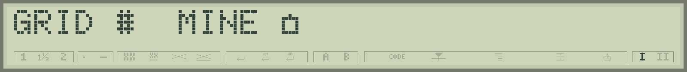

# Choosing your characters

Studio's **Characters** palette gives access to all 256 LCD codes. Select a drawing, then **Insert expression at cursor**: Studio writes CHR$(code) in your program. Choose a symbol without finding it on the Canon keyboard.

**These two tables reproduce Studio's palette**, transcribed by observing the S-70 display. Choose a letter, border, symbol or piece of scenery.

## LCD codes 0 to 127


**0 to 7** select eight custom patterns; **8 to 15** alias them. Their appearance depends on the program and is blank here. Positions **16 to 31** are blank on the studied display. Ordinary space is **code 32**.

## LCD codes 128 to 255


The range **128 to 159** appears blank on the S-70; extended characters begin at **160, Ç**. Solid block **171** serves as BASIC's cursor. Grid **172** and symbol **192** form Pocket Duel's terrain and mines. Choose patterns visible in the catalogue.

## Using a drawing from the table

```basic
10 CLS:CURSOR 4
20 PRINT CHR$(160);" ";CHR$(172);" ";CHR$(192)
```

This displays three native characters separated by spaces. **CHR$ belongs outside quotation marks**: `PRINT "CHR$(172)"` would simply display the text CHR$(172).

```basic
10 CLS:CURSOR 4
20 PRINT "GRID ";CHR$(172);"  MINE ";CHR$(192)
```



Common accents can also be entered directly into a Studio string, for example `PRINT "Accents: café, Noël"`. The tool converts supported characters to native codes. For symbols without a corresponding key, CHR$ remains the clearest approach. The table describes the reference S-70 display; another variant may contain different drawings.

## What about paper?

**PRINT and LPRINT have their own fonts.** LPRINT uses the 95 printable ASCII codes **32 to 126**, including space. To reproduce an LCD pattern such as grid 172 on paper, define it with GLYPH.


```basic
10 LPRINT "Backslash: ";CHR$(92)
20 LPRINT "Vertical bar: ";CHR$(124)
```

Prepare GLYPH patterns for accents and additional signs. A full LPRINT character list and a program to print it are in the [LPRINT reference](caracteres-lprint.md). Custom drawings are explained in [the paper chapter](08-papier-dessins.md#glyph).
