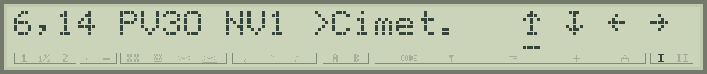
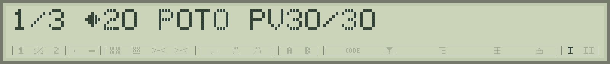
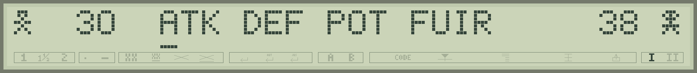
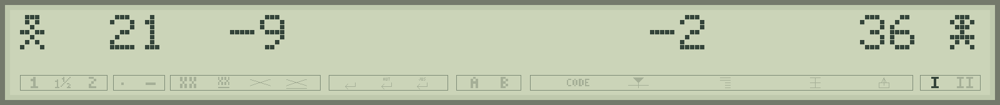
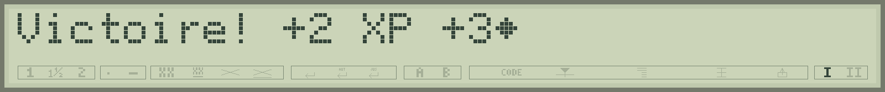
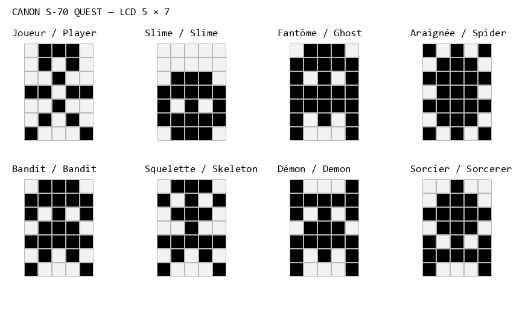
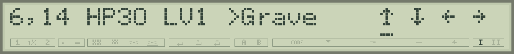
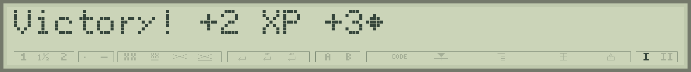

# Canon S-70 Quest — prototype 0.9

[Programme français](../games/canon-s70-quest-fr.bas) · [English program](../games/canon-s70-quest-en.bas)

## Français

**Le Roi charge le héros de retrouver le sorcier qui a fui.** Explorez le royaume imprimé sur papier et affrontez cinq gardiens sur le LCD. Cette adaptation de [Canon X-07 Quest](https://github.com/pR-0000/Canon_X-07_RPG) reprend sa **carte de 30 × 16 cases**, ses **quinze motifs** et ses **sept apparences d'ennemis**. Les combats se jouent au tour par tour : **ATK, DEF, POT, FUIR**.

### Préparer la partie

Utilisez le firmware **0.4.100-dev**. Ouvrez le programme dans **Typestar BASIC Studio** : **Exécuter (F5)** pour l'émulateur, ou **Envoyer → LOAD**, puis `RUN`, pour la Canon. Au premier écran, **Entrée imprime la carte** sur une nouvelle zone de papier thermique ; les gardiens vaincus sont ensuite barrés sur cette carte. **RET passer** désigne la touche **BACKSPACE** : elle passe l'étape d'impression et démarre directement l'aventure sur le LCD, avec le prochain objectif et les récompenses. Si vous possédez une carte déjà imprimée, vous pouvez la consulter comme repère.

La carte fraîchement imprimée est présentée **224 unités FEED plus haut** que dans la version 0.4. Avec **RET passer**, le papier garde sa position et les victoires sont indiquées sur le LCD. Une ancienne carte reste utilisable, quelle que soit la position de sa feuille ; les croix papier sont réservées à une carte imprimée pendant la partie en cours.

**IMPRESSION CARTE 1/16** à **16/16** indique la rangée en cours. Les deux rangées supérieures donnent les dizaines et les unités des colonnes ; les numéros des lignes alternent entre deux petites colonnes à gauche, pour garder les seize repères lisibles. Passez l'introduction avec une touche : vous partez en **6,14**, près du château.

La même carte sert pendant toute la partie. Les cases claires et le sable portent de petits repères pointillés en haut et à droite. Le LCD donne votre position sous la forme **colonne,ligne**, vos **PV**, votre **niveau NV** et, après **>**, le **prochain lieu dont il faut vaincre le gardien** : **Cimet.** (cimetière), **Forêt**, **Ruines**, **Oasis**, puis **Tour**. Par exemple, **6,14 PV30 NV1 >Cimet.** indique votre position, vos 30 PV, votre niveau 1 et le premier objectif. Ce repère suit votre progression ; votre position actuelle reste donnée par les coordonnées. Le caractère LCD 164 représente les pièces d'or dans les prix, les statistiques et les récompenses.

### Commandes

| Touche | Action |
|---|---|
| Flèche gauche / droite | Choisir le cap souligné parmi **↑ ↓ ← →**, dans l'ordre haut, bas, gauche, droite. |
| Entrée | Avancer d'une case. |
| BACKSPACE | Ouvrir les trois pages de statistiques et d'inventaire. |
| Espace | Lire le rappel des commandes. |
| BREAK | Interrompre le programme. |

Relâchez la touche entre les actions. Les décors denses forment les obstacles. **BACKSPACE affiche immédiatement l'or, le nombre de potions et les PV actuels/maximaux.** Les flèches parcourent trois pages, repérées **1/3**, **2/3**, **3/3** : **or/potions/PV**, **niveau/XP/attaque/défense**, puis **épée/armure**. **POT** signifie potions ; le caractère 164 représente les pièces d'or. Entrée ou BACKSPACE reprend le voyage.

### Combats et magasins

Passez le nom de l'ennemi avec une touche. Votre personnage et ses PV sont à gauche, l'adversaire et ses PV à droite, séparés des dessins par une case vide. Les flèches choisissent la commande soulignée, **Entrée** la valide. Après chaque tour, le centre montre les **PV perdus par le joueur à gauche**, et **par l'ennemi à droite**, avec une pause silencieuse de **800 ms**. Les nombres et le menu sont mis à jour sur place ; les personnages restent affichés. Vous avez le temps de réfléchir. Le premier ennemi conserve son nom **SLIME** en français comme en anglais.

| Commande | Effet |
|---|---|
| **ATK** | Frapper, puis subir une riposte si l'ennemi survit. |
| **DEF** | Porter un petit coup et diviser les dégâts reçus par deux, arrondis au supérieur. |
| **POT** | Boire une potion : +18 PV dans la limite du maximum, puis subir la riposte. Le stock est acheté au château ou au village. |
| **FUIR** | Quitter un combat ordinaire. Un gardien poursuit le duel. |

Chaque victoire rapporte de l'or et de l'expérience. Un niveau augmente les PV, l'attaque et la défense, et restaure toute la vie. **Cinq victoires contre des slimes donnent le niveau 2**, suffisant pour le cimetière. Le passage au niveau suivant coûte **6 + 4 × le niveau actuel** : 10 XP au niveau 1, 14 au niveau 2, 18 au niveau 3, puis quatre XP supplémentaires à chaque niveau. Le surplus est conservé. Les ennemis deviennent aussi plus résistants après chaque gardien vaincu. Prévoyez des repos au château pendant l'entraînement et achetez vos potions avant les gardiens. La commande **DEF** permet d'économiser les PV pendant un combat difficile.

L'écran de victoire donne les **XP et les pièces gagnés pendant ce combat**, bonus de gardien compris. Par exemple, un slime rapporte **+2 XP et +3 pièces**, un fantôme **+3 XP et +5 pièces**, une araignée **+4 XP et +7 pièces**, un bandit **+5 XP et +9 pièces**. Le premier gardien rapporte **16 XP et 21 pièces**. Une touche poursuit la partie ou affiche le niveau obtenu. Les récompenses permettent de préparer les achats de la région suivante.

Au château ou au village, choisissez **1 Repos**, **2 Potion**, **3 Épée** ou **4 Armure**. L'écran suivant donne votre or et le prix : **Entrée confirme**, **BACKSPACE revient au menu**. BACKSPACE dans le menu reprend le voyage.

- Repos complet : **4 pièces** ; potion : **8 pièces**.
- Épée ou armure **+1 : 40 pièces**, puis **+2 : 80 pièces** supplémentaires. Chaque type s'arrête à +2.
- L'épée augmente l'attaque ; l'armure réduit les dégâts reçus.
- Départ : **30 PV, 20 pièces et zéro potion**. Le premier stock s'achète au château voisin.

### Lieux et progression

| Lieu | Coordonnées | Rôle / niveau requis |
|---|---|---|
| Château | 4,14 ou 5,14 | Repos, potions et équipement. |
| Village | 13,7 | Même magasin, plus près du nord. |
| Cimetière | 19,14 | Gardien 1, squelette ; niveau **2**. |
| Forêt | 4,7 | Gardien 2, bandit ; niveau **4**. |
| Ruines | 17,3 | Gardien 3, démon ; niveau **6**. |
| Oasis | 26,6 | Gardien 4, démon ; niveau **8**. Bassin central franchissable. |
| Tour noire | 28,14 | Gardien 5, sorcier ; niveau **10**. |

Les gardiens se combattent dans cet ordre. Lorsque la carte a été **imprimée pendant cette partie**, une **croix papier** marque la case où un gardien a été vaincu. Dans les deux modes, le prochain objectif indiqué sur le LCD avance après chaque gardien vaincu. La défaite du sorcier termine l'aventure.

**Pour déclencher le gardien de l'Oasis**, entrez sur la case **26,6**, après les trois premiers gardiens et au **niveau 8** ou plus. Ce bassin central conserve son dessin d'eau et devient franchissable depuis les quatre cases voisines. Les autres cases d'eau et les motifs décoratifs constituent des obstacles. Si le niveau ou l'ordre des gardiens demande encore un entraînement, le LCD indique la condition à remplir. Après la victoire, le bassin reste traversable. La carte garde le même dessin : vous pouvez réutiliser une feuille déjà imprimée.

### Impression et mémoire

Le jeu transmet **une rangée complète de 30 motifs** au firmware avec `GLYPH G(0),30,8,5`. Le cache natif prépare les dessins et les remplace au besoin, en gardant la tête engagée entre les motifs, **cases vides comprises**. Chaque rangée se termine par un seul retour de tête. Les grands pixels carrés du mode 4 sont conservés ; `LSPACING 1` fixe l'avance à une bande de 56 unités.

Le programme prépare quinze motifs dans un tableau temporaire. `CLEAR` libère ce tableau avant le début de l'aventure, puis les deux choix de démarrage préparent les mêmes personnages LCD. Le listing français occupe **4 957 octets tokenisés**, l'anglais **4 941**, avant les données de travail. Deux cases tiennent dans chaque octet de carte. Les caractères inhabituels des lignes `DATA` codent la carte et les dessins : conservez-les lors de l'édition. Studio assure leur transfert. Un nouveau `RUN` initialise une nouvelle partie et propose d'imprimer la carte ou de passer cette étape.

Une carte imprimée initialise la position de lecture à **Y=1736**. B/C suivent les positions du papier et de la tête ; après une croix de gardien, le jeu retourne à ce même point de lecture. Lorsque l'impression est passée, **B=0** indique une partie sur LCD : le calcul des récompenses et du compteur reste commun aux deux modes, et les commandes papier sont réservées au mode imprimé.

L'impression utilise **35 transactions papier**, titres et coordonnées inclus. Le temps sur la machine réelle dépend aussi des moteurs et de la place disponible pour le cache des motifs.

### Modifier les personnages LCD

Le [catalogue BASIC français](../graphics/s70-quest-sprites-fr.bas) présente les huit dessins : **une ligne DATA par rangée de cinq pixels**, de haut en bas. Un `1` allume le pixel, un `0` l'éteint. Ouvrez-le dans Studio pour modifier et essayer les dessins. La huitième ligne de `LCDCHAR`, réservée ici au soulignement, vaut zéro. Les mêmes pixels sont fournis en [JSON modifiable](../graphics/s70-quest-sprites.json). Le joueur a son propre dessin et les sept types d'ennemis ont chacun leur silhouette.

## English

**The King sends the hero to find the sorcerer who has fled.** Explore the kingdom printed on paper and fight five guardians on the LCD. This adaptation of [Canon X-07 Quest](https://github.com/pR-0000/Canon_X-07_RPG) retains its **30 × 16 map**, **fifteen tiles** and **seven enemy appearances**. Combat uses turns: **ATK, DEF, POT, FLEE**.

### Starting a game

Use firmware **0.4.100-dev**. Open the program in **Typestar BASIC Studio**: **Run (F5)** for the emulator, or **Send → LOAD**, then `RUN`, for the Canon. At the first screen, **Enter prints the map** on a fresh area of thermal paper; defeated guardians are subsequently crossed out on that map. **BS skip** means **Backspace**: it skips printing and starts the adventure directly on the LCD, including the next objective and rewards. If you already have a printed map, you can consult it as a visual reference. The French program labels this choice **RET passer**.

A freshly printed map is presented **224 FEED units higher** than in version 0.4. With **BS skip**, the paper stays in place and victories appear on the LCD. An older map remains usable regardless of its position; printed crosses are reserved for a map printed during the current game.

**PRINTING MAP 1/16** through **16/16** identifies the current row. Two header rows give column tens and units; row numbers alternate between two small columns on the left, keeping all sixteen labels readable. Dismiss the introduction with a key: you start at **6,14**, near the castle.

The same map serves throughout the game. Clear and sandy tiles have small dotted guides along their top and right edges. The LCD shows your position as **column,row**, your **HP**, **level LV** and, after **>**, the **next guardian's location**: **Grave** (cemetery), **Forest**, **Ruins**, **Oasis**, then **Tower**. For example, **6,14 HP30 LV1 >Grave** gives your position, 30 HP, level 1 and the first objective. This marker follows your progress; the coordinates still identify your current location. Native LCD character 164 represents gold coins in prices, statistics and rewards.

### Controls

| Key | Action |
|---|---|
| Left / right arrow | Select the underlined heading among **↑ ↓ ← →**, ordered up, down, left, right. |
| Enter | Advance one tile. |
| Backspace | Open the three status and inventory pages. |
| Space | Read the controls reminder. |
| BREAK | Interrupt the program. |

Release the key between actions. Dense scenery forms obstacles. **Backspace immediately shows gold, the potion count and current/maximum HP.** Arrows cycle through three pages, marked **1/3**, **2/3**, **3/3**: **gold/potions/HP**, **level/XP/attack/defense**, then **sword/armor**. **POT** means potions; character 164 represents gold coins. Enter or Backspace resumes travel.

### Combat and shops

Dismiss the opponent's name with a key. Your character and HP appear on the left, the enemy and its HP on the right, separated from the pictures by a blank cell. Arrows select the underlined command; **Enter** confirms. After each turn, the centre shows **HP lost by the player on the left**, and **by the enemy on the right**, with a silent **800 ms** pause. Numbers and the menu update in place while the characters stay visible. Take your time to choose. The first enemy keeps its name **SLIME** in both languages.

| Command | Effect |
|---|---|
| **ATK** | Attack, then take a counterattack if the enemy survives. |
| **DEF** | Deal a small hit and halve incoming damage, rounding up. |
| **POT** | Drink a potion: +18 HP up to your maximum, then take the counterattack. Buy your supplies at the castle or village. |
| **FLEE** | Leave an ordinary battle. Guardian battles continue to their conclusion. |

Each victory awards gold and experience. A level increases HP, attack and defense, and fully heals you. **Five slime victories reach level 2**, enough for the graveyard. The next level costs **6 + 4 × your current level**: 10 XP at level 1, 14 at level 2, 18 at level 3, then four more XP per level. Surplus XP carries over. Enemies also grow tougher after each defeated guardian. Plan rests at the castle while training and buy potions before fighting guardians. **DEF** helps conserve HP in a difficult battle.

The victory screen gives the **XP and gold earned in that battle**, including guardian bonuses. For example, a slime awards **+2 XP and +3 gold**, a ghost **+3 XP and +5 gold**, a spider **+4 XP and +7 gold**, and a bandit **+5 XP and +9 gold**. The first guardian awards **16 XP and 21 gold**. A key continues the game or displays a newly gained level. Rewards help fund your purchases for the next region.

At the castle or village, choose **1 Rest**, **2 Potion**, **3 Sword** or **4 Armor**. The next screen shows your gold and the price: **Enter confirms**, **Backspace returns to the shop**. Backspace in the shop resumes travel.

- Full rest: **4 gold**; potion: **8 gold**.
- Sword or armor **+1: 40 gold**, then **+2: another 80 gold**. Each type stops at +2.
- The sword increases attack; armor reduces incoming damage.
- Start with **30 HP, 20 gold and zero potions**. Buy your first supplies at the nearby castle.

### Places and progression

| Place | Coordinates | Purpose / required level |
|---|---|---|
| Castle | 4,14 or 5,14 | Rest, potions and equipment. |
| Village | 13,7 | The same shop, nearer the north. |
| Graveyard | 19,14 | Guardian 1, skeleton; level **2**. |
| Forest | 4,7 | Guardian 2, bandit; level **4**. |
| Ruins | 17,3 | Guardian 3, demon; level **6**. |
| Oasis | 26,6 | Guardian 4, demon; level **8**. Walkable central pool. |
| Black tower | 28,14 | Guardian 5, sorcerer; level **10**. |

Fight the guardians in this order. When the map was **printed during the current game**, a **printed cross** marks the tile where a guardian was defeated. In both modes, the next objective shown on the LCD advances after each defeated guardian. Defeating the sorcerer ends the adventure.

**To trigger the Oasis guardian**, enter **26,6** after defeating the first three guardians and reaching **level 8** or higher. The central pool retains its water artwork and can be entered from all four neighbouring cells. Other water cells and decorative tiles form obstacles. If your level or guardian progression requires further training, the LCD identifies the condition to meet. After victory, the pool remains walkable. The map artwork stays the same, so an already printed sheet can be reused.

### Printing and memory

The game sends **one complete row of 30 tiles** to the firmware with `GLYPH G(0),30,8,5`. The native cache prepares and replaces tiles as needed, keeping the head engaged between them, **including blank tiles**. Each row ends with a single carriage return. Mode 4's large square pixels are retained; `LSPACING 1` sets the advance to one 56-unit band.

A temporary array holds the fifteen tiles. `CLEAR` releases it before the adventure starts, and both startup choices then prepare the same LCD characters. The French listing occupies **4,957 tokenized bytes**, the English listing **4,941**, before workspace. Two map cells fit in each encoded byte. Keep the unusual characters in DATA lines: they encode the map and artwork, and Studio handles their transfer. A new `RUN` starts a fresh game and offers to print the map or skip that step.

Printing a map initializes the reading position to **Y=1736**. B/C track paper and carriage positions; after a guardian cross, the game returns to that same reading position. When printing is skipped, **B=0** selects LCD play: rewards and the guardian counter use the common path, while paper commands are reserved for the printed-map mode.

Printing uses **35 paper transactions**, including titles and coordinates. Real hardware time also depends on the motors and the memory available for the tile cache.

### Editing the LCD characters

The [English BASIC catalogue](../graphics/s70-quest-sprites-en.bas) presents the eight pictures: **one DATA line per five-pixel row**, from top to bottom. A `1` lights the pixel; a `0` clears it. Open it in Studio to edit and try the drawings. LCDCHAR's eighth row, reserved here for underlining, is zero. The same pixels are supplied as [editable JSON](../graphics/s70-quest-sprites.json). The player has a dedicated picture and each of the seven enemy types has its own silhouette.
