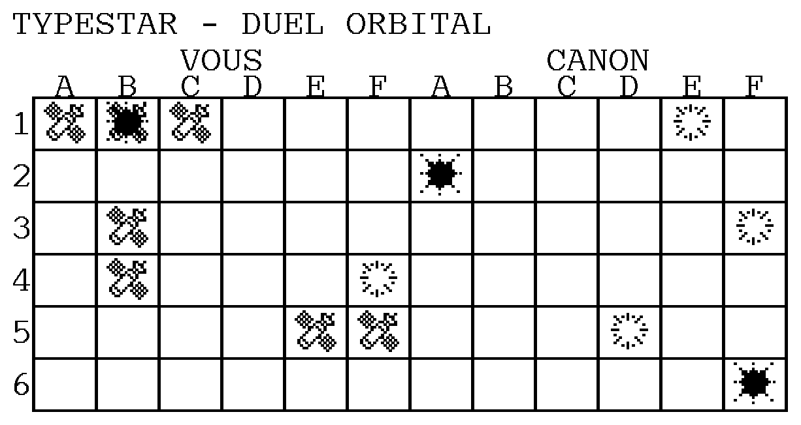

# Typestar — Duel orbital / Orbital Duel 1.8

[Programme français](../duel-orbital-fr.bas) · [English program](../orbital-duel-en.bas)

## Français

Vous commandez trois formations de satellites, de **3, 2 et 2 cases**, sur une grille de 6 × 6. La Canon possède la même flotte. Le premier à toucher les sept satellites adverses gagne. Utilisez **Typestar BASIC 0.4.93-dev** et du papier thermique.

### Jouer

`RUN` lance directement le dessin. Les tableaux sont désormais accolés : **VOUS**, à gauche, contient vos satellites ; **CANON**, à droite, conserve vos tirs. Les colonnes A–F sont indiquées au-dessus de chaque moitié ; les numéros 1–6 à gauche servent aux deux tableaux.

Cet aperçu représente la disposition et les motifs du programme. La durée et l'alignement mécaniques se vérifient sur le papier réel.

La Canon prépare sa flotte après le dessin. Pour placer chacune des vôtres, indiquez une case de départ, comme **A1**, puis **H** pour aller vers la droite ou **V** pour aller vers le bas. Return valide chaque saisie ; les minuscules sont acceptées. Les formations occupent des cases libres et peuvent se toucher. Une saisie invalide redemande la position ou l'orientation.

Pour tirer, saisissez une case comme **B3**, puis Return. **Q** termine la partie et révèle les satellites adverses restants. Les erreurs et les tirs répétés préservent le tour. La Canon joue immédiatement après vous, puis le papier présente les deux résultats. Les règles et le ciblage adverse restent ceux de la version 1.7 : recherche autour d'une touche, puis dans son prolongement.

Un satellite représente une case occupée ; l'explosion pleine est superposée à un satellite touché ; la couronne de particules marque un tir dans le vide. Les trois dessins ont maintenant **le double de la largeur et de la hauteur**, avec le mode `GLYPH 4`. Les cases gardent une marge autour des motifs. Le LCD annonce **DETRUIT** lorsqu'une formation entière est touchée. Le bilan est imprimé sous les grilles.

Laissez les moteurs conserver le repère du papier pendant la partie. Pour reprendre après BREAK ou une erreur, commencez une nouvelle partie sur une nouvelle zone.

### Impression continue et mémoire

Les deux tableaux sont préparés **ensemble, bande par bande**. Une matrice temporaire `Q(7,23)` décrit un fragment de case. `GLYPH Q(0,0),24,8,4,12` répète ce fragment pour les **douze colonnes dans la même passe horizontale**. Le firmware prépare un seul fragment, puis réutilise son tampon pour les copies. Les bandes suivantes ajoutent les traits horizontaux au bon niveau. Le bord droit est fermé par deux bandes verticales `BOX` étroites.

Les tableaux occupent seize bandes. Chaque fragment utilise trois blocs natifs ; le tampon d'impression et la sauvegarde matérielle occupent **412 octets**, quel que soit le nombre de répétitions. La matrice utilise **969 octets**, libérés par `CLEAR` après la grille. Un second `CLEAR` libère la composition graphique avant la création des données de jeu. Le programme reste en mémoire pendant ces deux opérations.

Les cases sont espacées de **48 unités HEAD** et **140 unités FEED**. Le tableau adverse commence 288 unités HEAD après le vôtre. Le placement des glyphes emploie les mêmes coordonnées physiques que le tracé : les colonnes éloignées conservent leur alignement.

La présentation du papier à la ligne 1600 utilise Y=1484. L'espace entre le bas du dessin et la position de lecture diminue de **448 unités FEED**, soit un grand segment de mouvement. La hauteur absolue tient compte de l'agrandissement du tableau. B/C conservent les positions Y/X et G/K les cibles ; la routine 1500 découpe chaque mouvement dans les limites HEAD/FEED.

La mise en commun réduit les préparations et les retours entre tableaux. Le dessin et le jeu ont été validés sur machine. Les grands dessins augmentent aussi la surface imprimée ; le gain de temps reste à mesurer précisément. Les vérifications dans l'émulateur portent sur une vraie bande de douze colonnes, les seize phases de la matrice, la libération du tampon et le placement du grand glyphe en colonne F.

Le programme français occupe **3 828 octets tokenisés**, l'anglais **3,817**. Les tableaux de jeu B, C, H et Z utilisent **856 octets**, en-têtes compris. B conserve les flottes et les tirs, C seulement les informations connues de la Canon, H les impacts et Z les trois bitmaps.

## English

Command three satellite formations of **3, 2 and 2 cells** on a 6 × 6 grid. The Canon has the same fleet. Hit all seven enemy satellites first to win. Use **Typestar BASIC 0.4.93-dev** and thermal paper.

`RUN` starts drawing immediately. The adjoining boards are headed **YOU** on the left and **CANON** on the right. A–F appears above each half; the row numbers 1–6 at the left apply to both boards. The illustration shows nominal layout; the drawing and game have also been validated on hardware.

After drawing, the Canon prepares its fleet. Place each of yours by entering a starting cell such as **A1**, then **H** for rightwards or **V** for downwards. Confirm each entry with Return; lowercase is accepted. Formations occupy free cells and may touch. Invalid input requests another position or orientation.

Enter **B3**, for example, to fire. **Q** ends the game and reveals remaining enemy satellites. Invalid and repeated shots preserve your turn. The Canon responds immediately, then the paper displays both results. The unchanged 1.7 opponent looks around a hit, then along aligned hits.

A satellite marks an occupied cell. A solid explosion overprints a hit satellite; a particle ring marks a miss. All three drawings are now **twice as wide and high**, using `GLYPH 4`. Cells leave margins around them. **DESTROYED** on the LCD identifies a fully hit formation. The final score is printed below the boards. Let the motors retain the paper reference; start on a fresh area after BREAK or an error.

Both boards print **together, one band at a time**. A temporary `Q(7,23)` matrix describes a cell fragment. `GLYPH Q(0,0),24,8,4,12` reuses one cached fragment across **all twelve columns in a single horizontal sweep**. Later bands insert horizontal lines at the correct height; two narrow vertical `BOX` sections close the right border.

Sixteen bands form the boards. The print buffer and native workspace take **412 bytes** regardless of repeat count. The **969-byte** construction matrix is released with `CLEAR`; a second `CLEAR` releases the graphics composition before the game arrays are created. Both operations preserve the program.

Cell pitches are **48 HEAD units** and **140 FEED units**. The enemy board begins 288 HEAD units after yours. Glyphs and grid lines use the same physical coordinates, including the farthest column. B/C track Y/X and G/K hold destinations; routine 1500 splits movements within HEAD/FEED limits.

Line 1600 presents the paper at Y=1484. Relative to the bottom of the enlarged drawing, this is **448 FEED units shorter**, saving one large movement segment. Shared bands reduce preparation and returns between boards, while larger artwork increases the printed area; the time saving has not been precisely measured, although the game and drawing have been validated on hardware. Emulator checks cover a real twelve-column band, all sixteen matrix phases, buffer release, and the large glyph at column F.

French source: **3,828 tokenized bytes**; English: **3,817**. Game arrays B, C, H and Z use **856 bytes** including headers: fleets/shots, the Canon’s public knowledge, hit counts and the three bitmaps respectively.
