# Labyrinthe 3D / 3D Maze — prototype 0.9

[Programme français](../games/labyrinthe-3d-fr.bas) · [English program](../games/3d-maze-en.bas)

## Français

Explorez un **labyrinthe aléatoire de 10 × 10 cases**, trouvez le **trésor**, puis gagnez la **sortie en J10, vers le sud**. Chaque `RUN` prépare une carte ; le hasard dépend aussi du moment où vous validez le premier écran. Les 100 cases communiquent : le trésor et la sortie sont toujours accessibles. Le jeu utilise le LCD, quelques effets sonores et, si vous le souhaitez, des **fragments de carte imprimés**.

### Démarrer

Utilisez **Typestar BASIC 0.4.100-dev**. Dans **Studio**, ouvrez le programme et choisissez **Exécuter (F5)** ; pour la Canon, utilisez **Envoyer → LOAD**, puis tapez `RUN`. Le premier écran propose **CARTES PAPIER ?** : **Entrée** active cette option ; **BACKSPACE** choisit le jeu sur LCD seul. Préparez une feuille thermique si vous activez le papier.

Le LCD affiche ensuite **GÉNÉRATION**. Cette préparation se fait une fois par partie et peut prendre un moment en BASIC. Le jeu annonce les coordonnées du trésor. Vous commencez toujours à un **carrefour ayant au moins trois passages intérieurs**, face à une ouverture. Les coordonnées du départ dépendent de la carte ; vous pouvez immédiatement choisir entre plusieurs chemins. L’entrée en A1 et la sortie en J10 gardent leur place ; les passages intérieurs changent, y compris sur la première rangée. **Espace** rappelle les commandes et la sortie en J10.

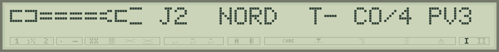

Les neuf premières cases du LCD dessinent les couloirs en perspective. Les indications à droite donnent :

- **A1…J10** : la colonne et la ligne actuelles.
- **NORD, EST, SUD, OUEST** : la direction du regard.
- **T− / T+** : trésor à chercher / trésor trouvé.
- **C0/4…C4/4** : le nombre de fragments de carte trouvés.
- **PV3…PV1** : vos points de vie. Vous commencez avec trois points.

### Commandes

| Touche | Action |
|---|---|
| Flèche gauche | Tourner d’un quart de tour vers la gauche. |
| Flèche droite | Tourner d’un quart de tour vers la droite. |
| Entrée | Avancer d’une case dans la direction regardée. |
| BACKSPACE | Faire demi-tour sur place. |
| Espace | Lire les commandes et rappeler l’objectif. Une touche passe chaque page. |
| Q | Terminer la partie et revenir au BASIC. |
| BREAK | Interrompre le programme. |

Relâchez la touche entre deux actions. Un mur produit un signal et laisse le personnage sur sa case. L’ouverture à l’ouest de A1 représente l’entrée ; la sortie de l’aventure est en J10.

Quand vous entrez dans la case du trésor, un petit signal annonce sa découverte et **T+** apparaît. Dirigez-vous ensuite vers **J10**, regardez vers le **sud** et appuyez sur **Entrée** pour sortir. Si le trésor attend encore dans le labyrinthe, le jeu vous rappelle l’objectif et vous laisse en J10.

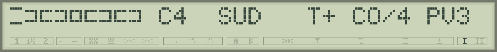

L’écran final indique le nombre de pas, avec le dernier pas vers l’extérieur. Une touche revient au BASIC. `RUN` prépare une nouvelle partie. Le compteur continue au-delà de 9 999 pas.

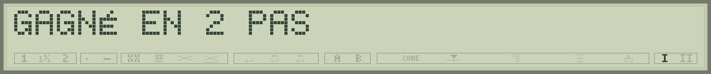

### Une perspective plus lisible

La vue utilise désormais **neuf caractères**, avec une ouverture centrale plus large et des lignes qui convergent vers le fond. Un **mur proche** réutilise les cadres `[]` visibles sur les côtés, avec une petite pierre fermée au centre ; un **couloir profond** garde son centre ouvert. Les ouvertures latérales indiquent les passages vers la gauche ou la droite. Le jeu regarde jusqu’à trois cases devant vous.

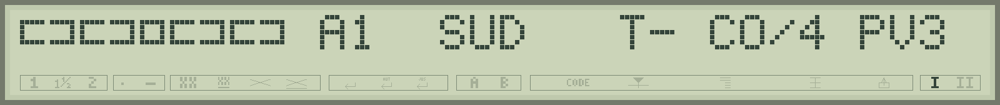

### Les fragments de carte

**Quatre fragments sont cachés**, un dans chacun des secteurs **A–E / 1–5**, **F–J / 1–5**, **A–E / 6–10** et **F–J / 6–10**. Leur position est tirée au hasard dans chaque secteur, à une case différente du départ. Explorez les embranchements : les fragments se découvrent en entrant sur leur case. Le compteur **C1/4** confirme la première découverte. Avec le papier activé, le LCD annonce **FRAGMENT 1/4**, puis l’imprimante dessine uniquement les **25 cases du secteur trouvé**.

Dans un couloir dégagé, un **point `.`** représente un fragment à **deux cases**. À une case, il devient le **caractère natif 197**, une petite étoile. Les murs masquent les objets situés derrière eux. Le centre de la vue affiche l’objet le plus proche ; un monstre placé sur un fragment passe devant celui-ci. Après la découverte, le symbole disparaît et la vue se met à jour. À trois cases, le fragment reste caché ; le décor et le monstre restent visibles jusqu’à cette distance.

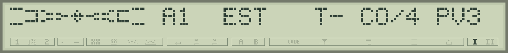

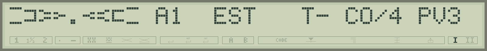

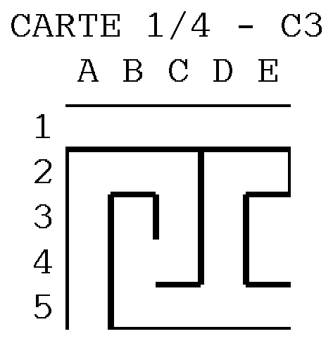

Chaque morceau porte les **lettres des colonnes au-dessus des cases**, les **numéros des rangées sur le bord gauche** et vos **coordonnées au moment de la découverte** dans le titre. Le nord reste en haut ; les cinq colonnes se lisent de gauche à droite et les cinq rangées de haut en bas. Les ouvertures sur les bords indiquent les passages vers les secteurs voisins. Vous pouvez noter votre trajet au crayon.

Les fragments s’impriment **dans l’ordre de leur découverte**, chacun une seule fois. Les autres secteurs restent à explorer. Le monstre et les fragments encore cachés gardent leur secret. Le monstre attend pendant l’impression ; le papier avance ensuite pour rendre le dessin visible. À la découverte suivante, le programme reprend l’impression sous le morceau précédent.

Les cartes constituent une aide facultative : **trésor puis sortie** reste la condition de victoire. Le mode LCD seul conserve les découvertes et leur compteur ; chaque fragment produit un son, et la partie continue sur l’écran.

### Le monstre

Le monstre commence dans un coin de la moitié opposée du labyrinthe, à **au moins cinq pas de chemin** de votre carrefour de départ. Il agit **tous les deux pas réussis** du joueur et avance d’une case au maximum. Tourner, consulter l’aide ou rencontrer un mur vous laisse le temps d’observer la situation.

Il vous entend à **trois cases de chemin au maximum**, en suivant les passages réels, y compris autour d’un angle. À cette distance, il suit votre piste. Au-delà, il **perd votre trace et erre au hasard** : il tente une direction, puis avance si le passage est ouvert, ou attend si un mur lui barre la route. Vous pouvez donc réellement le semer : avancez pour prendre de la distance et profitez des carrefours pour changer de branche. Tourner le regard conserve la même distance et le même niveau de détection. Il apparaît sur le LCD lorsqu’un **couloir libre devant vous** le relie à votre case, jusqu’à trois cases. Un bref signal accompagne son apparition. Un mur le masque ; tournez-vous pour surveiller vos arrières.

Lorsqu’il approche depuis un angle encore masqué, il **s’arrête sur la case voisine**. Vous pouvez tourner pour le voir et choisir votre chemin. Un monstre déjà visible peut vous rejoindre lors de son déplacement ; avancer sur sa case provoque également un contact. Cette règle laisse un avertissement visuel avant la perte d’un point de vie.

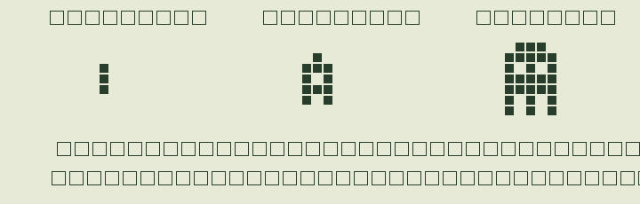

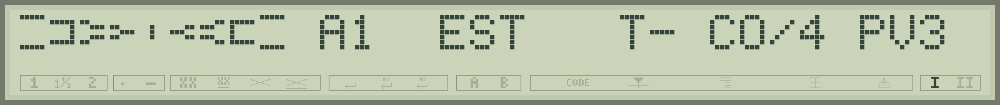

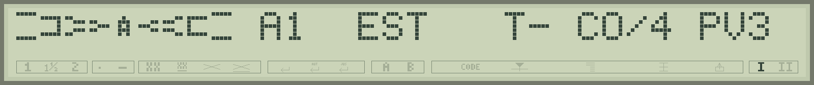

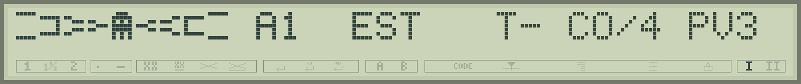

Vous disposez de **trois points de vie**. Entrer sur sa case ou le laisser atteindre la vôtre coûte un point. Un son et un message signalent le contact ; le monstre est **repoussé dans un coin éloigné**, puis reprend sa poursuite. Cela explique sa disparition immédiate après un contact. Votre position et le trésor déjà trouvé sont conservés. Le troisième contact termine la partie ; une touche revient au BASIC.

### Le dessin et la mémoire

Les **sept motifs fixes** du décor sont chargés au démarrage. Le **huitième motif** représente, selon la scène, la pierre centrale d’un mur proche ou l’une des trois tailles du monstre. Le tiret, le signe égal et l’espace utilisent la police native. Plusieurs cases peuvent afficher le même motif ; ces éléments composent les neuf caractères de la vue. Les coordonnées, la boussole, le trésor, les fragments et les points de vie occupent les 22 cases à droite, après un espace de séparation.

Les lignes **4 à 30** construisent la carte dans **V(0)…V(99)** et placent les fragments. **V(100)** mémorise l’option papier et **V(101)** compte les découvertes. La génération creuse un passage dans une direction tirée au hasard, puis revient sur ses pas pour rejoindre les cases encore isolées. Les directions de retour sont conservées dans les cases elles-mêmes. Cette construction produit une carte reliée avec un chemin unique entre deux cases. Un embranchement à trois ou quatre passages est mémorisé pendant la génération, puis les chemins de retour sont réorientés vers ce carrefour de départ. Une carte réduite à un seul couloir est recommencée. Le code source sauvegardé reste intact pendant la partie.

La carte conserve aussi un chemin de chaque case vers le joueur. Un déplacement retourne une seule liaison de ce réseau ; le monstre peut ainsi mesurer sa portée de détection avec trois lectures de tableau, puis choisir la bonne direction pendant la poursuite. Hors de portée, son déplacement est aléatoire.

Le rendu examine jusqu’à trois cases et compose la scène à partir de **deux chaînes de dessins** : les bords gauche et droit partagent `A$`, et le centre utilise `B$`. Elles couvrent les **148 configurations de couloirs** possibles. Trois `PRINT`, chacun portant sur trois caractères, affichent la vue ; le monstre ou le fragment se superpose au centre. Une vue et une présence identiques conservent leur dessin. `C$` sert aux messages et aux opérations temporaires ; cette organisation laisse de la place pour les coordonnées papier.

Le motif variable se recharge lorsque le monstre change de taille à l’écran ou lorsqu’on revient face à un mur proche. Le programme réserve brièvement les sept motifs fixes pendant cette opération ; leurs pixels restent intacts. Cette méthode utilise les commandes LCD habituelles du BASIC.

Le listing français occupe **4 659 octets tokenisés**, avant les variables et le tableau. Les deux lignes `DATA` du début décrivent les motifs de la vue LCD ; le labyrinthe est généré pendant la partie. Le générateur de nombres aléatoires avance pendant l’attente du premier choix : le moment de votre appui varie la carte, y compris dans le mode BASIC de Studio où le compteur matériel reste figé.

Pour imprimer, le programme sauvegarde temporairement les 100 cases dans deux chaînes, puis réutilise le tableau pour une palette de murs et la rangée à dessiner. **GLYPH en mode 5** imprime chaque rangée en un passage continu. Chaque case assemble quatre motifs de 8 × 8, pour un dessin de **16 × 16 pixels**. La carte et les banques du LCD sont restaurées avant de rendre la main au joueur. Le bit qui signale un fragment reste indépendant des chemins de poursuite du monstre.

Les contrôles logiciels exécutent la génération sur la ROM publiée et vérifient la connexion des 100 cases, les bords, les chemins de poursuite, les perspectives, les trois tailles, les murs qui les masquent, les contacts et le retour au BASIC. Les essais de génération comparent la carte réelle à une réalisation indépendante de l’algorithme et vérifient les trois passages intérieurs du départ. Les scénarios de poursuite couvrent la détection à travers les angles, la perte de piste hors de portée et les déplacements aléatoires. Les essais papier comparent les pixels de chaque secteur, les légendes, la restauration de la carte et l’impression unique des fragments. Des copies de diagnostic utilisent une carte préparée sur PC ; les scénarios LCD ajoutent deux touches pour isoler les tours du monstre et les rafraîchissements. Le programme distribué construit sa carte en BASIC.

### Origine

Adaptation inspirée de **Labyrinthe**, de **François Rapenne**, pour **Sharp PC-1500**, publié dans **Hebdogiciel n°41, le 20 juillet 1984, page 14**. [Référence du numéro et crédit de l’auteur](https://www.abandonware-france.org/bibliotheque/magazines/hebdogiciel-156/numero-41-8262/). L’objectif « trésor puis sortie » vient de ce jeu. La génération de carte, le rendu, le clavier, les sons et le monstre sont propres à cette adaptation Typestar BASIC.

## English

Explore a **random 10 × 10 maze**, find the **treasure**, then reach the **exit at J10 and walk south**. Each `RUN` prepares a map; randomness also depends on when you confirm the first screen. All 100 cells are connected, so both treasure and exit are reachable. The game uses the LCD, a few sound effects and, if you wish, **printed map fragments**.

### Starting

Use **Typestar BASIC 0.4.100-dev**. In **Studio**, open the program and choose **Run (F5)**; for the Canon, use **Send → LOAD**, then type `RUN`. The first screen offers **PRINT MAPS?**: **Enter** enables this option; **Backspace** selects LCD-only play. Prepare a sheet of thermal paper if you enable printing.

The LCD then shows **GENERATING**. This preparation happens once per game and can take a while in BASIC. The game announces the treasure coordinates. You always start at a **junction with at least three internal passages**, facing an opening. The starting coordinates depend on the map, giving you a choice of routes immediately. The entrance at A1 and exit at J10 keep their positions; the inner passages change, including the first row. **Space** recalls the controls and the exit at J10.

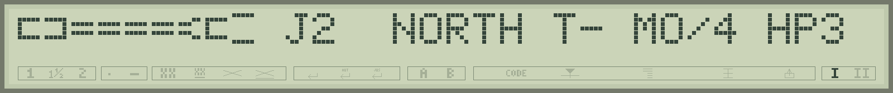

The first nine LCD cells draw the corridors in perspective. The text on the right shows:

- **A1…J10**: your current column and row.
- **NORTH, EAST, SOUTH, WEST**: the direction you face.
- **T− / T+**: treasure still to find / treasure collected.
- **M0/4…M4/4**: the number of map fragments found.
- **HP3…HP1**: your health points. You start with three points.

### Controls

| Key | Action |
|---|---|
| Left arrow | Turn a quarter turn to the left. |
| Right arrow | Turn a quarter turn to the right. |
| Enter | Walk one cell in the direction you face. |
| Backspace | Turn around on the spot. |
| Space | Read the controls and recall the objective. Any key advances each page. |
| Q | End the game and return to BASIC. |
| BREAK | Interrupt the program. |

Release the key between actions. A wall makes a sound and keeps you in the same cell. The opening west of A1 is the entrance; the adventure’s exit is at J10.

Entering the treasure cell plays a short sound and shows **T+**. Then head to **J10**, face **south** and press **Enter** to escape. If the treasure is still in the maze, the game recalls the objective and keeps you at J10.

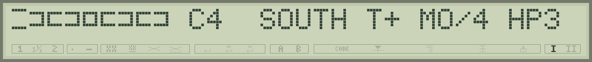

The final screen gives the step count, including the last step outside. Any key returns to BASIC. `RUN` prepares a new game. The counter continues beyond 9,999 steps.

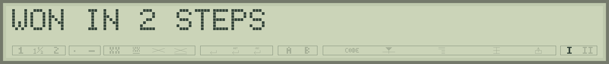

### A clearer perspective

The view now uses **nine characters**, with a wider central opening and lines converging towards the distance. A **nearby wall** repeats the `[]` frames seen at the sides, with a small closed stone in the centre; a **deep corridor** keeps its centre open. Side openings show passages to the left or right. The game looks up to three cells ahead.

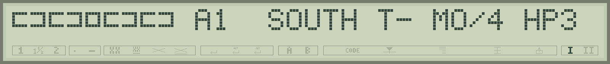

### Map fragments

**Four fragments are hidden**, one in each sector: **A–E / 1–5**, **F–J / 1–5**, **A–E / 6–10** and **F–J / 6–10**. Their positions are randomly chosen in each sector, away from your starting cell. Explore the branches: entering a fragment’s cell discovers it. The **M1/4** counter confirms the first discovery. With printing enabled, the LCD announces **FRAGMENT 1/4**, then the printer draws only the **25 cells in that sector**.

Along an open corridor, a **dot `.`** represents a fragment **two cells away**. One cell away, it becomes **native character 197**, a small star. Walls hide objects behind them. The centre of the view shows the closest object; a monster standing on a fragment takes priority. Collecting a fragment removes its symbol and refreshes the view. A fragment three cells away stays hidden; the scenery and monster remain visible at that distance.

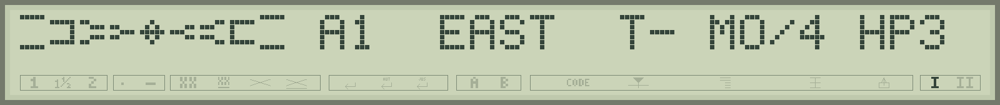

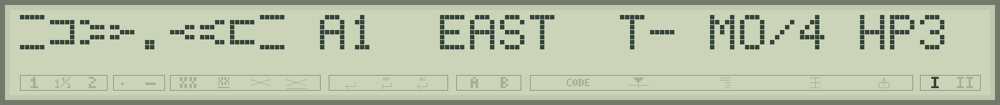

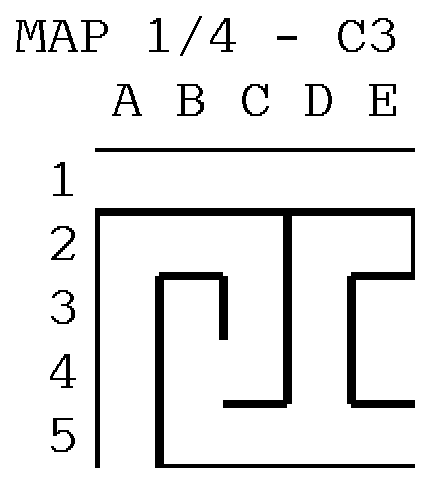

Each piece has **column letters above the cells**, **row numbers along the left edge** and your **coordinates at discovery** in its title. North stays at the top; read the five columns from left to right and the five rows from top to bottom. Openings along the edges show passages towards neighbouring sectors. You can mark your route with a pencil.

Fragments print **in discovery order**, once each. The other sectors remain to be explored. The monster and undiscovered fragments keep their secrets. The monster waits during printing; the paper then advances to make the drawing visible. At the next discovery, the program resumes printing below the previous piece.

Maps are optional help: **treasure, then exit** remains the winning condition. LCD-only mode retains discoveries and their counter; each fragment plays a sound, and play continues on the screen.

### The monster

The monster starts in a corner in the opposite half of the maze, **at least five passage steps from your starting junction**. It takes a turn **for every two successful player steps**, moving at most one cell. Turning, reading help or bumping into a wall gives you time to study the situation.

It hears you **at most three passage steps away**, using the actual route, including bends. Within that range, it follows your trail. Farther away, it **loses your trail and wanders randomly**: it tries a direction, then advances if the passage is open or waits if a wall blocks it. You can therefore shake it off: walk to gain distance, and use junctions to change branches. Turning your view preserves the distance and detection level. It appears on the LCD when an **open corridor ahead** connects it to your cell, up to three cells away. A short sound accompanies its appearance. Walls hide it; turn around to watch your back.

When approaching from a hidden bend, it **stops in the neighbouring cell**. You can turn to see it and choose your route. A monster that was already visible can reach you on its turn; walking into its cell also causes contact. This rule provides a visual warning before losing a health point.

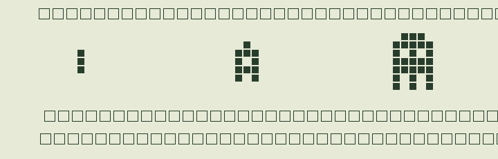

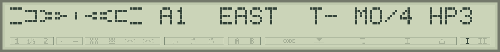

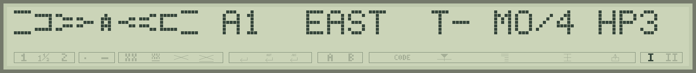

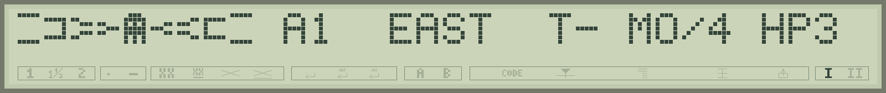

You have **three health points**. Walking into its cell or letting it reach yours costs one point. A sound and a message announce the contact; the monster is **pushed back to a distant corner** and resumes its pursuit. This explains its immediate disappearance after contact. Your position and any collected treasure are preserved. The third contact ends the game; any key returns to BASIC.

### Drawing and memory

The decor’s **seven fixed patterns** load at startup. The **eighth pattern** represents either the central stone of a nearby wall or one of the monster’s three sizes. The dash, equals sign and space use the native font. Several cells can display the same pattern; these elements assemble the nine-character view. Coordinates, compass, treasure, fragments and health occupy the 22 cells on the right, after a separating space.

Lines **4 to 30** build the map in **V(0)…V(99)** and place fragments. **V(100)** stores the paper option and **V(101)** counts discoveries. Generation carves a passage in a randomly selected direction, then backtracks to reach cells that are still isolated. The cells themselves store the return directions. This creates a connected map with a unique route between any two cells. A junction with three or four passages is recorded during generation, then the return paths are redirected towards this starting junction. A map containing only one winding corridor is regenerated. The saved source remains intact during play.

The map also keeps a path from every cell to the player. Moving reverses just one link in this network; the monster can then measure its detection range with three array lookups and choose the right direction during a chase. Outside that range, its movement is random.

The renderer examines up to three cells and assembles the scene from **two drawing strings**: left and right edges share `A$`, while the centre uses `B$`. They cover all **148 corridor configurations**. Three `PRINT` statements, each drawing three characters, display the view; the monster or fragment overlays the centre. An unchanged view and entity retain their drawing. `C$` holds messages and temporary data; this arrangement leaves room for the paper coordinates.

The variable pattern reloads when the monster changes size on screen or when you face a nearby wall again. The program briefly reserves all seven fixed patterns during this operation; their pixels stay intact. This method uses BASIC’s usual LCD commands.

The English listing occupies **4,664 tokenized bytes**, before variables and the array. The two `DATA` lines at the beginning describe the LCD view patterns; the maze is generated during play. The random generator advances while waiting for the first choice: your keypress timing varies the map, including in Studio’s BASIC mode where the hardware counter stays fixed.

For printing, the program temporarily saves all 100 cells in two strings, then reuses the array for a wall palette and the row to draw. **GLYPH mode 5** prints each row in one continuous pass. Each cell assembles four 8 × 8 patterns into a **16 × 16-pixel** drawing. The map and LCD banks are restored before control returns to the player. The fragment marker bit stays independent of the monster’s pursuit paths.

Software checks execute generation on the published ROM and verify connectivity of all 100 cells, boundaries, chase routes, perspectives, the three sizes, wall occlusion, contact damage and return to BASIC. Generation tests compare the actual map to an independent implementation of the algorithm and check the starting junction’s three internal passages. Pursuit scenarios cover detection around bends, losing the trail beyond hearing range, and random wandering. Paper tests compare each sector’s pixels, captions, map restoration and single-use fragment printing. Diagnostic copies use a host-prepared map; LCD scenarios add two keys to isolate monster turns and refreshes. The distributed program builds its map in BASIC.

### Origin

An adaptation inspired by **Labyrinthe**, by **François Rapenne**, for the **Sharp PC-1500**, published in **Hebdogiciel issue 41, 20 July 1984, page 14**. [Issue reference and author credit](https://www.abandonware-france.org/bibliotheque/magazines/hebdogiciel-156/numero-41-8262/). The treasure-then-exit objective comes from that game. Map generation, rendering, keyboard controls, sounds and the monster are specific to this Typestar BASIC adaptation.
