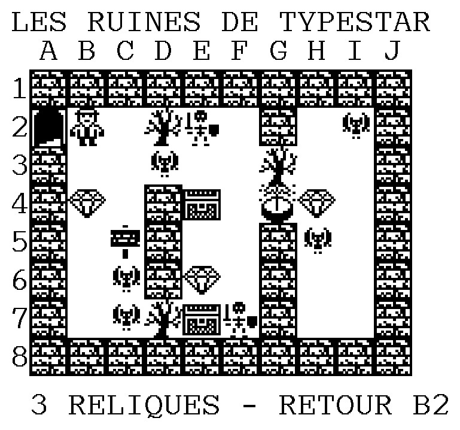
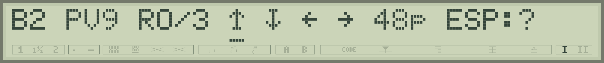
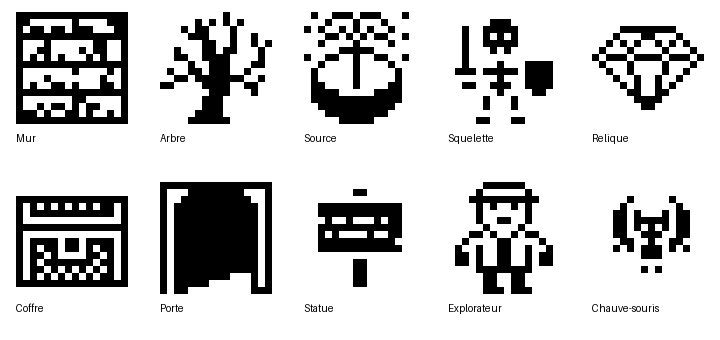
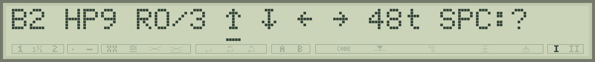

# Les Ruines de Typestar / Typestar Ruins — 0.6

[Programme français / French program](../games/ruines-typestar-fr.bas) · [English program](../games/typestar-ruins-en.bas)

## Français

Explorez un temple envahi par les arbres. Retrouvez **trois reliques**, puis revenez au départ **B2** avant la fermeture des portes. Vous disposez de **48 déplacements** et de **9 points de vie**.

Installez d'abord le firmware **0.4.100-dev**. Placez une nouvelle zone de papier thermique, chargez cette version du jeu avec **Typestar BASIC Studio**, puis lancez `RUN`. Le dessin commence directement, avec les grands glyphes et les rangées continues.

### De grands dessins, des murs imprimés ensemble

Les dix dessins fournis conservent exactement leurs **16 × 16 pixels**, leur taille et leurs asymétries. Chacun est partagé en quatre motifs de 8 × 8 pour le **mode 5 de GLYPH**, qui enchaîne des dessins différents, cases blanches comprises.

Le jeu imprime les parties hautes de toute une rangée, puis les parties basses. **Dix grands murs demandent toujours deux passes horizontales** ; les objets différents peuvent maintenant partager ces mêmes passes. Le mur et le sol gardent des emplacements fixes dans la palette ; cinq autres types peuvent être préparés par bande. Une rangée très variée est fractionnée quand cette palette est pleine. L’écran affiche **IMPRESSION CARTE 1/8** à **8/8**, pour les huit rangées du plan.



Cet aperçu conserve la disposition prévue et la police papier du firmware. Les règles et les grands dessins restent ceux du jeu validé ; le regroupement en rangées est vérifié dans l’émulateur. La durée réelle dépend de la carte et des mouvements nécessaires.

### Se repérer et jouer

La carte comporte dix colonnes **A–J** et huit lignes **1–8**. L'explorateur représente le départ B2, avec la porte juste à sa gauche. Le LCD donne votre **position actuelle**, votre vie, les reliques trouvées et les déplacements restants. Les quatre flèches **↑ ↓ ← →** se lisent dans le même ordre que dans S-70 Quest : **haut, bas, gauche, droite**. Un trait sous la flèche indique la direction choisie.

```text
B2 PV9 R0/3 ↑ ↓ ← → 48p ESP:?
```



| Touche | Action |
|---|---|
| Flèches gauche / droite | Choisir la direction soulignée. |
| Return | Avancer d'une case. |
| Espace | Lire l'aide ; une touche passe à la page suivante. |
| Q | Terminer l'expédition et imprimer le bilan. |

Les murs et les arbres bloquent le passage avec un bip et préservent la réserve de déplacements. Relâchez une touche entre deux actions. Pour commencer, appuyez une fois sur la touche gauche : la sélection passe de **↑** à **→** par bouclage. Appuyez ensuite sur Return : vous passez de B2 à C2. Les touches gauche/droite déplacent la sélection entre les quatre symboles ; Return effectue le déplacement choisi.

À chaque expédition, les cloisons changent de colonne et d'ouvertures, les arbres changent de place, et les objets sont redistribués. Chaque cloison possède une seule ouverture, qui oblige à chercher son passage. Les ouvertures relient toujours les **38 cases accessibles** ; les deux passages voisins du départ restent libres. La graine provient du compteur matériel.

### Rencontres et traces



Une **relique** augmente R. Son gardien coûte **un point de vie**, même lorsque vous avez évité les autres monstres. Une relique se trouve dans chacune des trois zones du temple. Un **coffre** rend trois points de vie, jusqu'au maximum de neuf ; la **source** restaure toute la vie. Deux **squelettes** coûtent chacun deux ou trois points ; cinq **chauves-souris**, un ou deux. Choisissez vos détours et le bon moment pour utiliser les soins. La statue rappelle l'objectif.

Les reliques, les soins et les monstres servent une seule fois. Après leur rencontre, une **croix épaisse** est imprimée par-dessus le dessin : elle signale que cette case a été utilisée. La statue, la porte et l'explorateur restent des repères permanents.

Chaque déplacement réussi ajoute une **pastille de quatre rangées source, agrandie comme les autres dessins**, y compris sur une case déjà visitée. Le jeu choisit parmi 45 emplacements à l'intérieur de la case et évite l'emplacement du passage précédent dans cette même case. Les traces s'accumulent ; les coordonnées du LCD désignent toujours la position présente. Les messages de rencontre attendent une touche. Entre les actions, le papier est avancé pour présenter la carte. La présentation a été raccourcie de **448 unités FEED**, soit un grand segment de mouvement. La ligne sous la carte rappelle maintenant l’objectif : **3 RELIQUES - RETOUR B2**.

Ramenez les trois reliques en B2 pour gagner. L'expédition se termine aussi lorsque la vie ou les 48 déplacements sont épuisés. Conservez le repère de la feuille pendant la partie ; une nouvelle expédition commence sur une nouvelle zone.

### Pour les programmeurs

Le programme occupe **4 322 octets tokenisés** en français et **4 280** en anglais. Les tableaux utilisent **1 016 octets**, en-têtes compris : `M(79)` pour la carte, `G(83)` pour la palette et la rangée, `S(20)` pour les adresses des dessins, et `D(10)` pour leurs emplacements dans la palette. Les images restent stockées dans les DATA du programme ; une lecture PEEK parcourt les enregistrements documentés à partir de &H20C0 et retrouve les chaînes des lignes 2000 à 2009. Les adresses sont recalculées au lancement. Les règles conservent la difficulté de la version 0.4 : trois reliques gardées et 48 déplacements.

Dans `M`, les quatre bits de poids faible donnent le terrain : 0 sol, 1 mur, 2 arbre, 3 source, 4 squelette, 5 relique, 6 coffre, 7 entrée, 8 statue, 10 chauve-souris. Le bit 16 marque une visite ; les multiples de 32 conservent le dernier emplacement de pastille. Les rencontres consommées deviennent du sol visité. Le motif 9 dessine l'explorateur.

Le rendu de la carte appelle `GLYPH G(0),2*Q,8,5`, où Q est le nombre de grandes cases de la bande. Chaque case fournit deux petits motifs côte à côte. Le pas reste de **32 unités HEAD** et **112 unités FEED**. Les images compactes utilisent un octet d’échappement pour les valeurs réservées ; le décodage reconstruit les bitmaps d’origine. Le pilote adapte son cache à la mémoire disponible, avec au minimum 316 octets temporaires. Les pastilles et les croix gardent leur impression isolée en mode 4. B/C suivent les coordonnées et la routine moteur conserve ses mouvements découpés.

## English

Explore an overgrown temple, find **three relics**, then return to the starting point **B2** before the gates close. You have **48 moves** and **9 health points**.

Install firmware **0.4.100-dev** first. Load a fresh area of thermal paper, send this game version through **Typestar BASIC Studio**, then `RUN` it. Drawing starts immediately, using large glyphs and continuous rows.

### Large drawings and continuous wall rows

The ten supplied drawings retain their exact **16 × 16 pixels**, size and asymmetries. Each is split into four 8 × 8 tiles for **GLYPH mode 5**, which streams different pictures, including blank cells.

The game prints the upper parts across a complete row, then the lower parts. **Ten large walls still need two horizontal sweeps**; different objects can now share those same sweeps. Wall and floor have fixed palette slots; five other types can be prepared per band. A particularly varied row is split when that palette fills. The LCD shows **PRINTING MAP 1/8** through **8/8**, counting the eight map rows.


This preview retains the intended layout and firmware paper font. Rules and large artwork remain those of the validated game; row batching is checked in the emulator. Actual duration depends on the map and required movements.

### Controls and orientation

The map has ten columns **A–J** and eight rows **1–8**. The explorer marks B2, with the gate immediately to its left. The LCD shows your **current coordinates**, health, relics and remaining moves. The four arrows **↑ ↓ ← →** follow S-70 Quest’s order: **up, down, left, right**. An underline marks the selected direction.

```text
B2 HP9 R0/3 ↑ ↓ ← → 48t SPC:?
```



| Key | Action |
|---|---|
| Left / right arrow | Select the underlined direction. |
| Return | Move one cell. |
| Space | Read help; press a key for each next page. |
| Q | End the expedition and print its result. |

Walls and trees block movement with a beep and preserve the move allowance. Release the key between actions. For your first move, press the left key once: the selector wraps from **↑** to **→**. Then press Return to move from B2 to C2. Left/right keys move the selection between the four symbols; Return moves in the selected direction.

Partitions change columns and openings each game; trees and items also change places. Each partition has a single opening, requiring a detour. Openings always connect all **38 walkable cells**, and the two passages next to the starting point stay clear. The seed comes from the hardware counter.

### Encounters and the paper journal


A **relic** increases R. Its guardian costs **one health point**, even if you avoided the other monsters. Each of the temple’s three regions holds one relic. A **chest** restores three health points, up to nine; the **spring** restores full health. Two **skeletons** each cost two or three points; five **bats** cost one or two. Plan your detours and the right time to use healing supplies. The statue reminds you of the goal.

Relics, supplies and monsters are used once. A **thick cross** is then printed over the drawing to show that the encounter has been consumed. The statue, gate and explorer remain permanent landmarks.

Every successful move adds a **four-source-row dot, enlarged like the other drawings**, including return visits. Its position is chosen from 45 places inside the cell and differs from the previous visit's position in that cell. Marks accumulate while the LCD always identifies your present location. Encounter messages wait for a key. The paper advances between actions to display the map. This presentation move is **448 FEED units shorter**, saving one large movement segment. The line below the map now states the goal: **3 RELICS - BACK TO B2**.

Bring all three relics back to B2 to win. Running out of health or moves ends the expedition. Keep the paper reference throughout a game, and begin each expedition on a fresh area.

### For programmers

The French program uses **4,322 tokenized bytes**, the English program **4,280**. Arrays use **1,016 bytes**, including headers: `M(79)` for the map, `G(83)` for the palette and row, `S(20)` for artwork addresses, and `D(10)` for palette slots. Artwork remains in the program DATA; PEEK scans documented records from &H20C0 to locate strings on lines 2000 through 2009. Addresses are recalculated at startup. Rules retain version 0.4’s difficulty: three guarded relics and 48 moves.

The low four bits of each `M` cell identify terrain: 0 floor, 1 wall, 2 tree, 3 spring, 4 skeleton, 5 relic, 6 chest, 7 entrance, 8 statue, 10 bat. Bit 16 records a visit; multiples of 32 store the previous dot position. Used encounters become visited floor. Motif 9 depicts the explorer.

Map rendering calls `GLYPH G(0),2*Q,8,5`, where Q counts large cells in the band. Each cell supplies two small tiles side by side. Pitches remain **32 HEAD units** and **112 FEED units**. Compact artwork uses an escape byte for reserved values; decoding reconstructs the original bitmaps. The driver adapts its cache to available memory, requiring at least 316 temporary bytes. Dots and crosses retain their isolated mode 4 printing. B/C track coordinates and the motor routine retains its segmented movements.