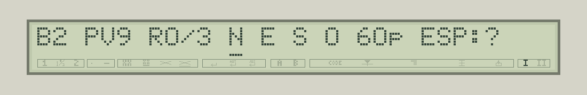

# Les Ruines de Typestar / Typestar Ruins — 0.4

[Programme français](../games/ruines-typestar-fr.bas) · [English program](../games/typestar-ruins-en.bas)

## Français

Explorez un temple envahi par les arbres. Retrouvez **trois reliques**, puis revenez au départ **B2** avant la fermeture des portes. Vous disposez de **48 déplacements** et de **9 points de vie**.

Installez d'abord le firmware **0.4.93-dev**. Placez une nouvelle zone de papier thermique, chargez cette version du jeu avec **Typestar BASIC Studio**, puis lancez `RUN`. Le dessin commence directement, avec les grands glyphes et les rangées continues.

### De grands dessins, des murs imprimés ensemble

Les dix dessins fournis sont repris exactement, avec leurs **16 × 16 pixels** et leurs asymétries. Le nouveau **mode 4 de GLYPH** double la largeur et la hauteur du mode carré 3. Les dessins retrouvent ainsi leur grande taille, plus facile à lire.

Le jeu charge un motif, repère les cases identiques qui se suivent sur une même rangée, puis les imprime ensemble. Une rangée de **dix grands murs demande deux passes horizontales** : la moitié haute des dix murs, puis leur moitié basse. Le firmware prépare chaque moitié une seule fois et réutilise son tampon pour toutes les copies. Les cases portant des motifs différents forment des groupes distincts. L'écran affiche `CARTE 1/10` à `CARTE 10/10` : le numéro désigne le motif en cours.


Cet aperçu montre la disposition prévue, avec la police papier du firmware. Le jeu et l'impression continue ont été validés sur machine, en complément des essais dans l'émulateur. La durée dépend de la carte tirée et des mouvements nécessaires.

### Se repérer et jouer

La carte comporte dix colonnes **A–J** et huit lignes **1–8**. L'explorateur représente le départ B2, avec la porte juste à sa gauche. Le LCD donne votre **position actuelle**, votre vie, les reliques trouvées et les déplacements restants. Un trait sous N, E, S ou O indique le cap choisi.

```text
B2 PV9 R0/3 N E S O 48p ESP:?
```



| Touche | Action |
|---|---|
| Flèches gauche / droite | Tourner le cap sélectionné. |
| Return | Avancer d'une case. |
| Espace | Lire l'aide ; une touche passe à la page suivante. |
| Q | Terminer l'expédition et imprimer le bilan. |

Les murs et les arbres bloquent le passage avec un bip et préservent la réserve de déplacements. Relâchez une touche entre deux actions. Pour commencer, choisissez Est avec la flèche droite, puis Return : vous passez de B2 à C2.

À chaque expédition, les cloisons changent de colonne et d'ouvertures, les arbres changent de place, et les objets sont redistribués. Chaque cloison possède une seule ouverture, qui oblige à chercher son passage. Les ouvertures relient toujours les **38 cases accessibles** ; les deux passages voisins du départ restent libres. La graine provient du compteur matériel.

### Rencontres et traces


Une **relique** augmente R. Son gardien coûte **un point de vie**, même lorsque vous avez évité les autres monstres. Une relique se trouve dans chacune des trois zones du temple. Un **coffre** rend trois points de vie, jusqu'au maximum de neuf ; la **source** restaure toute la vie. Deux **squelettes** coûtent chacun deux ou trois points ; cinq **chauves-souris**, un ou deux. Choisissez vos détours et le bon moment pour utiliser les soins. La statue rappelle l'objectif.

Les reliques, les soins et les monstres servent une seule fois. Après leur rencontre, une **croix épaisse** est imprimée par-dessus le dessin : elle signale que cette case a été utilisée. La statue, la porte et l'explorateur restent des repères permanents.

Chaque déplacement réussi ajoute une **pastille de quatre rangées source, agrandie comme les autres dessins**, y compris sur une case déjà visitée. Le jeu choisit parmi 45 emplacements à l'intérieur de la case et évite l'emplacement du passage précédent dans cette même case. Les traces s'accumulent ; les coordonnées du LCD désignent toujours la position présente. Les messages de rencontre attendent une touche. Entre les actions, le papier est avancé pour présenter la carte. La présentation a été raccourcie de **448 unités FEED**, soit un grand segment de mouvement. La ligne sous la carte rappelle maintenant l’objectif : **3 RELIQUES - RETOUR B2**.

Ramenez les trois reliques en B2 pour gagner. L'expédition se termine aussi lorsque la vie ou les 48 déplacements sont épuisés. Conservez le repère de la feuille pendant la partie ; une nouvelle expédition commence sur une nouvelle zone.

### Pour les programmeurs

Le programme occupe **4 328 octets tokenisés** en français  **4 289** en anglais. Les deux tableaux, en-têtes compris, utilisent **518 octets** : `M(79)` pour la carte, `G(19)` pour les pixels. Le jeu lit successivement les dix motifs dans les `DATA`, puis réutilise le même tampon pour la croix. Les quatre dernières cellules gardent la pastille. Cette lecture par motif économise le stockage d'une palette complète en RAM. La difficulté 0.4 ajoute deux cases de cloison, trois chauves-souris, des reliques gardées réparties entre les trois zones et une limite de 48 déplacements. Le firmware 0.4.93-dev suffit ; rechargez simplement le jeu.

Dans `M`, les quatre bits de poids faible donnent le terrain : 0 sol, 1 mur, 2 arbre, 3 source, 4 squelette, 5 relique, 6 coffre, 7 entrée, 8 statue, 10 chauve-souris. Le bit 16 marque une visite ; les multiples de 32 conservent le dernier emplacement de pastille. Les rencontres consommées deviennent du sol visité. Le motif 9 dessine l'explorateur.

Le rendu emploie `GLYPH G(0),16,16,4,U`, où U compte les cases identiques qui se suivent. Le pas est de **32 unités HEAD** et **112 unités FEED** entre cases. Le firmware garde un seul motif en mémoire : pour ce format, la bande et la sauvegarde native occupent **348 octets temporaires**, que le groupe comporte un mur ou dix. Les coordonnées B/C et les déplacements découpés reprennent le principe de Duel Orbital. Les pastilles et les croix utilisent également `GLYPH`, dans le même tampon, avec un contrôle des limites avant impression.

## English

Explore an overgrown temple, find **three relics**, then return to the starting point **B2** before the gates close. You have **48 moves** and **9 health points**.

Install firmware **0.4.93-dev** first. Load a fresh area of thermal paper, send this game version through **Typestar BASIC Studio**, then `RUN` it. Drawing starts immediately, using large glyphs and continuous rows.

### Large drawings and continuous wall rows

The ten supplied drawings are reproduced exactly, including their **16 × 16 pixels** and asymmetries. The new **GLYPH mode 4** doubles the width and height of square mode 3. This restores the larger, easier-to-read drawings.

The game loads one motif, finds adjacent matching cells within each row, then prints them together. A row of **ten large walls takes two horizontal sweeps**: the upper half of all ten walls, then the lower half. The firmware prepares each half once and reuses its buffer for every copy. Different motifs form separate groups. The LCD shows `MAP 1/10` through `MAP 10/10`, counting motifs.

The map illustration above uses nominal coordinates and the firmware's paper font. The game and continuous printing have been validated on hardware as well as in the emulator. Duration depends on the generated map and required movements.

### Controls and orientation

The map has ten columns **A–J** and eight rows **1–8**. The explorer marks B2, with the gate immediately to its left. The LCD shows your **current coordinates**, health, relics and remaining moves. An underline selects North, East, South or West.

```text
B2 HP9 R0/3 N E S W 48t SPC:?
```

| Key | Action |
|---|---|
| Left / right arrow | Rotate the selected direction. |
| Return | Move one cell. |
| Space | Read help; press a key for each next page. |
| Q | End the expedition and print its result. |

Walls and trees block movement with a beep and preserve the move allowance. Release the key between actions. For your first move, select East with the right arrow, then Return to move from B2 to C2.

Partitions change columns and openings each game; trees and items also change places. Each partition has a single opening, requiring a detour. Openings always connect all **38 walkable cells**, and the two passages next to the starting point stay clear. The seed comes from the hardware counter.

### Encounters and the paper journal

A **relic** increases R. Its guardian costs **one health point**, even if you avoided the other monsters. Each of the temple’s three regions holds one relic. A **chest** restores three health points, up to nine; the **spring** restores full health. Two **skeletons** each cost two or three points; five **bats** cost one or two. Plan your detours and the right time to use healing supplies. The statue reminds you of the goal.

Relics, supplies and monsters are used once. A **thick cross** is then printed over the drawing to show that the encounter has been consumed. The statue, gate and explorer remain permanent landmarks.

Every successful move adds a **four-source-row dot, enlarged like the other drawings**, including return visits. Its position is chosen from 45 places inside the cell and differs from the previous visit's position in that cell. Marks accumulate while the LCD always identifies your present location. Encounter messages wait for a key. The paper advances between actions to display the map. This presentation move is **448 FEED units shorter**, saving one large movement segment. The line below the map now states the goal: **3 RELICS - BACK TO B2**.

Bring all three relics back to B2 to win. Running out of health or moves ends the expedition. Keep the paper reference throughout a game, and begin each expedition on a fresh area.

### For programmers

The French program uses **4,328 tokenized bytes**, the English program **4,289**. The two arrays take **518 bytes** including headers: `M(79)` holds the map and `G(19)` holds pixels. Each of the ten motifs is read from `DATA` in turn; the same buffer then holds the cross. Its final four cells retain the dot. This avoids keeping a complete sprite palette in RAM. Version 0.4 adds two partition cells, three bats, guarded relics spread across the three regions, and a 48-move limit. Firmware 0.4.93-dev is sufficient; simply reload the game.

The low four bits of each `M` cell identify terrain: 0 floor, 1 wall, 2 tree, 3 spring, 4 skeleton, 5 relic, 6 chest, 7 entrance, 8 statue, 10 bat. Bit 16 records a visit; multiples of 32 store the previous dot position. Used encounters become visited floor. Motif 9 depicts the explorer.

Printing uses `GLYPH G(0),16,16,4,U`, where U counts adjacent identical cells. Cell pitches are **32 HEAD units** and **112 FEED units**. The firmware caches one motif: its band and native workspace use **348 temporary bytes** for this format, whether the group contains one wall or ten. B/C track coordinates and movements are segmented as in Orbital Duel. Dots and crosses also use `GLYPH` in the same buffer, with bounds checked before printing.
