# Vol radar / Radar Flight — prototype 0.5

[Programme français](../games/simulateur-de-vol-fr.bas) · [English program](../games/flight-simulator-en.bas)

## Français

Votre avion attend sur la piste **V16–V19**, au sud-est de la carte. Rejoignez la piste horizontale **C3–F3**, au nord-ouest, puis posez-vous dans son axe. Le LCD présente les instruments ; le papier conserve le terrain et les positions confirmées par la tour.

Le jeu propose un **pilotage par étapes** : réglez vos commandes, puis appuyez sur **Entrée** pour avancer. Vous disposez ainsi du temps nécessaire pour lire la carte et préparer une approche. Le carburant, la météo et les déplacements progressent à chaque étape de vol. La version 0.5 génère le paysage directement sur la Canon, à partir d'un numéro de carte.

### Préparer le départ

Utilisez **Typestar BASIC 0.4.100-dev**, une feuille bien engagée et, de préférence, du papier thermique. Ouvrez le programme dans **Typestar BASIC Studio**. **Exécuter (F5)** lance l'émulateur ; **Envoyer → LOAD** transfère le programme vers la Canon, où `RUN` le démarre.

Au premier menu, **Entrée** ouvre le choix de carte. **Espace** présente les commandes et **BACKSPACE** revient au BASIC. Entrez **0** pour tirer un numéro au hasard, ou un entier de **1 à 999**, puis validez avec Entrée. Le choix aléatoire tient compte du temps passé sur le menu, sur la machine comme dans Studio. Le numéro retenu est imprimé avec le titre : un même numéro retrouve exactement le même terrain, en français comme en anglais.

La carte porte 24 colonnes, **A à X**, et 20 rangées. Les numéros des rangées alternent sur deux colonnes à gauche pour garder les caractères papier lisibles. Le programme présente ensuite la feuille au-dessus de la tête ; laissez-le gérer les mouvements pendant la partie. Les numéros proposent plus de 700 terrains distincts : les massifs se déplacent, les lacs et les forêts se répartissent autrement. Les deux pistes gardent leurs positions et leurs approches dégagées.

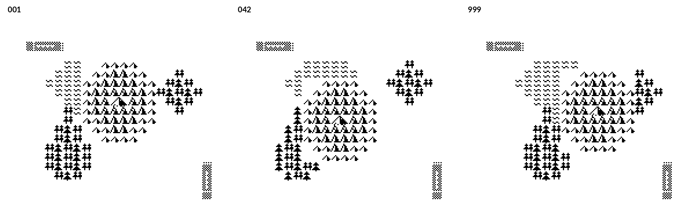

Un message rappelle les pistes de départ et d'arrivée ainsi que les commandes de décollage. Validez-le avec une touche.

### Commandes

| Touche | Action |
|---|---|
| Flèche gauche / droite | Changer le cap de 45°. |
| T+ | Choisir la montée : +50 d'altitude à la prochaine étape. |
| T− | Choisir la descente : −50 d'altitude à la prochaine étape. |
| TEXT | Choisir le palier : conserver l'altitude. |
| RIGHT MARGIN / LEFT MARGIN | Augmenter / réduire la vitesse de 20, entre 0 et 160. |
| Entrée | Avancer d'une étape avec les réglages choisis. |
| RELOC ou REPEAT | Contacter la tour pour demander un relevé radar. |
| Espace | Consulter les trois pages d'aide ; une touche passe à la suivante. |
| BACKSPACE | Consulter le bilan du vol. |
| BREAK | Interrompre le programme. |

Les réglages restent actifs : après avoir choisi **T+**, chaque Entrée continue la montée. Choisissez **TEXT** pour stabiliser l'altitude. Les menus, l'aide et les impressions laissent le vol en attente. Chaque appui sur une touche de commande compte une fois ; relâchez-la avant l'appui suivant.

**T+ = TAB SET** et **T− = TAB CLR** : certains claviers, notamment celui de la **Typestar 6-II / S-61**, portent ces derniers noms. Studio emploie aussi les boutons TAB SET et TAB CLR. Les touches de marge figurent dans la première rangée sous le LCD. **RELOC** (`&H33`) et **REPEAT** (`&H2E`) appellent tous deux le radar.

Dans le bilan, une touche revient au vol ; une seconde pression sur **BACKSPACE** termine la partie.

### Décoller et lire les instruments

Pour un premier vol, suivez ces étapes :

1. Gardez le cap initial **C0**, vers le nord, dans l'axe de la piste.
2. Appuyez **cinq fois sur RIGHT MARGIN**, en relâchant entre les appuis. Vérifiez **V100** sur le LCD. Cette commande règle la vitesse ; Entrée fait ensuite avancer le vol.
3. Appuyez une fois sur **T+ / TAB SET** : la flèche de montée apparaît et reste sélectionnée.
4. Appuyez **quatre fois sur Entrée**. L'altitude passe à **H50**, **H100**, **H150**, puis **H200**. Les quatre premières étapes sont protégées des orages.
5. Appuyez sur **TEXT** : le signe **=** confirme le palier. Préparez maintenant votre cap avec les flèches et la carte.

**V100 et H200** constituent un bon départ : l'avion garde une marge au-dessus des forêts. Les collines demandent une altitude supérieure à H200, les montagnes davantage encore. Gardez au moins **V80 en vol** ; une vitesse plus faible provoque un décrochage. La montée reste active à chaque Entrée jusqu'au choix de TEXT ou de T−.

| Indication | Signification |
|---|---|
| `U19~` | Secteur estimé : U19, V19, U20 ou V20. Le signe `~` rappelle l'incertitude. |
| `C0` | Cap : 0 nord, 90 est, 180 sud, 270 ouest ; les caps intermédiaires sont disponibles. |
| `H100` | Altitude, de 0 à 500. |
| `V100` | Vitesse. Plus elle est élevée, plus l'avion parcourt de distance par étape. |
| `F91` | Carburant restant, sur une réserve initiale de 99. |
| Flèche haute, `=` ou flèche basse | Montée, palier ou descente. |
| `RAD` | La tour peut fournir un relevé. |
| `R3` | Attendre encore trois étapes de vol avant le relevé suivant. |
| `ORG` | Orage et liaison radio coupée. |
| `VENT+` | Bande périphérique : surconsommation de 2 points par étape, hors pistes. |
| `H300/6` | Consigne : atteindre au moins H300 dans les 6 prochaines étapes de ciel calme. |
| `RAD/6` | Consigne : faire confirmer un relevé radar dans les 6 prochaines étapes de ciel calme. |

La position estimée couvre **2 × 2 cases** par temps calme. Le modèle utilise aussi des positions à l'intérieur des cases : le déplacement et le point radar sont plus fins que cette estimation.

### Demander sa position à la tour

Appuyez sur **RELOC ou REPEAT**, puis sur **Entrée** pour confirmer la demande. **BACKSPACE** l'annule. La tour imprime une petite croix à la position exacte de l'avion, puis confirme la case sur le LCD. Une touche ramène au tableau de bord.

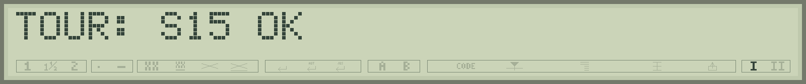

Un relevé consomme **un point de carburant**. La tour demande ensuite **quatre étapes de vol** avant une nouvelle mesure. Les croix restent sur le papier : elles racontent le parcours, tandis que le LCD présente l'estimation actuelle.

L'eau utilise désormais le **négatif du motif d'origine**, plus clair, et la croix mesure **7 × 7 pixels**, avec des traits fins. Elle ajoute ainsi des points noirs plus visibles sur l'eau et les autres motifs. Sur un dessin très dense, à la jonction de terrains ou sur plusieurs anciens relevés, elle peut encore se mêler aux traits existants : la confirmation sur le LCD reste utile. L'impression thermique ajoute du noir au papier ; le négatif concerne donc le motif initial de l'eau.

Le **centre de la croix suit la position de l'avion**, sans recentrage sur la tuile. Le jeu calcule cette position au **quart de case**, soit **2 pixels du dessin** dans chaque direction. La croix peut donc chevaucher deux cases ; ses traits restent alignés sur la grille des pixels de la carte.

Au-dessus d'un lac, montez à **H150 ou plus** pour obtenir le relevé. En dessous, le message « EAU: radar dès H150 » vous invite à prendre de la hauteur. Cette demande laisse le carburant et le compteur d'attente inchangés.

### Traverser l'orage

Des orages peuvent apparaître **plusieurs fois pendant le vol**, au-dessus des terres comme de l'eau. Après les quatre premières étapes de décollage et les périodes de répit, chaque étape en vol présente **10 % de risque au-dessus des terres** et **30 % au-dessus de l'eau**. Le terrain pris en compte est celui au début de l'étape. La météo constitue une règle de jeu simplifiée.

Un orage dure **2 à 5 étapes**. Le prochain tirage météo devient possible **3 à 6 étapes après son rétablissement**, ce qui ménage un temps de répit. Un message annonce la coupure radio. Pendant ce passage, le secteur estimé s'élargit à **4 × 4 cases** et le vent pousse légèrement l'avion vers l'est, d'un quart de case par étape. Les menus et le temps passé à réfléchir laissent la météo en attente.

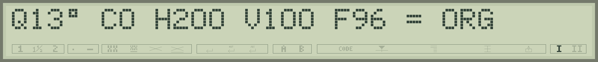

Préparez votre cap avec les derniers repères confirmés et gardez une marge autour des reliefs. À la fin de l'orage, la tour annonce le rétablissement de la radio. Vous pouvez alors demander un nouveau relevé dès que le compteur d'attente est revenu à zéro.

### Relief, carburant et atterrissage

Le terrain de la carte et les collisions utilisent les **mêmes données**. Gardez une altitude strictement supérieure au relief :

| Terrain | Altitude du relief |
|---|---:|
| Plaine, eau et pistes | 0 |
| Sapins et bosquets | 50 |
| Collines | 200 |
| Montagnes | 300 |
| Sommets enneigés | 400 |
| Grands pics formés de deux tuiles | 500 |

Le plafond de l'avion est **500** : contournez les grands pics. Vous disposez de **99 points de carburant** : elle donne de la place aux corrections de cap, aux consignes de la tour et aux relevés radar. Choisissez des passages entre les reliefs et l'altitude adaptée ; monter permet de survoler les forêts et les petites montagnes.

Les **vents forts des bandes périphériques** coûtent **2 points supplémentaires par étape**. Ces bandes couvrent les colonnes **A à D et U à X**, ainsi que les rangées **1 à 4 et 17 à 20**. Les deux pistes sont exemptées, en vol comme au sol, pour préserver les manœuvres de départ et d'arrivée. La surconsommation s'ajoute aux coûts habituels de vitesse, de montée et de forêt à basse altitude.

L'entrée dans une bande annonce **« VENTS FORTS CONSO+2 »**. Le tableau de bord peut ensuite afficher **VENT+** ; une consigne active ou un orage prend la priorité dans ce petit espace. Revenir vers l'intérieur rétablit la consommation habituelle. Un court détour près d'un bord reste possible ; suivre les bordures sur tout le trajet épuise la réserve avant l'arrivée.

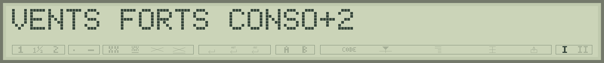

Le survol d'une **forêt à H150 ou moins** coûte **un point de carburant supplémentaire par étape**, pour représenter les corrections dans l'air turbulent à basse altitude. À H200 et au-dessus, le coût redevient normal. C'est une règle simplifiée du jeu, comme la contrainte radar au-dessus des lacs. Les motifs du terrain influencent donc le choix de la route et de l'altitude.

Une vitesse inférieure à **80 en vol** fait perdre rapidement de l'altitude : c'est le décrochage. Le carburant diminue à chaque étape, davantage en montée et à partir de V120. Le sol et l'eau se survolent en gardant une altitude positive ; les deux pistes accueillent l'avion à H0.

Pour réussir l'approche, rejoignez la rangée **3**, mettez le cap **90 ou 270**, puis descendez jusqu'à **H0** sur la piste **C3–F3**, avec une vitesse de **60 à 100**. À V100 et H100, deux étapes de descente suffisent : prévoyez aussi la distance parcourue pendant ces deux étapes.

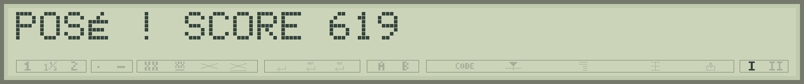

Une sortie de carte, une collision, un décrochage jusqu'au sol ou l'épuisement du carburant termine la partie. Après le résultat, le menu propose **Entrée** pour imprimer une nouvelle carte et recommencer, ou une autre touche pour revenir au BASIC.

### Répondre à la tour

Pendant le vol, la tour peut proposer une consigne lorsque le ciel est calme, que l'avion est au moins à **H150**, que le radar est disponible et que l'approche finale est encore éloignée. Les appels sont tirés au hasard à certaines étapes du trajet. Validez le message de la tour avec une touche ; le vol reste en attente pendant sa lecture. La consigne reste ensuite affichée dans la dernière partie du tableau de bord :

- **H300/6** ou **H400/6** : atteignez **au moins** cette altitude dans les six prochaines étapes de ciel calme. T+ sélectionne la montée ; TEXT permet ensuite de stabiliser l'avion.
- **RAD/6** : demandez et confirmez un relevé avec **RELOC ou REPEAT**, puis Entrée. Annuler la demande laisse la consigne et son délai en cours.

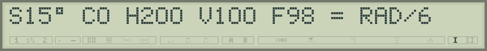

Les menus et les impressions laissent le compteur en attente. **Les orages suspendent aussi le délai**, le temps de retrouver la liaison radio. Une consigne accomplie rapporte **20 points**. Si le délai expire, la tour le signale et le vol continue : le bonus reste simplement à gagner lors d'un prochain appel. Une consigne en cours à l'atterrissage laisse la réussite du vol intacte.

### Sortie de carte et score

Les limites correspondent aux colonnes **A à X** et aux rangées **1 à 20**. Les franchir termine la partie avec **« Hors de la carte »** ; la position conserve son dépassement, sans retour automatique sur le bord opposé. Préparez vos virages avec les derniers repères confirmés.

Après un atterrissage réussi, le LCD affiche le score :

**100 + 5 × carburant restant − nombre d'étapes + 20 × consignes réussies**.

Le score récompense une route économe, un vol bien préparé et les réponses à la tour. L'impression d'une nouvelle carte relance une partie complète, avec 99 points et un compteur de consignes remis à zéro.

### Dessins et origine du jeu

La palette utilise **14 motifs de 8 × 8**, sol vide compris, et réserve deux emplacements. L'asphalte, la colline et le grand pic reprennent les dessins fournis pour le projet ; l'eau emploie le négatif du motif fourni pour mieux faire ressortir les relevés radar. Le grand pic associe deux tuiles ; chaque moitié reste un dessin 8 × 8. La carte est imprimée en **20 balayages**, un par rangée, avec `GLYPH` en mode 5. Les relevés utilisent ensuite un petit glyphe de croix et le repère papier conservé par le programme.

Le numéro de carte fournit quelques paramètres au calcul du terrain. La routine BASIC de terrain construit une rangée entière ; l'impression et les contrôles de vol l'appellent toutes les deux. Les dessins des tuiles occupent deux chaînes DATA compactes, décodées dans le tableau G au lancement. Cinq profils de montagne sont regroupés dans un petit atlas textuel au sein de la routine de terrain. Cette organisation économise la mémoire et garde le papier cohérent avec les obstacles du jeu.

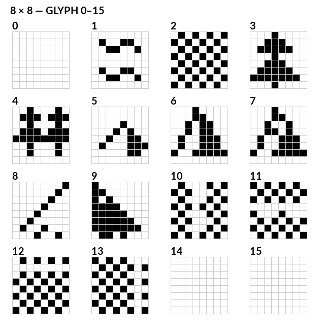

Ce prototype s'inspire de **Simulateur de vol**, de **Charles Caron**, publié pour **Sharp PC-1500 et CE-150** dans **Hebdogiciel n°37, en 1984**. L'association instruments LCD et carte papier vient de ce programme. Le terrain procédural en tuiles, le pilotage par étapes, les relevés radar, l'incertitude de position et l'orage constituent l'adaptation Typestar. Le modèle de vol est simplifié et le rythme reste à apprécier sur la machine réelle.

## English

Your aircraft waits on runway **V16–V19**, in the south-east of the map. Reach the horizontal runway **C3–F3**, in the north-west, and land along its axis. The LCD provides instruments; the paper keeps the terrain and positions confirmed by the tower.

The game uses **step-based flight**: adjust the controls, then press **Enter** to advance. You have time to read the map and prepare an approach. Fuel, weather and movement advance with each flight step. Version 0.5 generates the landscape directly on the Canon, from a map number.

### Preparing for departure

Use **Typestar BASIC 0.4.100-dev**, a firmly engaged sheet and preferably thermal paper. Open the program in **Typestar BASIC Studio**. **Run (F5)** starts the emulator; **Send → LOAD** transfers the program to the Canon, where `RUN` starts it.

At the opening menu, **Enter** opens map selection. **Space** shows the controls and **Backspace** returns to BASIC. Enter **0** to pick a random number, or an integer from **1 to 999**, then press Enter. Random selection incorporates the time spent on the menu, on the machine and in Studio. The chosen number prints with the title: the same number reproduces exactly the same terrain in either language.

The map has 24 columns, **A to X**, and 20 rows. Row numbers alternate between two positions on the left to keep the paper lettering readable. The program then presents the sheet above the print head; let it control paper movements during the game. The numbers offer more than 700 distinct terrains, moving mountains and rearranging lakes and forests. Both runways retain their positions and clear approaches.

One message reminds you of the departure and arrival runways and takeoff controls. Acknowledge it with a key.

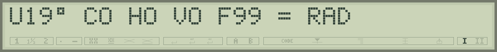

### Controls

| Key | Action |
|---|---|
| Left / right arrow | Change heading by 45°. |
| T+ | Select climb: +50 altitude at the next step. |
| T− | Select descent: −50 altitude at the next step. |
| TEXT | Select level flight: hold altitude. |
| RIGHT MARGIN / LEFT MARGIN | Increase / reduce speed by 20, from 0 to 160. |
| Enter | Advance one step with the selected controls. |
| RELOC or REPEAT | Contact the tower to request a radar fix. |
| Space | Read the three help pages; any key advances each page. |
| Backspace | Read flight status. |
| BREAK | Interrupt the program. |

Controls remain selected: after choosing **T+**, each Enter continues climbing. Choose **TEXT** to level off. Menus, help and printing keep the flight on hold. Each control press counts once; release the key before pressing again.

**T+ = TAB SET** and **T− = TAB CLR**: some keyboards, including the **Typestar 6-II / S-61**, carry these alternative labels. Studio also uses the TAB SET and TAB CLR buttons. The margin keys are in the first button row below the LCD. Both **RELOC** (`&H33`) and **REPEAT** (`&H2E`) call radar.

In the status display, any key returns to flight; pressing **Backspace** again ends the game.

### Taking off and reading the instruments

For your first flight, follow these steps:

1. Keep the initial heading **C0**, north along the runway.
2. Press **RIGHT MARGIN five times**, releasing between presses. Check **V100** on the LCD. This control sets speed; Enter then advances the flight.
3. Press **T+ / TAB SET** once: the climb arrow appears and stays selected.
4. Press **Enter four times**. Altitude increases to **H50**, **H100**, **H150**, then **H200**. The first four steps are protected from storms.
5. Press **TEXT**: the **=** sign confirms level flight. Now prepare your heading using the arrows and map.

**V100 and H200** provide a useful starting point, with clearance above forests. Hills require more than H200, and mountains require greater altitude. Keep at least **V80 while airborne**; a lower speed causes a stall. Climb remains selected at each Enter until you choose TEXT or T−.

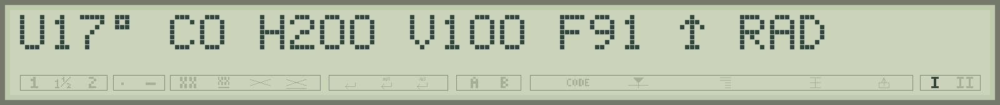

| Display | Meaning |
|---|---|
| `U19~` | Estimated sector: U19, V19, U20 or V20. The `~` indicates uncertainty. |
| `C0` | Heading: 0 north, 90 east, 180 south, 270 west; intermediate headings are available. |
| `H100` | Altitude, from 0 to 500. |
| `V100` | Speed. Higher speed covers more distance per step. |
| `F91` | Remaining fuel, from an initial reserve of 99. |
| Up arrow, `=` or down arrow | Climb, level or descent. |
| `RAD` | The tower can provide a fix. |
| `R3` | Wait three more flight steps before the next fix. |
| `STM` | Storm and lost radio contact. |
| `WIND+` | Outer wind band: 2 extra fuel points per step, except on runways. |
| `H300/6` | Request: reach at least H300 within the next 6 clear-weather steps. |
| `RAD/6` | Request: confirm a radar fix within the next 6 clear-weather steps. |

The estimate covers **2 × 2 cells** in clear weather. The model also uses positions within cells: movement and radar marks are finer than this estimate.

### Asking the tower for your position

Press **RELOC or REPEAT**, then **Enter** to confirm the request. **Backspace** cancels it. The tower prints a small cross at the aircraft's exact position, then confirms the cell on the LCD. Any key returns to the dashboard.

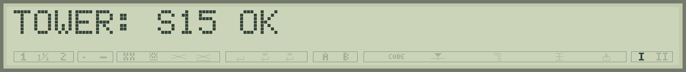

A fix consumes **one fuel point**. The tower then requires **four flight steps** before another measurement. Crosses remain on the paper to record your route, while the LCD gives the current estimate.

Water now uses a **negative of the original pattern**, giving a lighter background, and the cross spans **7 × 7 pixels** with thin strokes. It therefore adds clearer black marks over water and the other patterns. Dense artwork, terrain boundaries or several previous fixes may still merge with a cross; the LCD confirmation remains useful. Thermal printing adds black to the sheet, so the negative is applied to the initial water artwork.

The **centre of the cross follows the aircraft's position**, rather than snapping to a tile centre. The game calculates position to a **quarter-cell**, equivalent to **2 drawing pixels** in each direction. A cross may therefore straddle cells; its strokes remain aligned with the map's pixel grid.

Above a lake, climb to **H150 or higher** to obtain a fix. Below that height, “WATER: radar from H150” invites you to climb. This request leaves fuel and the waiting counter unchanged.

### Crossing the storm

Storms can occur **several times during a flight**, over land as well as water. After the first four takeoff steps and recovery periods, each airborne step has a **10% chance over land** and a **30% chance over water**. The game uses the terrain beneath the aircraft at the start of the step. This is a simplified gameplay rule.

A storm lasts **2 to 5 steps**. The next weather check becomes possible **3 to 6 steps after radio is restored**, providing a recovery interval. A message announces radio failure. During the storm, the estimated sector expands to **4 × 4 cells** and wind pushes the aircraft slightly east, by a quarter-cell each step. Menus and time spent thinking keep weather on hold.

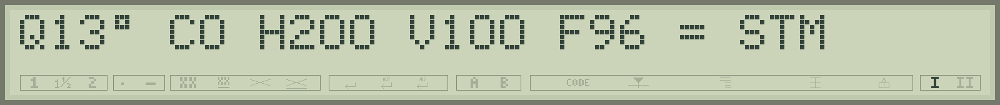

Plan your heading from the last confirmed positions and leave a margin around high terrain. When the storm ends, the tower announces restored radio contact. You can request another fix once the waiting counter reaches zero.

### Terrain, fuel and landing

The printed terrain and collision checks use the **same data**. Keep altitude strictly above the terrain:

| Terrain | Height |
|---|---:|
| Plain, water and runways | 0 |
| Fir trees and woods | 50 |
| Hills | 200 |
| Mountains | 300 |
| Snowy summits | 400 |
| Large peaks made of two tiles | 500 |

The aircraft's ceiling is **500**: fly around the large peaks. You have **99 fuel points**, leaving room for heading corrections, tower requests and radar fixes. Choose gaps between terrain and a suitable altitude; climbing lets you cross forests and smaller mountains.

**Strong winds in the outer bands** cost **2 extra fuel points per step**. These bands cover columns **A to D and U to X**, and rows **1 to 4 and 17 to 20**. Both runways are exempt, airborne or on the ground, preserving departure and arrival manoeuvres. The surcharge stacks with normal speed, climbing and low-forest costs.

Entering a band displays **“WIND: EXTRA FUEL +2”**. The dashboard may then show **WIND+**; an active request or storm takes priority in this small space. Returning inland restores normal consumption. A short stretch near an edge remains possible; following the outer corridors for the entire journey exhausts fuel before arrival.

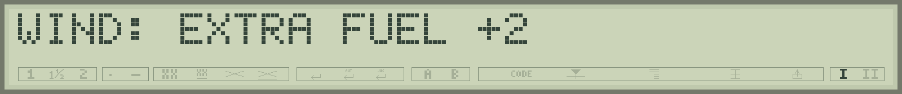

Flying over **forest at H150 or below** costs **one extra fuel point per step**, representing corrections in turbulent low-level air. At H200 and above, fuel use returns to normal. This is a simplified game rule, as is the radar restriction above lakes. Terrain patterns therefore influence route and altitude choices.

Flying slower than **80** rapidly loses altitude: this is a stall. Fuel decreases each step, faster while climbing and from V120 upwards. Fly above ground and water at a positive altitude; both runways support the aircraft at H0.

For a successful approach, reach row **3**, select heading **90 or 270**, then descend to **H0** on runway **C3–F3**, at a speed of **60 to 100**. At V100 and H100, two descending steps are enough: allow for the distance travelled during those steps.

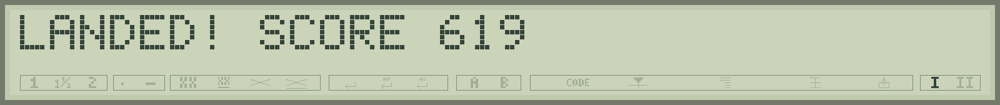

Leaving the map, colliding, stalling into the ground or exhausting fuel ends the game. After the result, the menu offers **Enter** to print another map and restart, or any other key to return to BASIC.

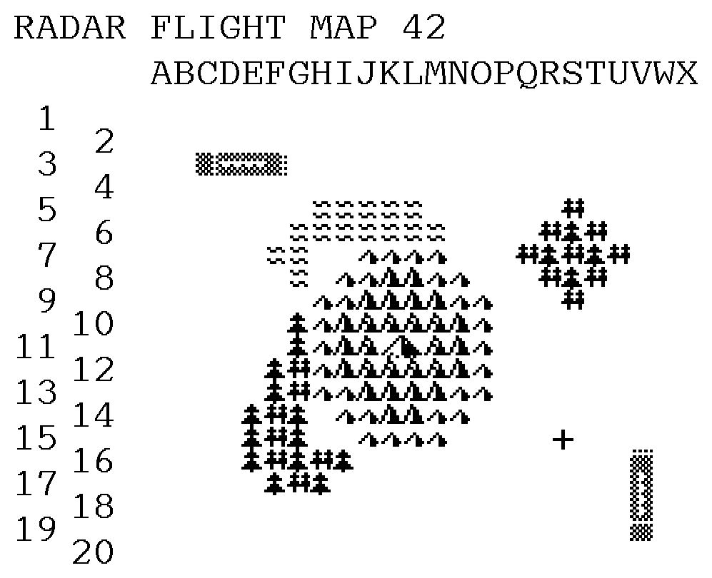

### Responding to the tower

During the flight, the tower may issue a request when the sky is clear, the aircraft is at least at **H150**, radar is available and the final approach is still some way off. Calls are randomly selected at certain flight steps. Acknowledge the tower message with a key; flight stays on hold while you read it. The request then remains in the last part of the dashboard:

- **H300/6** or **H400/6**: reach **at least** that altitude within the next six clear-weather steps. T+ selects climb; TEXT then lets you level off.
- **RAD/6**: request and confirm a fix with **RELOC or REPEAT**, then Enter. Cancelling the fix leaves the request and its deadline active.

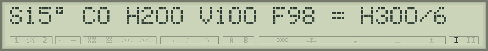

Menus and printing keep the countdown on hold. **Storms also pause the deadline** until radio contact returns. Completing a request earns **20 points**. If time expires, the tower reports it and the flight continues: another call offers another chance at the bonus. A request still pending at touchdown leaves the successful landing intact.

### Leaving the map and scoring

The limits are columns **A to X** and rows **1 to 20**. Crossing them ends the game with **“Outside the map”**; the position retains the overshoot, without wrapping to the opposite edge. Plan turns using your latest confirmed fixes.

After a successful landing, the LCD displays the score:

**100 + 5 × remaining fuel − flight steps + 20 × completed requests**.

The score rewards an economical route, a well-prepared flight and responses to the tower. Printing a new map starts a complete new game, with 99 fuel points and the request counter reset.

### Artwork and game origins

The palette uses **14 patterns of 8 × 8 pixels**, including blank ground, and reserves two slots. Asphalt, hill and large peak retain the artwork supplied for the project; water uses a negative of the supplied pattern to make radar fixes clearer. A large peak combines two tiles; each half remains an 8 × 8 pattern. The map prints in **20 sweeps**, one per row, using `GLYPH` mode 5. Fixes then use a small cross glyph and the paper coordinates retained by the program.

The map number supplies a few parameters to the terrain calculation. The BASIC terrain routine constructs a whole row; printing and flight checks both call it. Two compact DATA strings hold tile artwork, decoded into array G at startup. Five mountain profiles share a small text atlas within the terrain routine. This arrangement saves memory and keeps the paper consistent with the game's obstacles.

This prototype is inspired by **Simulateur de vol**, by **Charles Caron**, published for the **Sharp PC-1500 and CE-150** in **Hebdogiciel issue 37, in 1984**. The combination of LCD instruments and a paper map comes from that program. Procedural tile terrain, step-based flight, radar fixes, position uncertainty and the storm are the Typestar adaptation. The flight model is simplified; pacing remains to be assessed on the real machine.
